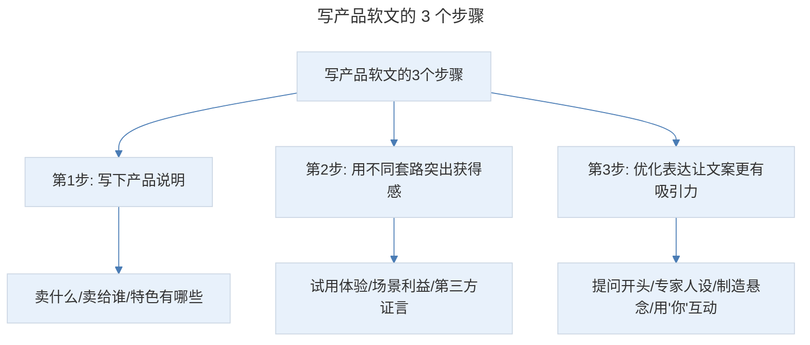
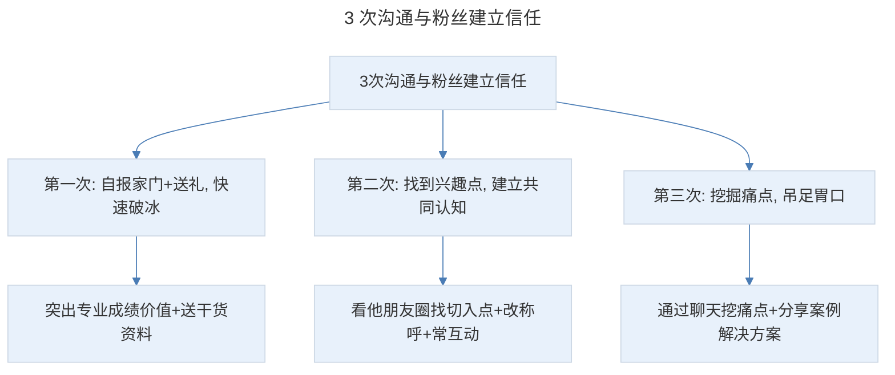

# 朋友圈卖货：4 个狠招让朋友圈潜在顾客纷纷下单，转化翻倍

## 1. 概念说明：朋友圈卖货的误区与正确逻辑

本篇知识点：打造朋友圈的 4 个技巧，帮助实现每月多赚 5000+。

朋友圈营销领域流传着不少说法："你的朋友圈价值百万""朋友圈就是印钞机""做好朋友圈，普通人也能躺赚"……于是不少人信心百倍交了钱、做了代理、拼命发圈，然而别人一条朋友圈能卖出几十、几百单，收款几千块，自己运气好的话才有一两单。

为什么有人发的内容没人看、没人买，甚至被拉黑，而另一些人却能把朋友圈经营得风生水起、赚得盆满钵满？差异往往源于以下误区。

## 2. 核心概念：朋友圈卖货的 4 个误区

- **第一个误区：朋友圈全是产品广告。**
- **第二个误区：没有一个鲜明的人设。**
- **第三个误区：没有对粉丝提供价值。**
- **第四个误区：刚加好友就群发广告。**

正确的朋友圈卖货逻辑是：先做信任，再卖货。而建立信任的第一步是打造一个鲜明的人设。

## 3. 方法论：打造让陌生人愿意掏钱的朋友圈人设

人设包含 2 个方面：专业人设和生活人设。

- 专业人设是职业维度的人物设定，包括职业、专业成绩、客户口碑评价等。
- 生活人设是个性、特点、兴趣与生活中的形象。

以原文作者（兔妈）为例：其职业是卖货文案，客户评价其专业靠谱，个性务实、接地气，爱好阅读。据此提炼出一句话——"兔妈是专业靠谱的卖货文案操盘手，她喜欢阅读，性格是务实、接地气"。这句话就是人设。

### 3.1 不专业怎么办？

针对"小白不专业"的疑问，原文作者的观点是：专业是相对的，路径有两条——一是自己成为专业人士；二是让别人以为自己是专业人士。

自己成为专业人士并不难：买一些相关书籍，关注同行大咖的公众号、微博，有条件的话听听线上、线下课程。经常学习、总结、归纳，一两个月就能入门，五六个月就能成为半个专家，起码比普通人懂得多。

让别人以为自己是专家，则要把每天学的内容通过朋友圈展示出来，让别人知道发圈者在这个领域有见解、有研究。例如卖服装：首先，买几本穿搭和色彩搭配的书，关注穿搭达人的公众号，借鉴他们的观点，用自己的话表达出来；其次，帮顾客解答问题，比如平胸怎么穿、个子矮怎么穿、苹果型身材怎么穿。

**3 个常用的体现专业度的模板：**

- **很多人问我 + 常见问题 + 解决方案……**
- **很多人以为 + 常见误区 + 解决方案……**
- **其实 + 结论 + 解释原因……**

"很多人"一词暗示发圈者专业、受欢迎，遇到同类问题的人会第一时间想到他。

最后是多分析案例。案例比理论更实用，也更受欢迎。原文作者经常发一些小案例，并给出分析思考：如果卖服装，逛街时看到好的穿搭就拍下来，发圈分析这个风格适合什么样的人、有什么样的视觉效果等。专业人设的核心是提供有价值的内容，需要了解顾客有哪些问题（即痛点），与写推文的思路一致。解决的问题越多，别人就越觉得发圈者专业。

### 3.2 生活人设等于晒生活吗？

生活人设不等于无筛选地晒生活：有的宝妈一天到晚晒娃，孩子邋里邋遢就出镜；有人遇到不顺心的事就在朋友圈发泄；有人占了便宜喜欢炫耀。这些虽然也算生活化，但会给人很 Low 的感觉。因此，生活人设并不是把生活原样直播到朋友圈，而是要过滤筛选。

方法是先想清楚希望给别人留下什么样的印象，然后列出关键词。例如原文作者希望呈现的形象是正能量、积极向上、生活得还不错，围绕这个形象可以列出关键词：读书、思考、自律、勤奋努力、女儿懂事、老公贴心……

然后，把生活中能体现这些关键词的细节记下来。例如原文作者发过一条早起的朋友圈，其中包含多个信号：休息陪娃，说明是兼顾事业与家庭的职场妈妈；4:50 醒、5 点起床，说明自律；早起赶稿，说明勤奋努力；做了几个压肩动作，说明热爱生活。

再如，原文作者拜访很多行业前辈后，发圈写下聊天收获，既说明积极向上、爱思考，也说明圈子质量不错。总之，生活人设不是简单地晒，而是通过生活细节佐证人设关键词，让大家熟悉、信任发圈者，甚至将其当榜样。这就是原文作者强调的**功利性发圈法**：发的每条朋友圈，都要给人设加分，让别人一看就知道发圈者是干什么的、是怎样的人。

## 4. 方法论：产品软文写作的 3 个步骤与 2 个模板

人设经营之后，终极目的仍是通过卖货、卖服务获得收入，因此不可避免要回答另一个问题：产品广告怎样写，才能既卖货又不伤人设？

### 4.1 写产品软文的原则

写产品软文有一条原则：一定要"以人为核心"。产品再好，直白生硬的叫卖也会让人觉得浮夸、不信任。正确的方法是：多写使用体验、场景利益、第三方证言或案例。真实的体验过程，让粉丝相信发圈者是亲自用过的；场景能激发顾客的美好想象；第三方证言和案例让顾客产生共鸣，并预期自己会产生同样的结果——有预期，就会有欲望。

### 4.2 写产品软文的 3 个步骤

> 写产品软文的 3 个步骤：写下产品说明（卖什么/卖给谁/特色有哪些）、用不同套路突出获得感（试用体验/场景利益/第三方证言）、优化表达让文案更有吸引力（提问开头/专家人设/制造悬念/用"你"互动）。

**第一步：写下产品说明。** 包括卖的是什么、要卖给谁、特色有哪些。例如卖面膜：产品是 XX 美白面膜，顾客是经常熬夜、想要变白的女性，特色有医美级美白成分、每片 22ml 精华、泰国进口蚕丝等。

**第二步：用不同套路，突出某个特色给顾客带来的获得感。** 获得感，指给顾客带来的可量化、可感知的好处。以突出"美白效果明显"这个特色为例，可以有三种写法。

用**试用体验**写：

> 我一般一周敷 2-3 次，每周坚持用，三周后和原来的照片一比，自己都被吓一跳，这明显白了一个色号啊！天生的暗黄皮变得由里到外的透亮，用手指轻轻一戳就像果冻一样 Q 弹，连闺蜜都问我是不是偷偷去打了美白针。

写试用体验还有一个技巧：与其他同类产品的试用感受进行对比，凸显产品的好。

用**场景利益**写：

> 上个月公司年中总结会，每天加班到晚上 1 点多，心想坚持这么久的美白功课又要被打回原形了。但熬了一周，皮肤还是很透亮，太让我惊喜了！连一起熬夜的同事都嫉妒地说：明明一样熬夜，凭啥你的脸像没熬一样。

用**第三方好评或案例**写：

> 刚 XX 留言说：她上周六，熬夜到凌晨三点多，一整天出门也没涂防晒，第二天以肉眼可见的速度黑了。接着她又说：星期天晚上急救敷了一片，敷完第二天就白了一点点。

如果手上没有顾客证言，可以向顾客要好评。例如原文作者的电子书发售时，让助手和买过的人聊天，询问对写稿有什么帮助，就收到了很多好评。注意提问要具体，不要问"觉得怎么样"——这样得到的答案十有八九是"差不多"，没有意义。正确的方法是问具体的某个点，比如：面膜的精华多不多？和以前用的比起来怎么样？对方回答"精华好多啊，比以前用的多多了"，就可以截屏、打码后发圈。

**第三步：优化表达，让文案更有吸引力。** 初稿写好不要着急发布，先想想能不能优化表达。例如：

- 用**提问**开头："为什么网红达人都力荐这个美白成分？我亲自体验后才明白，太神奇了。"
- 用**专家人设**开头："很多人问我，XX 面膜多久才能见到效果"+ 试用体验。
- 用**悬念**开头："这款面膜惹大祸了！连着好几个人问我：是不是偷偷打了美白针！"
- 用第二人称（"你"字）互动：试用体验 + 互动引导："你觉得我像打了美白针吗？"配上变白前后的对比图。

另外，还可以把产品特色写成**小科普**，比如产品原料、工艺、生产过程、产品故事、原理等。当然不能太生硬，可配合口语化的表达（原文作者另有"5 种人话技巧"的方法）。

### 4.3 知识付费课程的推荐语模板

实体产品的写法之外，在朋友圈卖知识付费课程时，转发推文的推荐语怎样写才愿意被点击、转化率才高？原文作者总结了 2 个模板：

**模板 1：普遍痛点 + 文章主题 + 圆满结局。** 先指出目标人群的痛点，让其产生共鸣；然后引出文章主题，并暗示这就是痛点产生的原因；最后给出圆满结局。为了解决痛点、获得圆满结局，粉丝就会点击链接查看原文。例如：很多人写稿的状态是收拾好桌面、冲了杯咖啡、打开 Word，脑袋一片空白，半天憋不出一个字——其实关键问题在于准备工作没做好，4 步准备工作就能让写稿更轻松。

**模板 2：我学了 + 学习收获 + 适合人群 + 引导行动。** "我学了"告诉朋友圈粉丝，这个课程是发圈者学过的；"学习收获"写出通过学习获得的成绩和改变；"适合人群"指出课程适合的人群，让潜在顾客对号入座；"引导行动"是用限时限量、价格锚点等引导粉丝马上下单。有位学员用这个模板推荐兔妈的文案社群，发完朋友圈不到 1 小时，就有 12 个人私信她问怎么买。这个模板的本质是顾客案例，只不过案例主角是发圈者本人：粉丝看到收益对比，会认为"她学完后能获得成长、赚到钱，我肯定也可以"。

最后需要强调：不管是实体产品还是知识付费产品，每条朋友圈最好只说一个点，这样不会被折叠，每天的素材也不容易枯竭。发布之后还有关键一步：评论区引导下单。原文作者建议每天发 4-8 条朋友圈：干货 1-2 条、个人生活 1-2 条、科普 1 条、产品软文 2-3 条。另外，发圈时间最好规律。

## 5. 实践要点：3 次沟通与粉丝建立信任，让订单翻倍

打造了人设、发了软文，就坐等订单上门吗？约 99% 的人是这样的。但让订单量翻倍的成交要诀是：私信沟通。有些粉丝持续关注、点赞甚至咨询，却迟迟不下单，因此需要主动出击。原文作者有位朋友是知识分销领域的大 V，不管卖什么课，别人都愿意找他买，原因只有 3 个字：多聊天。

不过直接开聊容易让顾客抵触，根本聊不下去。为什么是 3 次？统计表明：打交道 3 次，就能从陌生人变成半熟人，甚至熟人。

> 3 次沟通与粉丝建立信任：第一次自报家门+送礼快速破冰（突出专业成绩价值+送干货资料）、第二次找到兴趣点建立共同认知（看他朋友圈找切入点+改称呼+常互动）、第三次挖掘痛点吊足胃口（通过聊天挖痛点+分享案例解决方案）。

### 第一次：自报家门 + 送礼，快速破冰

如果从未说过话，对方会想"找我什么事"，很戒备，所以要先自报家门。自我介绍不能太硬，也不能太长，要突出专业、成绩、能给对方带来的价值，然后送上干货资料或产品小样。话术示例：

> 经常看到你给我点赞，特别感谢。送你一份 XXX，相信能帮上你。如果你有某方面的问题，也可以问我。

原文作者提到，其分销课程的那位朋友，就会给点赞的人送一份作者的干货包——别人觉得他真诚，也了解了课程的价值，就会找他买。

### 第二次：找到兴趣点，建立共同认知

切入点从对方的朋友圈找。比如一个人经常发健身、跑步的消息，可以说：

> 好佩服你，平时上班那么忙，怎么做到每天跑步的。我也很想跑步，但每次都坚持不了几天。

聊到差不多时，找借口说要发货等，让对方觉得发圈者很忙、事业做得还不错，引起对方注意。另外，这次要改称呼：男生叫某某哥，比自己小就叫帅哥，女生叫美女，明显年纪大的可以叫姐姐。在朋友圈还要常互动——点赞 + 评论 = 关心。如果对方卖产品，也可以买一份。这样很快就能与对方建立情感链接。

### 第三次：挖掘痛点，吊足胃口

以卖母婴产品为例：通过聊天知道对方孩子不好好吃饭、晚上睡得也晚，就可以说某顾客的孩子也是这样的情况，然后讲用什么方法帮他解决了、现在是什么情况。至于何时讲产品——答案是朋友圈。对方会对发圈者好奇，觉得其专业、人又贴心、还不推销产品，印象就很好，甚至会主动去翻其朋友圈；在需要时，也会首先想到他。

如今不管朋友圈卖什么，都能看到同行，而且一个微信只有 5000 好友。所以朋友圈卖货拼的不单是文案、人设，而是系统化、精细化的运营，这也是朋友圈卖货的真谛。

## 6. 小结

### 6.1 知识点总结

**第一个知识点：如何打造朋友圈的人设？**

列出目标形象的关键词，然后把体现关键词的生活细节展示出来；在朋友圈中多输出自己的见解和观点，让别人熟悉、记住、喜欢并信任发圈者。3 个体现专业度的常用模板：很多人问我 + 常见问题 + 解决方案；很多人以为 + 常见误区 + 解决方案；其实 + 结论 + 解释原因。

**第二个知识点：写产品软文的 3 个步骤**

第 1 步写出产品说明（卖什么、卖给谁、特色有哪些）；第 2 步用不同套路突出某个特色给顾客带来的获得感；第 3 步优化表达让文案更有吸引力。转发推文时常用的 2 个推荐语模板：普遍痛点 + 文章主题 + 圆满结局；我学了 + 学习收获 + 适合人群 + 引导下单。

**第三个知识点：3 次沟通，快速与粉丝建立信任**

第 1 次自报家门 + 送礼快速破冰；第 2 次找到兴趣点建立共同认知；第 3 次挖掘痛点吊足胃口。另外，需避开朋友圈卖货的 4 个误区：朋友圈全是产品广告、没有一个鲜明的人设、没有对粉丝提供价值、刚加好友就群发广告。

### 6.2 核心要点回顾

朋友圈卖货的正确逻辑是先做信任再卖货，需避开 4 个误区（全是产品广告、没人设、没价值、刚加好友就群发）。打造人设包含专业人设和生活人设：专业人设通过 3 个模板（很多人问我/很多人以为/其实）和案例分析体现专业性；生活人设通过"功利性发圈法"筛选生活细节佐证人设关键词。写产品软文坚持"以人为核心"原则，按 3 个步骤：写产品说明、用试用体验/场景利益/第三方证言突出获得感、优化表达（提问/专家人设/悬念/第二人称互动开头）；知识付费课程推荐语用 2 个模板（普遍痛点+文章主题+圆满结局、我学了+学习收获+适合人群+引导行动）。最后通过 3 次沟通（破冰/找兴趣点/挖痛点）与粉丝建立信任。朋友圈卖货拼的是系统化、精细化的运营。

### 6.3 实践练习

**用"我学了 + 学习收获 + 适合人群 + 引导行动"的模板，写一段朋友圈卖货文案。**

> 来源：极客时间《文案高手》（作者：兔妈）
