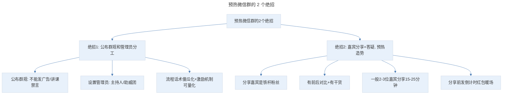
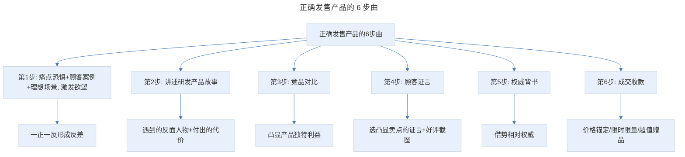
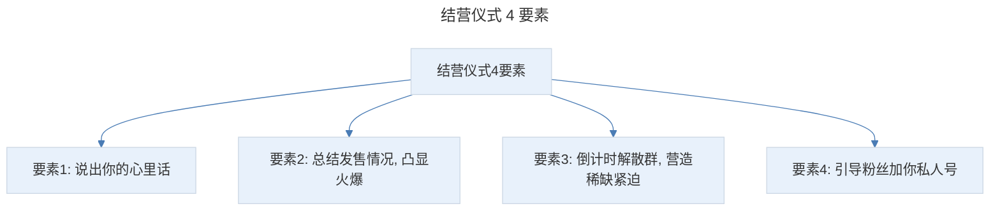

# 社群转化：3 个核心 6 个步骤，小白也能操作一场收款 10 万+ 的社群发售

## 概念说明

社群发售是以微信群为载体的集中式卖货方法：把一篇卖货推文的内容，像新闻发布会一样逐段呈现给社群成员，引导他们一步步了解产品、激发购买欲望、化解信任难题，最终下单付款。其门槛和成本极低，即使没有客户、没有预算、没有团队，也可以借助社群完成早期变现。

这种方法的可行性有真实案例支撑：

- **案例一（涛哥的卖货研究社群）**：原作者兔妈的朋友涛哥在当年 1 月通过社群发售售卖自己的卖货研究社群，收费 998 元，2 天时间卖出 103 个，成交金额 10.2 万元。
- **案例二（兔妈的电子书发售）**：同年 6 月，兔妈的电子书上线，定价 39.9 元，很多人认为比实体书还贵、不看好销量；但通过 3 天的社群发售成交了 1377 套，其中包括 89.9 元和 799 元的大额套餐，最终成交金额 10.7 万元，购买转化率高达 40.18%。

::: tip 核心结构
一场高转化的社群发售包含 3 大板块：建群、预热、发售。三者依次完成"筛选目标顾客—建立信任—推动成交"，缺一不可。
:::

## 核心要点

- 社群卖货的门槛和成本很低，关键不在资源而在流程：建群、预热、发售 3 大板块环环相扣。
- 建群有 2 个典型误区：不打招呼强行拉人、靠红包和礼品诱惑；正确做法是朋友圈征集与讲课 2 种方法。
- 预热的目的是建立信任感，一般持续 1-2 天，靠群规管理加铁杆粉丝分享完成。
- 发售环节是 6 步曲：痛点恐惧+顾客案例+理想场景、研发故事、竞品对比、顾客证言、权威背书、成交收款。
- 结营仪式加倒计时解散群，是打造第二波成交高峰、沉淀私域用户的关键收尾动作。

## 方法论一：正确建群的 2 个方法

### 建群的 2 个误区

- **误区 1**：不打招呼，也不管别人愿不愿意，就拉进群里。结果被拉进来的人很反感，没等宣传产品就退群了。
- **误区 2**：靠红包和礼品诱惑，承诺发多少元红包、多少元礼品。这样确实能快速吸引人，但吸引来的都是贪小利的人，效果也不好。

### 方法一：朋友圈征集

朋友圈征集包括 3 个方面：运营者本人发朋友圈预告"要搞事情"，感兴趣者在评论区扣 1 后拉群；请实力相当的好友帮忙转发，这一次对方帮忙、下一次为其推广，彼此赋能；向拥有大量粉丝的大 V 借势，前提是先为其提供其需要的价值。

发布进群信息时不能生硬地说"要建群发布新品了"，这样几乎没人进群。原作者总结了 4 个发布要点：

- **悬念反差 + 承诺**。兔妈在帮涛哥转发卖货社群时即用了这一技巧：开头说"很多人邀请他开课，他拒绝了"，制造反差；再以嘉宾身份做出承诺——都是真金白银实操出来的干货。一个微信群是 500 人，这条朋友圈为其引流了 102 人。
- **痛点 + 解决方案**。例如卖面膜，先直击痛点：网红面膜用了很多没效果，大牌面膜又舍不得；给出的解决方案是"花白菜钱用到千元品质的面膜"。
- **请求粉丝帮忙**。发消息说耗时多久的新品要上线了，想请大家帮忙做个小调研，感兴趣的在评论区扣 1，之后拉一个群并给参与的人送一份小礼品。在获取好友点赞的过程中，就完成了准顾客的筛选。
- **公布超值福利**。在前 3 点的基础上公布福利，比如给出有史以来的最低价、群外人享受不到，还会发红包和礼品。

### 方法二：讲课

可借助千聊、荔枝微课、抖音等各类直播平台，也可通过群直播软件多群同步讲课；免费公开课和收费课都可以。

两个真实数据：

- 兔妈曾做一次免费公开课，想听课的人必须将海报分享到朋友圈并截图，才能获得免费听课资格，靠这一机制吸引了 900 多人来听课。
- 在发售电子书时做了一次收费公开课，3 天课程收费 9.9 元；课程主题吸引人、性价比高，而且参与分销每分销一人可获得 99% 的分销佣金，很多人愿意帮忙分销，最终吸引 3200 多人来听课。

无论哪种形式，都要学会借势种子用户快速裂变，具体分 2 个步骤：

- **寻找种子用户**。种子用户是裂变传播的原动力。来源依次是：朋友、同事、家人等；混群结交的同频人、大 V 等；打造朋友圈专家人设时互动较多的人（常点赞、常评论者，可私信联系）。
- **设计裂变海报**。课程能不能吸引人，海报是关键。

**设计海报的 5 大要素：**

1. **海报主题**：主题要让人看见第一眼，就能理解内容是讲什么的、对自己有什么好处。例如两个标题："我是怎样帮助 1500+ 小白赚取文案第一桶金？""兔妈揭秘：如何从 0 写出卖货千万爆文，每月多赚 5 万+"。其手法有三：用提问引发好奇——人只要被问到，就会"想知道答案"，这是天性；筛选目标人群——"1500+ 小白""文案""从 0"这些关键词，精准锁定文案新手；凸显金钱获得感——"帮小白赚到第一桶金""每月多赚 5 万+"，明确给出结果利益，激发欲望。
2. **课程讲师**：要包括 2 个要点——权威背书 + 案例成绩。
3. **课程大纲**：不讲生硬的课程信息，要与顾客的痛点和需求产生强关联。
4. **大咖背书**：权威推荐能降低粉丝选择风险，获取信任。
5. **促使成交**：价格锚点凸显价值、限时限量制造紧迫感、超值福利加强诱惑。

这一套海报的最终数据：总浏览人数 5717 人，付费 3267 人，转化率 57.15%，原作者称创下其业内所见活动的最高纪录。

::: tip 经验结论
原作者对比两种建群方法后的建议是：收费课更利于后期转化。若担心收费没人进，可以把价格定低一些，比如 6.9、2.9 元。
:::

## 方法论二：预热微信群的 2 个绝招

预热的目的是建立信任感，让群成员认识、熟悉、认可并信任运营者——这也是社群卖货成功的关键。一般预热时间是 1-2 天，主要有 2 个要素。

> 预热微信群的 2 个绝招：公布群规和管理员分工（公布群规不能发广告/讲课禁言、设置主持人/助威团管理员、流程话术傻瓜化+激励机制可量化）；嘉宾分享+答疑预热造势（分享嘉宾是铁杆粉丝、有前后对比+有干货、一般 2-3 位嘉宾分享 15-25 分钟、分享前发倒计时红包暖场）。

**1、公布群规和管理员分工。** 首先，建好群后最重要的就是公布群规，比如不能发广告、讲课期间禁言等，并提醒流程安排。然后，设置管理员，包括主持人、助威团等。最后，还要明确岗位分工，主要有 2 个原则：（1）流程话术要傻瓜化，管理员只需复制、粘贴即可；（2）激励机制要可量化，比如得票最高的管理员可获得红包奖励等。

**2、嘉宾分享 + 答疑，预热造势。** 准确来说，分享嘉宾是运营者的铁杆粉丝，但千万不能太生硬地说这个产品多好、作者本人多厉害，这样一看就很假。这里有 2 个要点：（1）有前后对比，特别是之前的糟糕情况和之后的变化；（2）有干货。例如卖减肥产品，可以请几位减肥成功的顾客来分享：先分享之前胖的经历，再分享如何用产品成功瘦身，并给出瘦身前后的对比图；另外还要分享运动、饮食等减肥干货，让粉丝觉得有收获。

通过嘉宾分享，让粉丝对运营者或产品产生好感。更重要的是，给粉丝一种正面暗示："和我一样的普通人都做到了，我也一定能做到。"一般设置 2-3 位嘉宾分享，每次分享 15-25 分钟；嘉宾分享结束，还要解答粉丝的问题。一个小细节是，嘉宾分享前要发倒计时红包暖场；也可以穿插和产品有关的竞猜、游戏抽奖等，中奖粉丝送现金红包、产品小样、代金券等。

## 方法论三：正确发售产品的 6 步曲

谋划了这么多，终极目的就是成交卖货。发售环节按以下 6 步展开。

> 正确发售产品的 6 步曲：痛点恐惧+顾客案例+理想场景激发欲望（一正一反形成反差）→ 讲述研发产品故事（遇到的反面人物+付出的代价）→ 竞品对比（凸显产品独特利益）→ 顾客证言（选凸显卖点的证言+好评截图）→ 权威背书（借势相对权威）→ 成交收款（价格锚定/限时限量/超值赠品）。

**1、痛点恐惧 + 顾客案例 + 理想场景，激发粉丝欲望。** 先指出目标顾客普遍的痛点，再展示受益的顾客案例，并告诉粉丝：曾经他们也是同样的情况，让粉丝产生"别人能做到，我也能做到"的积极心理暗示。另外，还可以描绘顾客心中的理想场景，例如"有了这套课程，就能体会推文一发出去、订单就噌噌噌暴涨，商家、金主主动送钱上门"的感觉。一正一反，形成反差，激发顾客对现状的不满和对美好生活的渴望。

**2、讲述研发产品的故事。** 通过这一步，向粉丝传达这是一款重磅产品，引发好感和好奇。常用的有 2 个技巧：（1）遇到的反面人物——好的故事都是有冲突的，例如原作者写书时就讲到自己曾受到朋友、家人、客户的打击；（2）付出的代价——例如为了写书，原作者推掉了大量合作机会，大纲被推翻了几十次，52 位编辑反复校对了 200 次，这样粉丝就会觉得：花费这么多人力物力，肯定靠谱。

**3、竞品对比。** 听完故事，顾客付款时仍会想：故事的确很感人，但自己已经买过其他产品了。所以要通过竞品对比，指出该产品与市面其他竞品的区别，凸显产品的独特利益，告诉顾客：这个产品和其他的不一样。

**4、顾客证言。** 运营者罗列再多好处也是自述，还要给出其他顾客的证言，这样粉丝就会觉得：大家都说好，应该不错。而且顾客证言要选能凸显产品卖点的，例如"兔妈的电子书是文案界的新华字典"，其他人就会觉得：这么厉害，到底什么样？由此激发购买欲望。另外，要配上好评截图或视频，让人觉得真实。

**5、权威背书。** 对不了解的产品，很多人都喜欢参考权威的意见——大佬都说好，肯定错不了。若产品没有权威背书，可以借势身边的相对权威：例如卖蛋白粉，可以先免费送给健身教练，然后就可以说"国家二级健身教练都推荐"。

**6、成交收款。** 即使发售会非常成功、有 80% 的人感兴趣，结尾若轻描淡写地说"感兴趣的朋友快下单吧"，销量可能只有几单；而设计一个让顾客觉得买到就是赚到的成交方案，销量可能增加 2 倍甚至 3 倍。常用技巧有：（1）价格锚定——比如市面上同标准的产品都是 99 元，自家 69 元，而且群内成员只要 39 元；（2）限时限量限身份——关键是一定要给出限时限量的理由，例如"为了让大家熟悉这个品牌，是成本价出售，所以只限 300 套，而且只限群内成员，群外不能享受这个价格"；（3）超值赠品——赠品是促进购买的一个关键因素，能让人觉得占了便宜。

**在选择赠品时，要注意 4 个技巧：** ①赠品要能让顾客更好地达成目标（卖洗面奶就送洁面仪、面膜，因为这些能让顾客皮肤更好）；②要塑造赠品价值（拍精美的照片，标出赠品价格和给顾客带来的好处）；③赠品也要限时限量（仅限前 100 名下单的人）；④赠品要设置门槛（例如要求把下单截图发到群里、可以更快安排发货；其他顾客看到这么多人下单，从众和稀缺心理起作用，也会跟着下单）。

## 实践要点：结营仪式，打造第二波成交高峰

社群发售的流程和写卖货推文的步骤是一样的：把推文像新闻发布会一样逐段呈现给社群成员，引导他们一步步了解产品、激发购买欲望、解决各种信任难题，最终下单付款。

但到这里还没有结束，最后还有一个非常重要的环节：结营仪式，然后倒计时解散群。结营仪式之所以重要，原因有二：其一，群不解散，后期管理成本会很高，而且一旦有人说坏话或申请退款，就很难控场；其二，草草解散群，费尽心思引流来的人就流失了。正确的方法是举行结营仪式。

> 结营仪式 4 要素：说出你的心里话、总结发售情况凸显火爆、倒计时解散群营造稀缺紧迫感、引导粉丝加你私人号。

结营仪式主要包括 4 个要素：

- 说出运营者的心里话。
- 总结发售情况，凸显火爆。
- 倒计时解散群，营造稀缺感和紧迫感，促使粉丝快速做决定。
- 引导粉丝加运营者的私人号。

## 小结

**知识点一：正确建群的 2 个方法**

- 朋友圈征集：可以自己发圈，也可以和实力相当的人互推，或者借势大 V；发布信息时使用悬念反差+承诺、痛点+解决方案、请求帮忙、公布超值福利 4 个要点。
- 讲免费课或公开课：具体有 2 个步骤——找到种子用户、设计课程海报（海报 5 大要素：主题、讲师、大纲、大咖背书、促使成交）。

**知识点二：预热微信群的 2 个绝招**

- 用傻瓜式的话术降低管理员门槛，明确群规与分工，激励机制可量化。
- 请铁粉做分享，内容有前后对比、有干货，让顾客熟悉并信任运营者。

**知识点三：正确发售产品的 6 步曲**

- 第 1 步：用痛点恐惧 + 顾客案例 + 理想场景，激发粉丝欲望。
- 第 2 步：讲述产品研发故事，与顾客建立情感链接。
- 第 3 步：竞品对比，凸显产品独特利益。
- 第 4 步：顾客证言，配好评截图或视频。
- 第 5 步：权威背书，可借势相对权威。
- 第 6 步：成交收款，用价格锚定、限时限量、超值赠品设计成交方案。

最后，用结营仪式（心里话、总结火爆、倒计时解散、引导加私人号）打造第二波成交高峰。按原作者的经验，依照这 3 个知识点去操作，一场发售会即可完成半年的销量。
