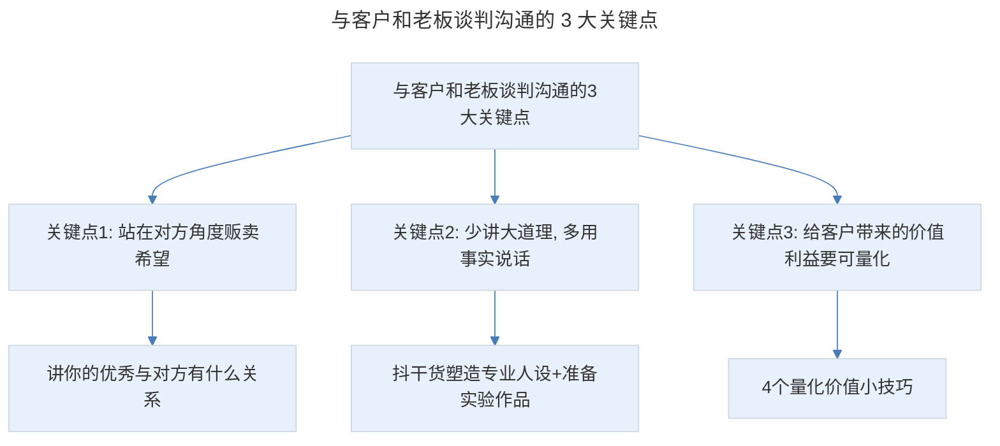
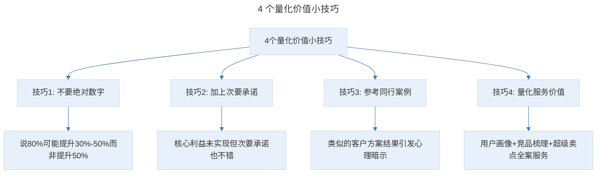
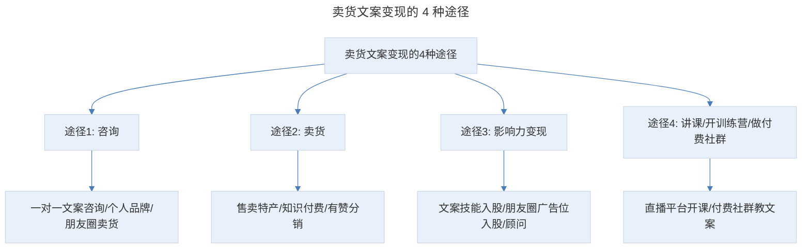

# 文案变现：1 套金主谈判、求职面试的万能表达脚本

## 1. 概念：对人营销与以变现促进学习

核心知识点：谈判沟通的 3 大关键点、变现的 4 种常见途径。

原文作者（兔妈）在文案写作教学中提出一个核心观点：对大多数人来说，以"提升自己"或"个人兴趣"为目标去学文案通常没有用——这个目标太虚、不能量化、也没有反馈机制，难以坚持；而如果用学到的文案方法去接稿、卖货、和老板谈判，发现每个月多赚了几百元、几千元，这个方法就会深刻留下记忆，想忘都忘不了。当真正体会到赚钱的正反馈，就像被注入了源源不断的能量，会愿意主动学习更多的东西。

在接稿场景中，一个常见的困惑是：明明有 7-8 年的文案经验，写的内容自认为不差，为什么同样一篇文案，别人能收几千甚至几万元，自己却只能收 500 元；明明收费更低、态度也不差，报完价格客户那边就没了下文。原文作者认为，这些问题的本质是对人的营销出了问题——没有把自己很好地"卖"出去。自己优秀，和让别人认为自己优秀，是两件事情。如何达成外界对自己的有效认知，让别人认为其优秀、可靠、有能力、值得万元稿费或薪酬，是对人营销的本质。

推销自己和推销产品的逻辑是一样的：要了解目标用户是谁、他有什么需求和痛点、能帮他解决什么问题、帮他达成什么结果，以及如何让他相信销售者有这个实力。

## 2. 方法论：与客户和老板谈判沟通的 3 大关键点

> 与客户和老板谈判沟通的 3 大关键点：站在对方角度贩卖希望（讲你的优秀与对方有什么关系）、少讲大道理多用事实说话（抖干货塑造专业人设+准备实验作品）、给客户带来的价值利益要可量化（4 个量化价值小技巧）。

### 2.1 关键点一：站在对方角度贩卖希望

这本质上是用户思维的运用，只是这里的"用户"不是购买产品的顾客，而是购买服务的老板或商家。所谓站在对方角度，是指不讲自己多优秀，而讲自己的优秀和对方有什么关系。

两种自我介绍的对比：

- 没有用户思维的表述："我叫某某，任职什么岗位，曾在 XX 文案训练营获得优秀学员称号，靠文案变现多少元，期望有机会与您合作。"客户看到会说：你是优秀学员、变现多少元跟我有什么关系？甚至会引起反感情绪。
- 有用户思维的表述："我叫某某，擅长什么，最近的成绩有：帮多少位商家卖货多少等。如果你在卖货时有选品、转化等方面的困惑，我可以提供什么样的帮助，比如免费诊断推文等。"

区别在于：有用户思维的人时刻站在对方角度，讲和对方有关的事；重心不是自己多厉害，而是能给对方提供什么价值。

与客户沟通谈判时，要多讲与客户有关、客户关心的事。但不能生硬地提问（例如"你们的产品有哪些特色？"），连续几个问题下去客户就会不耐烦。正确的方法是引导性地问，例如："这类产品近几年很火，市面上同类产品也不少，大部分卖点都是什么，不晓得我们家的产品除了这些点，还有哪些不同点呢？"这样既能凸显专业，又能打开话匣子，让对方更愿意谈产品的特色。

求职面试同理：可以先讲对公司的了解和印象，以及为什么对该公司充满敬仰。切忌浮于表面地拍马屁，而要真正去公司官网研究，说出 2-3 条对方引以为傲的点，并聊行业的趋势和痛点。不管与客户谈判还是求职面试，讲与对方有关的内容，就像一种"口头的握手"，能快速建立链接。

### 2.2 关键点二：少讲大道理，多用事实说话

当对方对这个人产生兴趣后，接下来要说明其有能力帮对方解决问题。此时不能说"我是某某第一人""我对这个项目有信心""我这个人在圈里认可度很高"，而要给出一系列事实证据，例如帮某位客户写的推文阅读量多少、转化多少、卖货多少等案例成绩。

如果没有成功案例，原文作者给出 2 个方法：

- **方法 1：抖干货，塑造专业人设。** 通过初步调研，了解市面上同类竞品有哪些、产品的目标人群有什么需求和痛点、选择投放渠道时要注意哪些问题、现有推文中有哪些问题以及调整建议和方向等。通过这些建议，让客户觉得其对卖货文案非常有研究。在求职面试或与领导谈升职加薪时同样有效。案例：原文作者的助手庞娜，是一名刚毕业的大学生，没经验、没资源，通过在早会上分享学到的文案知识和运营社群的经验，让领导认为她对运营很有研究，短短 8 个月晋升为运营主管，工资从 4000 元涨到 1.2 万元，翻了 3 倍。
- **方法 2：准备好一份实验作品。** 先选一篇有改进空间的推文优化一遍，把原文和优化后的推文一起发给客户，好坏一目了然；再找一篇当下比较火的爆款案例，写一篇深度拆解文。案例：原文作者刚开始接稿时，一位美妆产品客户前来洽谈，但其此前没有写过美妆案例，于是找了一篇当时非常火的洗面奶案例进行拆解，客户看过后直接确定了合作。

客户问有没有案例，很多时候并不是真的嫌没案例，而是用这种方式表达不信任。写作者需要帮客户解决这个顾虑，让他坚定"选你不会错"的信心。

### 2.3 关键点三：给客户带来的价值利益要可量化

顾客买东西，要的是产品能带来的结果和好处；客户花钱找人写文案、老板花钱雇佣员工，看重的也是能力能给公司带来什么。有人担心承诺结果会显得吹牛、不被信任。原文作者的回答是：有可能，所以表达要精准、切合实际。可用的 4 个量化价值小技巧如下：

> 4 个量化价值小技巧：不要绝对数字（说 80% 可能提升 30%-50% 而非提升 50%）、加上次要承诺（核心利益未实现但次要承诺也不错）、参考同行案例（类似的客户方案结果引发心理暗示）、量化服务价值（用户画像+竞品梳理+超级卖点全案服务）。

1. **不要绝对数字。** 说"我能让转化率提升 50%"可信度不高；说"根据以往经验，通过这个方法，80% 的可能能提升 30%-50% 的转化率"，可信度就高了。
2. **加上次要承诺。** 说"我 5 分钟就能把产品卖出去"客户会怀疑；补充说"即便 5 分钟没有卖出去，我也能让顾客以后主动找我买"，对方就会觉得：即便核心利益没有实现，实现次要承诺也不错。
3. **参考同行案例。** 讲述"曾经有个和你类似的客户，他的产品是什么、当时情况如何、给他制定了什么方案、最终帮他达到了什么结果"，顾客就会产生一种积极的心理暗示。
4. **量化服务价值。** 原文作者举例：别人一篇推文收几百、几千元，其收费一万块，底气除了成功案例，另一个重要因素是服务价值——做详细的用户画像分析、梳理市面上竞品的情况、提炼产品超级卖点、做好产品定位，并根据投放渠道定制不同的标题。别人只是写一篇文案，而其做的相当于产品全案。客户不仅会觉得专业，还会感觉物超所值。

### 2.4 报价策略

关于报价没有一定标准。很多人喜欢和同行比价，怕报低了吃亏、报高了客户流失。原文作者的观点是：只要把价值塑造出来，大多数客户不会流失。建议起步时价格低一些——其起步时一篇推文只收 200 元，重要的是通过客户反馈知道哪里写得好、哪里写得不好，这对新手才是最重要的。当找上门的客户越来越多，报价可以参考其他因素：利润高、客户实力强、要花费更多精力、时间加急的产品可以适当收高一点。

## 3. 方法论：卖货文案变现的 4 种常见途径

> 卖货文案变现的 4 种途径：咨询（一对一文案咨询/个人品牌/朋友圈卖货）、卖货（售卖特产/知识付费/有赞分销）、影响力变现（文案技能入股/朋友圈广告位入股/顾问）、讲课/开训练营/做付费社群（直播平台开课/付费社群教文案）。

1. **咨询。** 帮别人做一对一文案咨询、个人品牌咨询、朋友圈卖货咨询、推文卖货咨询、抖音卖货咨询；也可以根据擅长的领域专注某个垂直细分方向，如美妆类文案咨询、母婴类文案咨询等。据原文作者介绍，其咨询收费已达每小时 1000 元。
2. **卖货。** 当朋友圈里有了各种各样的人以后，可以通过卖货赚取利润实现变现，如售卖家乡特产、知识付费产品，或开一个有赞微小店分销别人的商品。选品依据自身资源和用户构成确定：家乡盛产核桃、粉条等，朋友圈中的好友没有特别明显的标签，这种综合类产品就比较适合；如果朋友圈中女性居多，可以卖服装、化妆品、母婴产品等；如果朋友圈都是爱学习的人，可以卖知识付费产品；如果朋友圈里有非常多的中小企业老板，还可以卖资源。
3. **影响力变现。** 有了成功案例、有了粉丝后，很多人会主动寻求合作，如提供文案技能入股、朋友圈广告位入股，或担任公司的文案顾问。原文作者本人即担任多家有赞头部商家的文案顾问。
4. **讲课、开训练营、做付费社群。** 可以在千聊、有赞、荔枝微课等直播平台开课，与知识付费平台合作，或者开自己的训练营、付费社群，教别人怎么写文案、怎么起标题、怎么写短视频脚本等。

需要注意的是：起步阶段最好专注一种途径，这样更容易积累案例和影响力；有了案例和影响力，顺其自然就能实现多途径变现。

## 4. 实践要点

谈判沟通的 3 大关键点在实际场景中的应用包括：与客户谈判时的引导性提问、求职面试中对公司官网与行业趋势的研究（见关键点一）；无成功案例时抖干货与准备实验作品（见关键点二）；报价与量化服务价值（见关键点三）。可对照这些场景演练这套万能表达脚本。

实践练习：列出自身谈判沟通中存在的问题，并写下优化计划；然后找一位搭档，试着进行演练。

## 5. 小结

知识点一：与客户和老板谈判沟通的 3 大关键点——首先，站在对方角度贩卖希望；其次，少讲大道理，多用事实说话；最后，给客户带来的价值利益要可量化。据原文作者的经验，用好这 3 个点可以提升约 60% 的客户成交率，并实现 3-5 倍的涨薪。

知识点二：卖货文案变现的几种常见途径——接稿、咨询、卖货、影响力变现，以及讲课、开训练营、做付费社群。起步阶段建议先专注其中一种途径，做出了案例和影响力，就能实现多途径变现。

核心要点回顾：用卖货文案技能赚钱是提高学习效率的最佳方式，而变现的关键是把自己"卖"出去——自己优秀和让别人认为自己优秀是两件事。3 大关键点为：站在对方角度贩卖希望（讲自己的优秀与对方有什么关系，用引导性提问而非生硬提问）、少讲大道理多用事实说话（抖干货塑造专业人设、准备实验作品）、给客户带来的价值利益要可量化（4 个技巧：不要绝对数字、加上次要承诺、参考同行案例、量化服务价值）。卖货文案变现的 4 种常见途径为：咨询、卖货、影响力变现、讲课/开训练营/做付费社群。

延伸思考：

- 如何根据自身资源和朋友圈构成选择合适的卖货变现产品？
- 如何在谈判中平衡"塑造价值"与"避免吹牛"的边界？

> 来源：极客时间《文案高手》，作者兔妈
