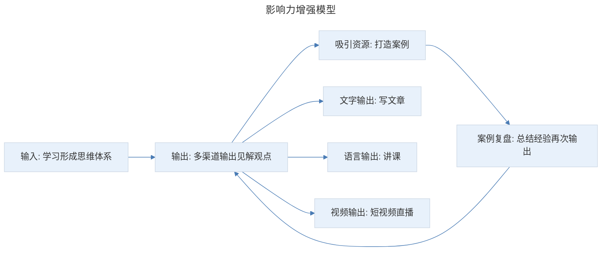
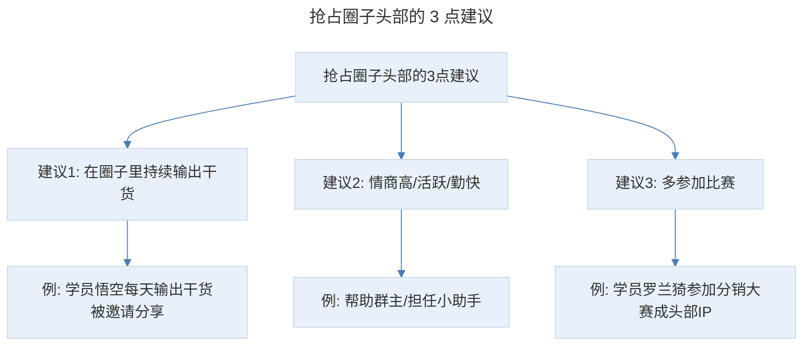
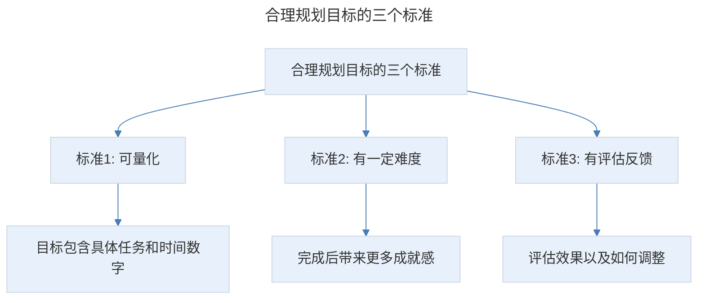

# 影响力打造：1 套影响力模型，教你打造吸金网红 IP

## 概念说明

核心知识点：1 个模型，2 个加速器，3 个标准。

什么是影响力？官方解释是"用一种别人乐于接受的方式，改变他人思想和行动的能力"；简单理解，就是一个人在某个领域的分量、信服力和号召力。

原文作者（兔妈）在筹备其文案课程和实体书的过程中，很多学员在没看过目录大纲、也没试听过的情况下，就主动询问课程上线时间并愿意提前预定产品。这一现象背后的 3 点要素是：在卖货文案领域建立起来的专家形象（品牌内涵）、在往期课程中积累的信用程度（品牌背书）、持续在学员中的曝光度（品牌曝光度）。

**品牌内涵、品牌背书、品牌曝光度，三者就是个人品牌 IP 的三大基本要素。而影响力就等于：品牌内涵 × 品牌背书 × 品牌曝光度，是三者叠加产生的结果。**

> 全球著名管理学大师、商界教皇汤姆·彼得斯说过："我们每个人都是'自己'这家公司的首席执行官。最重要的工作就是打造那个叫作'你'的品牌。"

## 方法论框架：影响力增强模型的 4 个要素

影响力增强模型指：通过学习输入，形成自己的思维体系，并进行多渠道输出；随后吸引好的资源，合作打造案例；再复盘案例、总结经验，进行新一轮多渠道输出。输出又会吸引新资源、催生新案例，由此形成正向循环，使影响力不断增强。

> 影响力增强模型：输入（学习形成思维体系）→ 输出（文字/语言/视频多渠道输出）→ 吸引资源（打造案例）→ 案例复盘（总结经验再次输出），形成正向循环，让影响力不断增强。

### 要素一：输入

输入就是通过学习，把别人的知识吸收进自己的大脑，提升专业技能。输入形式有很多：购买专业书籍、课程，关注领域内前十的公众号，阅读行业大咖总结的经验文章等。

输入不能为了学习而学习，而要带着目的去学习：先把要学的技能拆分成不同要点，列出需要加强的问题；找到这个领域最靠谱的信息源——排名前十的老师、书籍、公众号和课程；再归纳、总结，形成自己的思维体系。

需要特别注意的是版权问题：照抄别人的东西属于侵犯知识版权。正确做法是把学到的内容写出自己的理解以及对问题的重新思考；实在做不到，至少用自己的方式和语言风格把学到的内容重新表达一遍。

### 要素二：输出

输出有 3 种形式：

- **文字输出**，就是写文章。把学习的内容归纳、总结后，发表在自己的公众号、简书、头条号等平台，由此获得更多曝光机会：文章写得不错时会有号主转载，甚至有出版社找来签约写书；也可以去知乎、悟空问答等问答平台回答专业领域的提问，用学到的内容帮别人解决问题，既帮助了别人也打造了影响力；还可以在小红书等生活社区做经验分享。原文作者有一位学员，原来是体重 130 斤的胖子，通过正确的方法 3 个月减到 106 斤，随后在小红书上分享自己的瘦身方法，积累了 10 多万粉丝。
- **语言输出**，就是讲课。通过免费公开课的方式让更多人认识自己，进而扩大影响力。分享的好处有 3 点：课程有价值时，听课的人会自发扩散；一次课程 30-60 分钟，能同时对一群人产生影响，更容易被记住；有更多机会被领域内的 KOL（意见领袖）和专业平台看到，获得合作机会。案例：某年 10 月份，原文作者在荔枝微课自行筹备了一次线上公开课，唯库运营负责人看到后邀请其合作，做了一次 3 天文案训练营，最终听课人数累计 19200 多人。
- **视频输出**，比如抖音、快手等短视频直播。短视频平台拥有大量流量，可把学习的内容录成小视频上传，让更多人知道自己。

### 要素三：吸引资源，打造案例

只要持续输出，就会被一些有资源的合作方看到，从而获得合作机会、打造自己的案例。案例：很多商家看到原文作者写的文章和爆文拆解后，主动找其撰写产品推文，案例由此越积越多；很多专业平台和社群 KOL 看到其分享能力，也来邀请做分享，原文作者现已是有赞学院的高级讲师，出版社也邀请其出书。再如一位名叫彭妮子的学员，经常写美妆方面的文章，被平台看到后邀请讲授化妆方面的课程。

### 要素四：案例复盘，再次输出

做出案例后要及时复盘，总结好的经验，然后再通过写文章、讲课的形式输出。只有把案例说出去，成绩才能累积到个人品牌上，影响力才会越来越强。

常见误区是认为必须做出千万级案例才算案例——实际上普通人也可以有光环。例如：帮别人写的文案阅读量虽然只有 1000，但相比原来提升了 1.5%，就可以表述为"帮客户推文打开率提升 1.5%"。类似的还有"一篇文案销售 5 万产品""一个月服务过 XX 位商家""20 万粉丝公众号签约作者"等。

案例素材：原文作者社群的学员晶朵，全职主妇，学习文案 2 个月就写出了自己的第一篇小爆文，转化率 10%，卖货近十万元。另一位叫暖心的学员，用所学方法帮朋友写了一条果冻橙的朋友圈文案，5 分钟卖掉 8 箱；复盘内容发出来后，当晚精准涨粉 16 人，并链接到 2 个金主。

关于周期：只要用心执行，这一循环的见效通常也就是几个月的事。原文作者另提供了一套缩短周期的方法，即下文的两个加速器。

## 实践要点：打造影响力的 2 个加速器

### 加速器一：加入圈子

加入圈子可以掌握最新的趋势和方法，更重要的是借助高势能人群提高自身势能。可付费加入垂直学习社群、线下活动交流群、商务行业社群等。推荐付费方式的原因在于：付费社群的成员养成了为知识付费的习惯，成员质量更优。

需要注意的是，光加入还不行，还要抢占圈子的头部，才有机会被更多人看到。抢占头部有 3 点建议：

> 抢占圈子头部的 3 点建议：在圈子里持续输出干货（例：学员悟空每天输出干货被邀请分享）、情商高/活跃/勤快（例：帮助群主/担任小助手）、多参加比赛（例：学员罗兰猗参加分销大赛成头部 IP）。

- **在圈子里持续输出干货**。案例：一位叫悟空的学员每天在原文作者的社群输出干货文章，原文作者看到后觉得不错，邀请其做专题分享，最后有 500 人来听分享。
- **情商高一点，活跃一点，勤快一点**。主动关注群主接下来要做什么、哪些是自己可以帮忙做的：群主出了课程帮忙发朋友圈宣传，做用户调研时积极参与。另外，很多群主比较忙，不可能天天泡在群里，可以担任小助手的角色，解答成员问题、维持群内秩序，让群主看到自己的价值。
- **多参加比赛**。很多社群为提升活跃度会举办文案大赛、分销大赛等比赛，主办方会对比赛进行宣传，参与就有更多曝光机会。案例：学员罗兰猗付费加入很多社群，不但情商高、活跃，还主动参加各种分销大赛，现在已经是分销领域的头部 IP。

### 加速器二：链接牛人

学会借助牛人势能，可以快速打造自己的影响力。案例：原文作者的助手庞娜是一名 95 后陕西姑娘，大学毕业一年、没有运营经验，但多次提出帮忙管理社群，因此被记住，最终在四五个人中被选为助理；此后她成为兔妈多个学习社群的群主，很多学员主动加其微信，更多人由此认识她、记住她。

经验总结：当影响力不大时，多给没有能量的人提供价值，让别人喜欢自己；在有能量的牛人面前，多展现自己的价值，让对方愿意给机会、帮助赋能。

另外还要建立自己的核心粉丝群：通过聚集群友，让自己成为群里的意见领袖，扩大影响力。案例：一位叫西湖玉贝的学员，通过加入圈子、输出价值、链接到一些粉丝，建立了自己的读书打卡群，经常推荐自己看过的好书、分享读书心得，在给别人提供价值的同时也扩大了自己的影响力。

### 合理规划目标的三个标准

掌握了正确的方法，就能打造出影响力吗？不一定。常见的情况是目标远大却难以落地：就像跑步，刚开始能跑 10 公里，但一上来就要跑 42 公里的全马，非但完成不了，还会产生挫败感，最后往往不了了之。合理规划目标有三个标准：

> 合理规划目标的三个标准：可量化（目标包含具体任务和时间数字）、有一定难度（完成后带来更多成就感）、有评估反馈（评估效果以及如何调整）。

- **第一：可量化。**目标要包含具体的任务和时间数字，以便知道完成了多少。
- **第二：目标需要有一定难度。**原因是完成后会带来更多成就感。
- **第三：有评估反馈。**任务完成后，要评估效果以及如何调整。

示例：目标是成为文案讲师时，可以先设置一个量化的目标——2 个月时间输出 15 篇干货文章、进行 1 次微课分享，实现精准涨粉 300 人、听课人数 200 人。对照三个标准：可量化体现在 2 个月时间、15 篇干货文章、1 次微课分享、涨粉 300 人、听课 200 人；有一定难度体现在精准涨粉 300 人、听课人数 200 人的结果要求；评估反馈则是在任务完成后检查涨粉和听课人数是否达标，没达到时分析问题出在哪里（甚至可以发红包给粉丝和大咖，请对方提建议），达到后再对标榜样，检视文章哪里还可以提升。

设定目标是成长的重要手段，越精确、越严密，达成的效果越好。在正向激励和反馈中，逐步完成个人升值和影响力提升。

## 小结

### 核心要点回顾

**第一个知识点：影响力增强模型的 4 个要素**

- 通过书籍、课程不断输入知识，形成自己的思维体系。
- 通过文章、讲课、视频直播，持续输出自己的见解和观点。
- 吸引来好资源，打造案例成绩。
- 复盘案例，总结经验，再通过文章、讲课等方式输出。

做到这 4 点，就会有越来越多客户主动寻求合作。

**第二个知识点：打造影响力的 2 个加速器**

- 加入圈子，并努力挤入圈子的头部。
- 主动链接大咖，提供价值。

学会借牛人势能，可以做到事半功倍。

**第三个知识点：合理规划目标的三个标准**

- 可量化：目标要包含具体的任务和时间数字，以便知道完成了多少。
- 有一定难度：完成后会带来更多成就感。
- 有评估反馈：任务完成后，要评估效果以及如何调整。

小步快走，个人品牌会持续增值。按原文作者的观点，当影响力产生 10 倍提升时，收入也可能随之放大到原先的 10 倍。

### 实践建议

可结合打造影响力的四个要素，为自己的兴趣爱好制定 3 个月的短期目标。

### 延伸思考

- 如何在"持续输出"与"避免抄袭侵权"之间保持平衡？
- 个人品牌打造如何与卖货文案的变现途径形成协同？

> 来源：极客时间《文案高手》
