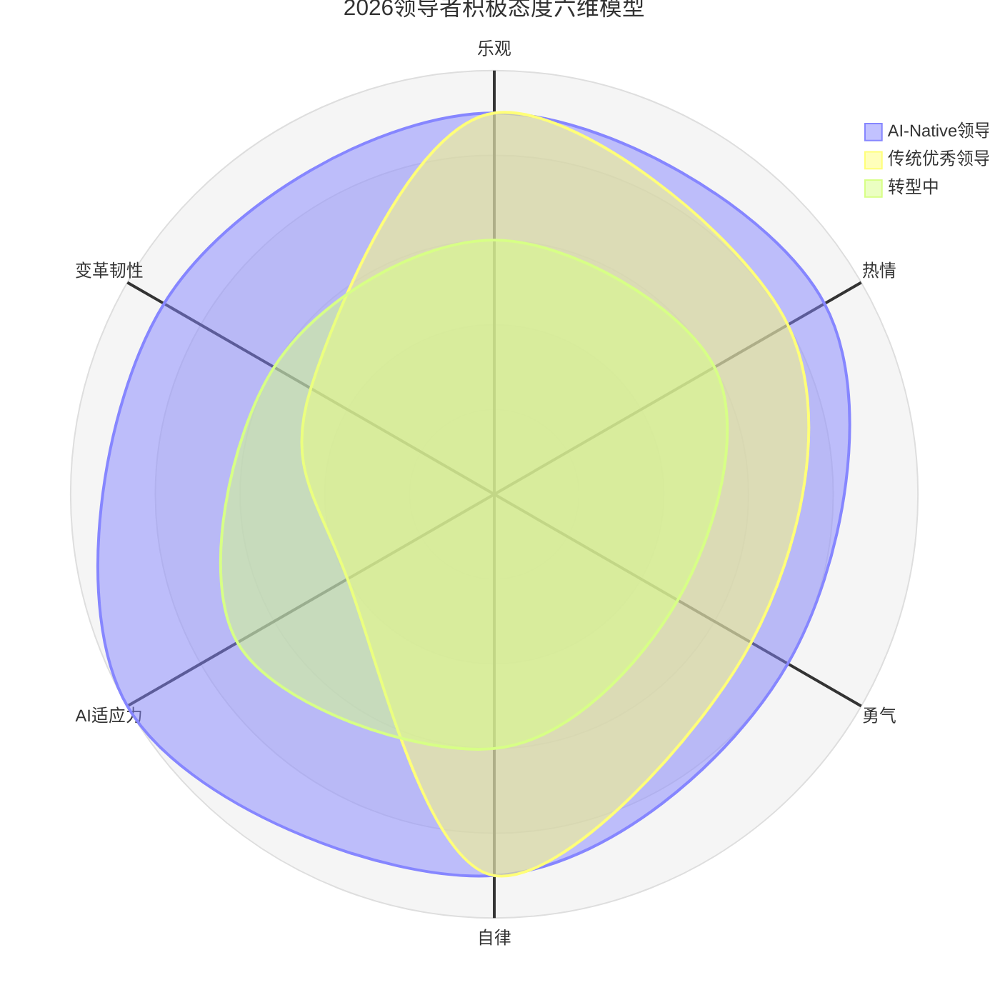

# 刘俊强：领导力提升指南之培养积极的态度

> **适用范围**：技术管理者、Team Leader、Engineering Manager

## 一、导言

作为技术管理者需要负责的事情繁多，需要培养并带领团队完成工作目标，会面临诸多不如人意或突发的情况，稍加不注意就会陷入负面情绪中。负面情绪必须及时处理——不论是团队成员的还是管理者自己的，因为负面情绪是可以传播的；没有人愿意给团队增加消极性，从而影响士气和团队表现。

> **⭐ 2026 年技术背景**：2026 年，原文核心方法论"积极态度四要素（乐观-热情-勇气-自律）"在 AI 时代需要重新诠释——**AI 时代的工作环境变化更快，不确定性更高，但同时也提供了更多工具来辅助保持积极心态**。"与 AI 协作"成为新的工作常态，对态度提出了新要求。

工作中常见的负面情绪及典型场景如下：

1. **挫败（Frustration）**：技术管理者感到卡住或陷入困境时，通常会有挫败感。典型场景：团队没有按照期望完成好项目，抑或是上司或老板未按时出席管理者主持的会议。
2. **愤怒（Anger）**：失控的愤怒可能是人们在工作场所中经历的最具破坏性的情绪，同时也是大多数人处理得不好的情绪；作为管理者更要学会控制愤怒的情绪。
3. **忧虑（Anxiety）**：对尚未到来事情的担忧和焦虑，例如公司业务发展受阻、需要对技术团队进行人员优化，抑或是工作挑战大、担心完成不了等。忧虑的情绪不加以控制，很容易扩散并影响身心健康和工作效率，同时容易让人在工作中不愿意承担风险。
4. **失望（Disappointment）**：当事情未达到期望时，一般会产生失望的情绪，例如团队成员认为未取得应得的晋升时。失望的情绪也会使人趋向避免承担风险，影响工作效率。

不得不承认的是，工作场所中不出现负面情绪是不可能的：不论是因为管理者糟糕的决策引起的，还是由团队成员的个人问题引起的，技术管理者都不能对负面情绪视而不见、不去处理、任由它们在团队中蔓延，影响团队效率和士气。作为合格的管理者，应该在团队中培养积极的态度，学习洞察和处理负面情绪。

---

## 二、核心方法论

### 2.1 基础四要素

刘俊强提出积极态度的四要素：
1. **乐观（Optimism）**：相信未来会更好，关注机会而非困难
2. **热情（Passion）**：对工作的热爱和投入
3. **勇气（Courage）**：面对挑战不退缩
4. **自律（Self-discipline）**：自我管理和持续学习

### 2.2 ⭐ 2026 四要素升级模型

上述雷达图对比了三类领导者在六个态度维度上的表现：AI-Native 领导者在 AI 适应力和变革韧性两个新增维度上显著领先；传统优秀领导者在这两个维度上明显不足；转型中的领导者处于中间状态，正在向 AI-Native 演进。

#### 新增两维详解

| 新维度 | 定义 | AI 时代重要性 |
|-------|------|------------|
| **AI 适应力（AI Adaptability）** | 快速接受并善用新技术的能力 | 技术迭代加速，不会用 AI = 被淘汰 |
| **变革韧性（Change Resilience）** | 在快速变化中保持稳定的能力 | AI 带来的组织变革频繁，需要心理韧性 |

### 2.3 培养积极态度的方法

#### 基础方法回顾

- 自我对话（调整内心独白）
- 持续学习（阅读/培训）
- 寻找导师
- 设定目标

#### ⭐ 2026 AI-Augmented 方法

| 方法 | 传统做法 | AI 增强做法 |
|-----|---------|-----------|
| **自我对话** | 写日记反思 | **+ AI 情绪日记助手**（分析情绪模式） |
| **持续学习** | 读书/上课 | **+ AI 个性化学习路径推荐** |
| **寻找导师** | 人际网络 | **+ AI Mentor（24 小时可用）** |
| **设定目标** | 年度计划 | **+ AI 目标分解与进度追踪** |
| **压力管理** | 运动/冥想 | **+ AI 健康提醒 + 工作负荷预测** |

---

## 三、关键流程

### 3.1 应对挫败感

无论是基于什么原因，快速处理挫败感很重要，因为它很容易导致更多的负面情绪，比如愤怒。刘俊强给出的处理建议：

1. **首先是停下来评估**：感到挫败时，能做的最好的事情之一就是先停下来——这里说的停下来是指精神和思维上的停顿；回顾遇到的情况，思考为什么感到沮丧，记录下来并具体审视这些事情，再想想所遇情况的积极方面。
2. **寻找情况的积极面**：考虑所遇情况的积极方面，有助于以不同的方式看待事物；角度微小的改变能够改善心情，因为造成挫败感的人，可能并不是刻意使人沮丧或困扰的。
3. **消除脑里的负面词语**：一般产生挫败感时，脑中会不自主产生负面词汇或语句，使人陷入负面情绪的影响之中；可以使用语气不那么重的词汇及语句来替换，例如"事情进展有些不顺利""完成情况低于预期"等。

### 3.2 控制愤怒

没有人会喜欢发怒的样子，作为管理者更不应该对团队成员发怒，因为这样会很容易将之前建立的团队信任摧毁掉。刘俊强给出的建议：

1. **注意愤怒的早期迹象**：愤怒发生时的危险信号只有本人最清楚，因此要学会在它们开始时识别它们。尽早制止愤怒是关键。
2. **当生气时想象自己生气的样子**：例如，如果要对团队大喊大叫，想象一下自己的样子——是不是面红耳赤、手舞足蹈，是否愿意和这样的人一起工作。
3. **学会聆听**：团队管理中经常遇到的愤怒场景，便是团队成员对未完成好的事情进行解释或辩解，这很容易让管理者情绪达到临界点进而爆发；因此要学会聆听，保持冷静沉着的风度。

### 3.3 解除忧虑

刘俊强给出的忧虑处理方法：

1. **正面处理员工的恐惧**：坦诚地与团队成员沟通现状，并探讨接下来该怎么改善处理，唯有行动才能打破忧虑与恐惧。
2. **帮助员工避免夸大风险**：当事情失去控制时，人们难免会产生恐惧并可能放大忧虑。管理者应通过自己的经验和分析，帮助员工正视现状及问题。
3. **记下担忧**：如果发现有些事情总是萦绕心头，那么请将它们记录下来，然后安排时间处理它们。

### 3.4 宽容失望

刘俊强给出的失望应对措施：

1. **调整心态**：花一点时间让自己意识到，事情并不总是一帆风顺的。
2. **适当调整目标**：对团队未达到目标感到失望，并不意味着目标不可到达，可能只是需要再多点的时间——可以考虑调整截止日期。
3. **帮助员工调整**：员工可能会因为未取得期望的晋升而感到沮丧和迷失方向；在沟通时要有同理心，不要直接要求他们怎么做，而是引导他们思考：如果要达到期望，应该解决哪些问题。

---

## 四、工具与实战

### 4.1 态度自评工具

使用"六维模型"进行自我评估：

| 维度 | 自评问题 | 评分（1-10） |
|-------|---------|-------------|
| 乐观 | "我相信团队和公司的未来会更好" | ___ |
| 热情 | "我对每天的工作充满期待" | ___ |
| 勇气 | "我敢于面对棘手问题和冲突" | ___ |
| 自律 | "我能持续学习和自我管理" | ___ |
| AI 适应力 | "我快速接受并善用 AI 新技术" | ___ |
| 变革韧性 | "我在快速变化中能保持稳定" | ___ |

### 4.2 团队情绪管理工具

| 工具类型 | 推荐工具 | 用途 |
|---------|---------|------|
| **情绪监测** | 团队 pulse survey + AI 情感分析 | 定期感知团队情绪状态 |
| **沟通辅助** | AI 会议纪要 + 行动项追踪 | 减少沟通误解和遗漏 |
| **学习支持** | AI 个性化学习推荐 | 降低学习焦虑 |
| **压力预警** | AI 工作负荷分析 | 提前识别过载风险 |

### 4.3 ⭐ 2026 立即行动清单

- [ ] 用上述"六维模型"自评当前态度状态
- [ ] 识别最需要提升的维度，制定针对性改进计划
- [ ] 为团队引入至少一种 AI 辅助工具，帮助成员保持积极状态

---

## 五、常见误区

| 误区 | 表现 | 应对策略 |
|------|------|----------|
| **忽视 AI 焦虑** | 认为 AI 焦虑会自行消散 | 正面沟通，提供培训和转型支持 |
| **强装积极** | 压抑负面情绪，不处理 | 允许情绪表达，提供疏导渠道 |
| **工具万能论** | 以为引入 AI 工具就能解决态度问题 | 工具是辅助，核心还是人的关怀和沟通 |
| **忽视自身情绪** | 只关注团队，不关注自己 | 管理者自身的情绪管理同样重要 |

---

## 六、进阶延展

### 核心洞察

> 在 AI 时代，积极的态度是领导力的基础——但积极的态度需要包含"拥抱变化"和"善用 AI"的新内涵。**AI 既是新的不确定性来源，也是保持积极心态的强大工具。**

### 总结

上文讨论了常见的负面情绪及其应对方法。刘俊强强调，作为管理者应该明白的一点是：不论是管理者本人还是团队产生负面情绪、士气低落，管理者都要为此承担责任——因为管理者的职责就是带领大家走出困境、解决问题。

做个阳光积极的管理者并不容易，需要保持对团队负面情绪的洞察，并采取适当的方法进行处理，而这需要管理者不断训练精进。

### 自查清单

- [ ] 最近一次发现的团队负面情绪是什么？当时的应对方式和效果如何？
- [ ] 是否主动留意过团队成员对 AI 的焦虑情绪，并提供过培训或转型支持？
