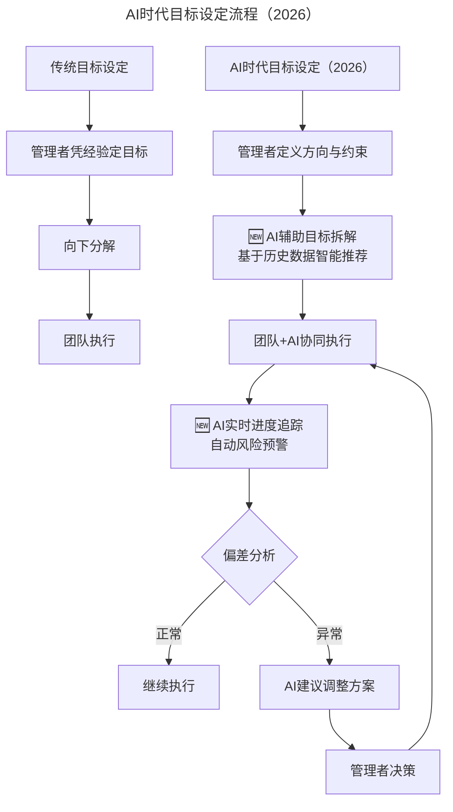
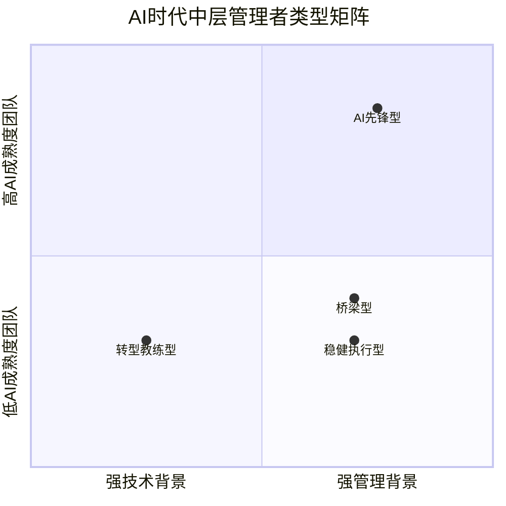
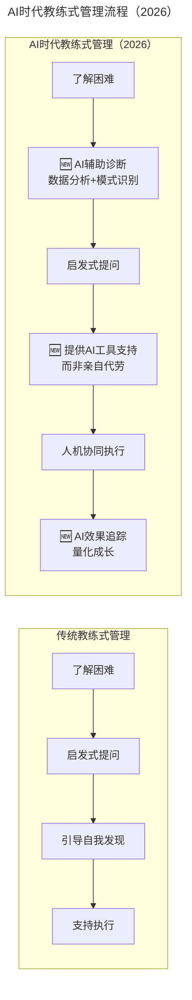
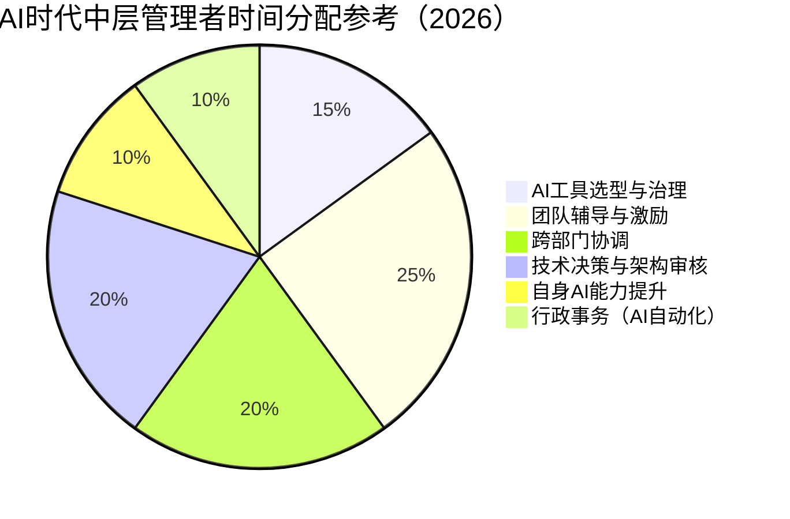

# 培养中层团队的管理认知

> **适用范围**：技术团队 CTO、工程总监、Tech Lead、HRBP

## 一、导言

技术团队到达一定规模之后，要保持高效，中层管理者会变得非常重要。他们在团队中起到承上启下的作用，既要接受上层的指派，又要领导下层执行。如果中层管理者给力，上层的管理者会轻松很多。所以一定要选对中层，培养中层。

> **⭐ 2026 年技术背景**：2026 年，**中层管理者的角色正在发生深刻变化**。传统中层管理者的核心职责——任务分配、进度跟踪、质量控制——正在被 AI 工具大量接管。新一代大模型的能力意味着**很多"管理动作"可以被 Agent 自动化**。但这不意味着中层管理者变得不重要了，相反，**AI 时代的中层管理者需要具备更高阶的能力**。

| 能力维度 | 传统中层管理者 | AI 时代中层管理者（2026） |
|----------|----------------|-------------------------|
| 任务分配 | 手动拆解分配 | **AI 辅助拆解 + 人机协同分配** |
| 进度跟踪 | 周会/日报 | **AI 实时看板 + 异常预警** |
| 质量控制 | Code Review | **AI Review + 人工架构审核** |
| 团队激励 | 一对一沟通 | **个性化激励 + AI 数据分析** |
| 🆕 新要求 | - | **AI 工具选型与治理、人机协作设计、AI 伦理判断** |

---

## 二、核心方法论

### 2.1 先做目标管理

在说中层团队的选拔和培养之前，先看嘉宾选择公司或者职位的理念：首先要去了解这家公司的目标是什么，目标的选择最受关注——目标选得好，就比较容易成功；反之，个人和团队都会比较辛苦，结果还不一定好。有了一个合理的目标之后，剩下的都是执行层面的技巧；有了带领团队达成目标的经验，执行并不困难。

**案例一：盛大集团测试团队的目标调整。** 嘉宾在盛大集团刚开始负责整个测试团队时，CEO 觉得测试团队不能满足公司的期望。测试团队一般有两个指标——速度和质量；不只测试团队，绝大部分团队都是如此，这两个指标的实现很多时候存在冲突。嘉宾意识到公司对测试团队的期望是速度更快一点，避免因为测试花掉太多时间而导致产品上线延迟；而当时的测试团队把过多注意力放在了测试质量上，时间用得比较长。做出的最主要改变，就是让整个测试团队了解真正的目标是什么，把原来以质量为重的目标，变成质量和效率兼顾的目标。目标修改之后，整个测试团队对公司业务的支撑改善了很多——不到一个季度，整个公司都感受到了测试团队的焕然一新。这就是通过目标的选择和调整让团队表现更好的例子。

**案例二：盛大在线数据团队的算法攻坚。** 在盛大在线时，嘉宾曾带领数据团队做数据算法的研究，用了大概两个季度的时间优化广告推荐算法，让点击率和广告收入提升了大概一倍。团队做事时可能忽略一些东西，导致整个进展不够顺利；管理者的职责是帮助他们把事情理顺。当时的实际情况是，团队已经在广告算法上探索了很长时间，但一直没有很好的产出。接手之后全面了解导致进展慢的原因，发现了几个问题：一是当时数据的准确性有问题，原始数据的准确性不够，导致团队被数据误导，结果自然不好。二是在算法假设上做了修正：很多人做算法时会假设某一个用户的唯一标识代表一个用户，而实际情况中，有的电脑白天是先生在用、晚上是太太在用，存在类似的情况。基于修正后的假设再去提升推荐算法，效果就比较明显。这个案例说明：目标达成过程中会出现困难，要能全面思考可能是哪里出了问题，问题解决之后才会获得比较好的进展。

### 2.2 AI 时代的目标管理升级

#### 从"目标选择"到"目标-AI 协同设计"

前文观点是"目标选得好，就比较容易成功"。在 AI 时代，这个原则依然成立，但目标的**设定方式**发生了变化：

上述流程图展示了 AI 时代目标设定的闭环机制：管理者定义方向与约束后，AI 基于历史数据辅助目标拆解，团队与 AI 协同执行，AI 实时追踪进度并预警偏差，管理者据此做出调整决策。

### 2.3 根据需要选管理者

在中层团队建立起来的时候，嘉宾会把亲身实战的管理方式传达给中层管理者。其团队大概有五、六个中层管理者，每一个细分的团队都有各自的 Manager，包括运维团队、后端开发团队、移动端开发团队、测试团队等。

一线工程师需要做实际的工作，而管理者更主要的目标是用各种手段帮助团队更好地提高产出，或者说提升整个团队的能力。围绕目标去了解是否有合适的人来做管理者：如果内部有合适的人就内部提拔；如果内部没有太合适的人，就考虑从外部招一些管理人才，帮助把团队的产出和整个技术能力提得更高。

关于选拔标准，嘉宾的观点是：**不存在通用类型的中层管理者，也就没有通用的标准**。关键要结合团队当时的情况，选拔最需要的管理者类型。大多数时候，不同的团队需要的管理者是不一样的：

- 有些团队面临的问题是经验不足、很多东西做不了、大家都不知道应该怎么做事——这种情况就不能找一个通常的人员管理能力较强的管理人员，而需要一个过去做过类似事情的人；只有做过这种类型的事情，才能解决当下的难题。
- 另一些团队遇到的问题是内部沟通不够顺畅、激励机制不够顺畅、士气低落——这种情况下要找的管理者就偏向于更擅长人员管理和沟通的人。

### 2.4 AI 时代的中层管理者选拔标准

#### 原有标准的 AI 时代演进

前文观点是"不存在通用类型的中层管理者"。在 AI 时代，这个观点更加正确——**不同 AI 成熟度阶段的团队需要不同类型的管理者**：

上述四象限图根据团队 AI 成熟度和管理者背景两个维度，将 AI 时代中层管理者分为转型教练型、AI 先锋型、稳健执行型和桥梁型四类。

| 类型 | 适用场景 | 核心能力要求 |
|------|----------|-------------|
| **转型教练型** | 团队刚引入 AI 工具 | **变革管理能力 + AI 培训能力** |
| **AI 先锋型** | 团队 AI 成熟度高 | **技术创新敏感度 + Agent 编排能力** |
| **稳健执行型** | 团队 AI 使用较浅 | **传统管理能力 + AI 基础应用** |
| **桥梁型** | 跨 AI/非 AI 团队协作 | **沟通能力 + AI 价值翻译能力** |

---

## 三、关键流程

### 3.1 做好教练

管理者选好之后，接下来才是培养。对任何中层管理者，嘉宾首先会分享自己对管理的认知：很多管理者对管理的目标、职责以及常用的管理方法还不太了解，包括管理的职责是什么、最主要的目标是什么、常用的管理手段是什么等问题。

有了这样的认知，中层管理者在具体操作细节上才有管理的概念，会在日常工作中实践。实践中遇到问题时，嘉宾会进一步与其一对一沟通，分享一些精髓——主要是让其对自己的职责和大的提升方向有比较清晰的认识；然后在日常工作中根据实际案例、实际情况，分享在不同情况下应该采取怎样的管理手段。

中层管理人员的时间分配也是被普遍关注的问题，嘉宾认为这件事没办法固定：不同团队情况不一样。有些团队人员比较少、内部沟通比较顺畅，不需要花太多时间做人员管理，这时嘉宾会要求管理者直接做一些技术方面的事情——提升架构能力，或做一些产品的方案设计，利用过去的经验帮助团队少走弯路，让整个团队产出更好一些。有些团队业务技术经验还可以，但内部沟通不够顺畅，这种情况就会希望管理者在人员管理方面投入更多精力。

### 3.2 AI 时代的教练式管理升级

#### 从"教练"到"人机协同教练"

嘉宾的管理方式是"极少情况下才会真正代替中层做事，更多时候以教练的角色出现"。在 AI 时代，教练的角色需要扩展：

上述流程对比了传统教练式管理与 AI 时代教练式管理的差异：AI 时代增加了 AI 辅助诊断、AI 工具支持和 AI 效果追踪三个关键环节。

### 3.3 AI 时代中层管理者的时间分配

#### 时间分配模型演变

前文观点是"时间分配没办法固定"。在 AI 时代依然如此，但有一些新的趋势：

上述饼图展示了 AI 时代中层管理者的时间分配参考模型：行政事务时间被大幅压缩，新增 AI 工具选型与治理时间，团队辅导时间质量得到提升。

关键变化：
- **行政事务时间大幅压缩**：AI 自动生成周报、会议纪要、进度报告
- **新增 AI 治理时间**：工具选型、安全审计、成本管控
- **辅导时间质量提升**：AI 承担事务性工作后，可投入更深度的一对一

---

## 四、工具与实战

### 4.1 教练的新技能包

| 场景 | 传统做法 | AI 时代做法 |
|------|----------|-----------|
| 成员遇到技术难题 | 一起 debug | **推荐 AI 调试工具 + 引导使用方法** |
| 成员效率低下 | 分析原因+给建议 | **AI 分析工作模式 + 识别瓶颈** |
| 成员职业发展迷茫 | 分享经验 | **AI 职业路径规划 + 技能图谱匹配** |
| 团队氛围不好 | 组织团建 | **AI 匿名调研 + 数据驱动改善** |

### 4.2 ⭐ 可执行建议

- 使用 **AI OKR 工具**（如 Tability AI、Weekdone）辅助目标拆解
- 让 AI 基于**历史项目数据**预估工期，减少拍脑袋
- 建立**目标-AI 联动机制**：目标变更时 AI 自动评估影响范围

### 4.3 选拔时的 AI 相关考察点

1. **AI 学习意愿**：候选人最近半年学习了哪些 AI 工具？
2. **AI 实践经验**：是否有带领团队引入 AI 工具的经验？
3. **AI 判断力**：能否区分"适合 AI 完成的任务"和"必须人做的任务"？

---

## 五、常见误区

### 陷阱 1："AI 替代中层"的错误预期
- **现实**：AI 可以替代事务性管理工作，但无法替代**人际洞察和判断**
- **对策**：中层管理者应主动拥抱 AI，将时间投入到**更高价值的活动**

### 陷阱 2：忽视团队的 AI 焦虑
- **现象**：团队成员担心被 AI 取代，士气低落
- **对策**：**透明化沟通 AI 战略**，强调"AI 是工具不是替代者"

### 陷阱 3：自己成为 AI 能力的瓶颈
- **现象**：管理者自己不会用 AI 工具，无法指导团队
- **对策**：**管理者必须是团队中最积极的 AI 学习者**

---

## 六、进阶延展

### 结语

最后再强调一次目标管理的重要性：不管管理什么样的团队，嘉宾首先做的就是帮团队确立并管理一个目标，让所有人都能理解这个目标；对应该用什么方式为目标努力，也会有比较清晰的设置。设置完目标之后，嘉宾使用的是偏教练式的管理方式——极少情况下才真正代替中层做事，更多时候以教练的角色出现：了解他们在完成目标过程中会遇到的困难，然后通过启发式的提问，让他们意识到应该做怎样的改变，才能更好地完成目标。

### 📊 2026 年中层管理者能力 Checklist

- [ ] 完成 **AI 管理工具认证**（至少掌握 3 款 AI 管理工具）
- [ ] 建立 **团队 AI 技能档案**，了解每位成员的 AI 能力水平
- [ ] 制定 **团队 AI 成长路线图**，明确阶段性目标
- [ ] 每月进行一次 **AI 工具效果评估**，优化工具组合
- [ ] 培养 **至少 2 名 AI Champion**（团队内的 AI 推广大使）
- [ ] 自身保持 **每周 5 小时以上**的 AI 学习时间

> **⭐ 一句话总结（2026 版）**：中层管理者不会被 AI 替代，但**会被善用 AI 的中层管理者替代**。2026 年的优秀中层 = **卓越的教练能力 + 熟练的 AI 工具运用 + 敏锐的人机协作设计能力**。技术管理者的角色已从"管人"升级为"**设计人机协同系统**"。
