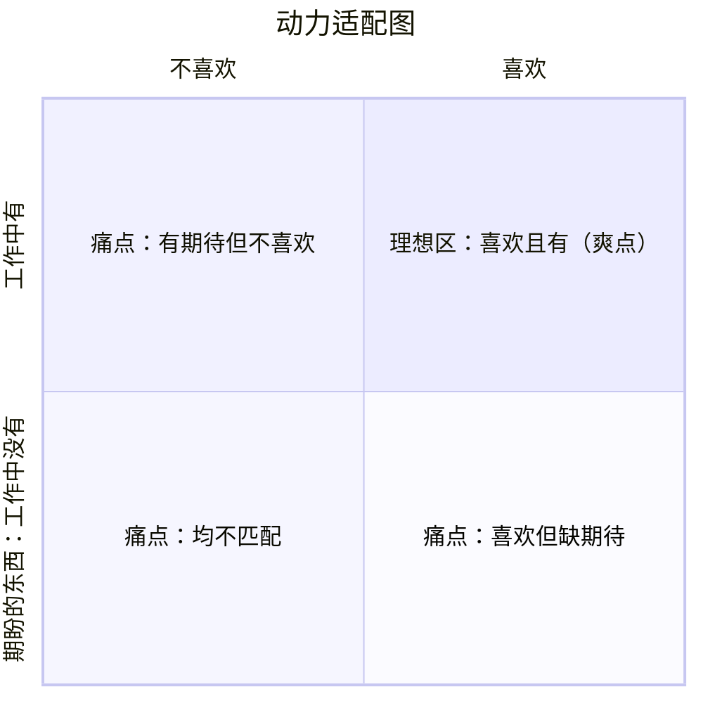
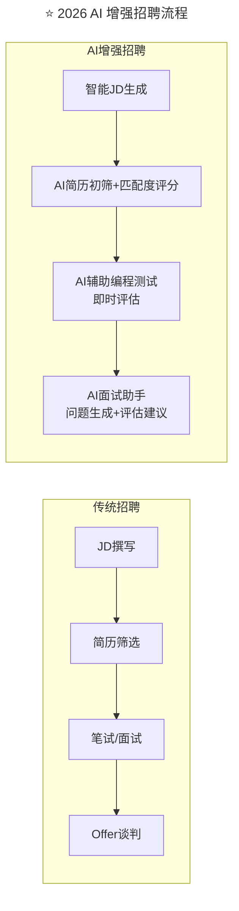

# 程军：打造高效技术团队之招人

> **适用范围**：CTO、技术团队管理者、招聘负责人

## 一、导言

程军的偶像是乔峰和李小龙：从乔峰那里学到铁汉柔情、处事侠义、国家问题大于一切——那种义薄云天的气概、大碗喝酒的豪爽，至今令人触动；崇拜李小龙不只是因为武功高强，更在于他对武术的不断追求——学习各类武术、汲取各家之长，从中国武术到世界武术，最终融合形成自己的"截拳道"。两位偶像都是集大成者。从他们身上可以提炼出成功的因素：**对已选择目标的坚持（称之为"行"）和达成目标后的认知升级（称之为"知"）**，程军将其称为知行合一。

回到打造高效技术团队的话题：在程军的实践中，最关键的是做好两件事——**招人和做事**。虽然老生常谈，却至关重要。本篇聚焦招人这件事。

> **⭐ 2026 年技术背景**：AI 时代招聘的本质没变——找到对的人，但方法需要升级。AI 对招聘流程的影响覆盖 JD 撰写、简历筛选、面试评估全链路。

---

## 二、核心方法论

### 2.1 识人模型：知识、经验、能力、动力

招人并选择合适的人是一个团队成功的关键因素之一——从三国中的"刘关张"团队到西游记中的"西天取经"团队都不难发现这一点。具体到互联网行业怎么招人，程军认为两个最核心的因素是**招聘渠道和识人**。

识人的模型分为**知识、经验、能力、动力**四个模块。

#### 识人的第一步，看知识和经验

这两个模块可以很容易地从候选人的简历和自我介绍中判断出来，并不难。比如要招一个高级软件工程师：具体的数据库索引怎么设计、简单的算法和数据结构理论就是**知识**；做过两个实际的软件项目并且有一定的业务量就叫**经验**。

#### 识人的第二步，看能力，以及未来能做什么

能力一般需要多轮现场面试来判断。墨子曾经说过："听其言，迹其行，察其所能"——即通过判断对方的过去行为来推测其能力。具体推荐 **STAR 法则**：

- **S** 是 Situation，即情况
- **T** 是 Task，即任务
- **A** 是 Action，即行动
- **R** 是 Result，即结果

面谈中需要重点考察的就是"在什么情况下/什么任务中 → 候选人做了什么 → 带来什么结果"。

#### 识人的第三步，看动力

动力是候选人自我说服换工作的内因。程军见过候选人换工作的理由包括异地恋等私人因素。判断动力一般从三个框架入手：

1. **职位是否适配**：岗位的工作领域和职责，与候选人的个人爱好是否吻合，以及工作本身是否令人满意甚至愉悦。
2. **组织适配**：组织的运作模式和价值观所营造的工作环境和氛围，与候选人的个人喜好的适配度。
3. **地点适配**：工作或组织的工作地点，与候选人的个人喜好是否匹配。

### 2.2 ⭐ 2026 新增评估维度

| 维度 | 传统评估 | 2026 年新增 |
|-----|---------|----------|
| 技术能力 | 算法/项目经验 | +AI 协作能力、Prompt 质量 |
| 学习能力 | 技术成长曲线 | +AI 工具上手速度 |
| 创造力 | 开源贡献/创新项目 | +AI 应用创新能力 |
| 文化匹配 | 价值观认同 | +AI 伦理意识 |

---

## 三、关键流程

### 3.1 招聘渠道分类

程军的做法是先把需求分类，一般分为**核心骨干、高潜骨干、一线员工**三类，然后根据招聘规划列出总人数和分批的需求时间节点。

**一线员工**可以去 boss 直聘等招聘网站，效果比较好；注意多平等沟通、多研究这类网站的攻略，就可以花更少的钱达到更好的效果。

通常，找到心仪的人才后，程军会先简单问候，再添加微信，从对方的朋友圈观察其为人，然后找到彼此可聊的话题，并发掘对方想要的东西——而这些恰好是公司能给的。

**核心骨干和高潜骨干**，建议通过人脉或朋友推荐，比较靠谱。因为这类人才都不缺工作机会，缺的是一个适合自己的机会。

对于**高潜骨干**，还可以通过猎头渠道从对手公司寻找，有时候会有非常不错的收获。

### 3.2 动力适配图

动力适配图可以清晰地说明这一观点：横轴描述候选人对工作的喜好程度，从不喜欢到喜欢；纵轴描述候选人期待的东西工作中有没有，从工作中没有到工作中有。

比如，第二象限是工作中有候选人期盼的东西、但候选人不喜欢这份工作；第四象限是候选人喜欢这份工作、但工作中没有期盼的东西——这两种情况都会导致候选人不开心，也就是其痛点。要按照这张图找出这些痛点并且视情况满足，直到候选人感觉到爽点。

### 3.3 ⭐ 2026 AI 增强招聘流程

上述流程图对比了传统招聘与 AI 增强招聘的流程差异：传统招聘从 JD 撰写到 Offer 谈判全靠人工；AI 增强招聘在每个环节引入 AI 辅助——智能 JD 生成、AI 简历初筛与匹配度评分、AI 辅助编程测试即时评估、AI 面试助手生成问题和评估建议，大幅提升招聘效率。

### 3.4 猎头渠道的三点建议

1. 一定要找 2 家或 3 家适合自己的猎头公司，向猎头顾问讲清楚需求，并且定期 review 结果、反思过程，落实改进方案。
2. 猎头公司并不是越大越好：有时候公司小一点，但对方的专业度和资源投入度都足够的话，也是非常不错的选择。
3. 建议扩大选择范围，不要把目光只放在竞品公司——思路开阔一些，办法就会更多一些。

---

## 四、工具与实战

### 4.1 STAR 法则实践

通常，候选人说一个观点或者结果的时候，面试官不但要让其举一个具体的例子，还要让其说出当时这么做的优点以及带来的问题。

因为这个世界是辩证的，每一种技术方案或者管理方法都有其优缺点。如果一个人说不出原委，或者聊得不透彻不痛快，那只能说明其从来没有认真思考过，或者即使思考了深度也有限——显而易见，对方并不是一个非常有能力的人。

### 4.2 动力适配图应用

这个理论还可以推广到日常的团队管理中：找出团队成员的痛点和爽点，视情况满足。

### 4.3 ⭐ 2026 面试新题示例

1. "描述一个用 AI 辅助解决复杂问题的案例"
2. "AI 生成的代码有什么风险？如何应对？"
3. "如何看待人与 AI 在团队中的分工？"

---

## 五、常见误区

### 5.1 无效的 STAR

还有一些候选人会做假设，比如"如果我是什么什么，我就能做到怎样怎样"——这些没有任何用，是无效的 STAR。遇到这种情况时，就要让其具体化、典型化并可量化，从而避免模糊、主观、假设或者不具体的 STAR。

### 5.2 猎头选择误区

- **误区**：猎头公司越大越好
- **正确做法**：关注专业度和资源投入度，小公司有时反而更好

### 5.3 招聘范围过窄

- **误区**：只把目光放在竞品公司
- **正确做法**：扩大选择范围，思路开阔一些

---

## 六、进阶延展

### 6.1 核心原则回顾

1. **明确岗位需求**：技能要求 + 文化匹配
2. **多渠道获取简历**：内推、猎头、校招、社招
3. **科学面试流程**：多轮面试、综合评估
4. **关注潜力**：学习能力比现有能力更重要

### 6.2 核心总结

招到优秀的人才只是第一步，更重要的是如何让这些人才在团队中发挥价值、持续成长——这需要在团队管理、文化建设等方面持续投入。

> **招聘的本质没变——找到对的人，但方法需要升级。**

### 6.3 延伸思考
- 识人模型从四模块（知识/经验/能力/动力）扩展，需加入 AI 协作能力评估
- 招聘渠道在 AI 时代新增 AI 垂直平台（PromptBase、Hugging Face 等）
- STAR 法则在 AI 时代需增加 AI 使用场景的追问
- 动力适配图可扩展加入"AI 工具选择权"作为新的动力维度
