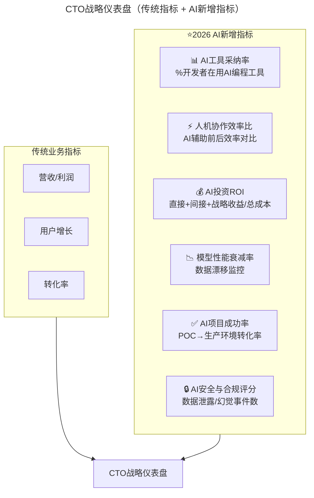
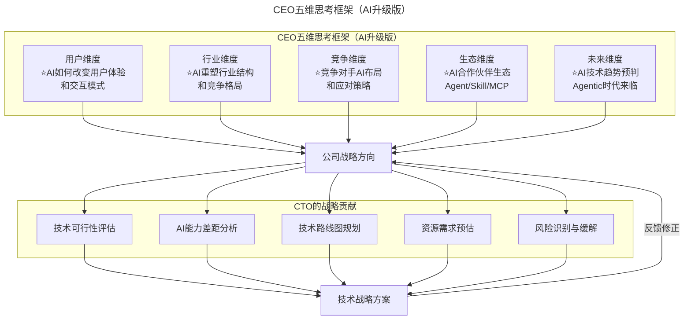

# 像CEO一样思考

> **适用范围**：CTO、技术 VP、技术总监，以及希望从技术负责人向商业领导者进阶的管理者。

## 1. 导言：李大学的京东案例

2008 年 5 月，李大学加盟京东。据他回忆，刚到京东时技术面临非常多的问题，甚至根本跟不上业务的成长。他到京东做的第一件事，就是准备了一支 5 人团队，在郊区租了一栋别墅，开始封闭开发，对京东网站进行改版。

这支 5 人团队连续征战三个月，把整个网站重新改写。正是这次改版，让京东的用户体验上了一个台阶，成为电商用户体验的标杆；改版之后，京东的订单从几千单突破了几万单。

在公司小的时候，很多事情 CTO 都必须亲力亲为；但当公司逐渐长大，情况就不同了——2010 年京东技术团队超过 200 人，开始做前后台拆分，公司的快速成长对 CTO 的能力提出了更高要求。一年后，京东的前、后台团队都超过 600 人，技术架构必须统一。李大学此前从来没带过这么大的团队，面临很大挑战。

他当时意识到：作为一个技术专家，自己可能是够格的；但作为一个 CTO，其实没有准备好。这时他想起一句话——站在 CEO 的角度思考。经过一段波折，2012 年底，他把京东整个研发体系重新管理起来；2012 年到 2015 年 5 月期间，京东的技术又上了一个台阶。

由此他总结的核心观点是：**CTO 要像 CEO 一样思考**。他坦言做这个决定很难，因为这意味着要受委屈、要放下、要接受很多挑战，而最重要的是——要坚持。

## 2. 核心方法论

### 换位思考：CEO 眼中的 CTO 是啥样？

一个人最大的问题，是不能很好地认识自己。两个人互相审视，一定会发现一个盲点：即一方身上的问题另一方知道，而当事人不自知。

李大学认为，作为 CTO，一定要 360 度审视自己：员工对自己有什么样的要求，同事对自己有什么样的要求，CEO 对自己有什么样的要求，特别是在他们眼中是怎么看待这位 CTO 的。如果不把这个问题处理好，就不是一个合格的 CTO。

要让别人理解自己，需要反过来换位思考：先去理解别人，很好地理解了别人，就能很好地让别人来理解自己。研究自己有盲点，所以要把同事、员工、CEO 甚至合作伙伴当做镜子，不断地反思。

通常在 CEO 眼里，CTO 是一个「成本中心」——总是要钱、要人、要资源，还经常出事，这是一个困境。

李大学指出，CTO 最大的问题一般在于沟通：技术人习惯用技术思维来沟通，在技术人的世界里只有 0 和 1，非黑即白；但对 CEO 来说，每天面临的都是不确定问题，不是靠推导逻辑可以推导出来的。尤其做战略选择的时候，只是判断一种可能性，CEO 面临很大的压力，这种思维模式跟技术思维是不一样的。因此用技术思维方式去跟 CEO、业务部门沟通，就会有很多问题。

### CEO 如何思考问题？五维框架

CEO 思考问题一般有五个维度：

**第一个，用户维度。** 一个公司其实就是做两件事：第一件事，把用户吸引过来；第二件事，让用户把钱掏出来，把用户留住，持续掏腰包。所以 CTO 要研究：企业的用户是谁？用户从哪儿来？怎么把用户留住？怎么让用户掏腰包？怎么提升用户的转化率？

**第二个维度是行业的维度。** CTO 必须具备行业知识，不能只讲技术，不能只用技术语言，很多时候要结合商业和技术。必须懂行业，了解行业的本质。

**第三个维度是竞争。** CTO 要对所在的行业了如指掌，特别是这个行业里有多少企业、处在什么样的地位。要对整个产业画一个地图，把本企业和企业未来要演变的路径标在上面。

**第四个维度是生态。** 也就是要关注合作伙伴，CTO 的圈子不仅要有技术圈，还要有行业的圈子；扩大自己的圈子，找到可以帮到自己的人。

**第五个维度是要面向未来去思考。** 如果 CTO 能看到公司未来三年、五年的前景，可能会更得心应手。CEO 的思维一定是面向未来的。所以怎么把技术的战略跟公司的业务战略结合起来，也是 CTO 要研究的课题。

### 五维思考框架的 AI 升级版

| 维度 | 原始问题 | ⭐2026 AI时代新增问题 |
|------|---------|---------------------|
| 用户维度 | 用户是谁？怎么留住？ | **AI如何改变用户体验和价值感知？AI能否创造全新的用户触点？** |
| 行业维度 | 行业本质是什么？ | **AI如何重塑行业结构和竞争格局？谁是AI时代的颠覆者？** |
| 竞争维度 | 对手在干什么？ | **竞争对手的AI布局？我们的AI差异化策略？** |
| 生态维度 | 合作伙伴是谁？ | **AI合作伙伴生态？Agent/Skill市场？MCP协议生态？** |
| 未来维度 | 未来3-5年前景？ | **AI技术趋势对未来3-5年的影响预判？Agentic Workflow何时成熟？** |

## 3. 关键流程

### 沟通的时候，用数据说话

在京东，李大学学到了很好的一招：和 CEO 沟通的时候，尽量用数据说话。包括立项，要说清楚这个项目能给公司带来什么——不是带来技术的先进性，而是跟收入、利润或者用户体验挂钩。这样做更能得到业务部门的支持，也更能得到 CEO 的支持。

用数据说话也意味着，每个技术团队的成长可能都有三个阶段。

**第一个阶段，技术跟随业务。** 业务跑得很快，技术跟在后面，业务部门可能不满意，但是要通过技术能力的提升去满足业务的要求。

**第二个阶段，技术同业务肩并肩。** 这个阶段需要用数据说话。在京东，团队成立了一个大数据部门，对每个业务部门制定 3~5 个指标，每个核心指标包括 100~300 个小指标；每个月都做月度经营会，各个部门 PK 这些指标，通过指标的 PK，各个部门业务就可以提升。也就是说，企业发展一定有一个业务验证到规模化的阶段，而规模化的时候就需要精细化，精细化的时候就需要数据说话。

李大学在京东时曾给强东总做了一个仪表盘：打开手机，对公司的经营情况一目了然，非常清楚哪个库房出问题了、哪里打包拥堵了。团队用三种颜色来标记业务的状态：黄色警告，绿色正常，红色报警。

**第三个阶段，通过技术来引领整个公司的发展。** 回顾在京东的经历，李大学认为技术部门一定要换一个思路：要跟业务部门做伙伴，要帮助业务部门成功。

### 技术跟随业务的三个阶段 → AI 版本

| 阶段 | 原始定义 | ⭐2026 AI升级版 | 典型实践 |
|------|---------|----------------|---------|
| 阶段1 | 技术跟随业务 | **AI工具提效阶段** | Copilot辅助编程、AI客服、智能文档 |
| 阶段2 | 技术与业务肩并肩 | **AI驱动流程重构阶段** | AI研发流程、AIOps、智能测试 |
| 阶段3 | 技术引领发展 | **AI-Native产品创新阶段** | AI定义新产品形态、Agentic SaaS |

**⭐2026关键洞察**：
- 大多数企业正处于**阶段1.5**：开始用AI提效，但尚未系统化
- 领先企业已进入**阶段2-3过渡期**：用AI重塑核心业务流程

### 当家才知柴米油盐贵：李大学成为 CEO 后的感悟

李大学结合自己成为一名 CEO 之后的经历，总结了几点变化与感悟。

角色变化最大的是对技术的参与方式：做 CTO 的时候，一门新技术出来就会深入下去，可以亲自动手；成为 CEO 后比较难做到了。他能做到的是搭一个平台，让这些牛人团结起来，在那个技术方向上深入下去，并让他们随时分享进展，从而跟上技术发展的步伐。

由此得出的方法是：从 CTO 到 CEO 位置，需要有勇气承认技术上不如 CTO 了，但要保持对技术的好奇心，要跟踪技术的趋势，同时尽量多花一点时间跟技术团队在一起。

另一个方面，技术进步非常快，但技术怎么转化成生产力、怎么商业变现，是从 CTO 到 CEO 后考虑更多的问题——怎么从新技术或者新趋势里面找到商业机会，在这方面李大学自认很敏感。

"当家才知柴米油盐贵"：成了 CEO，公司的生存发展就是头等大事。而且 CEO 承担的压力很大，很多人都在关注；李大学坦言当 CEO 之后，抗压能力更高了，对自己的要求也更高了。

## 4. 工具与实战

### "用数据说话"的 AI 时代增强版

**传统数据仪表盘**：KPI、收入、利润、用户增长

**⭐2026新增AI关键指标**：

CTO 战略仪表盘在传统营收/用户/转化指标之外，新增 AI 工具采纳率、人机协作效率比、AI 投资 ROI、模型性能衰减率、AI 项目成功率、AI 安全与合规评分六类指标，用于量化 AI 转型成效。

**具体指标说明**：

| 指标名称 | 计算方式 | 目标参考值（2026） |
|---------|---------|------------------|
| AI工具采纳率 | 使用AI工具的开发者数 / 总开发者数 | ≥80% |
| 人机协作效率比 | AI辅助后产出 / AI辅助前产出 | 1.5x - 3x |
| AI投资ROI | (直接收益+间接收益+战略收益) / 总成本 | >200% |
| 模型性能衰减率 | 当前准确率 - 上季度准确率 | <5%/季度 |
| AI项目成功率 | 成功上线的AI项目数 / 启动的AI项目数 | >60% |

### CEO 五维思考框架 AI 升级版

CEO 五维思考框架在 AI 升级版中，每个维度都新增了 AI 相关问题；CTO 的战略贡献则从单纯的技术可行性评估，扩展到 AI 能力差距分析、技术路线图规划、资源需求预估与风险识别，形成"战略方向 ↔ 技术方案"的双向反馈闭环。

### 李大学从 CTO 到 CEO 感悟的 AI 启示

| 原文感悟 | AI时代诠释 | ⭐2026行动建议 |
|---------|-----------|---------------|
| "搭一个平台让牛人团结起来" | **AI-Native IDP（内部开发者平台）正是这样的平台** | 建设集成AI能力的IDP，统一模型接入、Prompt管理、效果评估 |
| "技术怎么转化成生产力" | **AI正在极大缩短技术到生产力的转化路径** | 从"技术→产品→市场"变为"AI能力→场景→价值"的快速闭环 |
| "没有了框框" | **AI创业者最大的优势就是没有历史包袱** | AI-Native公司可以跳过传统IT架构，直接构建AI-First体系 |
| "当家才知柴米油盐贵" | **AI成本管控成为新挑战** | Token成本、算力成本、API调用费用需要精细化核算 |

## 5. 常见误区

### 误区一：在 CEO 眼里 CTO 只是"成本中心"

总是要钱、要人、要资源还经常出事，是 CTO 在 CEO 眼中的典型困境。破解之道是换位思考，理解 CEO 面临的不确定性与压力，用商业语言而非纯技术语言沟通。

### 误区二：用技术思维与 CEO 沟通

技术人习惯用 0 和 1、非黑即白的思维沟通，但 CEO 每天面临不确定问题，做战略选择只是判断一种可能性。用技术思维方式去跟 CEO、业务部门沟通会产生很多问题。

### 误区三：只讲技术先进性，不讲业务贡献

立项时只讲技术先进性，而不跟收入、利润或用户体验挂钩，难以获得业务部门与 CEO 的支持。应说清楚项目能给公司带来什么业务价值。

### 误区四：技术人不学行业知识

如果不懂仓储、配送、供应链、零售等业务知识，就无法跟业务部门沟通，更没法同 CEO 沟通。CTO 必须具备行业知识，结合商业和技术。

### 误区五：AI 时代忽视成本管控

"当家才知柴米油盐贵"在 AI 时代有了新含义：Token 成本、算力成本、API 调用费用需要精细化核算，AI 成本管控成为 CTO/CEO 的新挑战。

## 6. 进阶延展

### CTO→CEO 转型的新要求

**传统CTO→CEO的能力迁移**：
- 技术深度 → 商业广度
- 产品思维 → 用户+利润思维
- 团队管理 → 组织变革

**⭐2026新增迁移维度**：
- **AI判断力** → **AI战略决策力**
- **工具使用者** → **AI体系设计者**
- **效率追求者** → **价值创造者**

**新一代大模型时代的特殊挑战**：
- 当AI能写代码、做架构、写文档时，**CTO的独特价值是什么？**
- 答案：**连接技术与商业的翻译者 + AI体系的架构师 + 组织变革的推动者**

### ⭐2026行动清单

**本周可执行**：
- [ ] 绘制公司的"AI五维分析图"（用户/行业/竞争/生态/未来各维度的AI影响）
- [ ] 建立AI投资ROI追踪仪表盘（至少包含3个核心指标）
- [ ] 与CEO进行一次"AI战略对齐"对话

**本季度目标**：
- [ ] 完成团队AI能力现状评估（L1-L4分级）
- [ ] 确定1-2个AI-Native产品创新方向
- [ ] 制定公司级AI治理框架初稿
