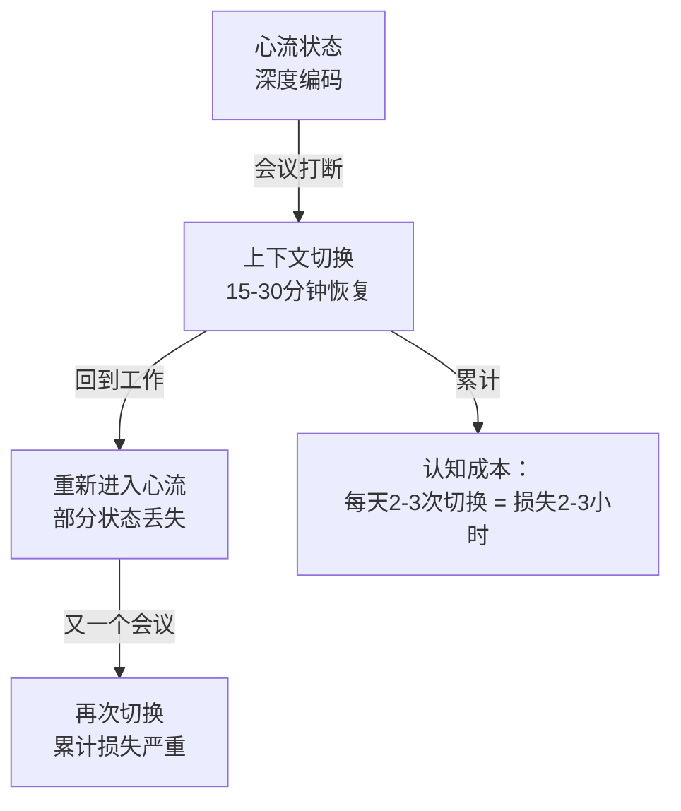
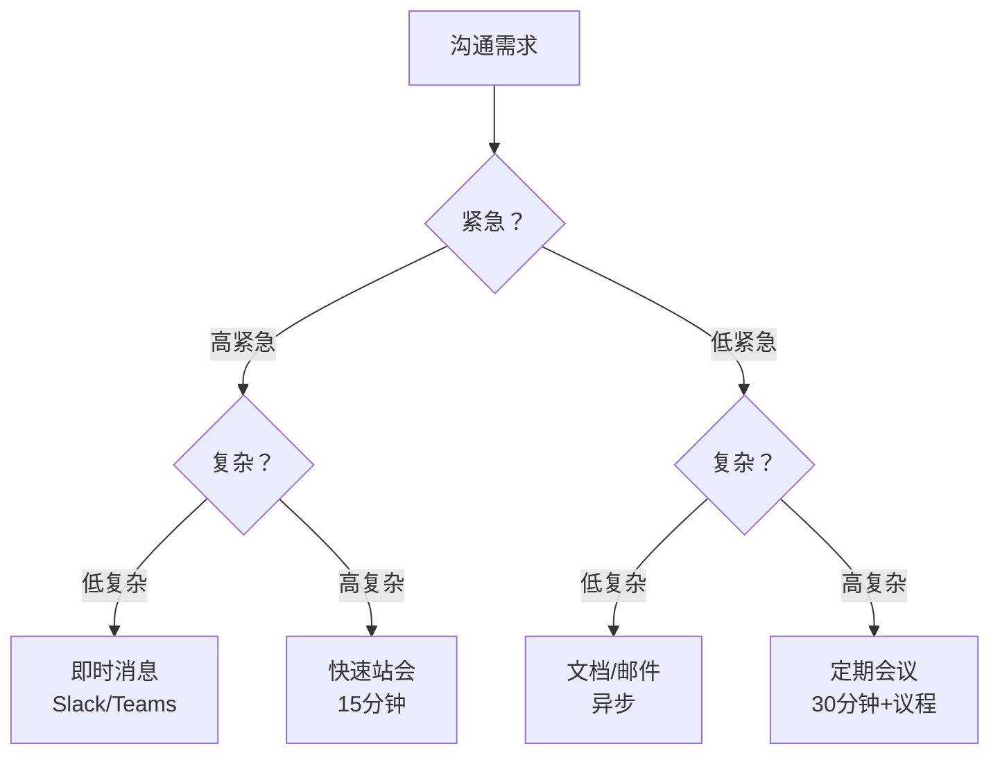
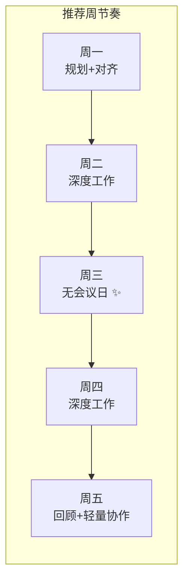
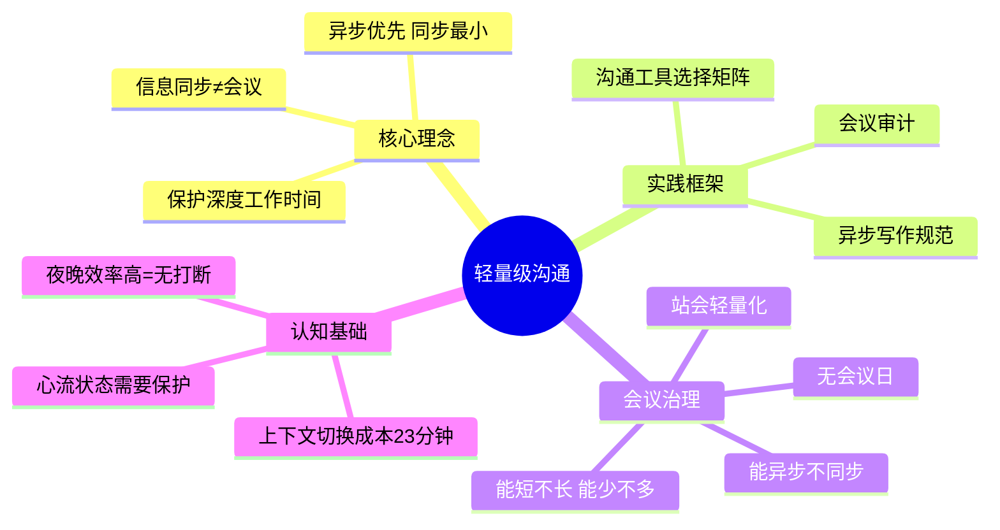

# 轻量级沟通：你总是在开会吗

## 核心命题

会议是组织协作的必要手段，但**会议过多是沟通效率低下的症状而非解药**。轻量级沟通的核心是将信息同步与决策制定分离——信息同步通过异步工具完成，会议仅用于需要实时交互的决策与讨论。程序员的深度工作需要长段不受干扰的时间，而频繁会议是**心流状态（Flow State）**的最大破坏者。

---

## 1. 会议过载的根因与代价

### 1.1 会议类型的混淆

| 会议类型 | 目的 | 时长 | 参与者 | 更优替代 |
|----------|------|------|--------|---------|
| **信息同步** | 传递状态 | 无需开会 | 全员 | 异步文档/消息 |
| **决策制定** | 做出选择 | 30-60 分钟 | 决策者 + 信息提供者 | 会议（无替代） |
| **问题解决** | 协作攻克难题 | 60-120 分钟 | 相关专家 | 结对编程/Workshop |
| **头脑风暴** | 生成创意 | 30-60 分钟 | 多元视角者 | 异步脑暴工具 |
| **进度汇报** | 向上级汇报 | 30 分钟 | 管理层 | Dashboard/周报 |

> **核心问题**：组织中 60-70% 的会议属于"信息同步"和"进度汇报"类型，本可通过异步工具完成。

### 1.2 会议对深度工作的破坏

**上下文切换的认知成本**：

- 每次中断后，平均需要 **23 分钟** 重新进入深度工作状态（Gloria Mark, UC Irvine 研究）
- 一天 3 次会议打断 → 损失约 **1-1.5 小时** 的有效编码时间
- 程序员"晚上效率高"不是因为夜晚更适合编码，而是因为**没有会议打断**

### 1.3 轻量级沟通原则

| 原则 | 实践 | 衡量标准 |
|------|------|---------|
| **能异步不同步** | 用文档/消息替代信息同步会议 | 同步会议数量减少 50% |
| **能短不长** | 25/50 分钟会议（而非 30/60） | 平均会议时长 < 30 分钟 |
| **能少不多** | 仅邀请必要参与者 | 每场会议 < 5 人 |
| **有议程有结论** | 会议前发议程，会议后发结论 | 每场会议有书面产出 |
| **有准备无空谈** | 参会者提前阅读材料 | 会上只讨论+决策，不"汇报" |

---

## 2. 异步优先的沟通架构

### 2.1 沟通工具的选择矩阵

| 紧急度 \ 复杂度 | 低复杂度 | 高复杂度 |
|----------------|---------|---------|
| **高紧急** | 即时消息（Slack/Teams/Lark） | 快速站会（15 分钟） |
| **低紧急** | 文档/邮件/PR Review | 定期会议（30 分钟 + 议程） |

### 2.2 现代异步协作工具链

| 工具类型 | 典型工具 | 替代的会议类型 | 适用场景 |
|----------|---------|---------------|---------|
| **文档协作** | Notion/Confluence/Google Docs | 信息同步会 | 状态更新、知识共享 |
| **代码协作** | GitHub/GitLab PR Review | 技术评审会 | 代码质量、方案讨论 |
| **项目协作** | JIRA/Linear/Asana | 进度同步会 | 任务状态、依赖管理 |
| **即时消息** | Slack/Teams/Lark | 日常沟通会 | 快速问答、通知 |
| **视频录制** | Loom/Vidyard | 演示/培训会 | 异步演示、操作指南 |
| **白板协作** | Miro/FigJam | 头脑风暴会 | 架构设计、流程梳理 |

### 2.3 异步沟通的写作规范

异步沟通的效果取决于**信息密度与结构化程度**：

| 原则 | 说明 | 反模式 |
|------|------|--------|
| **结论先行** | 第一句给出结论/请求 | 铺垫半天不说重点 |
| **结构化** | 用标题/列表/表格组织信息 | 大段无格式文本 |
| **可操作** | 明确期望读者的行动 | 模糊的"大家看看" |
| **自包含** | 包含所有必要上下文 | 需要追问才能理解 |

> **PR Review 作为异步技术评审的典范**：代码变更 + 描述 + 评论 → 比会议评审更高效（可异步、可追溯、可搜索）。

---

## 3. 会议治理的实践框架

### 3.1 会议审计

定期对团队会议进行审计：

| 审计维度 | 检查项 | 目标 |
|----------|--------|------|
| **数量** | 每周会议总时长 | < 10 小时/人/周 |
| **时长** | 平均会议时长 | < 30 分钟 |
| **参与度** | 平均参与人数 | < 5 人 |
| **产出率** | 有书面结论的会议比例 | > 90% |
| **必要性** | 可被异步替代的会议比例 | < 20% |

### 3.2 无会议日（No-Meeting Day）

| 实践 | 公司 | 效果 |
|------|------|------|
| **No-Meeting Wednesday** | Shopify | 开发者满意度显著提升 |
| **Maker's Monday** | Asana | 深度工作时间增加 30% |
| **Focus Friday** | Meta | 代码提交量增加 |

### 3.3 站会的轻量化

传统站会（15 分钟 × 全员）的问题：大部分人只关心自己的部分。

| 改进方式 | 做法 | 优势 |
|----------|------|------|
| **Walk the Board** | 看板上每张卡讨论，而非每人发言 | 聚焦工作项，减少冗余 |
| **异步站会** | Slack/Teams bot 收集更新 | 节省同步时间 |
| **按需站会** | 仅在有阻塞项时召开 | 减少无信息量会议 |

---

## 4. 总结

**核心要义**：能异步不同步，能短不长，能少不多。会议是昂贵资源，应仅用于需要实时交互的决策与问题解决。保护深度工作时间，是程序员效率的根基。

---

> **延伸阅读**
>
> - Cal Newport, *Deep Work* (2016): 深度工作与心流状态
> - Jason Fried & DHH, *Remote: Office Not Required* (2013): 异步协作实践
> - Gloria Mark, "No Task Left Behind?": 上下文切换研究
> - Shopify No-Meeting Policy: https://shopify.engineering/shopify-no-meeting-policy
---

## 原文存档

> 以下内容整理自郑晔原文，已改写为书面表述，保留全部案例与实践细节作为参考。

### 会议为什么没有解决问题

开会的本意是将大家组织起来解决问题，但真实情况却是开了会又没有解决多少问题，这是一个奇特的矛盾。

效果特别好的会议，基本上都是用来做信息同步的。比如领导宣布一个事情：宣布消息、大家收到消息、结束，几乎不会浪费时间。效果不好的会议则几乎都是讨论会：你一言我一语，几乎每个会都有擅长打岔的人，讨论跑偏，时间就这样一分一秒地流逝。

一个典型的案例是一次上线计划评审会。团队负责人把相关利益方召集起来，包括上下游可能受影响的团队、测试、运维等，一个不大的会议室里挤满了人。方案刚讲了几分钟，下游团队负责人就站出来质疑："这个方案为什么要这么做？我担心会对我们系统造成影响。"讲方案的人只好停下来解释，越解释细节越多，双方你来我往，方案评审会就转变成了一场技术讨论会。原本想听技术方案、为后续工作做准备的测试和运维同事一脸无奈——方案没确定好，所有的事情只能等下回再说。

问题出在沟通方式的选择上。开会是一种重量级的沟通，几乎是日常工作中最重的一种：它有很强的仪式感，大家会相对重视，但通常会牵扯很多人，尤其是与这件事情相关度不那么高的人。多数人参加会议时难以全程集中精力——讨论的内容可能与自己关系不大，或者已经听不懂了，坐在那里的唯一原因是主持人还没有宣布会议结束。用开会这种重量级的方式讨论问题，就好比杀鸡用了牛刀；解决办法很简单——杀鸡用鸡刀。

### 轻量级沟通的两个行动项

真正在会议上积极参与讨论的人并不会觉得会议浪费时间，因为高度参与时人进入了心流状态，时间流逝很快；觉得浪费时间的，往往是没有参与其中的人。会议给人留下不堪的印象，一个重要的原因是真正参与讨论的人并不多。

因此，**改善会议的第一个行动项是减少参与讨论的人数**。如果一个讨论有好几个议题、每个议题需要不同的人参与，正确做法是分别找这几个人专门讨论，而不是把大家放到一起。

第二个行动项是：**要讨论，就找人面对面沟通**。会议是一种重量级的沟通方式，而面对面沟通是一种更轻的选择。面对面沟通因为注意力有限，参与的人数不可能太多；也正因为参与人数相对少，每个人的投入会更多。

把这两个改进落到实操上：有一个问题需要讨论时，分别找到相关人针对关心的主题进行讨论，然后把讨论结果汇总再去征求大家的意见；大家达成一致之后才选择开会。这个时候，开会的目的不再是讨论，而是信息同步——"我准备这么干了，相关各方已经同意，知会大家一下，结束"。

### 站立会议

开会并非都不好，一些信息同步的会有存在的必要，站会（Standup）就是典型的例子。很多公司都在实践站会，它甚至成为每天的开工仪式：早上大家到齐后先开一个站会，同步昨天的工作，然后开始今天的工作。

有的团队一听站会就皱起眉头，多半是因为"站"错了。站会之所以站着开，是因为按照一般习惯，站立的时间不会太长——**站会超过 10 分钟，一定是错的**。

也有人会说，这点时间恐怕不够开站会，因为每个人都有一大堆要说的。但一旦一个人说多了、与别人关系不大，其他人就会思维发散。在总长固定的情况下，每个人的发言时间必然有限，只说三件事就足够：

- 我昨天做了什么？
- 我今天打算做什么？
- 我在过程中遇到了什么问题，需要请求帮助。

**"做了什么"**，是与其他人同步进展，看事情是否在计划上；一旦偏离计划，应当主动提出，项目经理可以借此判断是否需要调整项目计划。**"要做什么"**，是同步接下来的工作安排；如果涉及与其他人协作，等于让相关人提前有配合的心理准备。**"问题和求助"**，是与其他人的协作接口——遇到了不懂的问题，其他人有信息的话可以提供支持。

这三件事都与别人相关，几句话快速说完即可，大家的注意力可以相对集中。如果问题很复杂、需要展开讨论，那是另外一件事：可以在站会结束之后找相关人讨论，不要在站会上浪费大家的时间——在站会上只需在"问题和求助"中声明有一个问题需要相关人讨论即可。

为了帮助大家保持注意力集中，一些团队还使用过发言令牌的方式：找一个毛绒玩具作为"令牌"，谁拿到令牌谁发言，然后随机地扔给下一个人，一旦有人走神，立刻就能被发现。有趣的方式、短暂的时间、与所有人相关的事情——满足这三点，站会的效果普遍不错。

关于站会有一个典型的错误：把站会开成了汇报会。项目负责人指定成员一个个轮流发言，说的人都向负责人汇报工作，其他人自然容易走神，因为事情与己无关。

另一个常见疑问是团队比较大、一个人几句话加起来时间也会很长。团队很大时，更应该做的是把团队拆分——没有人能与 20 个人紧密地工作在一起。沃顿商学院的一项研究表明，5-12 人是一个恰当的团队规模，每个人都能在其中发挥自己的重要作用。

### 存档小结

开会是很多程序员的困扰，太多的会议甚至会影响到工作的进展。开会的本意是为了解决问题，但实际上大多数会议并不能很好地解决问题，因为会议是一种重量级的沟通方式，很多人参会时并不能真正参与其中。

想用会议的形式与别人讨论问题，最好放弃这种打算：面对面沟通更轻、人数相对少，每个人的参与度会高很多。基于这种改进，可以把大部分会议都改成信息同步的会，效率随之提高。站会则是用"站立"控制时间的特殊会议，发言遵循"做了什么、要做什么、问题和求助"的三问格式。

如果只能记住一件事，请记住：**多面对面沟通，少开会。**
