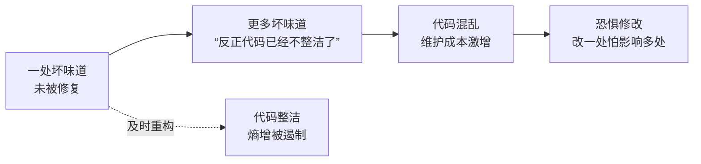
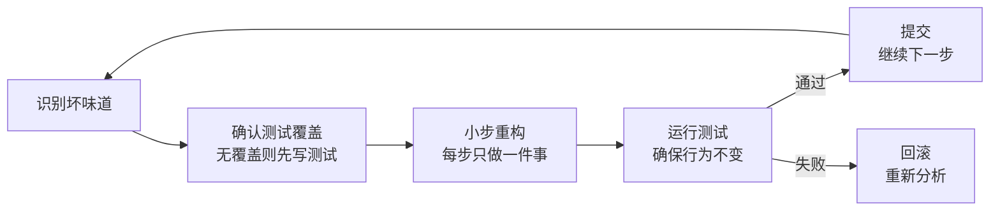
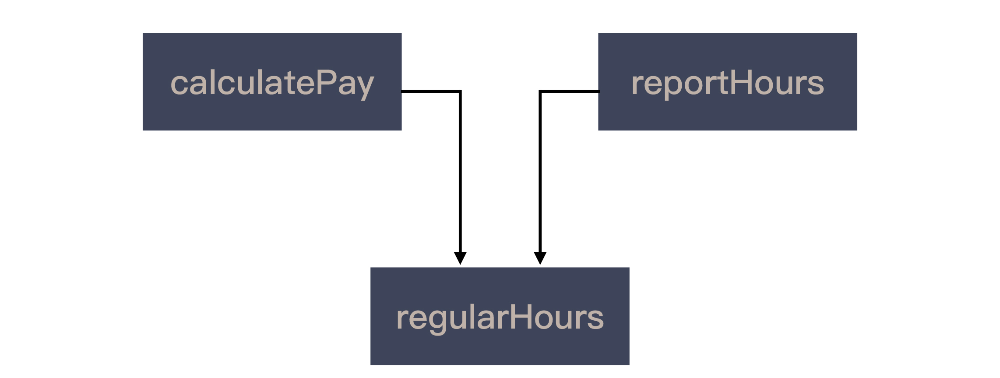
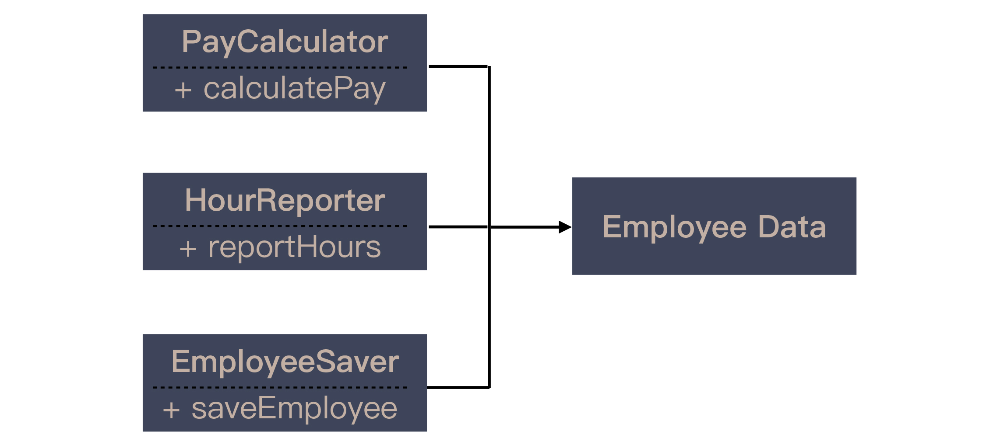

# 你的代码是怎么变混乱的

## 核心命题

代码混乱不是一朝一夕的结果，而是**缺乏持续重构的累积效应**。每次"只加一小段代码"而不重构，都在增加代码的熵值——这正是软件熵增定律（Software Entropy）的体现。代码混乱的根因可归类为**代码坏味道（Code Smell）**——识别坏味道是重构的前提，而重构的前提是**充分的测试覆盖**。

---

## 1. 软件熵增与坏味道

### 1.1 破窗效应与软件熵增

> **破窗效应（Broken Window Theory）**：一扇未被修复的破窗，会导致更多窗户被打破——因为"反正已经破了"。在代码中，一处坏味道未被修复，会吸引更多坏味道。

### 1.2 坏味道分类

| 类别 | 坏味道 | 症状 | 重构方向 |
|------|--------|------|---------|
| **膨胀者** | 过长方法、过大类 | 难以理解、难以测试 | Extract Method/Class |
| **滥用 OO** | Switch 语句、临时字段 | 缺乏多态、职责不清 | 以多态替代条件 |
| **变更阻止者** | 散弹式修改、并行继承 | 一个变更需改多处 | 移动方法/字段 |
| **不必要的复杂** | 过度设计、投机性泛化 | 代码多于需求 | 简化继承体系 |
| **耦合** | 消息链、中间人 | 模块间依赖过强 | 隐藏委托、移除中间人 |
| **命名问题** | 模糊命名、不一致命名 | 语义不清 | 重命名 |

---

## 2. 重构的安全保障

### 2.1 重构的前提条件

> **没有测试保护的重构，不叫重构，叫"重写"。** —— Martin Fowler

| 前提 | 作用 | 缺失后果 |
|------|------|---------|
| **充分的自动化测试** | 确保重构不改变行为 | 可能引入新 Bug |
| **小步重构** | 每步可验证 | 难以定位引入的问题 |
| **频繁提交** | 每步可回滚 | 大改动难以回退 |

### 2.2 重构的节奏

### 2.3 重构的时机

| 触发时机 | Boy Scout Rule | 做法 |
|----------|---------------|------|
| **添加功能时** | "离开时让营地比到达时更干净" | 在添加功能的同时重构周围代码 |
| **修复 Bug 时** | 修复 Bug 前先重构使 Bug 更明显 | 重构使 Bug 的根因暴露 |
| **Code Review 时** | Review 发现坏味道立即重构 | Review 发现→重构→再 Review |
| **定期重构日** | 每周/每迭代安排重构时间 | 专门处理累积的坏味道 |

---

## 3. 总结

**核心要义**：代码混乱是缺乏持续重构的累积效应——软件熵增定律与破窗效应。识别坏味道→确认测试覆盖→小步重构→频繁提交，是代码治理的基本节奏。没有测试保护的重构不叫重构，叫重写。

---

> **延伸阅读**
>
> - Martin Fowler, *Refactoring* (2nd ed. 2018): 坏味道与重构目录
> - Joshua Kerievsky, *Refactoring to Patterns* (2004)
> - Robert Martin, *Clean Architecture* (2017): 单一职责原则"仅对一类 actor 负责"定义的出处
> - Robert Martin, 《敏捷软件开发：原则、实践与模式》: SOLID 五原则的系统阐述
---

## 原文存档

> 以下内容整理自郑晔原文，已改写为书面表述，保留全部论述、案例与配图作为参考。

### 从软件外部到软件内部

此前的自动化相关篇章（如《懒惰与自动化》《项目自动化》）讨论了开发过程的各种自动化，从构建、验证到上线部署——那些内容都是站在软件外部看的。从代码治理开始，视角转入软件内部，从写代码说起。

### 逐步腐化的代码

代码是程序员改造世界最直接的武器，却也是程序员抱怨最多的东西。程序员抱怨的不是写一段代码——那是养家糊口的本领，最基本的职业素养还是有的；抱怨的是维护一段代码。维护之所以难，是因为通常要维护的代码已有一定"年龄"，人们总会抱怨前人没有好好写这段代码。

拿到一个新需求、要在一段旧代码上添加新功能时，很多人的做法是在原有代码上添加一段新逻辑，然后提交完工。问题是：**任务完成了，代码却变得更糟糕了**。如果追问原因，答案往往是"这段代码都这样了，我不敢乱改"，或者"之前就是这么写的，我只是遵循别人的风格在写"。

行业里有一个段子：**对程序员最好的惩罚是让他维护自己三个月前写的代码**——一不小心就成了自己最讨厌的人。

很多代码并非一开始就没写好，而是每次只加一点。一个产品一旦有了生命力，就会长期存在下去，代码也就随时间逐渐腐烂。而几乎每个程序员的理由都一样，他们也很委屈，因为自己"只改了一点点"。

这样的问题有解吗？一个解决方案是重构，但重构的前提是知道代码驶向何方；更好的答案是了解一些软件设计的知识。

### SOLID 原则

提到软件设计，大部分程序员都知道"高内聚、低耦合"的说法，但它如同"期待世界和平"一样，虽然没错，却不能很好地指导具体工作。比较能落地的一种做法，是 Robert Martin 提出的面向对象设计原则 [SOLID](http://butunclebob.com/ArticleS.UncleBob.PrinciplesOfOod)——五个设计原则的缩写：

- 单一职责原则（Single responsibility principle，SRP）
- 开放封闭原则（Open–closed principle，OCP）
- Liskov 替换原则（Liskov substitution principle，LSP）
- 接口隔离原则（Interface segregation principle，ISP）
- 依赖倒置原则（Dependency inversion principle，DIP）

早在 1995 年，Robert Martin 就提出了[这些设计原则的雏形](http://groups.google.com/forum/?hl=en#!topic/comp.object/WICPDcXAMG8)，然后在《[敏捷软件开发：原则、实践与模式](http://groups.google.com/forum/?hl=en#!topic/comp.object/WICPDcXAMG8)》一书中比较完整地阐述了这五个原则，后来又将其进一步整理为今天的 "SOLID"。

学习这些设计原则有什么用？今天的程序员学习软件设计多半从设计模式入门，但几个看上去相像的设计模式，不精心比较就很难记住细微差别；真正到了工作中，能想起来的往往只剩工厂方法、观察者等最简单的模式。还有人硬去使用设计模式，反而让代码变得更复杂。

《敏捷软件开发：原则、实践与模式》是一本被名字"糟蹋"了的好书——出版之际恰逢敏捷软件开发运动风起云涌，Robert Martin 也将"敏捷"挂进了书名，其实这是一本以软件设计为主题的书。看到 SOLID 的五个原则之后就会明白：如果说设计模式是"术"，设计原则才是"道"。设计模式并不能帮助建立知识体系，而设计原则可以。不理解"道"的时候，"术"只能死记硬背，效果必然不佳；想通这一点，按设计原则来写代码，反而时常能重构出符合某个设计模式的代码——至于具体模式的名字，不刻意去找甚至记不住。

当然，这不是说设计模式不重要：能够用设计原则写代码的前提，是曾经在设计模式上下过很多功夫。道和术是每个程序员都要有的功夫——在"术"上下过功夫，才会知道"道"的价值；"道"可以帮助建立更完整的知识体系，避免在"术"的低层次上不断徘徊。

### 单一职责原则

SOLID 中最容易被误解的是单一职责原则。《敏捷软件开发：原则、实践与模式》给出的理解是：**一个模块应该仅有一个修改的原因**。2017 年，Robert Martin 在《架构整洁之道》（Clean Architecture）中把定义修改为"**一个模块应该仅对一类 actor 负责**"，这里的 actor 可以理解为对系统有共同需求的人。

以 Robert Martin 自己给出的例子说明：在一个工资管理系统中，有一个 Employee 类，包含三个方法：

- calculatePay()，计算工资，财务部门关心；
- reportHours()，统计工作时长，人力部门关心；
- save()，保存数据，技术部门关心。

这三个方法放在一个类里，是因为它们的部分行为类似——比如计算工资和统计工作时长都需要计算正常工作时间。为避免重复，团队引入了新方法 regularHours()。

后来，财务部门要修改正常工作时间的统计方法，而人力部门不需要修改。负责修改的程序员只看到 calculatePay() 调用了 regularHours()，完成了修改，财务部门验收通过；但上线运行之后，人力部门产生了错误的报表。这是一个真实的案例，最终因为这个错误给公司造成了数百万的损失。

如果问程序员为什么要把 calculatePay() 和 reportHours() 放在一个类里，答案通常是"它们都用到了 Employee 这个类的数据"。但它们是在为不同的 actor 服务：任何一个 actor 有新需求，这个类都需要改，它也就很容易成为修改的重灾区。更关键的是，它很快会复杂到没人知道一共有哪些模块与它相关、改起来会影响到谁，程序员也就越发不愿意维护这段代码。

人的大脑容量有限，太复杂的东西理解不了，唯一能做的就是把复杂的事情变简单。任务分解（参见《向埃隆·马斯克学习任务分解》一文）反复强调把事情拆小，同样的道理在写代码中也适用——单一职责原则给出了一个指导：可以按照不同的 actor 分解代码。

针对上面的问题，Robert Martin 给出的解决方案就是按照不同的 actor 将类分解，分解结果的类图如下：

### 编写短函数

理解了单一职责原则，还有一个值得注意的维度：函数多长是合适的？曾有人自豪地表示自己对代码要求很高，超过 50 行的函数绝对要处理掉；而郑晔自己的习惯是函数通常都在十行以内，如果是表达能力很强的语言（比如 Ruby），函数会更短。

"函数长短"是一个极易引起争论的话题，不同的人有不同的答案，取决于他看问题的粒度。不讨论前提条件、只谈论函数长短，其实没有意义。

"小"的价值贯穿这些工程实践：能看到多小，就可以在多细的粒度上工作。单一职责这件事举例很容易，但在真实的工作场景中，**能看到一个模块在为多少 actor 服务，完全取决于分解能力**。

单一职责原则可以用在不同的层面：写一个类时，可以问问这些方法是不是为一类 actor 服务；写方法时，可以问问这些代码是不是在同一个层面上；甚至一个服务，也需要从业务上考虑它是否在提供同一类的服务。总之，看到的粒度越细，就越能发现问题。

如果只能记住一件事，请记住：**把函数写短**。
