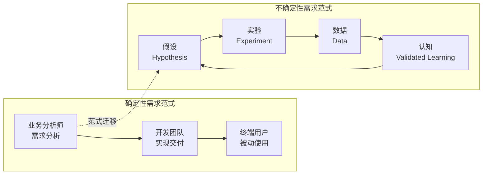
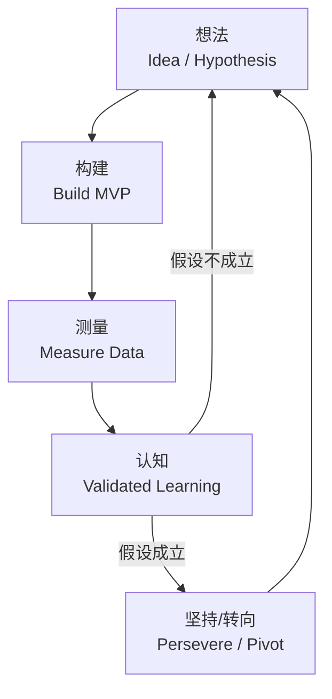
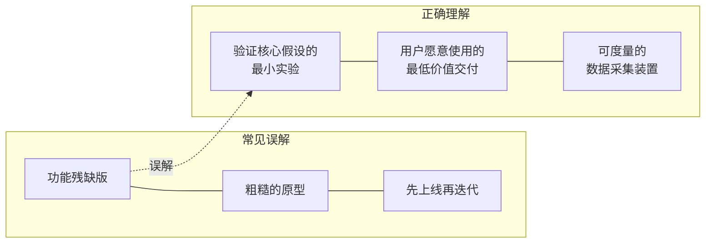
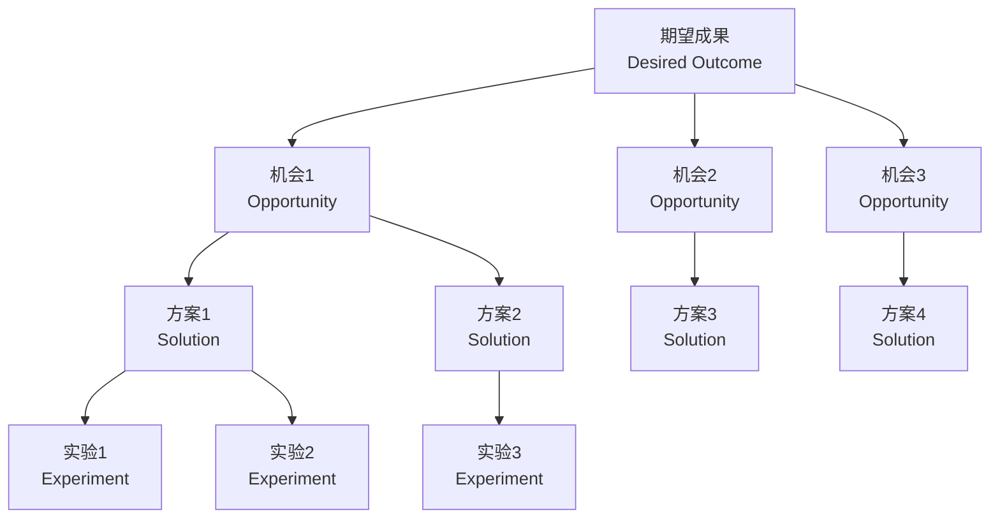
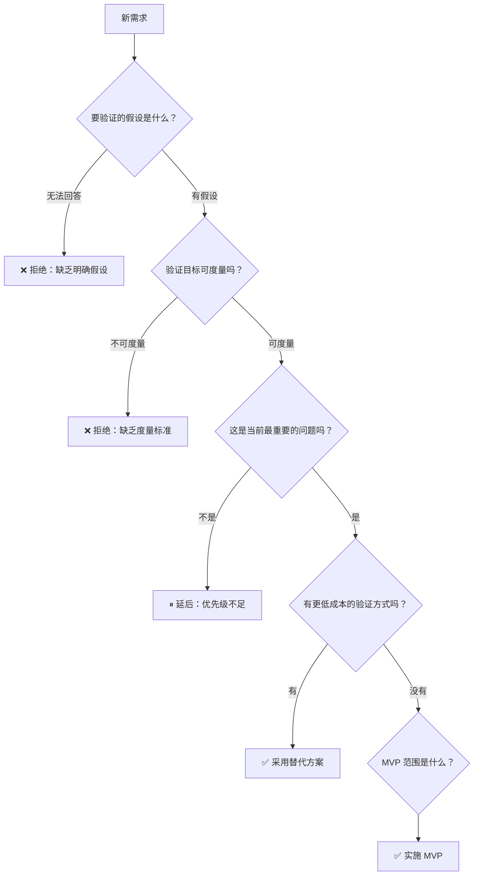
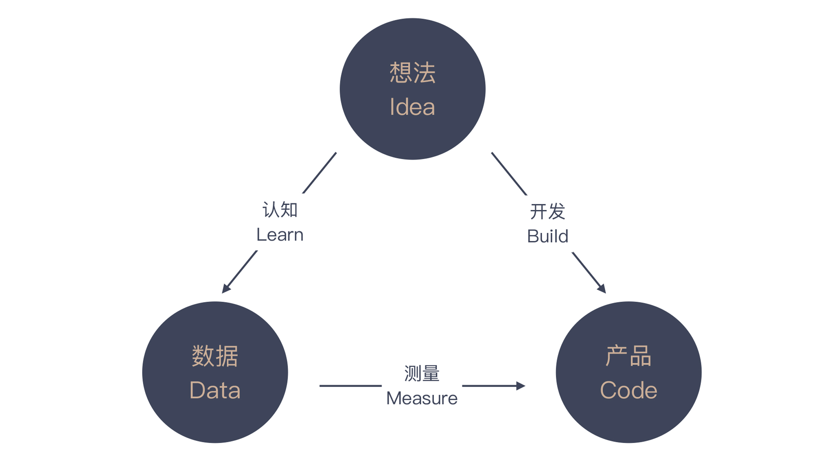
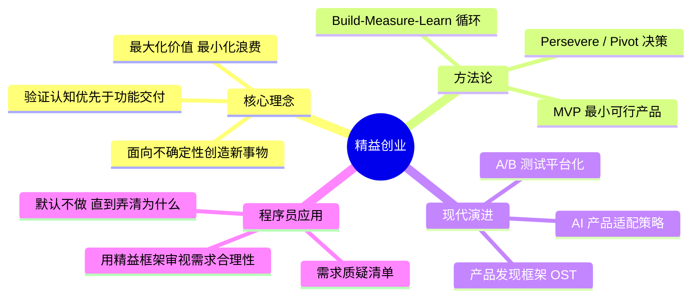

# 精益创业：产品经理不靠谱，你该怎么办

## 核心命题

当软件开发的驱动力从**确定性需求**转向**不确定性需求**时，传统的"需求分析→开发→交付"线性模式失效。面对不确定性，唯一可靠的策略是**低成本试错、快速验证假设**。精益创业（Lean Startup）提供了一套面向不确定性创造新事物的系统方法论，其核心工具——**Build-Measure-Learn 反馈循环**与**MVP（最小可行产品）**——不仅是创业者的武器，更是程序员审视产品需求合理性的思维框架。

---

## 1. 不确定性：现代软件开发的本质特征

### 1.1 需求类型的范式迁移

| 维度 | 确定性需求 | 不确定性需求 |
|------|-----------|-------------|
| 需求来源 | 企业内部明确指定 | 市场假设，待验证 |
| 成功标准 | 功能完整性 | 用户行为验证 |
| 开发策略 | 完整实现 | 最小实验 |
| 失败成本 | 低（需求已确认） | 高（方向可能全错） |
| 典型场景 | 企业 ERP、内部工具 | 消费级应用、创新功能 |

### 1.2 产品经理角色的专业化缺口

原文指出"IT 行业中大多数人的专业程度是不够的"，这一判断在 2024-2026 年依然成立，但有了更精确的行业数据支撑：

- 据 Pragmatic Institute 2024 调研，**仅 34%** 的产品经理接受过系统的产品管理培训
- 产品经理的岗位胜任力模型在行业内尚未形成共识——与软件工程师的"算法+系统设计"面试体系不同，产品经理的能力评估缺乏标准化框架
- 这一缺口导致开发团队必须具备**独立的产品思维**，而非被动接受需求

> **关键认知**：对产品经理提出的需求进行质疑，不是对抗，而是**专业协作**的体现。未经质疑的需求，是对开发资源和用户时间的双重浪费。

---

## 2. 精益创业方法论

### 2.1 理论渊源

精益创业的理论根基来自两个源头：

| 源头 | 核心理念 | 对精益创业的贡献 |
|------|---------|----------------|
| **精益生产（Lean Manufacturing）** | 丰田生产方式（TPS），大野耐一 & 新乡重夫 | 价值与浪费的辩证关系——最大化价值创造，最小化资源浪费 |
| **科学方法论（Scientific Method）** | 假设→实验→观察→结论 | 将产品开发视为实验过程，而非工程实施 |

### 2.2 Build-Measure-Learn 反馈循环

**循环的关键约束**：

1. **循环速度**：完成一个 BML 循环的时间越短，单位时间内获得的验证认知越多
2. **测量质量**：数据必须反映真实用户行为，而非团队主观判断
3. **认知优先**：循环的产出不是代码，而是**经过验证的认知（Validated Learning）**

### 2.3 MVP 的精确理解

MVP（Minimum Viable Product）是精益创业中被误解最深的概念。其精确定义为：

> **MVP 是能够启动 Build-Measure-Learn 循环的、成本最低的产品形态。它不是"功能不完整的版本"，而是"恰好足以验证核心假设的实验装置"。**

**MVP 的类型学**（根据验证目标选择）：

| MVP 类型 | 适用场景 | 实现方式 | 验证目标 |
|----------|---------|---------|---------|
| **Smoke Test（烟雾测试）** | 验证需求是否存在 | 落地页 + 邮件收集 | 用户是否愿意留下联系方式 |
| **Concierge MVP（礼宾式）** | 验证服务流程 | 人工模拟服务 | 用户是否愿意为服务付费 |
| **Wizard of Oz（绿野仙踪）** | 验证自动化价值 | 前端自动化 + 后端人工 | 用户是否接受产品形态 |
| **Piecemeal MVP（拼凑式）** | 验证核心功能 | 组合现有工具/服务 | 核心功能是否解决痛点 |
| **Single-Feature MVP** | 验证单一价值主张 | 仅实现核心功能 | 用户是否因单一功能留存 |

---

## 3. 精益创业的现代演进（2024-2026）

### 3.1 从精益创业到产品发现

精益创业的 BML 循环在产品管理领域已演进为更系统化的**产品发现（Product Discovery）** 框架，以 Teresa Torres 的 **Opportunity Solution Tree（OST）** 为代表：

OST 的核心改进在于：

- **结构化假设**：将模糊的"想法"拆解为"成果→机会→方案→实验"四层结构
- **并行实验**：同一机会下可同时测试多个方案，而非串行试错
- **可追溯决策**：每个决策节点都有对应的实验数据支撑

### 3.2 数据驱动的实验基础设施

现代产品实验已从"上线看效果"进化为**A/B 测试平台化**：

| 平台 | 核心能力 | 适用规模 |
|------|---------|---------|
| **LaunchDarkly** | Feature Flag + 实验 + 渐进式发布 | 中大型团队 |
| **Optimizely** | A/B 测试 + 多变量测试 + 统计引擎 | 产品驱动型团队 |
| **Amplitude Experiment** | 行为分析 + 实验 + 归因 | 数据驱动型团队 |
| **Statsig** | 门控功能 + 实验 + 统计显著性 | 初创至中型团队 |

### 3.3 精益创业与 AI 产品的适配

2024-2025 年 AI 产品爆发后，精益创业面临新的适配挑战：

| 传统精益创业 | AI 产品适配 |
|-------------|-----------|
| MVP 成本低（代码即可） | AI MVP 成本高（模型训练/推理） |
| 用户反馈即时 | 模型效果评估需统计显著性 |
| 功能可用性可直观判断 | AI 输出质量需专业评估 |
| 迭代周期：天-周 | 迭代周期：数据收集-标注-训练-评估 |

**AI 产品的精益验证策略**：

1. **Wizard of Oz MVP**：用人工模拟 AI 能力，验证用户是否愿意为该能力付费
2. **Shadow Mode**：AI 模型在后台运行但不影响用户决策，收集预测 vs 实际数据
3. **Graduated Deployment**：从 1% 流量开始，逐步扩大 AI 决策范围

---

## 4. 程序员的产品思维工具箱

### 4.1 需求质疑清单

当产品经理提出新需求时，程序员应系统性地提出以下问题：

### 4.2 需求决策矩阵

| 问题 | 判断标准 | 行动 |
|------|---------|------|
| 假设是否明确？ | 能用一句话描述"如果 X，则 Y" | 不明确 → 要求产品经理澄清 |
| 是否可度量？ | 存在可量化的成功指标 | 不可度量 → 共同定义指标 |
| 优先级是否最高？ | 与 OKR/北极星指标对齐 | 非最高 → 排入 Backlog |
| 是否有替代方案？ | 非开发手段能否验证 | 有替代 → 先用替代方案 |
| MVP 范围是否最小？ | 仅包含验证假设所需功能 | 范围过大 → 精简至最小 |

---

## 5. 面向不确定性的工作方式（郑晔）

### 5.1 一个典型的评审案例

郑晔讲述了一次产品设计评审的经历：一个大会议室里，产品团队和技术团队的很多人参与评审，一位产品经理对着设计稿讲解一个新的产品特性——公司准备将自己的服务变成云服务，允许第三方厂商申请，讲解内容是第三方厂商自行申报开通服务的流程。郑晔当场举手问了几个问题：

> 郑：这个服务会有多少人用？
>
> 产品经理：这是给第三方厂商的人用的。
>
> 郑：我问的是，这个服务会有多少人用。
>
> 产品经理：每个第三方厂商的申请人都会用。
>
> 郑：好，那你有预期会有多少第三方厂商申请呢？
>
> 产品经理：呃，这个……我们没仔细想过。
>
> 郑：那现在给第三方厂商开通服务的具体流程是什么。
>
> 产品经理：第三方厂商申请，然后，我们这边开通。
>
> 郑：好，这个过程中，现在的难点在哪里？这个审批过程能让我们的工作简化下来吗？
>
> 产品经理：……
>
> 郑：那我来告诉你，现在开通第三方厂商服务，最困难的部分是后续开通的部分，有需要配置服务信息的，有需要配置网络信息的。目前，这个部分还没有很好的自动化，前面审批的部分能够自动化，对整个环节优化的影响微乎其微。

问题问完，开发团队的人似乎明白了什么，纷纷表示赞同。郑晔的点评为：这个审批流程本身的产品设计并不是问题，但时间和资源是有限的，关键在于要不要在这个时间节点做这个事——准确地说，这是优先级的问题。能很好地回绝不恰当的需求，是因为问了一些好问题；而更重要的是，为什么能问出这些问题。

### 5.2 产品经理是一个"新"职业

郑晔认为，在与产品经理协作之前，必须认清一个现状：**IT 行业中大多数人的专业程度是不够的**。

- IT 行业是一个快速发展的行业，机会多、薪资水平相对高，驱使大量的人涌入；也因为快速发展，很多职位都是新近涌现的——比如 2010 年之前很少有专职的前端工程师，之前的工程师往往前后端通吃。
- 产品经理便是随着创业浪潮才风起云涌的职位。既然是个"新"职位，往往没有行业标准可言。于是出现了行业乱象：很多人想进入 IT 行业，一看程序员需要会写代码、门槛高，就从产品经理开始——这些人对产品经理岗位职责的理解是"告诉程序员做什么"。郑晔将此比作郭德纲口中外行人对相声的认识：以为会说话就能说相声，殊不知这是个门槛极高的行业；产品经理也一样，没有良好的逻辑性，不可能有好的发展。
- 如果遇到的产品经理能给出一个自洽的逻辑，就算遇到还不错的产品经理。多说一句，这个行业里专业度不够的程序员也有很多，人数比产品经理还多——道理很简单，程序员的数量本来就比产品经理多。
- 这么说并不是为了贬低哪个职位，而是说明：**必须有独立思考，多问几个为什么，尽可能减少掉到"坑"里之后再求救的次数。**

### 5.3 从确定性到不确定性：行业脉络

怎么与产品经理交流？答案还是"以终为始"：做产品需要倒着思考——这个产品会给谁用，在什么场景下怎么用。

郑晔梳理了这条线索的历史脉络：

- IT 行业诞生之初，这个问题并不是显学，因为最初的 IT 行业多是为企业服务的。企业开发的特点是有人有特定的需求，开发团队只要把需求分析清楚就可以动手做，这个阶段的关键角色是业务分析师；即便开发出来的软件并不那么好用，企业强行推动，最终用户也就用了。
- 后来，面向个人的应用开始出现。PC 时代和早期互联网时代，软件开发还基本围绕专业用户的需求，大部分软件只要能解决问题，用户还是会想办法用起来。
- 随着互联网深入人心，软件开始向各个领域蔓延，越来越多的人进入 IT 行业，在不同方向上尝试。**软件开发的主流由面向确定性问题，逐渐变成了面向不确定性问题。**
- IT 行业的规律是：一旦一个问题变成通用问题，就有人尝试总结各种最佳实践；最佳实践积累多了，就会形成一套新的方法论——敏捷开发的方法论就是如此诞生的，这次也不例外。

### 5.4 精益创业方法论精要

最早成型的、面向不确定性创造新事物的方法论就是精益创业（Lean Startup），由 Eric Ries 最早总结出来：他在很多场合分享理念、不断提炼，最终在 2011 年写成同名著作《精益创业》。

- **名字里有"创业"，但它不是指导人们创业挣大钱的方法论**——它要解决的是面向不确定性创造新事物。只不过，创业领域是不确定性最强而又需要创造新事物的领域；只要是面向不确定性解决问题，精益创业都是值得借鉴的方法论，比如打造一个新的产品。
- **"精益"（Lean）来自精益生产**，这是由丰田公司的大野耐一和新乡重夫发展出来的一套理论。这个理论让人们开始理解价值创造与浪费之间的关系：创造价值人人能理解，减少浪费却是很多人忽略的。把这几个理念结合起来，精益创业就是在尽可能少浪费的前提下，面向不确定性创造新事物。
- **既然是不确定的，唯一能做的事情就是"试"**。试就要有试的方法：精益创业提出"开发（build）—测量（measure）—认知（learn）"的反馈循环——有了新想法（idea），把想法开发成产品（code）投入市场，收集数据（data）获取反馈，看看前面的想法是否靠谱。结果无非两种：好想法继续加强，不靠谱的想法丢掉；不管哪种结果，都会产生新想法进入下一个循环。在反馈循环中，获得的认知是最重要的，因为它是经过验证的——这就是精益创业的重要概念：**经过验证的认知（Validated Learning）**。

- 既然不确定想法的有效性，最好的办法就是**以最低的成本试**：达成同样一个目标，尽可能少做事。精益创业由此提出**最小可行产品（MVP，Minimum Viable Product）**——少花钱，多办事。
- 许多软件团队都会陷入一个非常典型的误区：不管什么需求都想做出来看看。殊不知，**把软件完整地做出来是最大的浪费**。

### 5.5 程序员为什么要掌握精益创业

精益创业提供给程序员的是一个做产品的思考框架，工作中能接触到的大多数产品都可以放在这个框架内思考。有了框架，当产品经理要做一个新产品或产品的新特性时，就可以用精益创业的概念检验产品经理是否想清楚了：

1. 要做这个产品特性，要验证的东西是什么？
2. 要验证的目标是否有数据可以度量？
3. 要解决的这个问题是不是当前最重要的事情，是否还有其他更重要的问题？
4. 如果上面的问题都得到肯定答复，那么验证这个目标是否有更简单的解决方案——是不是一定要通过开发一个产品特性来实现？

回到 5.1 的评审案例：郑晔对产品经理提的问题，其实就是在确定这件事要不要做。事实上，团队当时是用一个表单工具在收集用户信息——也就是说，这件事有一个可用的替代方案。鉴于当时还有很多其他需求要完成，他建议把这个需求延后考虑。

### 5.6 小结

- 程序员与产品经理的关系是 IT 行业的经典话题：许多程序员倾向于不问为什么就接受产品经理的需求，然后暗自憋气。
- 产品经理是一个新兴职业——从前的 IT 行业更多面向确定性问题，需要的是分析；只有当面向不确定性工作时，产品经理才成为行业普遍存在的职业，因此当下它并不是一个有很好行业标准的职位。
- 比较早成型的、面向不确定性创造新事物的方法论是精益创业，它提出了"开发—测量—认知"反馈循环和最小可行产品（MVP）的概念。
- 当产品经理提出新的产品特性时，可以借精益创业的框架提出关键问题，确认该需求确实经过严格思考。
- 郑晔的核心结论：**默认所有需求都不做，直到弄清楚为什么要做这件事。**

---

## 6. 总结

**核心要义**：默认所有需求都不做，直到弄清楚为什么要做这件事。精益创业不是创业者的专属方法论，而是所有面对不确定性工作的人的思维工具。程序员掌握这一框架，便拥有了与产品经理进行**专业对话**的能力——不是对抗，而是共同追求"做正确的事"。

---

> **延伸阅读**
>
> - Eric Ries, *The Lean Startup* (2011): 精益创业奠基之作
> - Teresa Torres, *Continuous Discovery Habits* (2021): 产品发现框架，OST 方法论
> - Melissa Perri, *Escaping the Build Trap* (2018): 如何避免"只管构建不管验证"的陷阱
> - Lean Startup Co. 官方资源: https://leanstartup.co/

---

> **原文出处**：本文第 5 节的方法论与案例整理自郑晔原文《06 | 精益创业：产品经理不靠谱，你该怎么办？》，观点与案例细节均已署名保留。
