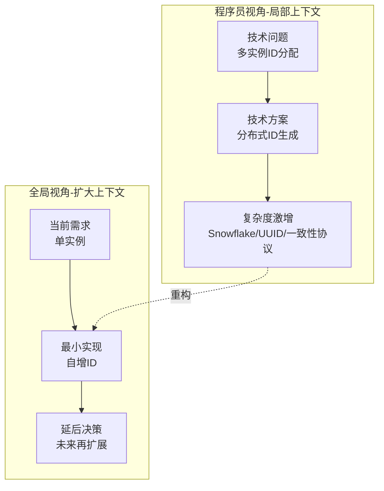
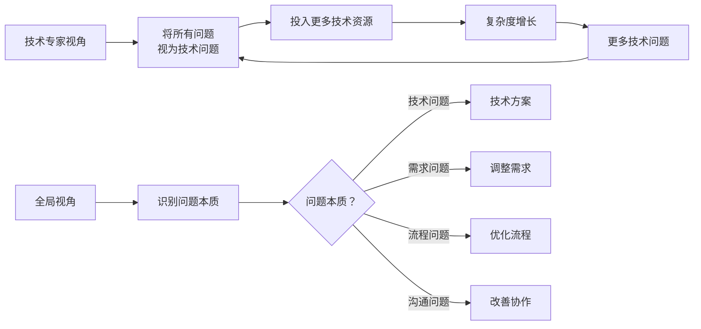
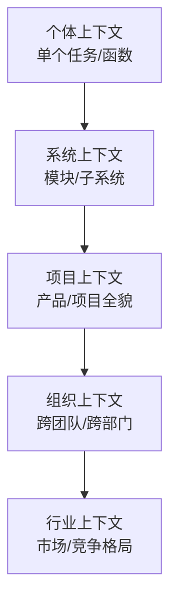
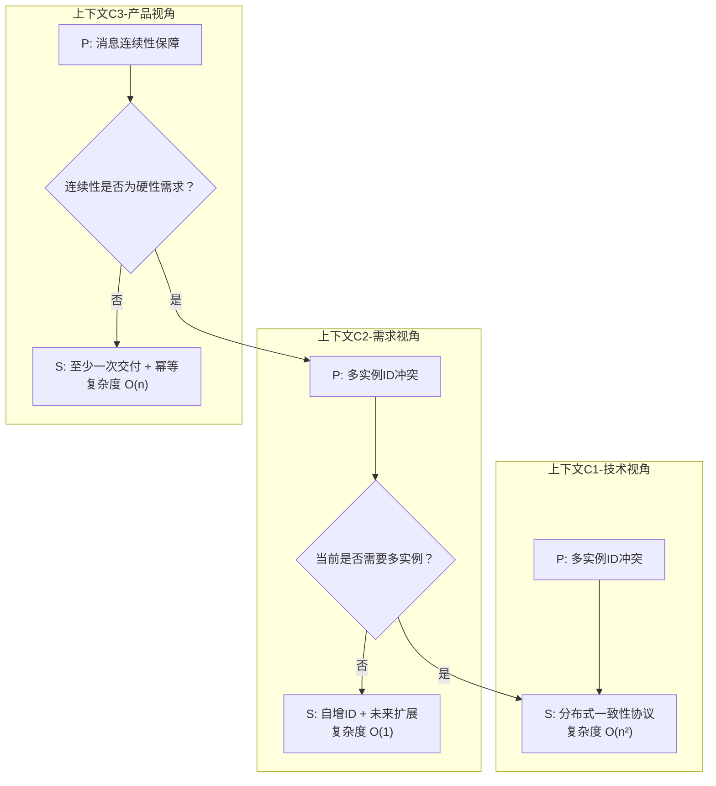
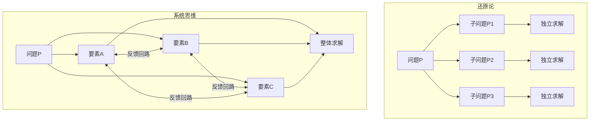
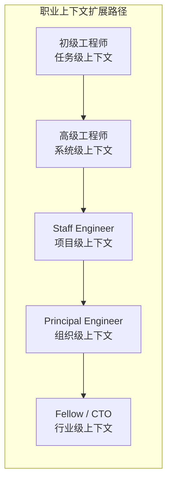
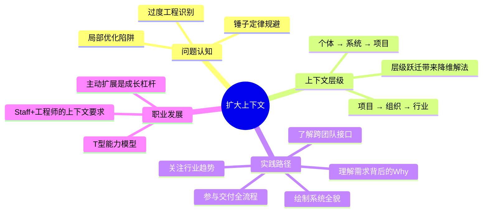

# 解决了很多技术问题，为什么你依然在"坑"里

## 核心命题

技术能力是程序员的立身之本，但**仅凭技术视角解决问题，往往陷入局部优化（Local Optimization）**。不同角色的工作差异本质上不是能力差异，而是**上下文（Context）的差异**。扩大工作上下文，从单点思维跃迁到系统思维，是提升工作效能与职业发展的关键杠杆。

---

## 1. 局部优化的陷阱

### 1.1 问题重构：从"解决技术问题"到"质疑问题本身"

原文案例中，团队成员纠结于"多实例间 ID 分配"这一技术方案，而实际上当前需求仅涉及单实例场景。这类问题的本质是**过度工程（Over-Engineering）**——为尚未出现的需求投入过早的复杂性。

**过度工程的特征识别**：

| 信号 | 含义 | 应对策略 |
|------|------|---------|
| "如果将来需要..." | 基于假设而非需求设计 | YAGNI 原则（You Aren't Gonna Need It） |
| "这个方案更优雅..." | 技术审美驱动而非价值驱动 | 回归需求验证 |
| "这样更灵活..." | 为未知场景预留扩展点 | 预留接口，但不实现 |
| "业界标准做法是..." | 盲目对标大厂方案 | 评估方案成本与当前需求的匹配度 |

### 1.2 锤子定律在软件工程中的表现

> "手里有了锤子，眼里都是钉子。" —— Abraham Maslow

软件工程中的"锤子定律"具体表现为：

---

## 2. 上下文差异：角色认知的结构性分析

### 2.1 上下文层级模型

不同角色的工作上下文构成一个嵌套层级结构：

| 上下文层级 | 典型关注点 | 思考模式 | 时间尺度 |
|-----------|-----------|---------|---------|
| **个体** | 代码实现、Bug 修复 | How（怎么做） | 小时-天 |
| **系统** | 架构设计、模块交互 | How + What（做什么） | 天-周 |
| **项目** | 需求优先级、交付节奏 | What + Why（为什么做） | 周-月 |
| **组织** | 跨团队协作、资源分配 | Why + When（何时做） | 月-季度 |
| **行业** | 市场趋势、竞争壁垒 | Strategic（战略方向） | 季度-年 |

### 2.2 上下文跃迁的收益

原文指出："许多在低一级难以解决的问题，放到更大的上下文里，根本就不是问题。" 这一观察可形式化为：

> **上下文跃迁定律**：当问题 P 在上下文 C₁ 中难以求解时，将上下文扩展至 C₂（C₁ ⊂ C₂），P 可能不再需要求解，或存在降维解法。

---

## 3. 扩大上下文的实践路径

### 3.1 主动扩展策略

| 维度 | 实践方法 | 具体行动 |
|------|---------|---------|
| **需求上下文** | 理解需求背后的业务目标 | 参与需求评审、与产品经理对齐 Why |
| **系统上下文** | 理解系统全貌而非局部 | 绘制系统架构图、阅读跨模块代码 |
| **组织上下文** | 理解跨团队协作接口 | 了解上下游团队的交付物与约束 |
| **流程上下文** | 理解软件交付全流程 | 参与 DevOps 流水线建设、发布流程 |
| **行业上下文** | 理解技术趋势与业务竞争 | 关注行业报告、竞品分析 |

### 3.2 系统思维 vs 还原论思维

| 思维模式 | 特征 | 局限 | 适用场景 |
|---------|------|------|---------|
| **还原论（Reductionism）** | 将问题拆解为子问题逐一解决 | 可能忽略子问题间的交互效应 | 明确边界的独立问题 |
| **系统思维（Systems Thinking）** | 关注要素间的关系与反馈回路 | 需要更大的认知负荷 | 复杂、动态、多因素问题 |

### 3.3 职业发展与上下文扩展

原文通过个人经历说明了上下文扩展对职业发展的价值。这一观察与现代职业发展理论一致：

**T型人才模型**的深化理解：

- **纵向深度（|）**：专业技术能力，是立足之本
- **横向广度（-）**：跨领域上下文，是发展之翼
- **关键洞察**：横向广度不是"什么都会一点"，而是**理解各领域的核心逻辑与接口**

> Will Larson 在 *Staff Engineer* (2021) 中指出：Staff+ 工程师的核心差异化能力不是技术深度，而是**在更大上下文中定义和解决技术问题的能力**。

---

## 4. 总结

**核心要义**：扩大自己工作的上下文，别把自己局限在一个"程序员"的角色上。单点再努力也只是局部优化，真正的突破来自上下文的跃迁——在更大的格局中，许多曾经令人纠结的问题根本不需要被解决。

---

> **延伸阅读**
>
> - Donella Meadows, *Thinking in Systems: A Primer* (2008): 系统思维经典
> - Will Larson, *Staff Engineer: Leadership beyond the management track* (2021): Staff+ 工程师的上下文要求
> - Martin Fowler, "TradeOffHypothesis": 技术决策中的权衡思维
> - YAGNI Principle: https://martinfowler.com/bliki/Yagni.html

---

## 原文存档

> 以下内容整理自郑晔原文，已改写为书面表述，保留全部论述与案例作为参考。

### 解决了很多技术问题，为什么依然在“坑”里？

此前的篇章讨论过几个体现“以终为始”原则的实践，包括界定工作是否完成的 DoD、判定需求是否完成的验收标准，以及验证产品经理给出的产品特性是否合理的精益创业理念。

了解这些内容之后，程序员心中难免产生疑问：作为安安静静写程序的人，为什么要关心其他人的工作做得好坏？如果管了那么多事，还算不算一个程序员，“终”又在哪里？

这正是许多人困惑的问题。只有跳出程序员的角色看问题，工作才会变得更加高效。

### “独善其身”不是好事

在需要与人协作的今天，独善其身并不一定是好的做法。郑晔讲述了一个发生在他身边的案例。

他的团队曾开发一个数据服务层，准备作为一个基础设施提供给核心业务系统。开发没多久，一名团队成员反馈工作进展不顺利，卡在了一个重要问题上：想不明白该如何在多个实例之间分配 ID。

郑晔听后有些疑惑：为什么要考虑这个与功能无关的问题？该成员解释说，因为系统需要保证消息的连续性，所以设计了消息 ID，下游系统可以通过消息 ID 识别出是否有消息丢失。这一点没有错，但郑晔奇怪的是，他为什么要在多个实例之间协调。该成员给出的理由是，这么做是出于对将来多实例并发场景的考虑。然而事实是，当下的需求应对的是单实例的情况。

了解情况之后，郑晔马上向他说明这一点，让他先把第一步做出来。该成员仍有些担心未来如何扩展，郑晔给出的答复是：别纠结，先把第一步做出来，等后面真的有需求再考虑。同事欣然答应了。

其实，这位同事的技术能力非常强，如果没有被拦下来，他或许真能实现出一个完美的技术方案，但正如他自己所纠结的那样，这个方案可能要花掉很长时间。而以现阶段的目标来看，根本没有这样的需求。

团队一直在强调“以终为始”。所谓“终”，就是做事的目标。虽然大家工作在一起，朝着一个共同的大目标前进，但真的到了一个具体的问题上，每个人看到的目标却不尽相同。

郑晔之所以能把同事从纠结的状态中拉出来，是因为他看到的是需求，而同事看到的是一个要解决的技术问题——双方在对目标的理解上存在根本差异。

有人也许会认为，这种差异源于角色差异：郑晔在项目里承担的角色更重，工作时间也比同事更长。但不同角色的差异到底在哪里，值得进一步追问。

### 角色的差异

作为职场中的一员，每个人都有一颗渴望得到认可的心，希望在职业阶梯上步步高升。假如让一个人往上走一个台阶——比如，原来在项目里打杂，现在成为项目主力；或者已经对项目细节驾轻就熟，即将被委任为项目负责人。他能否胜任？

需要补充的东西是什么？换句话说，与职业台阶中的上一级相比，差异到底是什么？

也许答案是“他来的时间长”，或者“他每天的主要工作就是开会”。如果真是这样，那是不是凑足这些条件就可以到达他的位置？显然不是。

**不同角色工作上真正的差异是上下文的不同。**

这是什么意思呢？以前面的案例为例：在项目里打杂的人只能关注到一个具体的任务，而项目主力心目中是整个系统。**虽然写的代码都一样，但前者看到的是树木，后者看到的是森林，后者更能从全局思考。**

同样，项目负责人的工作除了项目组内的协调，还有一部分是跨项目组的，他需要考虑本项目组与其他组的互动，所以其工作上下文在各组之间，包括技术和产品等方面。

再上升一个层面，部门负责人要协调内部各个组，同时考虑部门之间的协调。而公司负责人考虑的上下文甚至要跳脱公司内部，进入到行业层面。

明白了不同角色的上下文有差异之后，进一步的问题是：这种差异对实际工作意味着什么？

从工作角度看，回到前面分享的案例可以注意到：**问题并不是靠技术能力解决的，而是凭借对需求的理解被绕过去了。**

之所以能这样做，原因在于郑晔当时是在一个更大的上下文里工作。类似的情况在他的职业生涯中发生过无数次：许多令程序员愁眉不展的问题，换个角度可能都不是问题。

技术是一把利刃，程序员相信技术可以改变世界，但并不是所有问题都要用技术解决。正所谓“手里有了锤子，眼里都是钉子”，花大力气去解决一个可能并不是问题的问题，常常是很多程序员的盲区。

之所以称之为盲区，是因为很多人根本看不见它，而看不见的原因就在于上下文的缺失——只在程序员的维度看问题。

多问几个为什么，交流一下是不是可以换个做法，许多困惑可能就烟消云散了。**而能想到问这样的问题，前提是跳出程序员角色思维，扩大自己工作的上下文。**

虽然不是项目主力，也不妨碍更深入地了解系统全貌；虽然不是项目负责人，也可以去了解系统与其他组的接口；虽然不是项目经理，可以去了解项目经理是怎样管理项目的；虽然不是产品经理，了解一个产品的设计方法同样有帮助。

**对软件开发的全生命周期都有了认识之后，看到的就不再是一个点，而是一条线。** 与别人讨论问题时就会有更多底气，与那些只在一个点上思考的人相比，就拥有了降维攻击的能力。

这也解释了为什么有些工作总能让老板挑出毛病：工作的上下文不同，看到的维度差异很大。单一维度的思考，在多维度思考者的眼里几乎就是漏洞百出的。

当扩大了自己工作的上下文时，目标就不再局限于一个单点，而是会站在更高的维度去思考：解决问题还有没有更简单的方案。许多在低一级难以解决的问题，放到更大的上下文里，根本就不是问题。

郑晔的职业生涯中经常遇到这样的情况：在一个特定的产品设计下，总觉得设计的技术方案有些不优雅的地方，而只要产品设计微调一下，技术方案一下子就会得到大幅度提升。在这种情况下，他会先去问产品经理是否可以这样调整。只要不是至关重要的地方，产品经理通常会答应。

### 在更大的上下文工作

扩展自己工作的上下文，目光不再局限于自己的一亩三分地，还可以为职业发展做好布局。在这个方面，郑晔分享过一个不太成功的案例，即他自己的故事。

他自认属于愚钝型的程序员，工作最初的几年一直把自己限定在程序员的上下文里，最喜欢的事就是安安静静地写代码，把一个系统运作机理弄清楚会让他兴奋很长一段时间。

转变始于一次机缘巧合。当时有一个咨询项目，负责这个项目的同事家里有些事，需要一个人来顶班，公司就派他去了。

到了咨询项目中，他习惯的节奏完全乱掉了，因为那不是让代码正常运作就可以解决的问题，更重要的是与人打交道。

有很长一段时间，他处于很煎熬的状态，所幸客户没有把他从这个项目中赶出来，让他有了“浴火重生”的机会。

为了摆脱这种煎熬的状态，他必须从代码中走出来，尽量扩大自己思考的边界。经过一段时间的调整，他发现与人打交道也没那么难，也能更好地理解一个项目运作的逻辑——项目运作本质上就是不同人之间的协作。

突破了只愿意思考技术的限制，世界一下子宽阔了许多。后来他才有机会更多地走到客户现场，看到更多公司的项目运作。虽然他工作过的公司数量并不多，但却见过很多公司是如何工作的。

再后来，他有机会参与一个新的分公司建设工作，这让他有了从公司层面进行思考的角度，对员工招聘和培养形成了自己一套独立的思考。

这些思考在他创业的过程中帮助他建立了一支很不错的团队。而创业的过程中，他又有了更多机会面对其他公司的商务人员，从而建立起一个更大的上下文，把思考从公司内部向外拓展了一些。

回过头来看自己的生涯时，他发现，因为不愿意拓展自己的上下文，自己其实错过了很多职业发展的机会。所幸还有机会突破自己，让自己走出来——虽然走的速度不如理想中快，但至少一直在前进，而不是原地打转。这也是他反复强调一定要不断扩大工作上下文的原因。

机会总是垂青那些有准备的人，尤其在公司规模不大的时候，总有一些跳跃式的发展机会。

他见过有人几年之内从程序员做到公司中国区负责人，只是因为起初公司规模不大，而这个人特别热心公司的很多事情，跳出了固定角色的思维。所以，当公司不断发展、需要有人站出来的时候，虽然没有人是完全合格的，但正是这种热心让他有了更多的维度，才有机会站到了前排。

当然，随着公司规模越来越大，这种幅度极大的跳跃是不大可能的。业界流传着一个华为的故事：一个新员工给任正非写了封万言书，大谈公司发展，任正非回复：“此人如果有精神病，建议送医院治疗，如果没病，建议辞退。”

因为一旦公司规模大了，个人很难了解更大的上下文，很多关于公司的事情甚至需要从新闻里才知道。

本质上，一个人能在自己的工作范围内多看到两三级都是有可能的。公司规模不大时，从基层到老板没有太多层级，跳跃就显得很明显；而公司一大、层级一多，从低到顶的跳跃就不太可能了，但跨越级别的跳跃仍是可能的。

因此，跳出程序员思维不仅仅是为了工作更高效，也是为了更好的发展机会。

### 总结时刻

程序员总喜欢用技术去解决一切问题，但很多令人寝食难安的问题其实根本不是问题。之所以找不出更简单的解决方案，很多时候原因在于程序员被自己的思考局限住了。

不同角色工作真正的差异在于上下文的差异。在一个局部上下文难以解决的问题，换到另外一个上下文甚至是可以不解决的。所以说无论单点有多努力也只是局部优化，很难达到最优的效果。

想把工作做好，就需要不断扩大自己工作的上下文，多了解一下别人的工作逻辑是什么样的，认识软件开发的全生命周期。

扩大自己的上下文，除了能提高当前的工作效率，对职业生涯也有好处。随着看到的世界越来越宽广，得到的机会也就越来越多。

如果只记住一件事，请记住：**扩大自己工作的上下文，别把自己局限在一个“程序员”的角色上。**