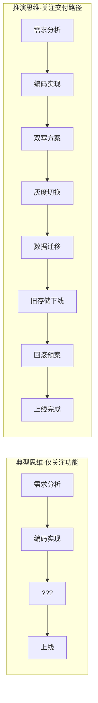
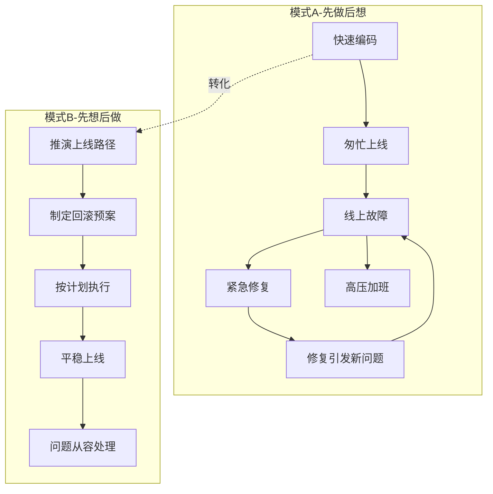
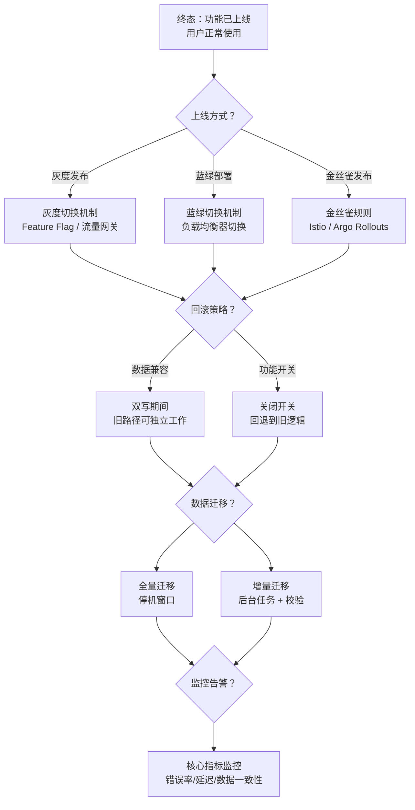
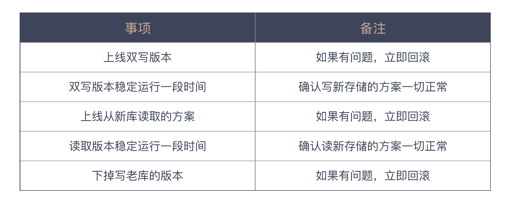
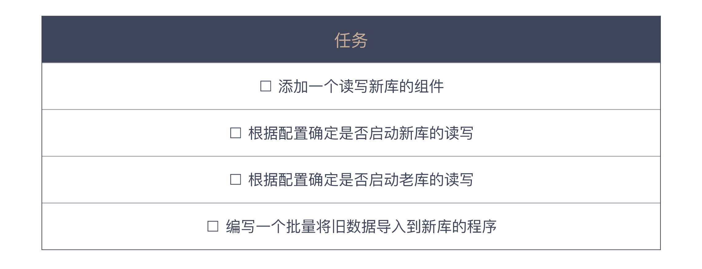
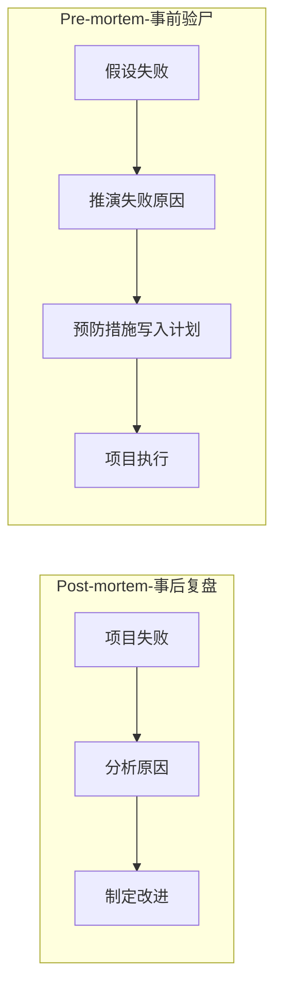
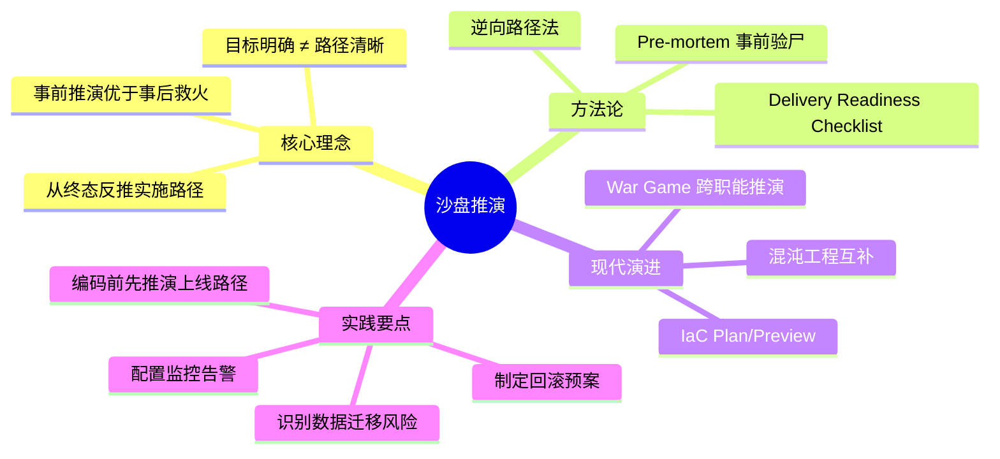

# 为什么说做事之前要先进行推演

## 核心命题

目标明确并不等同于路径清晰。在软件工程中，**仅确定"做什么"而不推演"怎么做"**，是导致"最后一公里"频繁失败的根因。沙盘推演（Tabletop Exercise）——在动手之前完成智力上的创造（First Creation），从终态反推实施路径——是将"手忙脚乱的事后补救"转化为"有条不紊的事前准备"的关键方法。

---

## 1. "最后一公里"问题的本质

### 1.1 功能实现 ≠ 交付完成

郑晔通过一个数据库迁移案例揭示了一个普遍问题：开发者倾向于只考虑**功能实现**（Happy Path），而忽视**交付路径**（Delivery Path）。



**数据库迁移案例的推演清单**：

| 步骤 | 关注点 | 风险 | 缓解措施 |
|------|--------|------|---------|
| ① 读写新库组件 | 新库 API 兼容性 | 查询语义差异 | 对比测试 |
| ② 双写阶段 | 数据一致性 | 写入失败导致不一致 | 异步对账 + 补偿机制 |
| ③ 读切换 | 查询结果正确性 | 新旧数据不一致 | 灰度放量 + 监控告警 |
| ④ 停止旧写 | 旧存储不再更新 | 遗漏写入路径 | 全量代码扫描 |
| ⑤ 历史数据迁移 | 历史数据完整性 | 迁移过程数据丢失 | 校验脚本 + 抽样比对 |
| ⑥ 旧存储下线 | 依赖清理 | 隐式依赖未清理 | 渐进式下线 + 监控 |

### 1.2 两种工作模式的系统动力学



| 维度 | 先做后想（Reactive） | 先想后做（Proactive） |
|------|---------------------|---------------------|
| 压力分布 | 前期轻松，后期高压 | 前期投入，后期从容 |
| 问题发现时机 | 上线后暴露 | 推演时预判 |
| 修复成本 | 高（影响线上用户） | 低（仅影响计划文档） |
| 团队士气 | 挫败感（反复救火） | 成就感（按计划推进） |
| 知识积累 | 零散（故障驱动） | 系统（推演驱动） |

---

## 2. 沙盘推演方法论

### 2.1 定义与渊源

沙盘推演源自军事领域，指在行动前通过模拟对抗来检验战略战术。军队通过沙盘模拟军事双方的对战过程，发现战略战术上存在的问题；这一思想后来也被商界借鉴，用于培训各级管理者。在软件工程中，其核心实践为：

> **假设软件已经就绪，从终态出发，逆向推演上线/推广/运营的完整路径，识别前置依赖与风险点。**

### 2.2 推演框架：逆向路径法



**推演检查清单（Delivery Readiness Checklist）**：

| 类别 | 检查项 | 状态 |
|------|--------|------|
| **部署策略** | 部署方式（灰度/蓝绿/滚动）已确定 | ☐ |
| **回滚方案** | 回滚触发条件与步骤已明确 | ☐ |
| **数据迁移** | 迁移脚本已编写并验证 | ☐ |
| **数据一致性** | 对账机制已就绪 | ☐ |
| **监控告警** | 核心指标已配置、告警阈值已设定 | ☐ |
| **功能开关** | 开关控制粒度与回退行为已确认 | ☐ |
| **依赖就绪** | 下游服务已同步升级 | ☐ |
| **文档更新** | API 文档、运维文档已更新 | ☐ |
| **应急预案** | 各阶段故障的 SOP 已制定 | ☐ |

### 2.3 推演的三种实践形式

| 形式 | 参与者 | 时机 | 适用场景 |
|------|--------|------|---------|
| **个人推演** | 任务负责人 | 编码前 | 小规模变更 |
| **团队 Walkthrough** | 开发 + 测试 + 运维 | 任务分解后 | 中等规模上线 |
| **War Game（作战推演）** | 跨职能团队 | 重大变更前 | 大规模架构迁移 |

---

## 3. 案例复盘：数据库迁移的推演过程

以下案例来自郑晔的实践经验（原文以第二人称叙事，此处转写为客观描述）。

### 3.1 案例背景

一家业务快速发展的公司，原有关系型数据库已无法满足快速变化，负责人指派一名工程师做技术选型，将部分业务迁移到更合适的存储方式上。工程师经过调研提出选用 MongoDB，负责人采纳了建议；随后进一步要求该工程师制定替代计划。

工程师最初的理解非常简单：把现在存到数据库的内容写到 MongoDB，一个表一个表地替换即可——甚至怀疑是否需要把"哪天替换哪个表"列出来。负责人的反应则是连续追问，从上线方式一路问到数据迁移，最终把一个看似简单的任务变成了一个长长的开发任务列表。

### 3.2 负责人的连环追问与对应方案

| 追问 | 暴露的问题 | 工程师给出的对策 |
|------|-----------|----------------|
| "你能确定新版代码一定是对的吗？" | 新代码存在出错可能，需要回滚手段 | 常规做法是回滚到上一个版本 |
| "数据已经写到了不同的存储里面，查询会受到影响，对不对？" | 直接切换后查询语义改变，出错即无法回滚 | 采用双写方案：新代码出问题时旧存储仍正常，保留回滚机会 |
| "原有的数据怎么办？" | 涉及原有数据的查询结果一定是错的 | 增加历史数据迁移任务 |

每一轮追问都暴露出一个被忽略的交付环节：最初只想写一个读写新库的组件，推演之后衍生出双写、灰度切换、历史数据迁移、旧存储下线、回滚预案等一系列任务。

**推演产出的上线方案**：



**由推演衍生的开发任务列表**：



### 3.3 两家公司的经验对照

工程师后来把两家公司的做法做了对比：

- **前一家公司**：负责人同样放手让成员独立承担任务，但不要求事前分解与推演。结果上线时常出现各种问题，团队手忙脚乱地处理异常，曾顶着巨大压力通宵救火——解决完问题离开公司时，天空已泛起鱼肚白。
- **现任公司**：负责人要求成员先提交任务分解结果，并对组内每个人的开发列表提出大量问题，多数情况下问到哑口无言。被追问的过程并不舒服，但加入这家公司后，做事明显更从容了。
- **对比结论**：负责人问的问题几乎都与上线相关——上线出问题怎么办、线上数据怎么处理等；而且无论对谁都问类似的问题，即便一行代码还没写，也会要求假设一切就绪、一步一步推演上线过程。
- **根因分析**：之前的项目之所以手忙脚乱，是因为只考虑了功能实现，从未考虑过上线，而问题基本都出在上线过程中。差别不在于做什么，而在于事前忙还是事后忙——现任公司属于事前忙。

### 3.4 "最后一公里"概念的引入

工程师在社区活动中听到一位资深工程师提出"**最后一公里**"的说法：完成一件事，在最后也是最关键的步骤。这一说法已被应用在许多领域，案例中的负责人正是站在"最后一公里"的角度审视即将发生的事情。掌握这个视角之后，站在"最后一公里"去发现问题，再结合推演能力，给出令人满意的任务列表就容易得多。

### 3.5 方法论提炼：三步问题解决计划

工程师在案例结尾整理出的计划：

1. 先从结果的角度入手，看最终上线要考虑哪些因素；
2. 推演出一个可以一步一步执行的上线方案，用前面考虑到的因素作为衡量指标；
3. 根据推演出来的上线方案，总结要做的任务。

---

## 4. 观点与引申

### 4.1 理想需要路径支撑

- 这个世界不缺有理想的人，大多数人都能看到一个宏大的未来，但真正取得与理想相配成绩的人少之又少，大部分人泯然众生。
- 宏大理想是目标，而走向目标需要一步一个脚印。唐僧的目标是求取真经，依然用了十几年时间才到达大雷音寺；他有一个极大的优势——达成目标的路径是清晰的，从长安出发向着西天一路前行即可。
- **对比日常工作：多数情况下即便目标清晰，路径却是模糊的。** 于是不同的人有不同的处理方式：有人走到哪算哪，有人先推演路径、看看能走到什么程度。

### 4.2 两种路径带来的差异

在软件开发中，两种做法的差异十分直观：一种是前期其乐融融、后期手忙脚乱；一种是前面思前想后、后面四平八稳。郑晔明确推崇后一种做法。这正是"以终为始"主题中"第一次创造/智力上的创造"的落地（参见 [相关论述](https://time.geekbang.org/column/article/74834)）。

### 4.3 推演的三个典型应用场景

- 在做一个产品之前，先推演这个产品如何推广、通过什么途径推广给什么样的人；
- 在做技术改进之前，先考虑上线是怎样的一个过程，为可能出现的问题准备预案；
- 在设计一个产品特性之前，先考虑数据由谁提供、完整的流程是什么样的。

反例：为数不少的产品经理在设计产品时只考虑用户界面如何交互，全然不理会数据从何而来，结果是累死累活做出来的东西完全跑不通，因为没有数据源。

### 4.4 混沌工程等现代演进

沙盘推演的"识别风险"思想在云原生时代演化为**混沌工程**——通过主动注入故障来验证系统的韧性：

| 维度 | 沙盘推演 | 混沌工程 |
|------|---------|---------|
| 风险发现方式 | 脑力推演（假设性） | 实际注入（验证性） |
| 执行时机 | 上线前 | 运行中（受控实验） |
| 覆盖范围 | 逻辑推理可及的风险 | 包括未预期的涌现行为 |
| 工具 | 无（思维工具） | Chaos Monkey、Litmus、Chaos Mesh |

> **Principle**：沙盘推演和混沌工程不是替代关系，而是**互补关系**——推演覆盖"可预知风险"，混沌工程覆盖"涌现风险"。

### 4.5 Pre-mortem（事前验尸）

与传统的 Post-mortem（事后复盘）相反，Pre-mortem 要求团队在项目开始前假设项目已经失败，然后反推失败原因：



**Pre-mortem 实施步骤**：

1. 团队成员独立写下"项目失败的可能原因"（5 分钟）
2. 汇总并去重，按可能性和影响度排序
3. 对 Top 5 风险制定预防措施，纳入项目计划
4. 在项目关键节点复查风险清单

### 4.6 Infrastructure as Code 的推演能力

现代 IaC 工具（Terraform、Pulumi、Crossplane）提供了 `plan` / `preview` 功能，使基础设施变更的推演从"脑力活动"变为"可执行验证"：

```bash
# Terraform Plan：推演基础设施变更
terraform plan -out=plan.tfplan
terraform show -json plan.tfplan  # 查看变更详情

# Pulumi Preview：预览资源变更
pulumi preview --diff

# Argo CD Sync Preview：预览 K8s 资源变更
argocd app diff my-app
```

---

## 5. 总结



**核心要义**：即便已经确定了工作目标，动手之前仍要把实施步骤推演一番，完成一次头脑中的创造，即第一次创造或智力上的创造。在软件开发中，假设软件已经就绪，审视就绪之后要做哪些事情（如何上线、如何推广等），这样的推演会发现前期准备的不足，进一步丰富工作计划。前期推演是不在"最后一公里"摔跟头的必要条件，也是让团队进入有条不紊状态的前提。推演不是"想太多"，而是用最低成本（思维成本）发现最高成本（线上故障）的问题——"最后一公里"的失败，99% 可通过事前推演预防。

**只记一件事**：在动手做一件事之前，先推演一番。

**实践检验**：把当前正在做的事情推演一番，检查哪些环节还可以改进。

---

> **延伸阅读**
>
> - Gary Klein, "Performing a Project Premortem" (HBR 2007): Pre-mortem 方法论
> - Nora Jones & Casey Rosenthal, *Chaos Engineering* (2020): 混沌工程系统化实践
> - Terraform Plan: https://developer.hashicorp.com/terraform/cli/commands/plan
> - Argo Rollouts: https://argoproj.github.io/argo-rollouts/
