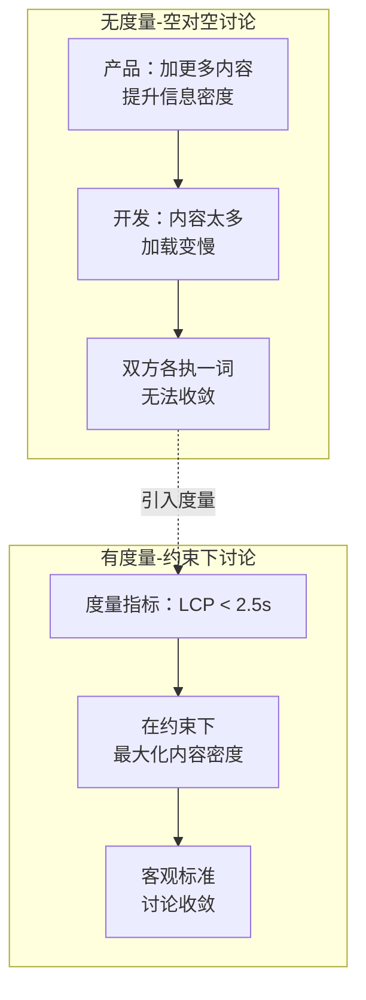
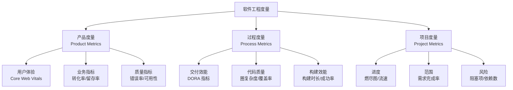
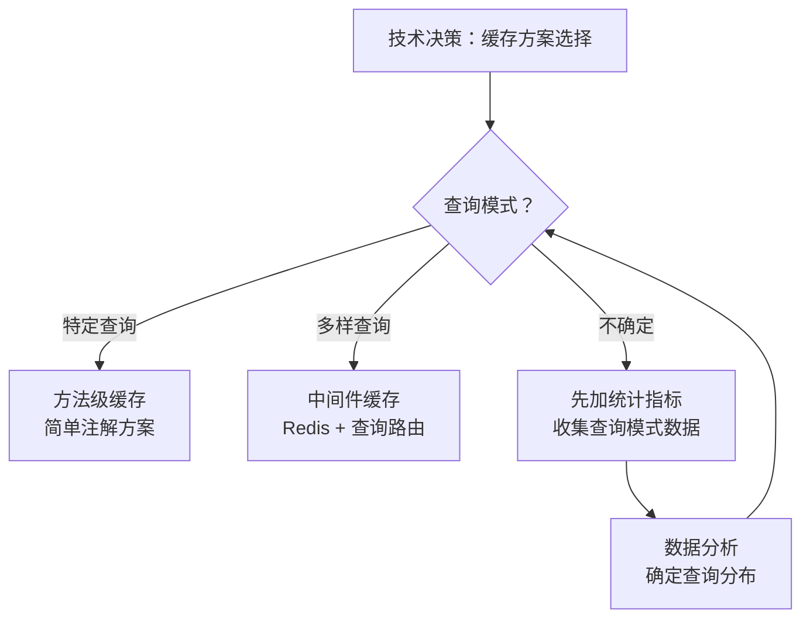
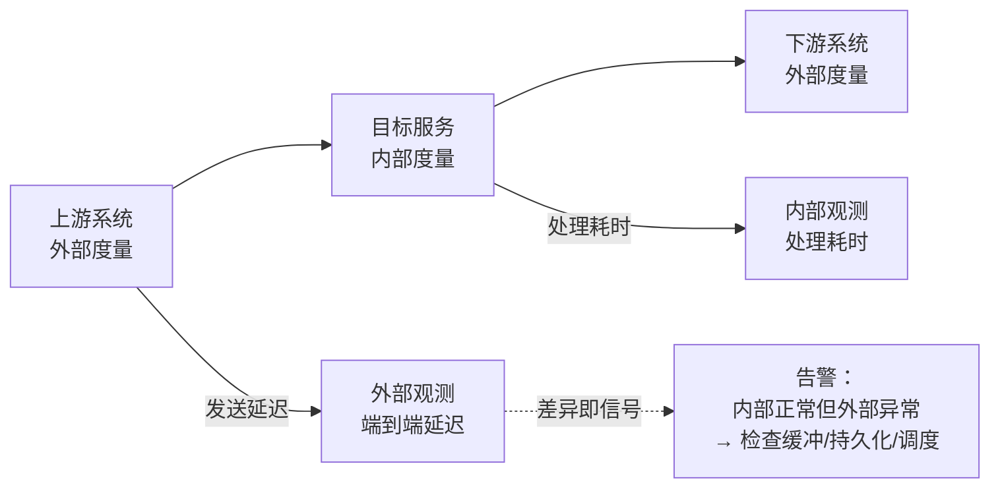
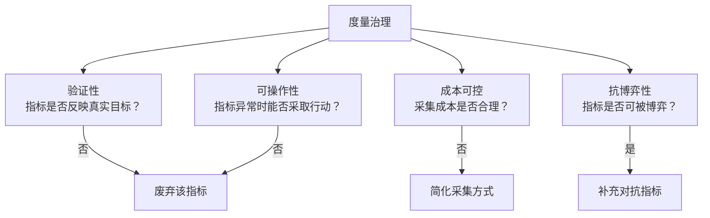
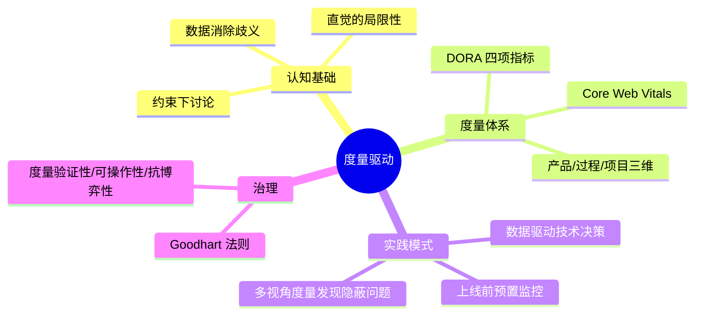

# 你的工作可以用数字衡量吗

## 核心命题

语言定义的"终"天然存在模糊性，而**数字是消除歧义的最有效手段**。在软件工程中，从"靠直觉讨论"到"用数据决策"的转变，是将主观争论转化为客观约束的关键。结合"以终为始"原则，应在着手工作之前**先设计度量指标**，使工作目标可量化、可验证、可追溯。

---

## 1. 度量驱动的认知基础

### 1.1 直觉的局限性与数据思维的必要性

人类认知系统存在两套决策模式：

| 模式 | 特征 | 适用场景 | 局限 |
|------|------|---------|------|
| **System 1（直觉）** | 快速、自动化、低能耗 | 简单、重复性判断 | 复杂场景下系统性偏差 |
| **System 2（分析）** | 缓慢、需主动调用、高能耗 | 复杂、多变量决策 | 认知负荷大，易疲劳 |

> 郑晔指出"所谓直觉，通常是一种洞见（Insight），洞见依赖于长期沉淀积累，本质上是一种内化的'大数据'"。这一观察与 Herbert Simon 的**专家直觉理论**一致——专家的直觉是模式匹配的结果，而非凭空产生。

**但在软件工程中，System 1 的适用边界极窄**：

- 系统行为涉及多变量交互（并发、网络、数据一致性）
- 人的直觉对非线性关系、概率分布、时间序列趋势的判断系统性失准
- "我觉得"式的讨论在信息不对称时无法收敛

### 1.2 从"空对空"到"约束下讨论"

郑晔的主页改版案例揭示了一个通用模式：

**度量指标的核心价值**：将主观争论转化为**约束优化问题**——在给定约束下最大化目标函数。

---

## 2. 软件工程中的度量体系

### 2.1 度量分类框架

### 2.2 DORA 指标：交付效能的黄金标准

DORA（DevOps Research and Assessment）四项指标是衡量软件交付效能的**行业标准**：

| 指标 | 定义 | 低效能 | 高效能 | 精英级 |
|------|------|--------|--------|--------|
| **Deployment Frequency** | 部署到生产的频率 | 低于每周一次 | 每天至少一次 | 按需（每天多次） |
| **Lead Time for Changes** | 提交→部署生产的耗时 | 1 周-1 个月 | 1 天-1 周 | < 1 小时 |
| **Change Failure Rate** | 部署导致故障的比例 | 40%-64% | 10%-15% | 约 5% |
| **MTTR** | 失败部署恢复时间（故障→恢复） | 1 周-1 个月 | < 1 天 | < 1 小时 |

> 注：阈值为 DORA 历年报告的集群分档口径（以 2021 报告四档基准为主），各年度分档数值会随调研样本浮动，使用时应以最新报告为准。

> **2024 DORA 报告关键发现**：精英级团队比例从 2023 年的 7% 提升至 2024 年的 18%，且**持续实施度量的团队在所有四项指标上均显著优于未实施团队**。

### 2.3 Core Web Vitals：用户体验的量化标准

Google 于 2020 年推出 Core Web Vitals，为用户体验提供了标准化度量：

| 指标 | 含义 | 良好阈值 | 度量方式 |
|------|------|---------|---------|
| **LCP（Largest Contentful Paint）** | 最大内容渲染时间 | < 2.5s | Performance Observer |
| **INP（Interaction to Next Paint）** | 交互响应延迟 | < 200ms | Event Timing API |
| **CLS（Cumulative Layout Shift）** | 累积布局偏移 | < 0.1 | Layout Instability API |

> 2024 年 3 月，FID（First Input Delay）被 INP 替代，因 INP 更准确地反映页面全生命周期的交互响应性。

---

## 3. 度量驱动的实践模式

### 3.1 技术决策的数据驱动

郑晔的缓存方案案例的模式化：

**数据驱动决策的通用流程**：

1. **明确决策点**：需要做出什么选择？
2. **识别关键变量**：哪些数据能区分选项？
3. **采集数据**：埋点/日志/监控
4. **分析数据**：统计分布/趋势/异常
5. **基于数据决策**：消除"我觉得"式讨论

### 3.2 上线监控的预置指标

郑晔的系统升级案例体现了**上线前预置监控**的实践：

| 阶段 | 预置指标 | 异常阈值 | 响应动作 |
|------|---------|---------|---------|
| **上线前** | 基线值采集 | - | 建立正常范围 |
| **灰度期** | 错误率、P99 延迟、QPS | 较基线偏移 > 2σ | 暂停灰度 |
| **全量期** | 同上 + 业务指标 | 较基线偏移 > 3σ | 触发回滚 |
| **稳定期** | 趋势监控 | 连续 30min 无回归 | 确认上线成功 |

### 3.3 从数字中发现问题：内部 vs 外部度量差异

郑晔的实践揭示了一个重要模式——**多视角度量**：

> **原则**：永远不要只依赖单一视角的度量。内部度量与外部度量的差异，往往揭示系统中最隐蔽的问题。

---

## 4. 度量的反模式与治理

### 4.1 Goodhart 法则

> **Goodhart's Law**："当一个指标成为目标时，它就不再是一个好指标。" —— Charles Goodhart

软件工程中的典型反模式：

| 反模式 | 表现 | 后果 | 治理 |
|--------|------|------|------|
| **测试覆盖率崇拜** | 追求 100% 覆盖率但测试无断言 | 覆盖率高但质量低 | 覆盖率 + 变异测试（Mutation Testing） |
| **代码行数崇拜** | 以代码量衡量产出 | 鼓励冗余代码 | 改为度量功能交付速率 |
| **Story Point 通胀** | 估算值逐迭代增长 | 速率虚高 | 用 Lead Time 替代 Story Point |
| **告警疲劳** | 告警过多导致忽视 | 真正的告警被忽略 | 告警分级 + 去噪 |

### 4.2 度量治理框架

---

## 5. 用数字思考：郑晔的实践与观点

### 5.1 观点：数字是诠释"终"的最好方式

郑晔在一家提供 24 小时服务的数字资产公司工作。他介绍，从加入公司第一天起就被不断灌输一个重要理念——看数字：座位正前方摆着一个巨大的显示器，展示不断变换的曲线、柱状图和数字，反映各种系统运行指标；团队每天看着这些指标发掘线上系统问题，一旦某些指标出现无法理解的异常，就着手调查。

这一实践与"以终为始"直接相关：靠语言定义的"终"，或多或少存在模糊之处、容易产生误解；而数字是一个明明白白的"终"。例如测试覆盖率要求 100%，即便做到 99.9%，不达标就是不达标，没有争辩空间。

精益创业的反馈循环"开发（build）-测量（measure）-认知（learn）"中，开发是可控的，认知必须得到反馈之后才能有，因此最需要回答的环节是测量（measure）——而测量的最好检验标准就是数字。

### 5.2 论据：人类为什么熟悉又陌生地对待数字

- **数感的进化局限**。数字是人类在进化历程中较晚创造的东西。科普著作《从一到无穷大》开篇讲过一则故事：两个匈牙利贵族玩说数字的游戏，一个绞尽脑汁说出"3"，另一个苦思一刻钟后认输——"好吧，你赢啦！"故事虽荒诞，但一些非洲探险家证实，某些原始部族里不存在比 3 大的数词：问他们有几个孩子，若数字大于 3，回答就是"许多个"。中华民族重视教育、承认数学是重要基础知识，但日常除买东西、发工资等场合外，需要对数字斤斤计较的场景并不多，人们习惯性地观其大略。当今社会面临的复杂度，已经远远超过凭直觉就能把事情做好的程度。

- **直觉的本质是内化的大数据**。郑晔强调，所谓靠直觉就能把事情做好是一种误解：那种直觉通常是洞见（Insight），很大程度上依赖于一个人在一个领域长期的沉淀和积累，其实是某种意义上的大数据。

- **AI 演进的印证**。人工智能作为一门 20 世纪 50 年代就已问世的技术，直到近年才大踏步前进，主要归功于基础设施的发展：基于统计的方法早已在学术界提出，但受限于当时的数据采集和存储能力，当时的"大"数据与今天的大数据完全不是一个量级；进入互联网时代，处理数据量增加推动基础设施拓展，进而促使人们采集更多数据，这个正向反馈造就了今天的大数据，也让原本缺乏足够数据支撑的 AI 算法从边缘角色成为舞台中心的主角。

- **算法、算力、数据**。今天谈人工智能主要谈三件事：算法、算力和数据。算法几乎是行业共有的，算力在云计算普及的今天不再是稀缺资源，数据几乎成了兵家必争之"物"——各公司都在努力搜集数据，让数据成为自己的竞争力，数据采集已是行业共识。

- **程序员的反差**。作为世界上最了解数据价值的一批人，程序员努力把数据用于改善别人的生活，却很少思考用数据改善自己的日常工作。更习惯的讨论方式依然是靠直觉："增加了这个特性**可能**会让用户增长""做了这个调整**应该**会让系统的压力变小"。在简单情形下，或大家信息对称、知识背景相差无几时，这样的讨论容易得到认同；而当事情复杂到一定程度时，简单地靠感觉很难让人相信——一个人说"我觉得这个有作用"，另一个说"我觉得那个没有"，几个"觉得"下来就进入隔空对话，谁也无法说服谁。

### 5.3 案例：郑晔用数字思考的四个场景

**案例一：主页改版——用度量指标终结"空对空"。** 为改善用户体验，团队准备进行一次主页改版：产品团队希望在主页上加上大量内容，开发团队认为太多内容会导致主页加载变慢、用户体验下降。就在对话即将进入"空对空"讨论时，团队找到了一个测量指标——主页加载速度。只要保证主页加载速度，产品团队就可以按照自己的理解做调整。一个即将不可挽回的讨论，变成了在一定约束条件下的讨论，双方不再思维发散，讨论得以继续推进。结合"以终为始"，应在着手做一件事之前先想怎么测量：无论讨论产品特性还是功能开发，"信口雌黄"是容易的，落到数字上人们就会多想一下——这是对彼此的约束。

**案例二：缓存方案——用统计数据做技术决策。** 团队打算给系统增加缓存以减轻数据库压力，共同设计了两个技术方案：如果查询是特定的，就在某些方法上简单加缓存；如果查询是五花八门的，就用一个中间件的查询方案。系统现状到底是什么样？当时无法立刻回答。于是大家决定在系统中增加统计指标，让数据给出答案，再根据数据反映的情况进行具体决策。

**案例三：系统升级——上线前预置数据面板。** 一次影响力较大的系统升级，涉及系统关键模块，上下游系统都会受到影响，谁也不能确定哪个模块会在上线过程中出问题。团队设计了一个全新的数据面板，把相关几个模块的核心指标都摆在上面，在上线的同时观察指标变化。这次上线影响不大，几个指标一路平稳，而大家的信心正源自这些提前准备好的指标。

**案例四：内外部度量差异——从数字中发现隐蔽问题。** 由于各种历史原因，团队的重点指标面板上有几个指标表示类似的东西：某模块的处理能力，一个指标站在模块内部度量，另一个由上下游系统度量。多数情况下两者表现一致；某天突然出现很大差异——内部度量依然良好，外部度量却出现很大延迟。一路追问发现：该模块内部需要定期将内部状态持久化，在那个时间段内会停止从上游读取数据，因此内部看一切正常、外部看延迟较大。随后团队找到方案解决了这一问题。

**行业延伸：AIOps。** 据郑晔了解，行业里的某些公司已开始做 AIOps——通过人工智能的方式从数据中发现更多运维问题。无论哪种做法，都是为了**从数字中发现问题，让系统更稳定**。

### 5.4 方法论与小结

- 郑晔的一位同事有个值得玩味的观点：从数字上看，好的系统应该是"死水一潭"。他赞同这一说法——出现波动尤其大幅度波动又不能给出合理解释，就说明系统存在隐患；而让系统稳定，正是工作的重要组成部分。
- 实践效果：团队习惯了"给个数字看看"的沟通方式后，内部扯皮的机会相应减少。
- IT 人在通过数据为其他人服务的同时，很少把数字化思维带到自己的工作范围内——这是工作中很多"空对空"对话的根源。
- 方法：一开始就设计好测量工作有效性的指标，工作就能更有目的性；用数字思考可以拓宽的维度包括——基于数据做技术决策、预先设定系统指标、从数字（包括内外部度量差异）中发现系统问题。
- 郑晔给出的核心记忆点：**经常自问——自己的工作是不是可以用数字衡量。**

---

## 6. 总结

**核心要义**：经常自问——自己的工作能否用数字衡量。如果无法度量，就无法改进；如果无法量化，就无法对齐。度量不是目的，而是**将主观争论转化为客观约束**的手段。

---

> **延伸阅读**
>
> - DORA State of DevOps Report (2024): https://dora.dev/research/
> - Google Core Web Vitals: https://web.dev/vitals/
> - Daniel Kahneman, *Thinking, Fast and Slow* (2011): System 1 vs System 2
> - Goodhart's Law: https://en.wikipedia.org/wiki/Goodhart%27s_law
> - Charity Majors, "Observability: The 5-Year Retrospective": https://www.honeycomb.io/blog/observability-retrospective
