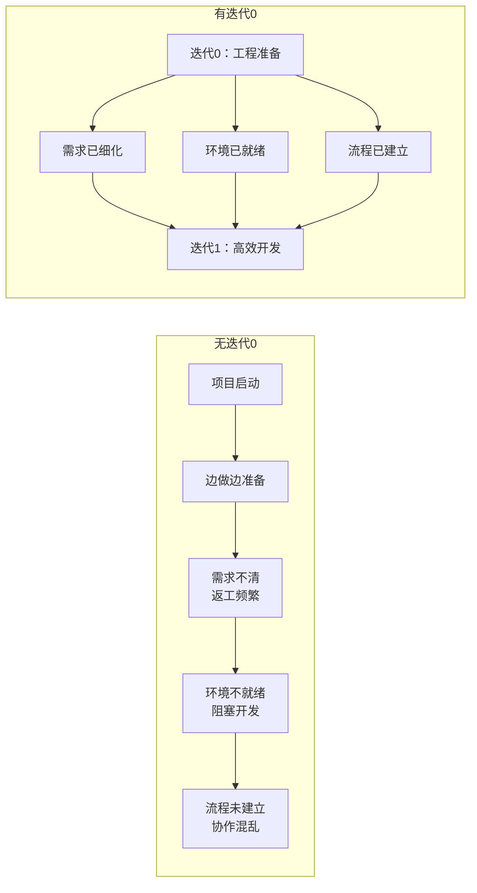
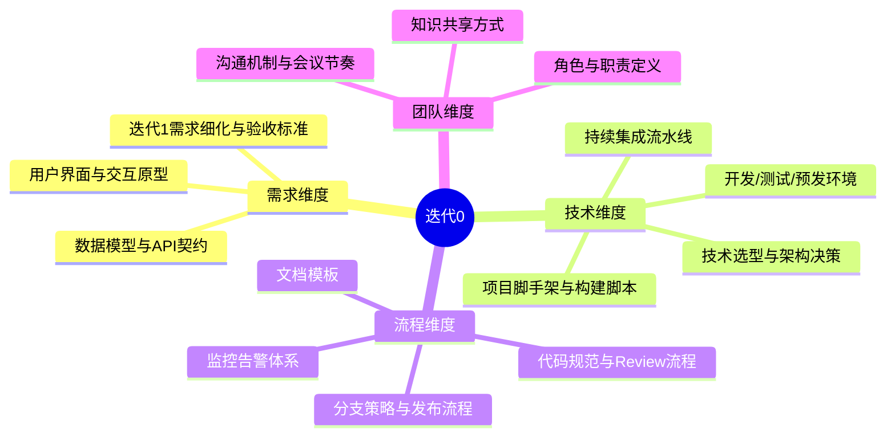
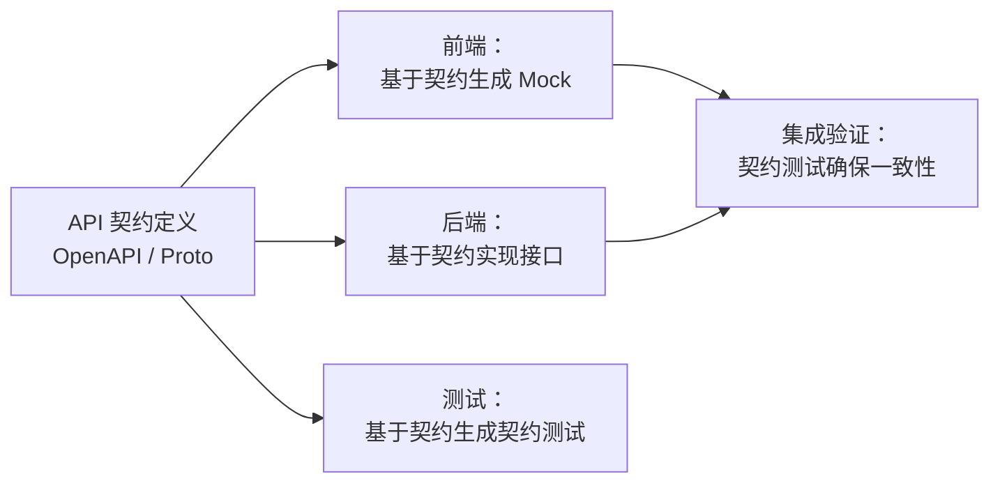
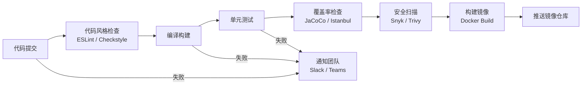
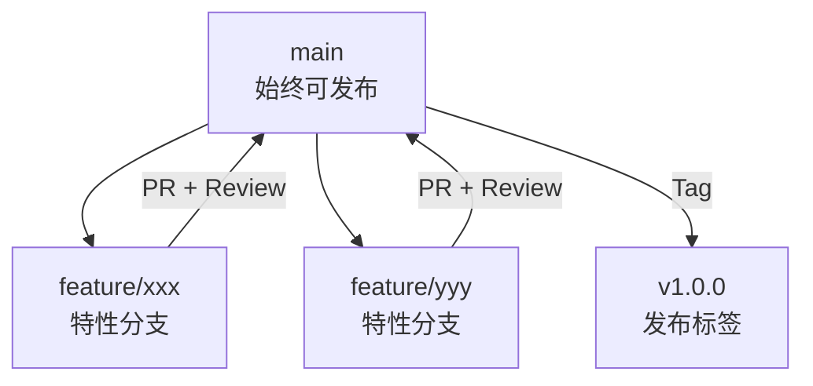
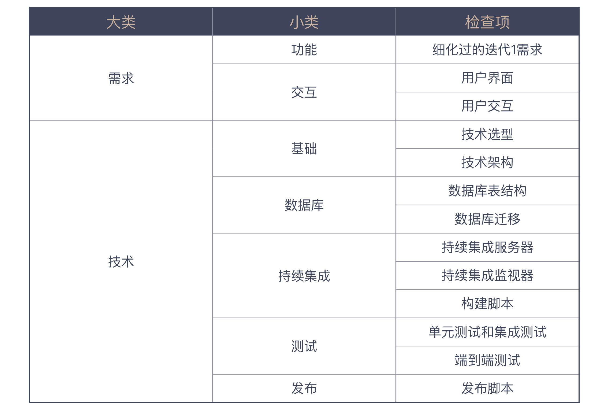
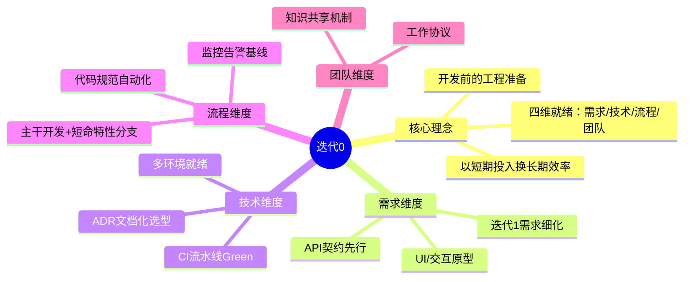

# 迭代0：启动开发之前，你应该准备什么

## 核心命题

迭代0（Iteration Zero）是项目正式启动前的**工程准备阶段**，其目标是在编码开始之前，将需求、技术、流程、团队四个维度的基础设施就绪。迭代0的质量直接决定了后续迭代的节奏稳定性——**"磨刀不误砍柴工"的本质，是以短期投入换取长期效率**。

---

## 1. 迭代0的定义与定位

### 1.1 为什么需要迭代0

### 1.2 名称由来

敏捷开发中的迭代是一个完整的开发周期，各团队的差别主要在时间长度。一般第一个迭代周期是迭代1，之后是迭代2、迭代3，依次排列。所谓迭代0，就是迭代1之前的一个迭代，可理解为**开发的准备阶段**——把需要提前准备好的各项内容在这个阶段准备好。

需要事先说明：**这里给出的迭代0清单只是基本清单**，团队完全可以依据项目实际情况扩展或调整。

### 1.3 迭代0的四维准备框架

---

## 2. 需求维度准备

### 2.1 迭代1需求细化

| 步骤 | 活动 | 产出物 |
|------|------|--------|
| ① 需求分解 | 将 Epic 拆分为 User Story | Product Backlog |
| ② 优先级排序 | 基于 MVP 目标确定优先级 | 优先级排列的 Backlog |
| ③ 迭代1范围确定 | 选择最高优先级需求 | Sprint Backlog（迭代1） |
| ④ 需求细化 | 定义验收标准（Acceptance Criteria） | 可执行的 User Story |
| ⑤ 契约定义 | API 契约先行（Consumer-Driven Contract） | OpenAPI / gRPC Proto |

### 2.2 用户界面与交互原型

现代原型工具链：

| 工具 | 特点 | 适用场景 |
|------|------|---------|
| **Figma** | 协作设计、组件库、Design Token | UI 设计与交互原型 |
| **Storybook** | 组件级原型、视觉回归测试 | 前端组件开发 |
| **Moco / WireMock** | API 模拟服务器 | 前后端并行开发 |

### 2.3 API 契约先行（Contract-First）

**API 契约工具生态**：

- **OpenAPI 3.1**（REST）：Swagger Editor、Prism（Mock Server）、Spectral（Lint）
- **gRPC / Protocol Buffers**：grpcurl、Buf（Lint + Breaking Change Detection）
- **GraphQL**：GraphQL Schema、Apollo Federation

---

## 3. 技术维度准备

### 3.1 基本技术准备清单

| 类别 | 准备项 | 现代工具/实践 |
|------|--------|-------------|
| **技术选型** | 语言、框架、数据库、中间件 | ADR（Architecture Decision Record）文档化 |
| **架构决策** | 分层架构、模块划分、部署架构 | C4 Model 架构图 |
| **项目脚手架** | 初始项目结构 | Nx Monorepo / Turborepo / Spring Initializr |
| **数据库** | Schema 定义、迁移脚本 | Flyway / Liquibase / Prisma Migrate |
| **构建脚本** | 编译、测试、打包、检查 | Gradle / Maven / pnpm / Bazel |

### 3.2 持续集成流水线

迭代0中 CI 流水线的最低要求：

**CI 可视化**：部署 CI 监视器（如 Buildkite Dashboard、Grafana CI Dashboard），确保构建失败时全团队即时感知。

### 3.3 开发环境就绪

| 环境 | 用途 | 就绪标准 |
|------|------|---------|
| **本地开发环境** | 开发与调试 | 一键启动（`docker compose up` / `devcontainer`） |
| **CI 环境** | 自动化构建与测试 | 流水线 Green |
| **测试环境** | 集成测试与 QA | 与生产环境配置一致 |
| **预发环境（Staging）** | 发布前验证 | 与生产环境同构 |

> **DevContainer 实践**：通过 `.devcontainer/devcontainer.json` 定义开发环境，确保团队成员环境一致性，消除"在我机器上能跑"的问题。

---

## 4. 流程维度准备

### 4.1 代码规范与自动化检查

| 规范类别 | 工具 | 集成方式 |
|----------|------|---------|
| **代码风格** | Prettier / google-java-format | Pre-commit Hook + CI |
| **静态分析** | SonarQube / ESLint / Pylint | CI Pipeline |
| **安全扫描** | Snyk / Trivy / Semgrep | CI Pipeline + PR Check |
| **提交规范** | Conventional Commits + commitlint | Pre-commit Hook |
| **依赖安全** | Dependabot / Renovate | 自动 PR |

### 4.2 分支策略

**推荐策略**：Trunk-Based Development（主干开发）+ Short-Lived Feature Branch（< 24h）

### 4.3 监控告警体系

迭代0需建立基础监控：

| 层级 | 监控类型 | 工具 |
|------|---------|------|
| **基础设施** | CPU / 内存 / 磁盘 / 网络 | Prometheus + Grafana |
| **应用** | 错误率 / 延迟 / QPS / 饱和度 | OpenTelemetry + Jaeger |
| **业务** | 核心业务指标 | 自定义 Metrics + Dashboard |
| **日志** | 结构化日志聚合 | ELK / Loki + Grafana |

---

## 5. 团队维度准备

### 5.1 工作协议（Working Agreement）

| 协议项 | 示例内容 |
|--------|---------|
| **核心工作时间** | 10:00-16:00 无会议，专注开发 |
| **每日站会** | 9:30，15 分钟，3 个问题 |
| **Code Review SLA** | PR 提交后 4 小时内 Review |
| **构建失败 SLA** | 发现失败后 30 分钟内修复 |
| **文档规范** | ADR / README / API Doc 模板 |

### 5.2 知识共享机制

| 机制 | 形式 | 频率 |
|------|------|------|
| **Tech Talk** | 团队内技术分享 | 双周 |
| **Architecture Decision Record** | 架构决策记录 | 按需 |
| **Retrospective** | 回顾与改进 | 每迭代 |
| **Pair/Mob Programming** | 结对/群体编程 | 按需 |

---

## 6. 迭代0完整检查清单

| 维度 | 检查项 | 状态 |
|------|--------|------|
| **需求** | 迭代1需求已细化，验收标准已定义 | ☐ |
| **需求** | 用户界面/交互原型已完成 | ☐ |
| **需求** | API 契约已定义 | ☐ |
| **技术** | 技术选型已确定并文档化（ADR） | ☐ |
| **技术** | 项目脚手架已创建 | ☐ |
| **技术** | CI 流水线已建立且 Green | ☐ |
| **技术** | 开发/测试/预发环境已就绪 | ☐ |
| **技术** | 数据库 Schema 与迁移脚本已准备 | ☐ |
| **流程** | 代码规范已配置并自动化检查 | ☐ |
| **流程** | 分支策略与发布流程已约定 | ☐ |
| **流程** | 监控告警已建立基础覆盖 | ☐ |
| **团队** | 工作协议已达成 | ☐ |
| **团队** | 知识共享机制已建立 | ☐ |

---

## 7. 方法论依据：清单背后的判断（源自郑晔的实践）

### 7.1 需求侧的决策链

- 决定做一个项目时需求往往不愁，真正必须做的是决策：哪些需求先做、哪些后做。迭代0要做的是"把悬在空中的内容落到地上"。
- 需求分解之后得到的是一大堆待开发需求列表——此时只是列表，尚未细化，也不可能在这个时点把所有内容都细化出来（做过 Scrum 的团队，Backlog 里放的就是这类内容）。
- 优先级依据要完成的最小可行产品（MVP）确定，而 MVP 又由当前迭代要验证的内容决定——一环扣一环，得出迭代1的需求列表。
- 确定迭代1需求后，将其细化到可执行程度。细化需求应达到的标准在"用户故事"方法中已有论述（参见 [相关论述](https://time.geekbang.org/column/article/75100)），关键点是**把验收标准定义清楚**。

### 7.2 用户交互是需求的一部分

- 有用户界面的产品，界面与交互都应在迭代0定义清楚。
- 常见误区：很多团队只给出用户界面，让前端或 App 程序员根据界面自行实现交互。实现功能没有问题，但**定义交互并不是程序员角色的强项，它应该是需求的一部分**。
- 论据：市面上大量难用的网站或 App，基本上是程序员按照自己的习惯设计出来的。如何让用户用着舒服是一门学问。
- 工具支撑：现如今的画原型工具用得好可以以假乱真；若再进一步，可用模拟服务器工具把整个交互界面做出来。郑晔作为 Moco 模拟服务器的开发者，对原型能达到的高度有直接的判断。

### 7.3 持续集成：重点是构建脚本与展示

- 对持续集成的第一反应通常是搭一个持续集成服务器——没错，但不够。**重点其实是构建脚本**，因为持续集成服务器运行的就是构建脚本。
- 构建脚本中应放入的内容：编译打包（最容易想到）；测试（现代构建工具一般会默认放入）；此外还可加入构建 IDE 工程、代码风格检查、常见 bug 模式检查、测试覆盖率等。
- 持续集成的展示同样重要，判断依据是：构建失败时如何第一时间发现？简单方案是摆一个大显示器，用 CI Monitor 软件展示持续集成状态；更进一步可用实体灯，感官刺激更强。

### 7.4 测试规范化：覆盖率入构建

- 程序员对测试又爱又恨。运行测试已成为很多构建工具的默认选项；若所用工具没有该能力，应自行将其加入构建脚本。
- 给一个已有项目补测试是非常痛苦的事；如果一开始就把测试作为规范加入，边开发边写测试的痛苦度低得多，团队成员也更容易遵守该开发规范。
- **把测试当作规范确定下来的办法，就是把测试覆盖率加入构建脚本。**
- 视野盲区：多数团队提起开发者测试想到的是单元测试和集成测试，而把贯穿整个系统的"端到端测试"交给其他人，或交给测试团队专门开发的特定程序来做。
- 更合适的描述方式：BDD、Specification by Example——可简单理解为一种描述系统行为的方式；Cucumber 等框架对这类开发方法支持良好。存在这类测试时，也不妨加入构建脚本。

### 7.5 发布准备：数据库迁移与发布自动化

**数据库迁移**：

- 服务器端开发多半离不开数据库，强烈建议把数据库变更管理起来。
- 数据库变更管理曾是很多团队的困扰，如今已有成熟工具支持。郑晔推荐 flyway：它把每一次数据库变更当作一个文件，从而可以把数据库变更放进版本控制工具统一管理。
- 管理变更有两种做法：每个变更一个文件，或每次发布一个文件，各有好处，按需选择。

**发布**：

- 技术团队擅长功能开发，但上线部署或打包发布是很多团队前期最欠考量的内容，也是很多团队手忙脚乱的根源。
- 一开始就把部署或发布过程自动化，未来会轻松很多：采用 Docker 就准备好第一个可以部署的 Dockerfile；自行部署就编写好 Shell 脚本。
- 一个客观事实：上述所有内容即便不在迭代0做，项目各个阶段也会碰到；即便迭代0做好了，后续依然要不断调整。但郑晔仍建议在迭代0把这些事做好，**因为它会给项目定下一个基调——一个自动化的基调**。

### 7.6 迭代0就绪后的典型工作流

迭代0一切准备就绪后，迭代1中的日常工作呈现如下有序节奏（原文以开发者视角叙事，此处转写为流程）：

| 步骤 | 动作 | 体现的迭代0设施 |
|------|------|----------------|
| ① | 从任务卡中选卡，与产品经理确认不清楚的细节 | 细化过的迭代1需求 |
| ② | 从代码仓库更新最新代码，开始实现 | 版本控制与工作协议 |
| ③ | 任务需在数据库加字段：新增数据库迁移文件并运行迁移工具，字段正常出现 | 数据库迁移管理 |
| ④ | 运行构建脚本：风格检查报错，顺手修复；再运行，测试通过但覆盖率不够，补几个测试 | 构建脚本 + 覆盖率入构建 |
| ⑤ | 更新代码、解决合并问题，再运行构建脚本全过，提交代码 | 代码规范自动化 |
| ⑥ | 提交后 CI 大屏变红——有一个新文件忘提交，补交后大屏恢复绿色 | CI 展示（CI Monitor） |
| ⑦ | 休息后拿下一个任务，继续循环 | 有条不紊的工作节奏 |

**说明**：这就是正常开发该有的样子——迭代0把准备工作做好，后续一切工作井然有序，简单问题很快被发现，所有人处于有条不紊的工作节奏中。

### 7.7 清单的适用性

根据郑晔的经验，对比这份清单，**大多数新项目都在一项或几项上准备得不够充分**。即便做的不是从零开始的项目，对照清单也会发现项目在某些项上的欠缺，可以有针对性地做补充。

---

## 8. 总结

迭代0的本质是**在编码开始之前，建立项目的"操作系统"**——需求、技术、流程、团队四维就绪，使后续迭代专注于价值交付而非环境搭建。

**核心要义**：磨刀不误砍柴工——迭代0的投入，是项目可持续交付的基石。没有迭代0的团队，将在后续每个迭代中为"准备不足"支付复利。

**只记一件事**：设计迭代0清单，给自己的项目做体检。

**实践检验**：按上述维度设计一份适合所在项目的迭代0清单，逐项对照检查当前的准备程度。

---

> **延伸阅读**
>
> - Architecture Decision Records (ADR): https://adr.github.io/
> - C4 Model: https://c4model.com/
> - GitHub Dev Containers: https://containers.dev/
> - OpenTelemetry: https://opentelemetry.io/
> - Trunk-Based Development: https://trunkbaseddevelopment.com/
