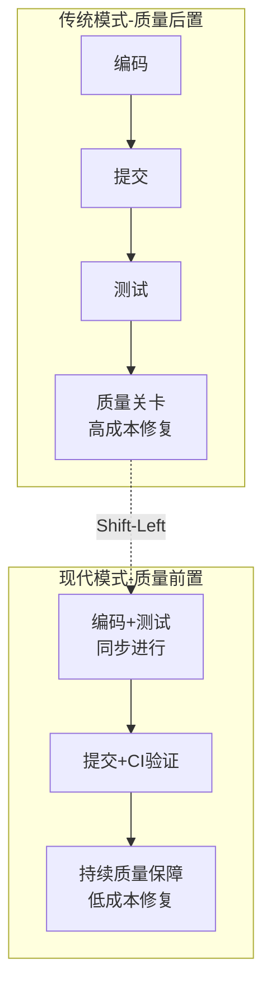
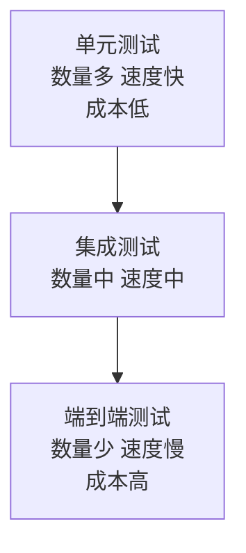
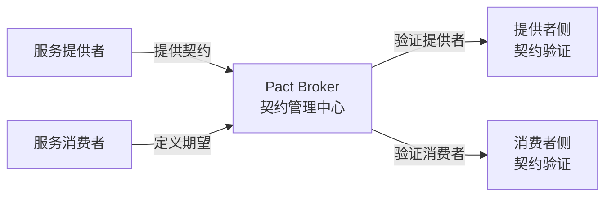
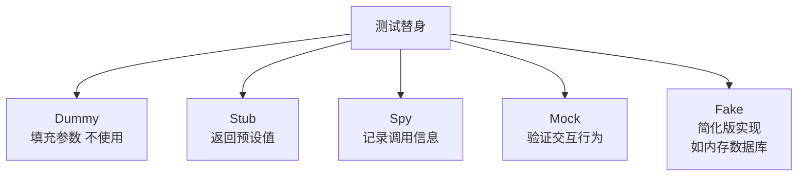
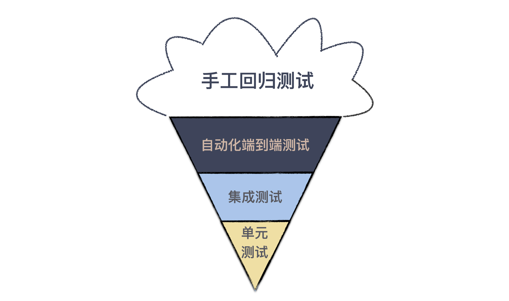
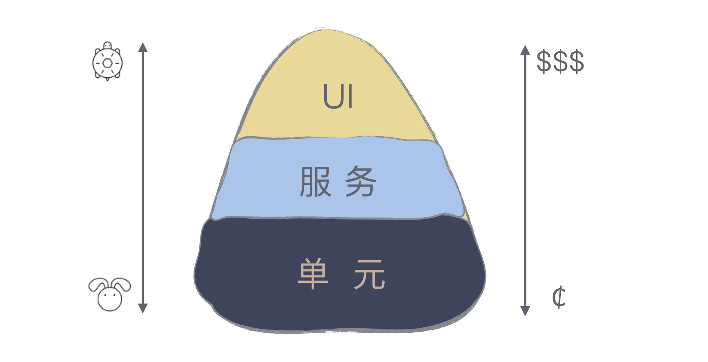
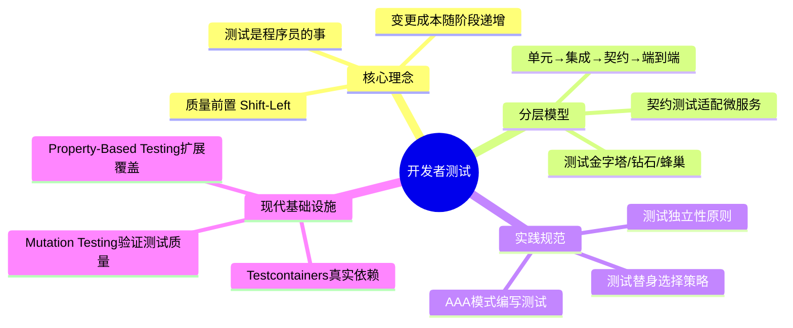

# 测试也是程序员的事吗

## 核心命题

**测试不是测试人员的专属职责，而是程序员的核心工程实践。** 软件变更成本随时间推移呈指数增长——在开发阶段发现并修复缺陷的成本远低于测试阶段和上线阶段。程序员编写自动化测试，本质上是**将质量保障内化为开发过程的一部分**，而非将其外包给后续环节。

---

## 1. 缺陷成本曲线与质量前置

### 1.1 变更成本的阶段递增

```mermaid
graph LR
    REQ[需求阶段] --> DEV[开发阶段] --> TEST[测试阶段] --> PROD[生产阶段]

    REQ --> |修复成本 1x| C1[$]
    DEV --> |修复成本 10x| C2[$$$]
    TEST --> |修复成本 100x| C3[$$$$$$]
    PROD --> |修复成本 1000x| C4[$$$$$$$$$$]

```

| 发现阶段 | 相对修复成本 | 典型场景 |
|----------|-------------|---------|
| **编码时** | 1x | IDE 即时反馈、编译错误 |
| **提交时** | 10x | CI 构建失败、单元测试未通过 |
| **测试阶段** | 100x | QA 团队发现功能缺陷 |
| **生产环境** | 1000x | 线上故障、用户投诉、紧急修复 |

> **数据支撑**：IBM Systems Sciences Institute 研究表明，生产环境修复缺陷的成本是设计阶段的 **100-200 倍**。

### 1.2 质量前置原则（Shift-Left Quality）



---

## 2. 开发者测试的分层模型

### 2.1 测试金字塔

Mike Cohn 提出的测试金字塔是开发者测试的经典分层模型，2024 年在其基础上演化出多个变体：



| 层级 | 职责 | 粒度 | 速度 | 稳定性 | 现代工具 |
|------|------|------|------|--------|---------|
| **单元测试** | 验证单个函数/类的行为 | 方法级 | < 10ms/个 | 高 | JUnit 5、Jest、pytest |
| **集成测试** | 验证模块间协作 | 组件级 | 100ms-1s/个 | 中 | Spring Boot Test、Testcontainers |
| **契约测试** | 验证服务间 API 契约 | 服务级 | 100ms/个 | 高 | Pact、Spring Cloud Contract |
| **端到端测试** | 验证完整用户流程 | 系统级 | 1-30min/个 | 低 | Playwright、Cypress |

### 2.2 测试钻石与测试蜂巢

针对微服务架构，测试金字塔演化为两个变体：

| 模型 | 形状 | 核心主张 | 适用场景 |
|------|------|---------|---------|
| **测试金字塔** | △ 底宽顶窄 | 单元测试为主 | 单体/模块级开发 |
| **测试钻石** | ◇ 中间宽 | 集成测试和契约测试为主 | 微服务架构 |
| **测试蜂巢** | ⬡ 中间最宽 | 服务间契约测试为核心 | 大规模微服务系统 |

### 2.3 契约测试：微服务时代的集成测试替代方案



**契约测试的核心价值**：

- 消除端到端测试的脆弱性——不需要部署完整系统即可验证服务间兼容性
- 支持独立部署——消费者与提供者可独立发布，只要契约兼容
- 变更影响分析——通过 Pact Broker 可即时发现 API 变更对下游的影响

---

## 3. 开发者测试的实践规范

### 3.1 测试命名的结构化约定

| 命名模式 | 示例 | 优势 |
|----------|------|------|
| **Method_State_Expected** | `withdraw_insufficientBalance_throwsException()` | 精确定位 |
| **Given_When_Then** | `givenInsufficientBalance_whenWithdraw_thenThrowException()` | BDD 风格 |
| **Should_When** | `shouldThrowExceptionWhenBalanceInsufficient()` | 简洁 |

### 3.2 测试的结构化编写（AAA 模式）

```java
@Test
void shouldCalculateTotalPriceWhenItemsAdded() {
    // Arrange（准备）- 构建测试数据与环境
    ShoppingCart cart = new ShoppingCart();
    cart.addItem(new Item("Book", 29.99));
    cart.addItem(new Item("Pen", 3.50));

    // Act（执行）- 调用被测方法
    double total = cart.calculateTotal();

    // Assert（断言）- 验证结果
    assertThat(total).isCloseTo(33.49, within(0.01));
}
```

### 3.3 测试的独立性原则

| 原则 | 含义 | 违反后果 |
|------|------|---------|
| **无共享状态** | 测试之间不依赖执行顺序 | 不可并行、不可重复 |
| **无隐式依赖** | 测试不依赖外部服务可用性 | Flaky Test |
| **确定性** | 相同输入始终产生相同输出 | 不可信任的测试 |
| **自包含** | 每个测试自行准备和清理数据 | 交叉污染 |

### 3.4 测试替身（Test Double）的选择



| 替身类型 | 用途 | 典型工具 |
|----------|------|---------|
| **Dummy** | 满足方法签名要求 | 无需工具 |
| **Stub** | 隔离外部依赖，返回预设值 | WireMock、Moco |
| **Spy** | 验证方法是否被调用 | Mockito spy、Jest spyOn |
| **Mock** | 验证交互行为（调用次数、参数） | Mockito、Jest mock |
| **Fake** | 提供可用的简化实现 | 内存数据库（H2）、Fake S3 |

---

## 4. 现代测试基础设施（2024-2026）

### 4.1 Testcontainers：集成测试的革命

Testcontainers 使集成测试可以启动真实的依赖服务（数据库、消息队列），而非使用 Mock：

```java
@Testcontainers
class UserRepositoryTest {
    @Container
    static PostgreSQLContainer<?> postgres = new PostgreSQLContainer<>("postgres:16");

    @Test
    void shouldPersistAndRetrieveUser() {
        // 使用真实的 PostgreSQL 实例
        UserRepository repo = new UserRepository(postgres.getJdbcUrl());
        repo.save(new User("alice", "alice@example.com"));
        User found = repo.findByUsername("alice");
        assertThat(found.email()).isEqualTo("alice@example.com");
    }
}
```

### 4.2 Mutation Testing：测试质量的验证

传统覆盖率只能证明"代码被执行了"，无法证明"测试是否有效"。Mutation Testing 通过注入代码变异来验证测试的缺陷检测能力：

| 工具 | 语言 | 原理 |
|------|------|------|
| **PITest** | Java | 修改条件运算符、返回值等 |
| **Stryker** | JavaScript/TypeScript | 字符串/条件/算术变异 |
| **mutmut** | Python | 源码级变异 |

### 4.3 Property-Based Testing：参数化测试的扩展

相比 Example-Based Testing（给定具体输入-输出对），Property-Based Testing 通过定义"属性"自动生成大量测试用例：

| 工具 | 语言 | 核心思想 |
|------|------|---------|
| **QuickCheck** | Haskell | 声明属性，自动生成输入 |
| **jqwik** | Java | JUnit 5 集成的 PBT 框架 |
| **fast-check** | JavaScript | TypeScript 友好的 PBT |
| **Hypothesis** | Python | 自动缩小失败用例 |

---

## 5. 论据：测试为什么是程序员的事（源自郑晔的实践）

### 5.1 程序员已经在做测试

测试是一个让程序员又爱又恨的主题：爱测试，因为它能让项目的质量有保证；恨测试，因为测试不好写。而实际上，很多人之所以写不好测试，主要是因为不懂任务分解。

关于"测试该谁做"，很多人凭直觉的答案是"测试不就该是测试人员的事吗"。测试人员应该做测试，这没有错；但**测试只是测试人员的事吗**？

事实上，程序员多半已经做了很多测试工作：提交代码之前，把代码跑一遍，保证提交的基本功能是正确的——这就是最基本的测试。只不过通常不把它当成测试，所以直觉里测试成了测试人员的事。

### 5.2 外部测试的局限

论据链如下：

- 测试人员能测的是什么？只能**站在系统外部做功能特性的测试**。
- 而一个软件是由它内部诸多模块组成的，测试人员只从外部保障正确性，所能达到的效果是有限的。
- 打个比方：做一台机器，每个零部件都不保证正确性，却要求最后的结果正确——这是一个可笑的要求，但它真实地发生在软件开发过程中。

### 5.3 软件变更成本与内建质量

软件开发中有一个重要概念：[软件变更成本会随着时间和开发阶段逐步增加](https://www.agilemodeling.com/essays/costOfChange.htm)。也就是说，要尽可能早地发现问题、修正问题，这样消耗的成本才是最低的。

- 能从需求上解决的问题，就不要到开发阶段；在开发阶段能解决的问题，就不要留到测试阶段。
- 对比一下：在代码中发现错误直接改代码容易，还是测试报了 bug 再定位找问题方便？答案不言自明。
- 更理想的情况是：质量保证贯穿软件开发全过程——从需求开始的每一个环节都将"测试"纳入考量，每个角色交付自己的工作成果时都多问一句"怎么保证交付物的质量"。
- 需求人员要确定验收标准，开发人员则要交出自己的开发者测试。这是来自精益原则的重要思想：**内建质量（Build Quality In）**。

**结论：对每个程序员来说，只有在开发阶段把代码和测试都写好，才有资格说自己交付的是高质量的代码。**

---

## 6. 自动化测试与测试框架的由来

### 6.1 程序员的天然优势

传统测试人员只通过手工方式进行验证；程序员这个群体做测试有一个天然优势——会写代码，这个优势可以把测试自动化。

### 6.2 测试框架的演进史

- **最早期做法**：另外写一个程序入口来测试代码。郑晔初入职场时也曾这么做——这是一种符合直觉的做法。既然程序员有写测试的需求，如此反复出现的东西就会催生更好的自动化方案，于是测试框架出现了。
- **起源**：最早的测试框架起源于 Smalltalk。这是一门早期的面向对象程序设计语言，拥趸众多，很多今天流行的编程概念都来自 Smalltalk，测试框架便是其中之一。
- **JUnit 的诞生**：真正让测试框架广泛流行，要归功于 Kent Beck（极限编程创始人）和 Erich Gamma（《设计模式》作者，Visual Studio Code 也有他的重大贡献）。有一次，二人一起从苏黎世飞往亚特兰大参加 OOPSLA（Object-Oriented Programming, Systems, Languages & Applications）大会，在航班上结对编程写出了 JUnit——从名字不难看出，它的目标是打造一个单元测试框架。
- **佐证细节**：Kent Beck 是狂热的 Smalltalk 粉丝，写过 SUnit 测试框架——理解了这一点，就不难理解两人为什么能在一次航班上完成这样的力作。
- **现状**：JUnit 之后，测试框架的概念逐渐流行。如今每个程序设计语言都有自己的测试框架，甚至不止一种，一些语言还把它放进了标准库；行业里用 XUnit 统称这些测试框架。

**测试框架最大的价值，是把自动化测试作为一种最佳实践引入到开发过程中，使得测试动作可以通过标准化的手段固定下来。**

---

## 7. 测试模型：冰淇淋蛋卷与测试金字塔

### 7.1 测试的层次划分

把测试分为人工测试和自动化测试之后，即便只关注自动化测试，也可以按层次划分：关注最小程序模块的**单元测试**、将多个模块组合在一起的**集成测试**、将整个系统组合在一起的**系统测试**。有人喜欢把验收测试也放到这个分类里，为简化讨论此处忽略。

随之而来的问题是：应该写多少不同层次的测试？理论上固然是越多越好，但实际上做任何事都有成本，必须有所取舍。根据不同测试的配比，形成了不同的测试模型。

### 7.2 冰淇淋蛋卷模型

一种直觉的做法是：既然越高层的测试覆盖面越广，就多写高层测试（如系统测试）；高层测试不容易覆盖到的情景，再补一些底层测试（如单元测试）。此时底层测试只作为补充，主力是高层测试——这就形成了**冰淇淋蛋卷**模型。



- 听说过冰淇淋蛋卷测试模型的人并不多，它是一种费时费力的模型——要准备高层测试实在是太麻烦了。
- 提及它的原因：虽然概念鲜有人知，但**有不少团队的测试实际采用的就是这种模型**，这也是很多团队觉得测试很麻烦却不明就里的原因。

### 7.3 测试金字塔：行业最佳实践



Mike Cohn 在著作 [《Succeeding with Agile》](https://book.douban.com/subject/5334585/) 中提出了测试金字塔，但大多数人都是通过 [Martin Fowler 的文章](https://martinfowler.com/bliki/TestPyramid.html) 知道这个概念的。

从图中不难看出，它几乎是冰淇淋蛋卷的反转——**测试金字塔的重点是越底层的测试应该写得越多**。

理解测试金字塔成为行业最佳实践的缘由，需要理解不同层次测试的差异：**越是底层的测试，牵扯到的相关内容越少；高层测试则涉及面更广。**

- 单元测试：关注点只有一个单元，没有其他任何东西。只要这个单元写好了，测试就可以通过。
- 集成测试：要把好几个单元组装到一起才能测试，通过的前提是所有这些单元都写好了，周期明显比单元测试长。
- 系统测试：要把整个系统的各个模块连在一起、各种数据都准备好，才可能通过。

结合"任务分解"视角可以进一步说明：**小事反馈周期短，大事反馈周期长**；小事容易做好，大事难度大得多。以这个标准来看，底层的测试才更容易写好。

### 7.4 高层测试为什么脆弱

- 高层测试涉及的模块过多，任何一个模块做了调整，都有可能破坏高层测试，因此高层测试通常相对脆弱。
- 实际工作中，有些高层测试还牵扯到外部系统，复杂度进一步提升。
- 人们会本能地倾向于少做复杂的东西，所以不会倾向于多写高层测试——结果必然是高层测试的测试量不会太多、测试覆盖率无论如何都上不来；而且一旦测试失败，因为牵扯的内容太多，定位起来也非常麻烦。
- 反过来，将底层测试定义为测试主体：牵扯的内容少、更容易写，团队才可能得到更多的测试，而且一旦出现问题，也更容易发现。

**结论：虽然冰淇淋蛋卷更符合直觉，但测试金字塔才是行业的最佳实践。**

---

## 8. 当测试金字塔遇到持续集成

- 测试金字塔是持续集成这一重要实践的基础。当测试数量达到一定规模，测试运行时间会很长，可能无法在本地环境一次性运行所有测试。一般做法是：在本地运行所有单元测试和集成测试，把系统测试放在持续集成服务器上执行。
- 这时底层测试的数量就成了关键：按测试金字塔模型，底层测试数量多，可以覆盖主要的场景；按冰淇淋蛋卷模型，底层测试的数量则有限。
- 作为提交代码的防护网，**测试数量多寡决定着得到反馈的早晚**。所以金字塔模型与持续集成天然就有很好的配合。
- 特别注意：**不是用单元测试框架写的测试就是单元测试**。很多人用单元测试框架写的其实是集成测试或系统测试。单元测试框架只是一个自动化测试的工具，并不是用来定义测试类型的。
- 区分不同测试的常见做法：将不同的测试放到不同的目录下，或给不同类型的测试制定统一的命名规范。区分的主要目的是在不同的场景下运行不同类型的测试——例如本地运行单元测试和集成测试，持续集成服务器上运行系统测试。

---

## 9. 总结



**核心要义**：测试是软件开发重要的组成部分，应该是开发团队中所有人的事，而不仅仅是测试人员的事。软件变更成本会随着时间和开发阶段逐步增加，能在早期解决的问题就不要延后至下一个阶段。程序员天生会写代码，自动化测试是其突出的强项，写测试应该是程序员工作完成的重要组成部分。越底层的测试成本越低、执行越快；越高层的测试成本越高、执行越慢。人的时间和精力有限，需要思考不同测试如何组合——这个方面的最佳实践就是测试金字塔，它强调越底层的测试应该写得越多。只有按照测试金字塔的方式写测试，持续集成才能更好地发挥作用。

**只记一件事**：多写单元测试。

**实践检验**：检视所在团队的测试配比属于冰淇淋蛋卷还是测试金字塔，评估底层测试数量是否足以支撑持续集成的反馈速度。

---

> **延伸阅读**
>
> - Mike Cohn, *Succeeding with Agile* (2009): 测试金字塔
> - Gerard Meszaros, *xUnit Test Patterns* (2007): 测试替身模式
> - Testcontainers: https://testcontainers.com/
> - Pact: https://docs.pact.io/
> - PITest: https://pitest.org/
