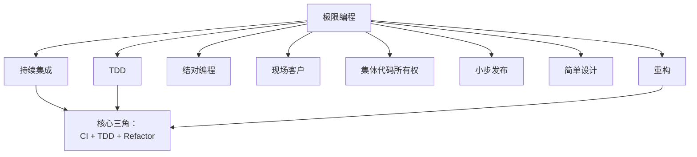
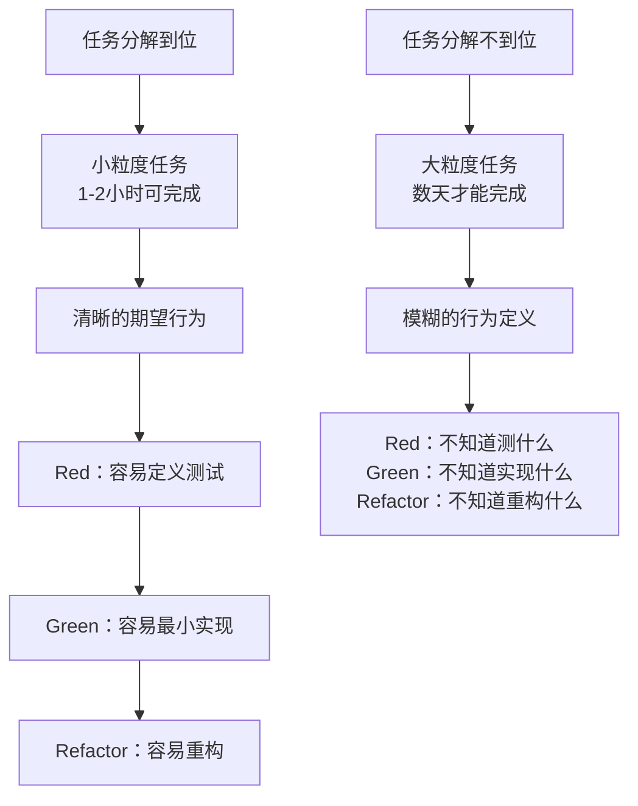

# 大师级程序员的工作秘笈

## 核心命题

TDD 的"任督二脉"在于**任务分解**——只有将需求拆解到足够小的粒度，TDD 的 Red-Green-Refactor 循环才能顺畅运转。极限编程（Extreme Programming）的"极限思维"——将好的实践推向极致——是理解 TDD、持续集成、结对编程等实践的思想根源。

---

## 1. 极限编程的极限思维

### 1.1 将好的实践推向极致

| 实践 | 基本形态 | 推向极致 → 极限形态 |
|------|---------|-------------------|
| **集成** | 定期集成 | → 每次提交即集成（持续集成） |
| **测试** | 开发者写测试 | → 先写测试再写代码（TDD） |
| **代码评审** | 定期 Code Review | → 实时持续评审（结对编程） |
| **客户交流** | 定期需求评审 | → 客户与团队始终在一起（现场客户） |

> **极限思维的应用**：在工作中，识别"好的实践"，然后问自己"如果将这个实践推向极致，会是什么样？"这种思维方式本身比具体的极限实践更有价值。

### 1.2 TDD 的源流

- TDD 早期只在小圈子里流行，真正让它在行业中广为人知的是 Kent Beck 的软件工程名作 [《解析极限编程》](https://book.douban.com/subject/6828074/)（Extreme Programming Explained），该书介绍了一种软件开发方法——[极限编程](https://en.wikipedia.org/wiki/Extreme_programming)。
- 该书写作之时，业界许多人正在探寻瀑布开发方法之外的软件工程方法：除极限编程外，还有 [特征驱动开发](https://en.wikipedia.org/wiki/Feature-driven_development)、[水晶开发方法](https://en.wikiversity.org/wiki/Crystal_Methods) 等。正是这些开发方法的探索，才有了后来敏捷方法的诞生。
- 极限编程对行业最大的贡献是引入了大量实践：持续集成、TDD、结对编程、现场客户等。
- TDD 虽然只是《解析极限编程》介绍的诸多实践中的一种，却是与开发人员关系最密切的一个实践。随着 TDD 流行，Kent Beck 又专门为 TDD 写了 [《测试驱动开发》](https://book.douban.com/subject/1230036/)（Test Driven Development: By Example）。

### 1.3 极限编程实践体系

---

## 2. TDD 不实用的根因分析

### 2.1 "TDD 不实用"的真实原因

市面上" TDD 不实用"的说法来自两类人群：一类尚未动手、准备实践；另一类早已自我修炼过但实践之路不通。郑晔的判断是：TDD 和任何技能一样需要练习，更关键的是打通"任督二脉"——任务分解。

| 表面原因 | 根因 | 本质 |
|----------|------|------|
| "测试太难写" | 代码耦合度高，难以隔离 | 设计问题 |
| "不知道测什么" | 需求未拆解到可测试粒度 | 任务分解问题 |
| "测试太脆弱" | 测试依赖了实现细节 | 测试设计问题 |
| "进度来不及" | 未将测试纳入开发时间估算 | 认知问题 |

> **核心洞察**：TDD 困难的根因 80% 是**任务分解不到位**，而非 TDD 本身的问题。只有把任务分解到可以测试的地步，才能够有针对性地写测试。很多人看 TDD 练习示例觉得简单，自己动手却不知如何下手——中间缺的正是任务分解的环节。

### 2.2 任务分解是 TDD 的"任督二脉"

### 2.3 分解粒度的"金发姑娘原则"

| 粒度 | 表现 | TDD 体验 |
|------|------|---------|
| **过粗** | 一个任务涵盖多个行为 | Red 阶段测试复杂，Green 难以增量实现 |
| **合适** | 一个任务对应一个行为 | Red-Green-Refactor 循环流畅 |
| **过细** | 一个任务拆到 getter/setter 级别 | 测试没有行为意义，过度工程 |

> **判断标准**：每个测试应描述一个**有业务意义的行为**，而非一个代码结构单元。

---

## 3. 大师级程序员的工作方式

### 3.1 Kent Beck 的工作方式

《测试驱动开发》第一部分只是写一个功能，写完一段又写一段——只为了解 TDD 而读，可能觉得无聊。郑晔读过两遍：第一遍觉得平淡无奇，"这种代码我也能写"；第二遍看懂思路时几乎是震惊的感觉，因为它完全是在展示 Kent Beck 的工作方式。**Kent Beck 在做的就是任务分解，这也是这本书真正的价值所在**。当时已工作多年、自认为写代码很专业的郑晔，看懂思路后的结论是：与 Kent Beck 相比，自己还不够专业。

Kent Beck 的具体做法：

1. **小步前进**：每当遇到一件要做的事，先把它分解成几个小任务，记在清单上，然后才动手写测试、写代码、重构；一个循环完成，划掉已完成的任务，开始下一个。
2. **问题不丢失**：解决问题过程中遇到任何新问题，先记录在清单上，然后继续回到正在处理的任务上；一个个任务完成时，问题也就解决完了。
3. **频繁提交**：每个 Red-Green-Refactor 循环完成后立即提交——**每个任务完成之后，代码都是可以提交的**。
4. **持续重构**：重构不是阶段性活动，而是每个循环的固定步骤。
5. **简单设计**：YAGNI（You Aren't Gonna Need It），不写当前不需要的代码。

**提交频率检验**：多长时间提交一次代码？答案若超过半天，步子一定太大了——之所以不能小步提交，一定是牵扯了太多相关的部分。Kent Beck 的做法清晰而有节奏，看上去简单，但这是大多数程序员做不到的。只有把任务分解到很小，才可能做到小步提交；能把任务分解到很小，恰恰证明已经想清楚了。**大多数程序员开发效率低，很多时候是没想清楚就动手了。**

### 3.2 Ward Cunningham 的结对实证

郑晔在 ThoughtWorks 工作时，每个人都会有一个 Sponsor（类似工厂里师傅带徒弟的关系）。他当时的 Sponsor 是 ThoughtWorks 现任CEO 郭晓（写代码出身）。郭晓讲过与 Wiki 发明者 Ward Cunningham 结对编程的场景：

- Ward 每天拿到一个需求，并不急于写代码，而是和郭晓一起做任务分解，分解到每个任务都很清晰了才开始动手；接下来就是一个任务一个任务完成。
- 郭晓当时觉得工作节奏很紧张，但思路非常清晰。有时在开始工作之前，他会觉得那个问题非常难以解决；结果一路分解下来，每一步都是清晰的，没遇到什么困难就完成了。
- Ward Cunningham 就是当年和 Kent Beck 在同一个小圈子里一起探讨进步的人，二人在解决问题的思路上如出一辙。

### 3.3 从"写代码"到"设计行为"

| 普通程序员 | 大师级程序员 |
|-----------|-------------|
| 想到功能就开始编码 | 先定义行为，再考虑实现 |
| 一次性写完整个功能 | 小步增量，每次一个行为 |
| 重构是"有空再做" | 重构是每个循环的固定步骤 |
| 测试是"事后补写" | 测试是设计的起点 |
| 提交是"功能做完再说" | 提交是每个循环的终点 |

---

## 4. 微操作：任务分解的关键在"小"

### 4.1 分解粒度可以小到什么程度

随着在任务分解上练习的增多，郑晔越发理解任务分解的关键在于：**小**。有时甚至小到认为这件事不值得成为一件独立的事——比如升级一个依赖的版本、做一次变量改名。

这样做的好处是：**保证随时可以停下来**。

### 4.2 "老虎"伍兹的类比

高尔夫球手打球时可能受外界干扰。一般选手若已开始挥杆时受到干扰，通常会继续把杆挥下去，结果往往不理想；而伍兹遇到这种情况会停下来，重新做挥杆动作，保证每一杆动作的标准。

- 伍兹能停下来，固然经过大量练习，但还有一个关键：对别人而言，挥杆击球是一个必须一气呵成的动作；对伍兹而言，这个动作由若干小动作组成——他只不过是刚好完成了某个小动作，而没有做下一个小动作而已。
- 换句话说，大家完成的都是原子操作，只不过伍兹的原子操作比其他人的小得多。

### 4.3 微操作与抗打扰

写程序的人都不喜欢被打扰：一旦被打扰，接续上状态需要很长时间——人不像操作系统那样容易进行上下文切换。但如果任务足够小：

- 完成一个任务后，可以选择进入下一个任务，也可以停下来；
- 即便被打扰，也可以很快收尾当前任务，不至于被影响太多。

### 4.4 跨领域印证：微习惯

极其微小的原子操作在其他领域也有应用，典型是"微习惯"。以健身为例：很多人难以坚持，因为一想到健身就想到汗如雨下的场景。但如果一次只做一个俯卧撑呢？对大多数人来说这不难——先做一个，做完还想做就接着做，不想做就停。一个俯卧撑确实是很小的动作，重要的是它是可以坚持完成的；每天做 10 个恐怕大多数人都做不到。养成一个习惯，最难的是坚持——**有了微习惯，坚持就不难了**。

### 4.5 实证：GitHub 连续提交 1000 天

郑晔曾在 GitHub 上连续提交代码 1000 天——差不多三年时间里每天坚持写代码、提交代码，还不算工作上写的代码。他的归因不是个人了不起，而是养成了微习惯：连续提交的基础，就是在练习任务分解时不断尝试把一件事拆细，每天至少保证完成一小步，有时间就多写一点。正是通过这样的方法，既坚持了 1000 天，也熟练掌握了任务分解的技巧。

### 4.6 小粒度的认知收益

- **一个经过分解后的任务，需要关注的内容是有限的，可以针对这个任务把方方面面的细节想得更清晰。**
- 很多人写代码漏洞百出，一个重要原因就是任务粒度太大——普通人能考虑问题的规模是有限的，很难方方面面都考虑仔细。
- 经过练习后，任务分解会成为本能，不局限于写程序：遇到任何需要解决的问题，第一反应是它可以怎么一步一步完成，确定分解之后，解决问题就是一步一步做。如果不能很好地分解，说明还没想清楚——还需要更多信息，或者需要找到更好的解决方案。

---

## 5. 微操作与分支模型

理解了任务分解与微操作，就很容易理解一些"步子太大"带来的问题，典型如分支策略：

- 行业内存在不同做法：有的团队所有人都在一个分支上写代码，有的每个人拉一个分支、写完再合并回去。
- **行业最佳实践是基于主分支的模型**：大家都在同一个分支上开发。拉分支是件麻烦事，尽管 Git 的出现极大降低了拉分支的成本。
- 为什么还有人拉分支开发？多半是因为写的代码太多、改动量太大，很难很快合并回开发主分支。而为什么会写那么多代码——答案就是步子太大。
- 懂得任务分解的团队，每个分解出来的任务改动代码不会太多，影响在可控范围内，代码可以很快合并到主分支上，也就没有必要拉分支。
- 郑晔在实际工作中带的团队基本都采用基于主分支的策略：只有在做实验时才拉出一个开发分支，且这不是常态。

---

## 6. 总结

**核心要义**：TDD 在很多人眼中不实用，一来是并不理解测试"驱动"开发的含义，但更重要的原因是很少做任务分解——而任务分解正是做好 TDD 的关键点。只有把任务分解到可以测试的地步，才能有针对性地写测试。任务分解的结果是"微操作"，远比大多数人理解得小；**能将任务分解到多小，就决定了原子操作的粒度是多大**。软件开发中的许多问题正是由粒度太大造成的，分支策略只是其中一例。

**只记一件事**：将任务拆小，越小越好。

**实践检验**：检视当前项目中是否存在因任务分解不够小带来的问题——提交周期过长、长期分支、合并困难等，均可作为分解粒度的诊断信号。

---

> **延伸阅读**
>
> - Kent Beck, *Extreme Programming Explained* (1999)
> - Kent Beck, *Test Driven Development: By Example* (2002)
> - Kent Beck, *Smalltalk Best Practice Patterns* (1996): 简单设计的哲学
