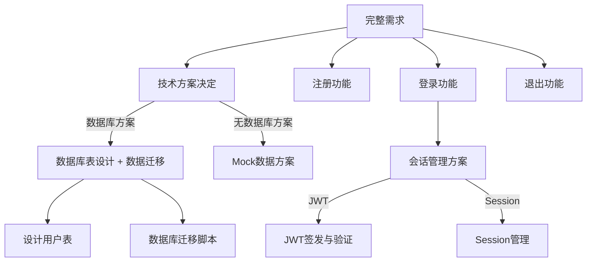
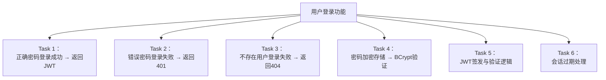
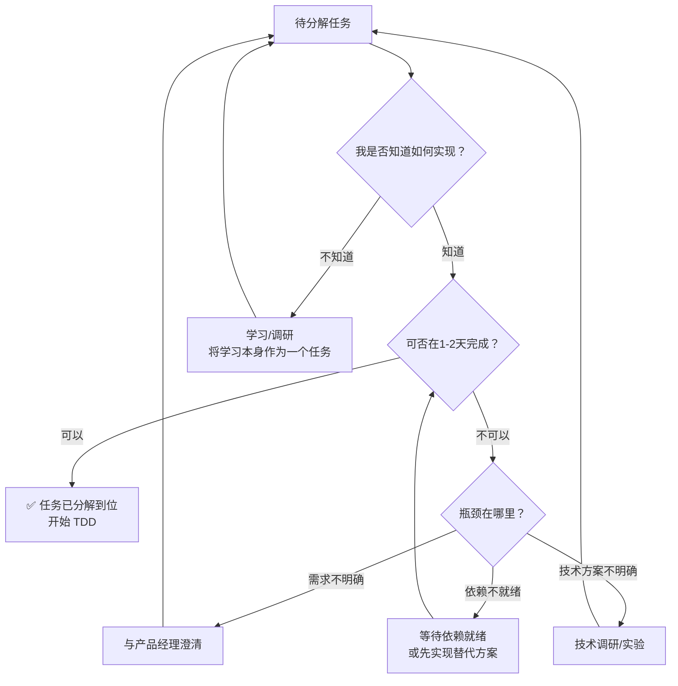
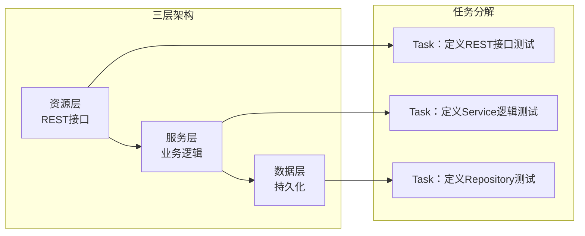
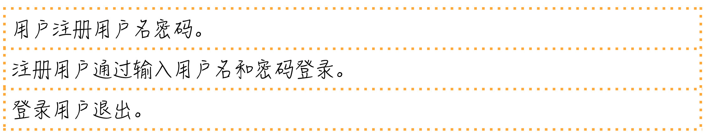
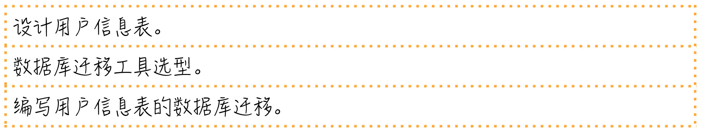
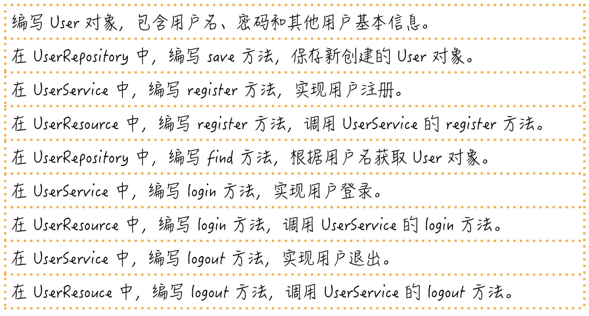
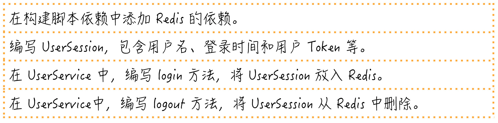
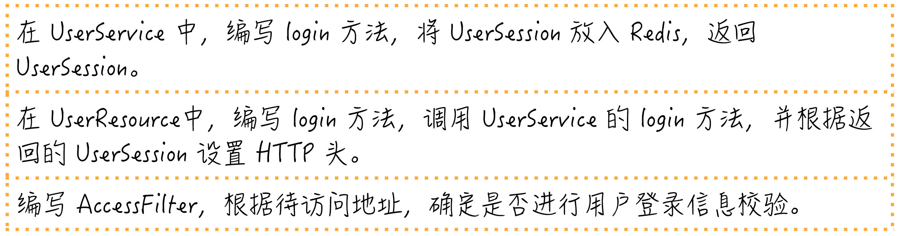
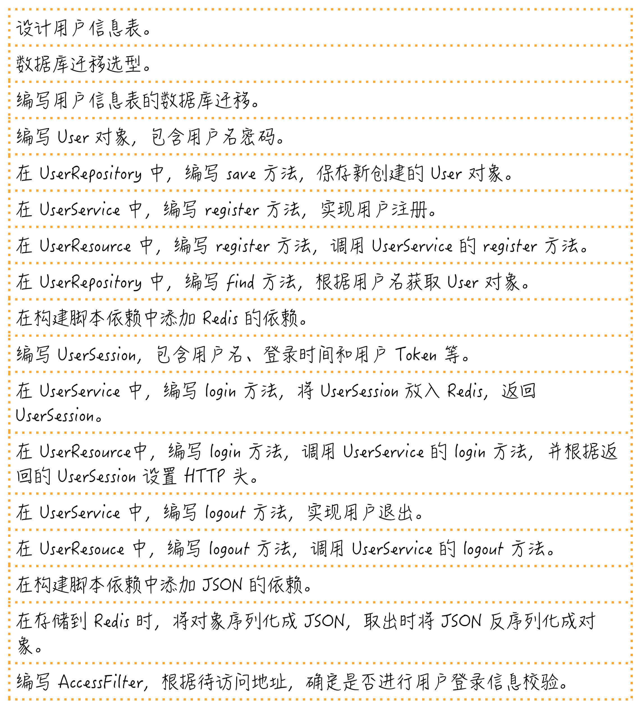

# 一起练习：手把手带你分解任务

## 核心命题

任务分解不是理论空谈，而是需要反复练习的**工程手艺**。以"用户登录"这一最常见功能为例，通过完整的需求→技术→实现的分解过程，展示如何将一个看似简单的需求拆解为**可独立开发、可独立测试、可独立验证**的子任务序列。

---

## 1. 需求分解：从"登录"到完整需求

### 1.1 沙盘推演发现隐含需求

原始需求："用户通过用户名密码登录"

推演后发现隐含需求：

| 原始需求 | 推演发现的隐含需求 |
|----------|------------------|
| 用户登录 | 用户名密码从何而来？→ 需要注册功能 |
| 用户登录 | 登录后的状态如何管理？→ 需要退出功能 |
| 用户登录 | 分布式场景下的会话共享？→ 需要会话持久化 |

**完整需求列表**：

1. 用户注册（设置用户名密码）
2. 用户登录
3. 用户退出

### 1.2 需求→技术方案→任务分解

---

## 2. 逐步分解过程

### 2.1 第一轮：需求级分解

| # | 任务 | 状态 | 备注 |
|---|------|------|------|
| 1 | 设计用户信息数据库表 | 需技术选型 | 表结构设计 |
| 2 | 数据库迁移 | 需选型 | Flyway/Liquibase |
| 3 | 用户注册 | 明确 | 用户名+密码注册 |
| 4 | 用户登录 | 明确 | 验证+会话 |
| 5 | 用户退出 | 明确 | 清除会话 |

### 2.2 第二轮：技术细节填充

技术选型确定后，每个任务进一步拆解：

| # | 原始任务 | 子任务 | TDD 切入点 |
|---|---------|--------|-----------|
| 1 | 设计用户表 | 用户表 Schema | 无（纯设计） |
| 2 | 数据库迁移 | 编写迁移脚本 | 无（基础设施） |
| 3 | 用户注册 | REST接口+Service+Repository | 先写注册接口的测试 |
| 4 | 用户登录 | 验证+JWT签发 | 先写"正确密码登录成功"测试 |
| 5 | 用户退出 | 清除JWT/Session | 先写"退出后会话失效"测试 |

### 2.3 第三轮：实现级分解（TDD 级）

以"用户登录"为例的 TDD 级分解：

**每个 Task 的 Red-Green-Refactor 循环**：

| Task | Red（测试） | Green（最小实现） | Refactor（重构） |
|------|-------------|------------------|----------------|
| 1 | `shouldReturnJwtWhenValidCredentials` | 硬编码返回 JWT | 引入 JWT 生成器 |
| 2 | `shouldRejectInvalidPassword` | 返回 401 状态码 | 引入密码验证逻辑 |
| 3 | `shouldRejectNonexistentUser` | 返回 404 状态码 | 引入 Repository 查询 |
| 4 | `shouldStorePasswordAsBCryptHash` | BCrypt 加密+验证 | 提取 PasswordEncoder |
| 5 | `shouldGenerateValidJwtToken` | JWT 签发 | 提取 TokenService |
| 6 | `shouldHandleExpiredToken` | 检查过期时间 | 提取 TokenValidator |

---

## 3. 分解过程的通用方法论

### 3.1 分解决策树

### 3.2 不确定性任务的处理策略

| 不确定性类型 | 策略 | 示例 |
|-------------|------|------|
| **需求不确定** | 先做需求澄清任务 | "与产品经理确认登录失败重试限制" |
| **技术方案不确定** | 先做技术 Spike | "对比 JWT vs Session 方案（半天调研）" |
| **实现细节不确定** | 先做最简单的测试 | "从 'shouldReturnJwt' 开始，逐步细化" |

> **Spike（技术探针）**：时间盒限定的技术调研活动（通常 1-2 天），目的是消除不确定性，产出是认知而非代码。Spike 结束后丢弃探针代码，用 TDD 重新实现。

---

## 4. REST 服务的三层架构分解

分解案例采用 REST 服务 + 三层架构，其任务分解映射为：

**Outside-In TDD 的推进顺序**：

1. 先写 Controller 层测试（定义 REST 接口行为）
2. Mock Service 层，实现 Controller
3. 写 Service 层测试（定义业务逻辑行为）
4. Mock Repository，实现 Service
5. 写 Repository 层测试（定义数据访问行为）
6. 实现 Repository

---

## 5. 分解实战全程：用户登录案例的逐步推演

以下还原郑晔对该案例的完整推演过程，展示任务分解到底可以做到什么程度。

### 5.1 基本需求与隐含需求

完成该需求最基本的任务是：用户通过输入用户名和密码登录。

登录任务本身很简单，但用沙盘推演一下便不难发现，这不是一个完整的需求：用户名和密码是哪来的？可能是用户设置的，也可能由系统管理员设置——此处简单设定为用户设置，于是有了注册；另外，有用户登录，一般情况下还会有退出功能。到此才是一个简单而完整的需求，不再做进一步的需求扩展。完整需求列表如下。

### 5.2 技术方案引入新任务

假设拿到需求列表的程序员要进行开发，先分析要做的事情有哪些，即任务分解。先决定技术方案：用最简单的方式实现——在数据库里建一张表保存用户信息；一旦牵扯到数据库表，就会涉及数据库迁移，于是任务清单增加两项。

接着检查这两个任务自己是否知道怎么做：设计表，一般熟悉 SQL 的人都知道怎么做；数据库迁移可能要牵扯技术选型——不同迁移工具写法上略有差别——把还不完全明确的内容加到任务清单里。

### 5.3 REST 三层架构的代码任务

数据库内容准备好后，轮到编写代码的准备。对外提供访问采用常见的 REST 服务，按最常规的三层技术架构，一般要编写：

- **领域对象**：此处即用户；
- **数据访问层**：不同项目叫法不一——有人从 J2EE 年代继承下来叫 DAO（Data Access Object），有人跟着 MyBatis 叫 mapper，郑晔更倾向使用领域驱动设计的术语，叫 repository；
- **服务层**：提供对外的应用服务，完成业务处理；
- **资源层**：提供 API 接口，包括外部请求的合法性检查。

**任务清单的排序原则**：清单上任务的顺序是按照一个需求完整实现的过程排列的。例如第一部分是一个完整的用户注册过程——先写 User，然后是 UserRepository 的 save 方法，接着是 UserService 的 register 方法，最后是 UserResource 的 register 方法；等这个需求开发完了，才是 login 和 logout。很多人习惯一个类一个类地写，但**最好按照一个需求、一个需求的过程走，这样任务可以随时停下来**：同样只有一半时间，按需求走至少交付了一个完整的注册过程，而按类写的结果是一个需求都没完成。

### 5.4 登录退出的难点：会话共享

register 只是一个在数据库中存储对象的过程，没有难度；login 和 logout 则不同。考虑到做的是一个 REST 服务，可能分布到多台机器上，请求到任何一台都能提供同样的服务，因此需要把登录信息共享出去。最常见的解决方案是用 **Redis 共享数据**：登录成功就把用户的 Session 信息放到 Redis 里，退出就是删除 Session 信息。任务清单上原本没有 Session，需要引入 Session 的概念，任务调整如下。

采用 Redis 后还要决定在 Redis 里存储对象的方式：可以用原生的 Java 序列化，但一般开发中会选择文本化的方式，维护起来更容易。此处选择常见的 JSON，任务又增加两项。

### 5.5 访问控制：filter 与 Token

最基本的登录退出功能已覆盖，但还要问一个问题：这就够了吗？之所以要登录，通常是要限定用户访问一些资源，因此还需要访问控制的能力。简单的做法是加入一个 filter，在请求到达真正的资源代码之前先做一层过滤；在 filter 里，如果待访问的地址需要登录才能访问，就检查用户是否已经登录——现在一般的做法是用一个 Token，通常从 HTTP 头里取出。而这个 Token 是什么时候放进去的？答案显然是登录的时候。任务列表继续调整。

至此已比较完整地实现了用户登录功能。真实项目中需求还可以继续扩展，例如：用户 Session 过期、用户名密码格式校验、密码加密保存、刷新用户 Token 等——按照上述讨论，这些都可以继续分解。

### 5.6 完整任务清单与检验标准

分解好的最终任务清单如下。

几点说明：

1. **任务分解没有绝对的标准答案**：分解结果因个人技术能力的不同，差异也会很大。
2. **检验标准**：检验每个任务项是否拆分到位，就是看是否知道它应该怎么做了。即便技术能力已经很强，依然建议把任务分解到很细——观其大略人人行，细致入微见本事。
3. **清单是备忘录**：郑晔实际写代码时并不会把所有任务一项项写下来——任务分解训练过无数次后，清单已在脑子里；但会把想到的、容易忽略的细节写下来。任务清单的主要作用是备忘录：一般情况下主流程不会遗漏，各种细节却常常遗漏，想到了就要记下来。
4. **顺序可再调整**：完整任务清单的顺序是调整过的，可以按列表一项项做；调整的基本标准是任务之间的依赖关系，以及"完整地实现一个需求"的原则。
5. **任务是独立的**：所有分解出来的任务都是独立的——**每做完一个任务，代码都是可以提交的**。只有这样，才可能做到真正意义上的小步提交。

---

## 6. 总结

任务分解是一个需要反复练习的手艺。从"用户登录"案例的完整分解过程中，可以提炼出：

1. **沙盘推演**发现隐含需求——"登录"不只包含登录本身
2. **技术选型**影响分解方向——数据库方案决定了额外的迁移任务
3. **不确定性处理**——不知道怎么做时，先做学习/调研任务
4. **TDD 级粒度**——每个子任务对应一个 Red-Green-Refactor 循环
5. **Outside-In 推进**——从外部接口开始，由外向内驱动设计
6. **按需求排序**——按照完整实现一个需求的顺序去安排分解出来的任务，任务可随时停下来
7. **小步提交**——每个任务独立完成即可提交

**核心要义**：分解到每个子任务都"知道怎么做"的程度，才是一个可执行的分解。

---

> **延伸阅读**
>
> - Kent Beck, *TDD By Example* (2002): 完整的 TDD 分解实战
> - "Growing Object-Oriented Software, Guided by Tests" (2009): Outside-In TDD 案例
> - Spike Solution: https://www.extremeprogramming.org/rules/spike.html
