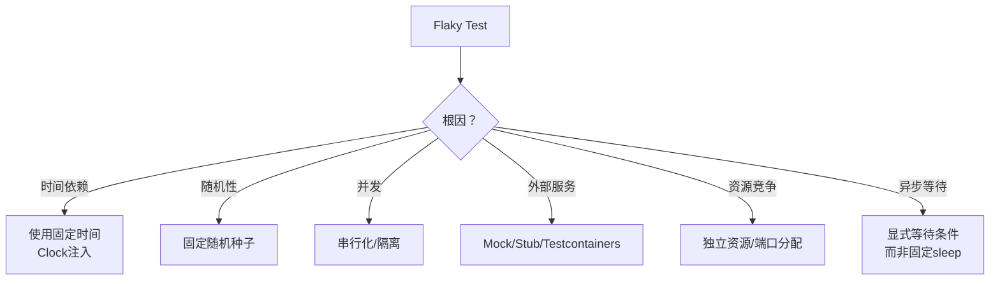
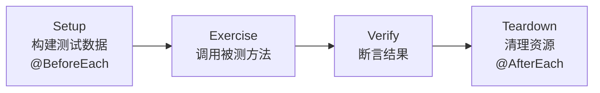
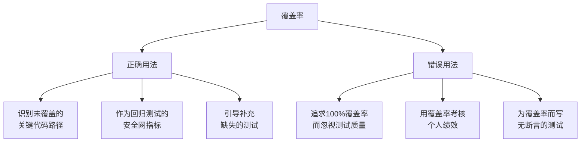

# 为什么你的测试不够好

## 核心命题

**测试必须简单到一目了然，不需要证明其正确性。** 谁来保证测试的正确性？答案是：没有人——因为给测试写测试会导致无限递归。唯一的出路是**将测试写得足够简单**，使其正确性不证自明。测试质量问题的根因，几乎都可以归结为"测试不够简单"。

---

## 1. 测试质量的典型问题与根因

### 1.1 常见测试反模式

| 反模式 | 表现 | 根因 | 后果 |
|--------|------|------|------|
| **Flaky Test** | 时过时不过 | 非确定性（时间/随机/并发/外部依赖） | 破坏信任，团队忽视测试 |
| **Setup 过重** | 测试环境搭建耗时 | 测试耦合了过多外部依赖 | 测试慢，不愿运行 |
| **测试间依赖** | 必须按特定顺序执行 | 共享可变状态 | 不可并行，不可重复 |
| **测试测实现** | 修改实现导致测试失败 | 测试断言了内部实现细节 | 重构困难，测试脆弱 |
| **God Test** | 一个测试验证所有行为 | 未按单一关注点拆分 | 失败时难以定位问题 |

### 1.2 Flaky Test 的治理

Flaky Test 是 CI/CD 流水线的头号敌人。据 Google 工程团队在 Google Testing Blog 上的披露，**约 16%** 的 Google 内部测试存在不同程度的 Flaky 行为。



**Flaky Test 的处理策略**：

1. **隔离**：标记为 Flaky，从 CI 关键路径中移除
2. **诊断**：多次运行（`--repeat=100`）定位非确定性来源
3. **修复**：消除非确定性根因
4. **移除**：无法修复的 Flaky Test 应删除，而非保留

郑晔在实际观察中也见到过同类问题的典型表现：测试不稳定，这次能过、下次过不了；测试本身要测的东西很简单，但周边依赖很多，搭建环境就需要很长时间；一个测试要运行，必须等另一个测试运行结束。他的结论是：**这些测试不够简单——只有将复杂的测试拆分成简单的测试，测试才有可能做好。**

---

## 2. 简单测试的结构化规范

### 2.1 一个好测试的结构

```
测试 = 准备（Arrange）+ 执行（Act）+ 断言（Assert）
```

**好测试的特征**：

| 特征 | 含义 | 检验方法 |
|------|------|---------|
| **单一断言原则** | 一个测试只验证一个行为 | 测试名与断言一一对应 |
| **无隐式依赖** | 所有依赖显式构造 | 无全局状态访问 |
| **确定性** | 相同输入→相同输出 | 多次运行结果一致 |
| **自解释** | 测试名即文档 | 阅读测试名即可理解行为 |
| **快速** | 毫秒级完成 | 无 I/O、无网络、无 sleep |

### 2.2 测试的 4 阶段生命周期



**Setup/Teardown 的最佳实践**：

- 使用 Builder Pattern 构建测试数据，提高可读性
- 使用 JUnit Rule/Extension 管理共享资源，避免手动 Teardown
- Test Fixture 应**最小化**——只构造当前测试所需的数据

### 2.3 测试代码与生产代码同等重要

| 维度 | 生产代码 | 测试代码 |
|------|---------|---------|
| **代码质量** | 需要重构 | 同样需要重构 |
| **命名** | 清晰表达意图 | 同样清晰表达行为 |
| **DRY** | 避免重复 | 适度重复（测试应自包含） |
| **设计模式** | 使用适当模式 | Builder、Object Mother、Test Data |

> **关键区别**：测试代码中**适度的重复是可接受的**——每个测试应独立可读，不应为消除重复而引入共享的复杂 Setup 逻辑。

---

## 3. 测试替身的精确使用

### 3.1 Mock vs Stub 的选择原则

| 场景 | 选择 | 原因 |
|------|------|------|
| 验证**交互行为**（是否调用了某方法） | Mock | 关注"做了什么" |
| 隔离**返回值**（需要特定数据） | Stub | 关注"返回什么" |
| 需要**简化实现**（如内存数据库） | Fake | 关注"行为等价" |

### 3.2 Mock 的过度使用问题

> **London School 的批评**：过度使用 Mock 会导致测试与实现细节强耦合——重构实现时测试大量失败，即使行为未变。

**缓解策略**：

- Mock 接口而非具体类
- Mock 外部边界（Repository、Gateway），不 Mock 内部协作
- 优先使用 Fake（如内存数据库），仅在必要时使用 Mock

---

## 4. 测试覆盖率：度量而非目标

### 4.1 覆盖率类型的精确理解

| 覆盖率类型 | 含义 | 局限 |
|-----------|------|------|
| **行覆盖率** | 被执行的代码行比例 | 不检查分支 |
| **分支覆盖率** | 被执行的分支比例 | 不检查条件组合 |
| **路径覆盖率** | 被执行的执行路径比例 | 组合爆炸，实际不可达 |
| **Mutation 覆盖率** | 被杀死的变异比例 | 最严格，但计算成本高 |

### 4.2 覆盖率的正确使用方式



> **原则**：覆盖率是**发现工具**（发现未测试的代码），而非**目标**（追求数字）。100% 行覆盖率不等于 100% 行为覆盖。

---

## 5. 简单测试的写法与 A-TRIP 标准（郑晔）

### 5.1 为什么测试必须简单

郑晔用一个有趣的逻辑论证了测试必须简单：测试的作用是保证代码的正确性，随之而来的问题是——谁来保证测试的正确性？

- 许多人第一次面对这个问题会答"再写测试"，但没有人给测试写测试：一旦这么做，"谁来保证那个测试的正确性"的问题会随即上升，总不能无限递归地给测试写测试。
- 既然无法用写程序的方式保证测试的正确性，唯一的办法就是：**把测试写简单，简单到一目了然，不需要证明它的正确性**。
- 因此，如果见到哪个测试写得很复杂，它一定不是一个好的测试。

### 5.2 简单测试的标准结构：四段式

下面这个例子来自郑晔的开源项目 [Moco](https://github.com/dreamhead/moco)（稍做调整以便理解），测试内容是从一个 HTTP 请求中提取出 HTTP 方法：

```
@Test
void should_extract_HTTP_method_from_HTTP_request() {
  // 前置准备
  request = mock(HttpRequest.class);
  when(request.getMethod()).thenReturn(HttpMethod.GET);
  HttpMethodExtractor extractor = new HttpMethodExtractor();

  // 执行
  HttpMethod method = extractor.extract(request);

  // 断言
  assertThat(method, is(HttpMethod.GET));

  // 清理
}

```

郑晔把这段代码分成四段——**前置准备、执行、断言和清理**，这也是一般测试要具备的四段：

- **执行**：核心部分，就是测试的目标，但往往也是最短小的，一般就是一行代码调用——例中调用 HTTP 方法提取器提取 HTTP 方法。
- **前置准备**：准备执行部分所需的依赖，比如一个类所依赖的组件，或是调用方法所需要的参数。例中准备了一个 HTTP 请求并设置其方法为 GET；这里用到了 Mock 框架，因为完整地设置一个 HTTP 请求很麻烦，而且与这个测试没什么关系。
- **断言**：预期，即这段代码执行出来怎么算是对的——例中判断提取出来的方法是否是 GET 方法。补充一点：断言不仅仅是 assert，使用 Mock 框架时，校验 mock 对象行为的 verify 也是一种断言。
- **清理**：可能会有的部分，测试用到任何资源都可以在这里释放。如果利用好现有的测试基础设施（比如 JUnit 的 Rule）、遵循好测试规范，很多情况下这个部分就可以省掉。

### 5.3 常见的测试"坏味道"

郑晔总结了三种典型"坏味道"：

1. **执行部分做太多事**：一个测试里出现了几个不同方法的调用——这个测试到底在测谁？测试一旦出错，就需要把所有相关的方法都查看一遍，这无疑增加了工作的复杂度。解决办法很简单：有多个方法要测，就多写几个测试。
2. **没有断言**：**测试一定要有断言**，没有断言的测试是没有意义的。郑晔见过不少人写了不少测试，但测试运行几乎从来不会错——打开代码一看，没有断言；没有断言当然就不会错。写测试的同事还会委屈地说测试不好写、而且已经人工验证代码是对的——但测试不好写往往是设计的问题，应该调整的是设计，而不是在测试这里做妥协。
3. **复杂**：当测试代码里出现各种判断和循环语句时，这个测试基本就有问题了。典型场景是断言写在一堆 if 语句中，美其名曰"根据条件执行"——可是怎么保证这个测试函数本身写的是对的？除非用调试手段，否则无法判断条件分支是否执行到了。如果有一大堆不同的数据要测，正确做法是**多写几个测试，每个测试覆盖一种场景**。

### 5.4 A-TRIP：好测试的五个标准

怎么样的测试算是好测试？郑晔引用了一个总结——A-TRIP，五个单词的缩写：

- **Automatic（自动化）**：把测试尽可能交给机器执行，人工参与的部分越少越好。这也是测试一定要有断言的原因——只有存在断言，机器才能自动判断测试是否成功。
- **Thorough（全面的）**：应该尽可能用测试覆盖各种场景。理解这一点有两个角度：写代码之前，要考虑各种场景——正常的、异常的、各种边界条件；写完代码之后，看测试是否覆盖了所有的代码和所有分支，这正是各种测试覆盖率工具发挥作用的场景。想做到全面并非易事，团队补测试时，一种办法是让测试覆盖率逐步提升。
- **Repeatable（可重复的）**：一个角度是单个测试反复运行结果应该一样——每个测试都不应该依赖任何不在控制之下的环境。比如有外部依赖，可以采用模拟服务的手段：郑晔的 [Moco](https://github.com/dreamhead/moco) 就是为解决外部依赖而生，可以模拟外部 HTTP 服务，让测试变得可控；测试依赖数据库，就在执行完之后将数据库环境恢复，Spring 的测试框架就提供了测试数据库回滚的能力。反复运行不能产生相同的结果，要么是代码有问题，要么是测试有问题。另一个角度是一堆测试反复运行结果应该一样——这说明测试和测试之间没有任何依赖。
- **Independent（独立的）**：测试和测试之间不应该有任何依赖。什么叫有依赖？比如测试依赖外部数据库或第三方服务，测试 A 运行时在数据库里写了些值，测试 B 要用到这些值，测试 B 必须在测试 A 之后运行——这就是有依赖。不能假设测试按编写顺序运行：为了加快速度，测试常常被并行执行，顺序完全无法保证。减少外部依赖可以用 mock；实在要依赖，每个测试自己负责前置准备和后续清理；如果多个测试有同样的准备和清理，那正是 setup 和 teardown 发挥作用的地方——测试基础设施早已为此做好了准备。
- **Professional（专业的）**：这是很多人观念中缺失的一点——测试代码也是代码，也要按照代码的标准去维护。这意味着测试代码也要写得清晰：良好的命名、把函数写小、要重构，甚至要抽象出测试的基础库。Web 测试中常见的 PageObject 模式，就是这种理念的延伸。

### 5.5 写好测试的前提：编写可测试的代码

看完这些标准，一个常见的疑问是：业务代码那么复杂、测试路径那么多，怎么能让测试满足这些要求？

郑晔强调了他关于测试驱动开发的一个观点：**编写可测试的代码**。很多人写不好测试、或者觉得测试难写，关键在于始终站在写代码的视角，而不是写测试的视角——如果不重视测试、不给测试留好空间，测试是不可能做好的。

### 5.6 小结

- 测试是一个说起来很简单、但很不容易写好的东西；实际工作中出现的各种测试问题，主要原因是测试写得太复杂——测试一旦复杂，就很难保证测试本身的正确性，更何谈用测试保证代码的正确性。
- 测试的基本结构是四段：前置准备、执行、断言和清理；常见的"坏味道"是做了太多事的测试、没有断言的测试，以及一眼就能看出问题的含判断语句的测试。
- 衡量测试是否做好的标准是 A-TRIP：Automatic（自动化）、Thorough（全面）、Repeatable（可重复）、Independent（独立）、Professional（专业）。
- 郑晔的核心结论：**要想写好测试，就要写简单的测试。**

---

## 6. 总结

**核心要义**：测试必须简单到一目了然。如果测试比被测代码还复杂，那测试本身就成了问题。Flaky Test、Setup 过重、测试间依赖等问题的根因，都是测试不够简单。将复杂测试拆分为简单测试，是测试质量提升的第一步。

---

> **延伸阅读**
>
> - Gerard Meszaros, *xUnit Test Patterns* (2007): 测试反模式与重构
> - Google Testing Blog: https://testing.googleblog.com/
> - Martin Fowler, "TestDouble": https://martinfowler.com/bliki/TestDouble.html
> - PITest Mutation Testing: https://pitest.org/

---

> **原文出处**：本文第 5 节的方法论与案例整理自郑晔原文《16 | 为什么你的测试不够好？》，观点与案例细节均已署名保留。
