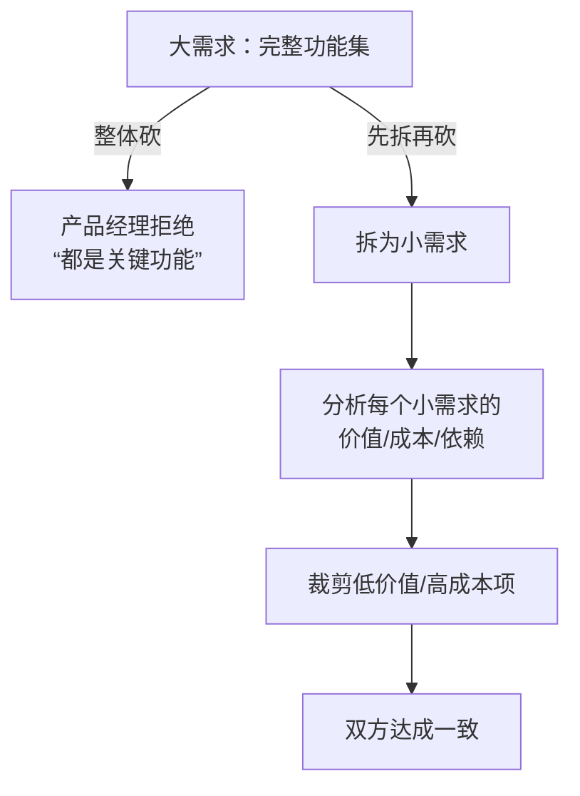
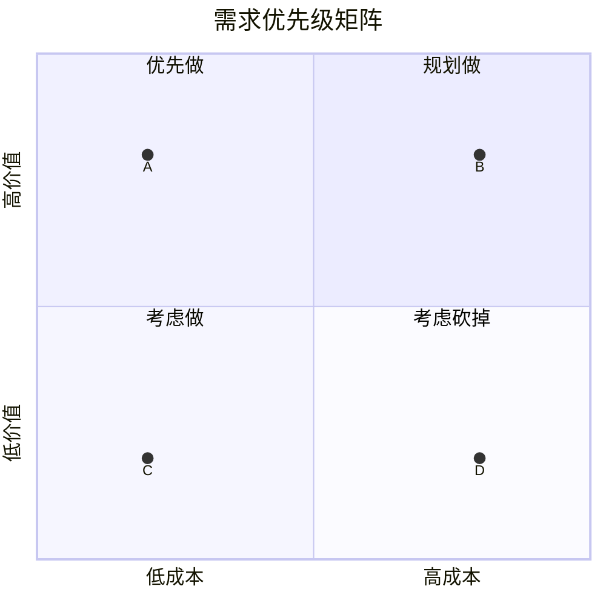

# 程序员也可以"砍"需求吗

## 核心命题

需求分解不仅是开发任务分解的前置步骤，更是**程序员参与产品决策的关键入口**。通过将大需求拆分为小需求，程序员可以基于技术可行性、实现成本和优先级，对需求进行**有理有据的裁剪**——这不是对抗产品经理，而是共同追求"做正确的事"。

---

## 1. 需求分解的必要性

### 1.1 为什么"砍需求"常常失败？

**核心逻辑**：大需求整体砍 → 产品经理认为"都是关键" → 无法砍。拆为小需求后 → 可以逐项讨论价值与成本 → 可裁剪。

### 1.2 需求分解的 INVEST 原则

User Story 应满足 INVEST 原则：

| 字母 | 含义 | 对分解的指导 |
|------|------|-------------|
| **I**ndependent | 独立 | 故事间无依赖，可独立排序 |
| **N**egotiable | 可协商 | 故事是讨论起点，而非契约 |
| **V**aluable | 有价值 | 对用户/业务有可感知的价值 |
| **E**stimatable | 可估算 | 技术团队可评估实现成本 |
| **S**mall | 小 | 一个迭代内可完成 |
| **T**estable | 可测试 | 有明确的验收标准 |

---

## 2. 需求裁剪的决策框架

### 2.1 价值-成本矩阵

| 象限 | 策略 | 典型需求 |
|------|------|---------|
| **高价值 + 低成本** | 立即做 | 核心功能、关键 Bug 修复 |
| **高价值 + 高成本** | 规划做，寻找简化方案 | 基础设施升级、架构迁移 |
| **低价值 + 低成本** | 考虑做（填充迭代） | UI 微调、小优化 |
| **低价值 + 高成本** | **砍掉** | 过度工程、边缘场景 |

### 2.2 程序员的需求裁剪策略

| 策略 | 方法 | 示例 |
|------|------|------|
| **成本透明化** | 为每个需求提供实现成本估算 | "这个功能需要 5 人天，涉及 3 个模块改造" |
| **替代方案提出** | 用更低成本方案替代 | "不需要自建，可用 SaaS 替代" |
| **范围缩小** | 缩小需求的边界 | "先支持单租户，多租户延后" |
| **延迟决策** | 将非紧急需求排入 Backlog | "这个需求与 Q2 OKR 无关，排入 Q3" |

---

## 3. 总结

**核心要义**：程序员可以"砍"需求，但前提是先将需求拆小。大需求整体砍会被拒绝，小需求逐项讨论价值与成本则可达成一致。需求分解是程序员参与产品决策的桥梁。

---

> **延伸阅读**
>
> - Mike Cohn, *User Stories Applied* (2004): INVEST 原则
> - Jeff Patton, *User Story Mapping* (2014): 需求分解与优先级

---

## 原文存档

> 以下内容整理自郑晔原文，已改写为书面表述，保留全部论述、案例与链接作为参考。

### 程序员也可以“砍”需求吗？

前文讲的任务分解，主要是开发任务的分解。本篇换个角度，讨论需求的分解——是的，需求也要分解。

郑晔曾与一位做开发的同事聊天，对方道出了近期的烦恼：团队需求太多、开发人手太少，再这么干下去，哪天感觉扛不住了就打算离职。郑晔问他有没有尝试砍需求；同事说尝试过，但产品的人都不同意，认为这批功能都是关键功能。郑晔再问：有没有尝试把需求拆开了再砍？同事十分惊讶：“还可以这样？”

同事的惊讶并不意外。双方都在说“需求”，但对需求的理解却大不相同。提到“需求”这个词，会想到什么？以最常用的登录为例，大多数人的第一直觉还是用户名密码登录。

**基本上，闯入脑海的需求描述是主题（epic），在敏捷开发中，有人称之为主用户故事（master story）。**

如果对需求的管理粒度就是主题，很多事情就没法谈了。比如时间紧迫时想砍需求，直接问产品经理“不做登录行不行”，就等着被拒绝吧。但换一种说法——时间比较紧，能不能把登录验证码放到后面做，或是把邮件地址验证的功能放到后面——这种建议产品经理是可以谈的。这其中的差别就在于，后者将需求分解了。

大多数人可以理解需求是要分解的，但分解的程度不同，正是导致执行效果差异极大的根源。以郑晔的经验而言，**绝大多数问题都是由于分解的粒度太大造成的，少有因为粒度太小而出问题的。**所以，需求分解的一个原则是：粒度越小越好。

### 需求要分解

“主题”只是帮人记住大方向，真正用来进行需求管理，还要靠进一步分解出来的需求。本篇沿用此前篇章已介绍过的需求描述方式：用户故事，它是需求管理讨论的基本单位。如果团队用的是其他方式描述需求，也可以寻找对应的管理方式。

在以终为始的讨论中，对用户故事的关注点主要在验收标准，以确保一个需求的完整性；而在任务分解的语境下看用户故事，则主要关注它作为需求分解的结果，也就是分拆出来要解决的一个个需求点。

此前的讨论已经说明了用户故事的“长相”，但更重要的问题是：划分需求的方式有无数种。就像一块蛋糕，可以横着切，也可以竖着切；一刀不切，就是拿着主题当用户故事；快刀飞起，则可以把主题切碎。

每个人都会有自己喜欢的拆分方式，知道拆分的重要性之后，总会有办法。这里主要讨论怎样评判拆分结果——毕竟要把它当作需求管理的基本单位。

只有细分的需求才能方便进行管理。什么样的需求才是一个好的细分需求？先来看用户故事的衡量标准。

评价用户故事有一个“INVEST 原则”，这是六个单词的缩写，分别是：

- **Independent，独立的。** 一个用户故事应该完成一个独立的功能，尽可能不依赖于其它用户故事，因为彼此依赖的用户故事会让管理优先级、预估工作量都变得更加困难。如果真的有依赖，一种好的做法是，将依赖部分拆出来，重新调整。
- **Negotiable，可协商的。** 有事大家商量是一起工作的前提，谁也无法保证所有的细节都能 100% 落实到用户故事里，这时最好的办法是大家商量。它也是满足其它评判标准的前提——就像前面提到的，一个用户故事不独立、需要分解，这也需要大家一起商量。
- **Valuable，有价值的。** 一个用户故事都应该有其自身价值，这一项应该最容易理解：没有价值的事不做。正如反复强调的那样，做任何事情之前，先问问价值所在。
- **Estimatable，可估算的。** 团队会利用用户故事估算的结果安排后续的工作计划。不能估算的用户故事，要么是因为有很多不确定的因素，要么是因为需求还是太大——这样的故事还没有到一个能开发的状态，还需要产品经理进一步分析。
- **Small，小。** 步子大了，不行。不能在一定时间内完成的用户故事只应该有一个结果：拆分。小的用户故事才方便调度，才好安排工作。
- **Testable，可测试的。** 不能测试，谁知道做得对不对。这就是此前强调过的验收标准——得知道怎样才算是工作完成。

“INVEST 原则”的说法是为了方便记忆，这里着重讨论两个点。

第一个关注点是可协商。作为实现者，要主动问问题。只是被动接受的程序员，价值就少了一半；只要开始发问，就会发现很多写需求的人没有想清楚的地方。

郑晔在职业生涯中无数次将需求挡了回去，不是不合作，而是不想做一些糊涂的需求。之所以能问出问题，一方面是出于常识，另一方面就是这里说的用户故事是否有价值。**用户故事，之所以是故事，就是要讲，要沟通。**

还有一个更重要的关注点，也是本篇的核心：小。无论是独立性也好，还是可估算的也罢，其前提都是小。只有当用户故事够小了，后续的腾挪空间才会大。

那接下来就是一个重要的问题：怎么才算小？这就牵扯到用户故事另一个重要方面——估算。

### 需求的估算

估算用户故事，首先要选择一个度量标准。度量用户故事大小的方式有很多种：有人用 T 恤大小的方式，即 S、M、L、XL、XXL；也有人用费波纳契数列，即 1、2、3、5、8 等。有了度量标准之后，就可以开始估算了。

从分解出来的用户故事中挑出一个最简单的，比如“某个信息的查询”。这个最简单的用户故事，其作用就是当作基准。

比如采用费波纳契数列，那这个最简单的用户故事就是基准点 1。其他用户故事要与它一一比较，如果一个用户故事比它复杂，可以按照复杂程度给出估计。

有人或许会问，怎么知道复杂程度是什么样的？这时前文讲过的任务分解就派上用场了：在大脑中快速地做一个任务分解，想想有哪些步骤要完成，然后才好做对比。

所以，任务分解是基础中的基础：不学会分解，工作就只能依赖于感觉，很难成为一个靠谱的程序员。

**估算的结果是相对的，不是绝对精确的。不必像做科研一样，只要给出一个相对估算就好。**

同一个用户故事，不同的人估算出的结果可能会有差别。怎样尽可能在团队中达成一致？这就需要团队中的很多人参与进来，如果团队规模不大，全员参与也可以。

多人估算时会出现一个有趣的现象：针对同一个用户故事，不同的人估算的结果差异很大。

如果差别不大——比如一个人估 3 个点、另一个人估 2 个点——协调一下就好。但如果差异很大——比如一个认为 2 个点、另一个认为 8 个点——那绝对是双方对任务的理解出现了巨大差异。这时就可以把刚才在脑中进行的任务分解“摆”到桌面上，看看差异在哪。

通常情况下，是双方对需求的理解出现了偏差，这时负责用户故事编写的同事就要站出来，帮助大家澄清需求。所以，**一般来说，估算的过程也是大家加深对需求理解的过程。**

估算还有另外一个重要的作用：发现特别大的用户故事。一般而言，一个用户故事应该在一个迭代内完成。

比如，预计大小为 1 点的用户故事要用 1 天完成，而团队的迭代周期是两周，即 10 个工作日，那 13 点的任务是无论如何都完不成的。怎么办？很简单，把它拆分成多个小任务，这样一来，每个小任务都可以在一个迭代中完成。

所以，一般来说，用户故事有可能经过两次拆分：一次是由负责业务需求的同事（比如产品经理）根据业务做一次拆分；另一次是在估算阶段发现过大的用户故事，再拆分一次。

有了合适的用户故事列表，接下来就可以安排开发计划了。只要厘清用户故事之间的依赖关系，安排工作是每一个团队都擅长的事情。

回到开头的讨论。常说需求来自产品经理，但需求到底是什么，是一个很宽泛的话题。到这里，团队已经有了一个更清晰、更可管理的需求——用户故事。这时候再说需求调整，调整的就不再是一个大主题，而是一个个具体的用户故事了。

许多团队真正的困境在于，开发过程中缺少需求分解的环节。在这种情况下，需求的管理基本单位就是一个主题；既然是基本单位，那就是一个不可分割的整体。团队就被生生绑死在一个巨大的需求上，没有回旋的余地。

如果团队可以将需求分解，需求的基本单位就会缩小，每个人看到的就不再是“铁板”一块，才能更方便地进行调整，才会有比较大的腾挪空间。

### 总结时刻

软件开发中，需求管理是非常重要的一环。需求管理上常见的错误是粒度太大：很多团队几乎是在用一个大主题管理需求，这就让需求调整的空间变得很小。

结合用户故事，本篇讨论了一个好的需求管理基本单位是什么样子：它要符合“INVEST 原则”，其中一个关键点是“小”——只有小的需求才方便管理和调整。

什么样的需求才算小？本篇介绍了一种需求估算的方式，每个团队都可以根据自己的特点决定多大的需求算大。大需求怎么办？只要再进行分解就好了。

如果对用户故事这个话题感兴趣，推荐阅读 Mike Cohn 的两本书 [《User Stories Applied》](https://book.douban.com/subject/4743056/) 和 [《Agile Estimating and Planning》](https://book.douban.com/subject/26811747/)。

如果只能记住一件事，请记住：**想要管理好需求，先把需求拆小。**