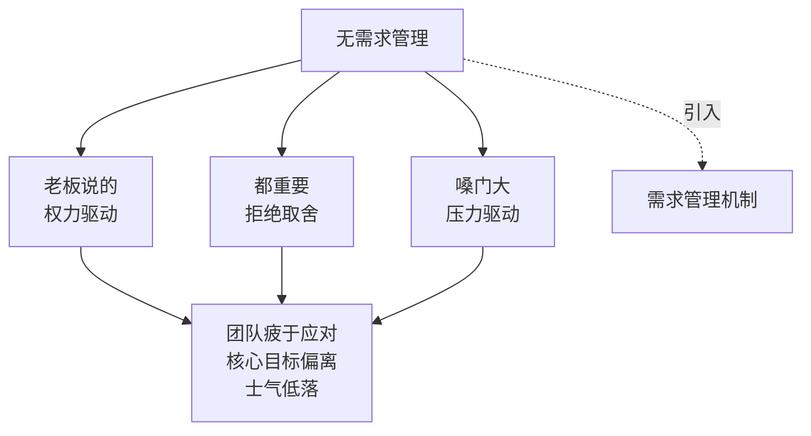
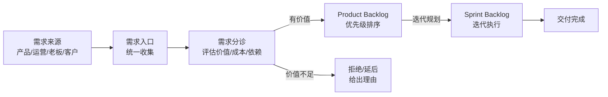
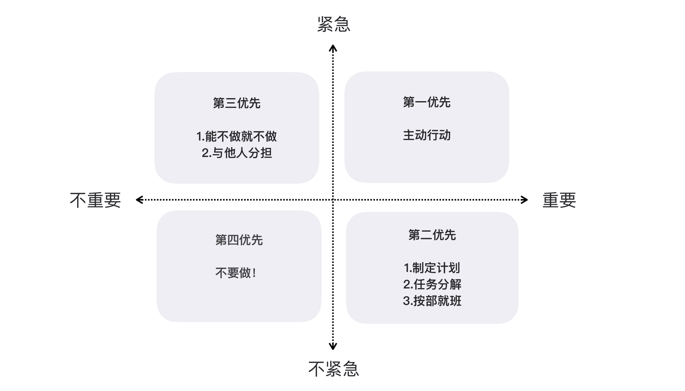
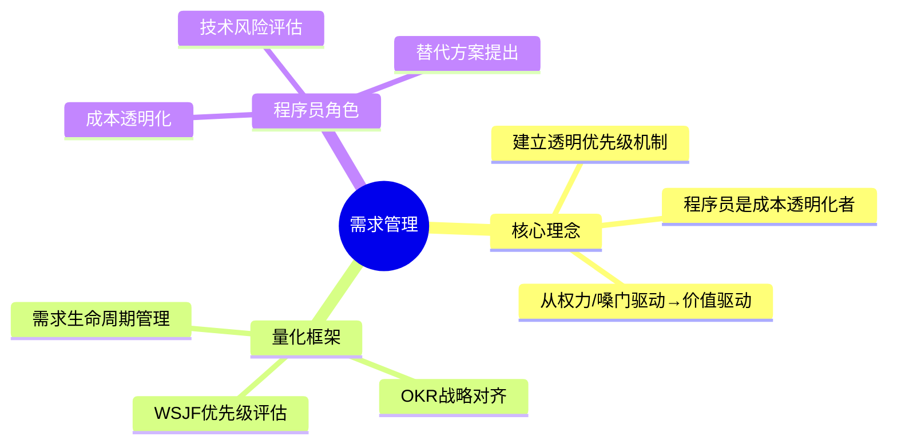

# 需求管理：太多人给你安排任务，怎么办

## 核心命题

需求分解只是第一步，**需求管理**才是程序员从"被动执行者"转向"主动贡献者"的关键。需求管理的核心不是"拒绝需求"，而是**建立透明的优先级机制**——使所有利益相关方对"先做什么、后做什么、不做什么"形成共识。没有需求管理的团队，程序员会陷入"谁嗓门大听谁的"困境，疲于应对却难以产出核心价值。

---

## 1. 需求管理的三种反模式

### 1.1 常见失败模式

| 反模式 | 表现 | 后果 | 根因 |
|--------|------|------|------|
| **"老板说的"** | 需求优先级由权力而非价值决定 | 资源错配，重要需求被挤占 | 缺乏透明决策机制 |
| **"都重要"** | 所有需求标记为 P0 | 无法区分优先级，团队无所适从 | 不愿做取舍 |
| **"谁嗓门大听谁的"** | 需求优先级由施加压力的能力决定 | 团队疲于应对，核心目标偏离 | 缺乏量化评估框架 |

---

## 2. 需求管理的系统化框架

### 2.1 需求生命周期

### 2.2 WSJF：量化优先级的标准方法

SAFe 提出的 WSJF（Weighted Shortest Job First）是量化需求优先级的行业方法：

**WSJF = (用户价值 + 时间紧迫性 + 风险降低/机会赋能) / 作业规模**

| 因子 | 含义 | 评估方式 | 示例（1-10 评分） |
|------|------|---------|------------------|
| **用户业务价值** | 对用户/业务的收益 | 业务方评估 | 新支付方式价值=8 |
| **时间紧迫性** | 延迟交付的代价 | 业务方评估 | 竞品已上线紧迫性=9 |
| **风险降低/机会赋能** | 降低风险或开启新机会 | 产品+技术评估 | 合规要求风险=10 |
| **作业规模** | 实现成本 | 技术团队评估 | 需 3 人天=3 |

> **示例**：WSJF = (8+9+10)/3 = 9.0 → 高优先级

### 2.3 OKR 对齐：需求筛选的战略锚点

| 层级 | OKR 示例 | 需求筛选标准 |
|------|---------|-------------|
| **公司级** | O: 提升用户留存 / KR: 留存率 > 60% | 是否直接贡献留存指标？ |
| **团队级** | O: 优化核心流程 / KR: 转化率 > 5% | 是否优化核心转化路径？ |
| **个人级** | O: 提升系统稳定性 / KR: MTTR < 1h | 是否降低 MTTR？ |

> **原则**：与 OKR 无关的需求，默认不做——除非有明确的价值论证。

---

## 3. 程序员在需求管理中的角色

### 3.1 三个关键贡献

| 贡献 | 说明 | 示例 |
|------|------|------|
| **成本透明化** | 为每个需求提供实现成本估算 | "这个功能需要 5 人天，涉及 3 个模块改造" |
| **技术风险评估** | 识别需求的技术风险 | "这个方案会导致数据迁移，需要额外 3 人天" |
| **替代方案提出** | 用更低成本方案替代 | "不需要自建，可用 SaaS 替代，节省 10 人天" |

### 3.2 需求管理的沟通技巧

| 场景 | 有效话术 | 无效话术 |
|------|---------|---------|
| 拒绝需求 | "基于 WSJF 评估，此需求优先级低于当前 Sprint 的其他项" | "做不了" |
| 延后需求 | "此需求与 Q2 OKR 不直接相关，建议排入 Q3 规划" | "以后再说" |
| 简化需求 | "如果先做核心功能（3 人天），延后高级功能（5 人天），可以更快上线验证" | "太复杂了" |
| 质疑需求 | "这个需求要验证的假设是什么？有没有更简单的验证方式？" | "为什么要做这个？" |

---

## 4. 需求优先级的判断方法（郑晔）

### 4.1 典型案例：一句"老板说的"压垮一个团队

郑晔讲述了一个发生在身边的案例：在一次各团队负责人的复盘会上，一位开发团队负责人抱怨倒排期过于严重——每个产品经理到他这里都说上线日期已经定好，而团队资源有限，实在扛不住了。当被追问"这些任务都一样重要吗""他们凭什么说自己的任务重要"时，这位负责人的回答是："他们告诉我，是老板说的。"

郑晔据此指出两点：

- **就凭一句"老板说的"，就可以判断出产品经理缺乏对需求管理应有的理解**——"来自老板"不应成为需求优先级的依据。
- 研发团队也因为无脑地接受了需求，几乎将自己压垮。

会上给出的处置办法层层递进：CTO 提出"口头的东西不算数，如果他们说是老板说的，那就让老板发邮件确认"；考虑到产品经理可能不会去和老板提这个要求，进一步建议这位负责人直接发邮件给老板并同时抄送 CTO；最终 CTO 把责任扛了过去，负责人才心里有底。这个场景向下延伸到程序员身边就是：一个需求不明就里地来了，周末假期全部泡汤，因为负责人会说"这是老板说的"。

### 4.2 需求管理的本质是优先级问题

- 软件行业有个段子：做软件最理想的交付日期是什么时候？答案是昨天，其次是尽快。所有提出业务需求的人都恨不得需求早就做好了。
- 如果等着所有需求都开发好了再上线，那是当年瀑布模型的做法——放在二十年前还有生存空间，今天显然已经不合时宜。今天做软件的关键点在于世界有太多不确定，只能把产品的"一部分"开发好送上线。
- 这就牵扯出需求管理的本质：**实际上是个优先级的问题**——必须在宏大的理想和骨感的现实中作出取舍，选择"哪部分"优先上线。
- 优先级这种事是可以谈的，大多数能当老板的人都是可以讲道理的；但要和老板谈，得知道怎么讲道理——准备一些基础知识，才能与各级老板探讨怎么安排工作的优先级。
- 为什么要区分优先级？因为时间是有限的，有限时间内能完成工作的上限是一定的。怎么充分利用有限的时间是一个时间管理问题，因此完全可以借鉴时间管理领域的优秀实践来明辨优先级。

### 4.3 艾森豪威尔矩阵：区分"重要"与"紧急"

一个有效的时间管理策略是**艾森豪威尔矩阵（Eisenhower Matrix）**，由美国前总统艾森豪威尔开发，后经史蒂芬·柯维（Stephen Richards Covey）在《高效能人士的七个习惯》中发扬光大，推广至世界各地。

矩阵将事情按"重要"和"紧急"两个维度划分成四个部分。郑晔用程序员工作中的例子说明了各象限的定位与处理原则：

| 象限 | 处理原则 | 程序员工作中的例子 |
|------|---------|------------------|
| **重要且紧急** | 立即做 | 让系统不能正常运行的线上故障——不赶紧解决，就影响公司的正常运营 |
| **重要不紧急** | 重点投入精力 | 团队对系统的升级改造——改造好，性能与可维护性都提升；不改造，一时半会也能用 |
| **紧急不重要** | 委托别人做 | 各种临时任务 |
| **不重要不紧急** | 尽量少做 | 刷朋友圈 |

矩阵带来的最大思维改变是：**事情和事情不是等价的；如果不把精力放在重要的事情上，到最后可能都变成紧急的事情**。郑晔举例说明：放任系统不做升级改造，过多的技术债会让系统的问题越来越多、新需求实现的速度越来越慢，最后几个看起来不大的需求就足以让团队加班加点、天怒人怨。

把这个思路带回需求管理可以发现：团队面临的各种需求所采用的优先级排序方式，基本都是按紧急程度排列的，但它们是否真的重要是另一回事。如果把这个问题抛给需求的提出者，几乎可以肯定得到的答案是"提出的需求就是重要的"——一种可能是，提出者自己也分不清重要和紧急的差别。

### 4.4 需求没那么重要，直到说清它为什么重要

针对上述场景，郑晔给出的做法是**多问一些问题**。他在"精益创业"一篇中提出过一条原则：

> 默认所有需求都不做，直到弄清楚为什么要做这件事。（[精益创业：产品经理不靠谱，你该怎么办？](https://time.geekbang.org/column/article/76260)）

同样，需求也没那么重要，直到产品经理能说明白它为什么重要——尤其是为什么比其他需求重要。如果一个产品经理不能把几个需求排出优先级，就可以把艾森豪威尔矩阵的思路讲给他。

另一种可能是，需求在产品经理自己的工作上下文中确实是最重要的内容。但当有多个需求来源时，如何确认哪个需求是最重要的？这时才到了真正需要老板出场的时刻。

### 4.5 站在老板面前：用更大的上下文做判断

郑晔在另一篇文章中指出，不同角色真正的差异是工作上下文的不同——每个人都在自己的上下文里工作，而上下文局限了很多人的视野（[解决了很多技术问题，为什么你依然在"坑"里？](https://time.geekbang.org/column/article/76567)）。

**案例**：两个产品经理同时提出需求，一个说"公司要拓展新方向，这个功能要做"，另一个说"公司要进一步盈利，那个功能必须做"。两人说得都对，听上去都挺重要；但骨感的现实是，把两件事都接下来，等着团队的是累死都完不成的任务。

此时能做的是跳出当前上下文，到更大的上下文中判断：向老板说明"资源有限，需要将这两个需求排个序，看哪个更重要；上下文有限，需要上级帮助判断"。案例中的老板随后说明了两个需求的起源：扩展盈利的需求是竞争对手都已经有了、客户也在要，再不做会影响客户关系，尤其是新财年快到了，下个阶段的合同会受影响；而新业务是某天一个高端聚会上得到的新启发，想尝试一下，并不确定能带来多少收益，就让产品部门试一下。听完这些信息，两件事的重要性顿时清晰，也知道该如何面对两个产品经理了。

老板的上下文更大，因为他看待这个问题有更多的维度，所以在团队眼里无比纠结的事情，老板几句话就云开雾散。郑晔的总结是：**当员工想不明白的事，换成老板的视角就全明白了**——这就是《三体》所说的"降维攻击"，另一个熟悉的说法叫大局观。

因此，郑晔鼓励每个程序员在更大的上下文中工作；当自己的上下文不足时，可以引入新的元素——比如征求老板意见——来扩大自己的上下文。为人做事同样要不断扩展自己的上下文，也就是常说的"涨见识"：很多所谓的人生难题不过是见识有限造成的。例如，如果觉得公司内总有人跟自己比技术，不如把眼光放得长远一些，把自己放在全行业的水平上去比较——程序员是为自己的职业生涯在工作，而不是为一个公司工作。

### 4.6 小结

- 需求分解之后，最重要的是排列需求的优先级。可以借鉴时间管理的方法，按重要和紧急两个维度划分四个象限，尽可能把精力放在重要的事情上，而不是把紧急程度当成排序的方式。
- 需求分解成一个个小块，其实也分解了原本合一的上下文。有效管理需求、确定事情重要程度的一种方式，是找回丢失的上下文；自己无法判断时，引入外部更大的上下文（如征求老板意见）。
- 郑晔给出的核心结论：**尽量做最重要的事。**

---

## 5. 总结

**核心要义**：需求管理的核心是建立**透明的优先级机制**——从"谁嗓门大听谁的"到"用 WSJF/OKR 量化决策"。程序员应理解需求管理流程，提供成本估算和替代方案，而非被动接受所有任务。

---

> **延伸阅读**
>
> - SAFe WSJF: https://www.scaledagileframework.com/wsjf/
> - John Doerr, *Measure What Matters* (2018): OKR 方法论

---

> **原文出处**：本文第 4 节的方法论与案例整理自郑晔原文《18 | 需求管理：太多人给你安排任务，怎么办？》，观点与案例细节均已署名保留。
