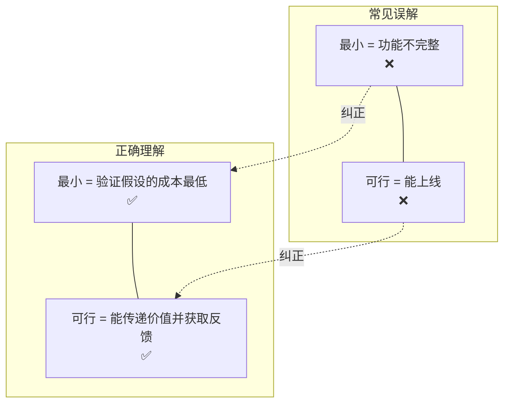
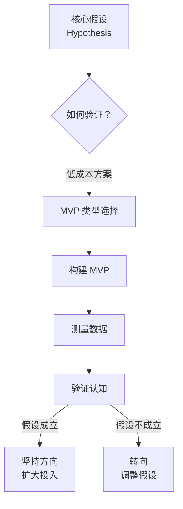

# 如何用最小的代价做产品

## 核心命题

精益创业中的 MVP（Minimum Viable Product）不仅是创业者的工具，更是**所有产品开发的效率杠杆**。MVP 的精确定义为"刚好足以验证核心假设的最小产品形态"——"最小"指成本最低，"可行"指能传递价值并获取反馈。通过 MVP，将"憋大招式开发"转变为"低成本试错式验证"。

---

## 1. MVP 的精确理解

### 1.1 "最小"与"可行"的辩证

### 1.2 MVP 的决策流程

### 1.3 MVP 类型选择矩阵

| MVP 类型 | 验证目标 | 实现成本 | 适用场景 |
|----------|---------|---------|---------|
| **Smoke Test** | 需求是否存在 | 极低 | 新产品方向探索 |
| **Concierge MVP** | 服务流程可行性 | 低 | 人工模拟服务 |
| **Wizard of Oz** | 自动化价值 | 低-中 | AI 产品验证 |
| **Piecemeal MVP** | 核心功能必要性 | 低 | 组合现有工具 |
| **Single-Feature MVP** | 单一价值主张 | 中 | 功能验证 |

---

## 2. MVP 的现代演进

### 2.1 Feature Flag 与渐进式发布

Feature Flag 将"代码部署"与"功能发布"解耦，使 MVP 可以在真实用户环境中验证：

### 2.2 产品发现与 Opportunity Solution Tree

Teresa Torres 的 OST 方法将 MVP 验证嵌入产品发现流程：

- **Outcome**（期望成果）→ **Opportunity**（机会）→ **Solution**（方案）→ **Experiment**（实验/MVP）

---

## 3. 最小的代价：验证优先于开发（郑晔的实践）

### 3.1 核心认知

- 产品经理的想法层出不穷，如果一味闷着头实现产品经理的想法，无论多大的开发团队都是不够用的——要学会用最小的代价做产品。
- 在 [精益创业](https://time.geekbang.org/column/article/76260) 一文中，郑晔分享了精益创业的理念：任何的想法都要放到真实世界中检验。直觉是把所有的东西都实现了再去检验，但世界不会停下来等着；事实也一次又一次证明，"憋大招"的瀑布式软件开发已经成为不合时宜的"老古董"。理想的实现途径唯有分解。
- 最小可行产品就是"刚刚好"满足客户需求的产品，关键在于理解"最小"和"可行"。
- "最小"指的是最小的代价：能不做的事情就不做，能简化的事情就简化。
- 最重要的一点：**要做的是验证一个想法的可行性，甚至不是为了开发一个软件——开发软件只是一种验证手段。**
- 很多程序员都有一个认识上的误区：容易把解决方案当成问题。开发软件的目的是解决问题，如果不写软件就把问题解决了，岂不是更好。

### 3.2 案例一：物联网项目的零代码验证（郑晔亲历）

一位朋友手头有一些制造业的客户，想做一个物联网相关的项目，帮助客户改造设备、实现物联网功能。郑晔团队的验证过程分两步：

**第一步：验证想法是否可行——只用一份产品文档。**

- 制作一份产品文档，就好像已经有了这个产品一样，让负责销售的同事拿着文档给客户讲解，观察客户的反应。
- 结果：验证了"已有设备进行物联网化改造"的需求真实存在——客户看到这样的东西后，各种各样的想法和要求冒了出来。
- 额外收获：了解到客户对这样一个产品能够接受的价格区间，帮助团队给产品进行适当的定价。

**第二步：验证产品设计是否可被接受——只做一个交互原型。**

- 得益于原型工具的快速发展，用原型工具做出了相对完整的用户界面，并把各种交互流都做了出来。在用户看来，这几乎就是完整的软件，甚至可以在自己的设备上体验产品用起来的感觉。
- 用户上手后就会抛出各种细节问题："如果这样就好了""如果能做到这个就太棒了"，当然也会说"这个东西我不需要"。
- 由此可以知道产品上的假设哪些是好的、哪些是不流畅的。团队根据反馈调整产品设计，再给用户测试，如此反复——有的时候，产品会在一天之内改好几个版本。
- 多轮测试后，团队获得了一大堆来自真实用户的反馈；整理这些反馈、决定哪些可以真正开发出来之后，团队才进入开发阶段。

> **直到进入开发阶段之前，这个团队验证了一大堆的想法，而代码却是一行都没有写——所有花费的工作量都是有针对性的验证。**

### 3.3 延伸讨论

- 常听到的段子是"就差一个程序员了"——创业者把前期的准备都做好，就差程序员把产品开发出来。按照 MVP 的思想，这个创业者做的就是对的，前提是他真的把前期准备都做好了。
- 开发软件是一件成本很高的事情。如果只是验证想法——无论是创业方向还是产品设计——可以找到各种各样的不写代码的手段。
- 即便不是在做新产品，同样可以把"最小代价"理念用在日常工作中。比如衡量产品经理的产品设计好不好，可以问：这个功能不做，用户会怎么样？有没有什么替代方案？以此帮助产品经理想清楚自己的产品设计是否真的有价值。

---

## 4. 可行的路径：完整用户体验优先（郑晔的实践）

### 4.1 核心认知

- "可行"是要找到一条路径，给用户一个完整的体验。程序员出身的人对软件系统的认识总是一个模块一个模块的，相对较弱的方面是缺少完整的图景。
- 从产品可行的角度需要转换思路：**不是一个模块做得有多完整，而是一条用户路径是否通畅。**

### 4.2 案例二：P2P 借贷平台的功能裁剪（郑晔亲历）

郑晔当年做过一个 P2P 项目（个人对个人的互联网借贷平台），从头开始搭建：

- 项目方和所有项目方一样，希望项目尽快上线，给出的时间线是：第一个上线的版本在一个月之后。
- 在"一穷二白"的基础上，一个月内完成一个完整的借贷平台不太可能。时间有限，只能做最基本的东西，许多运营上的想法（比如发红包、代金券之类）第一期一律不做。即便如此，完整实现借贷循环仍然不现实。
- 从需求完整性角度动脑筋：借贷系统最基本的模型是——贷款方贷款之后一次性拿到所有的钱，然后用等额本息的方式每个月还款，最后一个月剩多少钱一次性全还了。
- 模型中找到一个关键点：**每个月还款**。也就是说，第一笔贷款发生之后，最早的一笔还款发生在一个月之后。
- 于是做一个决定：**第一个版本只包含贷款能力**——只能贷款，不能还款。因为用户一个月之内不会用到还款功能，从页面上完全看不出这样的能力缺失（一个月内根本没有任何用户有可还的款项）。
- 由于缩减了项目规模，团队在预期的一个月内完成所有开发，成功把项目送上线。第一批早期用户开始使用；从用户视角看，这是一个功能完整的项目——虽然简单了点，但它是完整的。
- 还款功能排到下一期：按照两周一迭代的节奏，第一期上线两周后就上线还款功能（每期等额本息还款）；至于最后一次性还清剩余贷款的功能依然不支持，因为按需求设计，最后一次还款最早发生在一年之后。
- 基本功能全部上线之后，这个系统就是一个真正完整的借贷平台。但相对其他提供相同能力的平台，它依然很简单——常见的运营功能、短期借贷计划等都没有。
- 有了基础之后，就在基础上叠加；随着项目方自己团队的构建，团队规模变大，可以同时做几个大需求。几个月之后，逐步上线了一个功能相对完整的 P2P 平台。在这个过程中，每个阶段都会上线新功能——从用户可见的角度，用户看到的始终是一个完整的平台，其中的变化只有站在内部实现者的角度才能看得清楚。

> **当时间有限时，需要学会找到一条可行的路径，在完整用户体验和完整系统之间找到一个平衡。**

### 4.3 团队的应用方式

站在开发团队的角度运用 MVP 理念：当产品经理有一大堆要实现的功能时，可以根据 MVP 理念，从这些产品功能中找出一条最小的可行路径，重新安排一个合理的开发计划。

---

## 5. 总结

**核心要义**：用最小的代价做产品，核心是理解 MVP 的"最小"与"可行"——最小指验证成本最低，可行指能传递价值并获取反馈。通过 Feature Flag 和渐进式发布，在真实环境中低成本验证假设。

> **郑晔的小结**：产品同样需要分解。目前在探索产品不确定性上的最佳实践是精益创业，而精益创业就包含了将庞大的产品分而治之的方式——最小可行产品（MVP）。想要在实践中运用好 MVP，就是要用最小的代价找到一条可行的路径：最小的代价是能不做的事就不做、能简化的事情就简化；可行的路径是一条完整的用户体验路径——至少在用户眼中是这样。程序员通常愿意用自己的代码解决问题，而写代码通常是代价非常高的解决方案，它应该成为最后的产品解决方案。
>
> **如果只能记住一件事：做好产品开发，最可行的方式是采用 MVP。**

---

> **延伸阅读**
>
> - Eric Ries, *The Lean Startup* (2011)
> - Teresa Torres, *Continuous Discovery Habits* (2021)
> - LaunchDarkly Feature Flag: https://launchdarkly.com/
