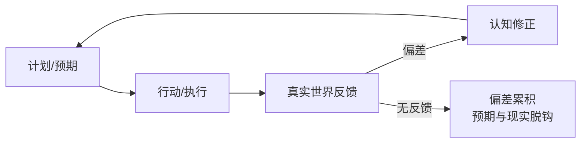
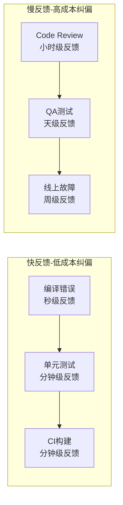
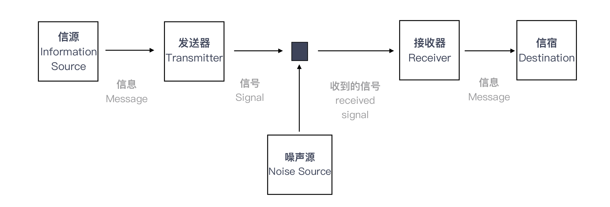

# 为什么世界和你的理解不一样

## 核心命题

理想与现实之间的差距，本质上是**认知偏差（Cognitive Bias）**的产物。在软件工程中，偏差表现为：产品成功预期过高、需求理解偏差、代码质量幻觉、目标理解错位。**沟通反馈**的作用不是"技巧性交谈"，而是**建立纠正偏差的反馈回路**——让认知与真实世界持续对齐。

---

## 1. 认知偏差的软件工程映射

### 1.1 常见偏差与工程表现

| 偏差类型 | 定义 | 软件工程表现 |
|----------|------|-------------|
| **确认偏差** | 倾向于寻找支持既有信念的证据 | 只关注支持自己方案的测试结果 |
| **乐观偏差** | 高估成功概率、低估时间和成本 | "这个功能一天就能做完" |
| **锚定效应** | 过度依赖最先获得的信息 | 最初的估算成为不可更改的锚点 |
| **沉没成本** | 因已投入而继续坚持错误方向 | "已经写了这么多代码，不能放弃" |
| **达克效应** | 能力不足者高估自己，能力强者低估自己 | 初学者过度自信，资深者过度谨慎 |

### 1.2 反馈回路：偏差的纠正机制

---

## 2. 反馈的类型与层级

### 2.1 反馈的三层模型

| 层级 | 反馈类型 | 时间尺度 | 示例 |
|------|---------|---------|------|
| **第一层：代码级反馈** | 编译/测试/Lint | 秒级 | IDE 即时反馈、CI 构建 |
| **第二层：团队级反馈** | Code Review/站会 | 小时-天 | PR Review、每日站会 |
| **第三层：产品级反馈** | 用户行为/业务指标 | 天-周 | A/B 测试、业务指标监控 |

### 2.2 反馈的速度与价值关系

> **反馈越快，纠偏成本越低。** 这是持续集成、TDD、自动化测试等实践的经济逻辑根基。

---

## 3. 沟通反馈的工程实践

### 3.1 建立反馈回路的实践矩阵

| 实践 | 反馈层级 | 建立者 | 目的 |
|------|---------|--------|------|
| **持续集成** | 代码级 | 开发者 | 提交即验证 |
| **TDD** | 代码级 | 开发者 | 行为定义即验证 |
| **Code Review** | 团队级 | 开发者 | 代码质量即反馈 |
| **结对编程** | 团队级 | 开发者 | 实时持续反馈 |
| **用户访谈** | 产品级 | 产品 | 用户真实需求反馈 |
| **A/B 测试** | 产品级 | 产品+数据 | 行为数据反馈 |
| **监控告警** | 产品级 | 运维 | 系统行为异常反馈 |

---

## 4. 信息论视角：理解偏差为什么产生（郑晔）

### 4.1 观点：真实世界不以美好愿望驱动

郑晔指出，"人生不如意的事十有八九"的根源并非世事艰辛，而是对真实世界抱有太多不切实际的幻想——真实世界有自己的运行规律，不以美好愿望驱动。他列举了软件开发中愿望与现实的典型落差：

- 在愿望中，做出来的产品应该一举成名，现实却是惨淡经营；
- 在愿望中，产品经理给出的需求应该清晰明了，现实却是模模糊糊；
- 在愿望中，写出来的代码应该快捷无错、维护容易，现实却是 Bug 百出，越修改、修改的时间就越长；
- 在愿望中，接到任务应当迅速理解到关键，现实却是做出来的结果与布置者的目标天差地别。

虽然所有人都生活在同一个世界中，但每个人理解世界的方式千差万别。郑晔强调：努力地学习各种知识，为的就是更好地理解世界的运作方式，而沟通反馈，就是与真实世界互动的最好方式。

### 4.2 论据：香农通信模型与编解码偏差

1948 年，克劳德·香农（Claude Elwood Shannon）在《贝尔系统技术学报》（Bell System Technical Journal）上发表论文《通信的数学原理》（A Mathematical Theory of Communication），这是现代信息论的开端。程序员熟知的通信、数据压缩、密码学、自然语言处理等诸多领域都有信息论的身影。

郑晔借用香农信息论中的通信模型，解释理解偏差的产生过程：

模型包含以下要素：

- 信源（Information Source）：负责产生信息（Message）。
- 发送器（Transmitter）：对信息进行某些操作，即对信息编码，产生信号（Signal）。
- 信道（Channel）：信号传送的媒介。
- 接收器（Receiver）：对信号执行发送器的逆操作，解码信号，提取出信息。
- 信宿（Destination）：负责接收信息。
- 噪声（Noise）：削弱信号的东西，在该讨论中被暂时忽略。

**案例：一次任务布置中的编解码失配。** 项目经理给开发者布置工作：项目经理是信源，他的想法是消息；他先在大脑中把想法编码成语言表达出来，说出的这段话就是信号；这段话通过信道（空气）传到开发者耳中，开发者按自己的理解解码，作为信宿形成自己的想法。问题在于：项目经理脑中的原始信息是"编写完成这个功能所需的代码，然后为这段代码写好自动化测试，再将它与现有系统集成好，通过测试人员的验证"；而开发者从"完成一个需求"这个信号中解码出的信息却只是"把功能代码写完"。即便忽略噪声的干扰，当编码和解码不是一个版本的时候，信息就很难被准确传达。

信息传达要经过编码和解码两个过程，无论哪一端出现问题，都会造成信息不准确。失效场景可归为三类：

| 失效环节 | 具体表现 |
|---------|---------|
| **编码失效** | 表达不清楚，一件简单的事说了半天，听者依然云里雾里——信源发出的信息经过编码得到的信号已经不准确 |
| **解码失效** | 信号准确，但接收者没有对应的解码装置（如听技术演讲，讲者说得很清楚，听者因缺乏相关背景依然无法得知对方表达的信息） |
| **编解码不配套** | 收发双方编解码器不匹配，同样的信号得到的信息截然不同，信息传达的目的无法完成 |

郑晔由此得出的结论是：人们对世界产生误解的核心原因，在于人与人拥有不同的编解码器——每个人经历见识的差异，造成了各自编解码器的差异。世界是同一个世界，每个人看到的却是千姿百态。

### 4.3 案例：三类失效的典型场景

**编码失效（郑晔的客户现场咨询经历）。** 郑晔在客户现场做咨询时，一位程序员向他介绍其系统，讲了二十分钟他仍一头雾水；于是打断对方，用自己的语言花五分钟复述一遍并确认"想说的是不是这个意思"，对方猛劲点头。究其原因：这位程序员上来就讲实现细节，完全没有任何铺垫；而听者是来了解情况的，背景知识不足，凭空理解细节非常困难，过程中还要不断补充缺失的背景，浪费大量时间。郑晔总结这几乎是很多程序员讲东西的通病：**讲东西直奔细节**。他在面试中也经常遇到类似情况——候选人上来就讲技术细节，而面试官对其做过的系统一无所知，只好打断对方先介绍背景。很多人抱怨别人不能理解自己，首先应该想的问题是：自己到底有没有把话说清楚。

**解码失效（花剌子模信使）。** 郑晔引用作家王小波讲过的故事：中亚古国花剌子模有一个奇怪的风俗，凡是给君王带来好消息的信使就会得到提升，带来坏消息的信使则会被送去喂老虎。如此一来，谁还敢把坏消息带给君王？但君王不听坏消息，坏消息并不因此不存在。这相当于解码器出了问题，过滤掉了很多真实的信息；而真实世界就是真实世界，不会按照人们的美好愿望运行。

**解码失效（团队讨论中的抢话）。** 能做程序员的人大多很聪明，几个人一起讨论问题时，别人往往刚开了个头，有人就认为自己已经理解了对方的想法，随即开始表达自己的观点。信息都不全，何谈解码。因此开发团队的讨论中常常出现一个人高谈阔论、却离题万里的情况。

### 4.4 方法论：改善编解码的三个方向

郑晔提出，想在真实世界中生活得更幸福，就要不断改善自己的编解码器，从三个方向着手：

| 改善方向 | 目标 | 具体做法 |
|---------|------|---------|
| **编码器** | 让信息能输出更准确 | 把信息编码成有效的信号，至少保证在自己这一端信息不丢失；表达前先审视是否把话说清楚，先铺垫背景再进入细节 |
| **解码器** | 减少信号过滤，改善解码能力 | 一是打开自己的接收器，把信号接纳进来、让反馈进来（这是解码的前提）；二是扩展见识，提升自己理解他人表达内容的能力 |
| **编解码算法** | 协调沟通双方更有效地进行沟通 | 采用行业最佳实践作为沟通双方共用的"编解码手册" |

关于"编解码算法"，郑晔认为从始至终被讨论的各种最佳实践就是一个个好的算法，能帮助改善沟通效果。例如"以终为始"主题中讨论过的"完成的定义"：当"完成一个需求"这样的信号发出时，接收方的解码动作变成了先查一下手册里关于"完成一个需求"的标准动作都有哪些，于是就不会对事情做那么简单的估计——这就相当于沟通的双方都有了一个编解码手册。

### 4.5 小结

- 人生不如意事十有八九，很大原因在于对真实世界抱有不切实际的幻想；美好的愿望并不能驱动这个世界，软件开发中也是如此。
- 人和人生活在一个世界中，但对世界的理解千差万别；用信息论的通信模型可以解释这种差异——人和人拥有不同的编解码器。
- 改善编解码的三个着力点：编码器，让信息能输出更准确；解码器，减少信号过滤、改善解码能力；编解码算法，用来自行业的"最佳实践"协调沟通双方。
- 郑晔给出的核心记忆点：**通过沟通反馈，不断升级自己的编解码能力。**

---

## 5. 总结

**核心要义**：认知偏差使预期脱离现实，世界因此显得与理解不一样。沟通反馈不是谈技巧，而是建立纠正偏差的反馈回路。反馈越快，纠偏成本越低——这是持续集成、TDD、自动化测试等实践的共同经济逻辑。用信息论的语言概括：编解码器的差异造成理解偏差，沟通反馈正是升级编解码能力、让认知与真实世界持续对齐的手段。

---

> **延伸阅读**
>
> - Daniel Kahneman, *Thinking, Fast and Slow* (2011): 认知偏差的全面分析
> - Amy C. Edmondson, *The Fearless Organization* (2018): 心理安全与反馈
