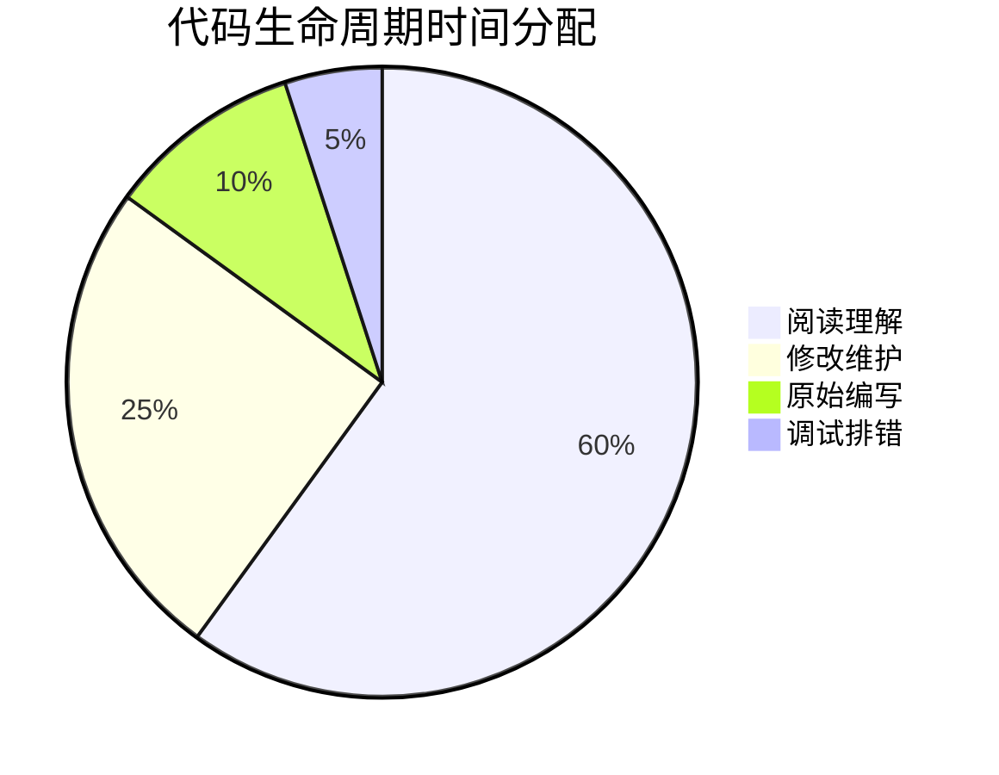
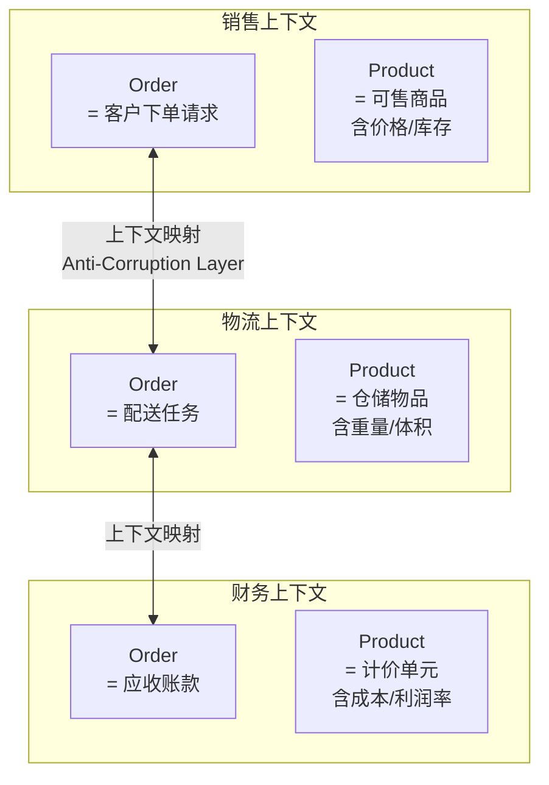
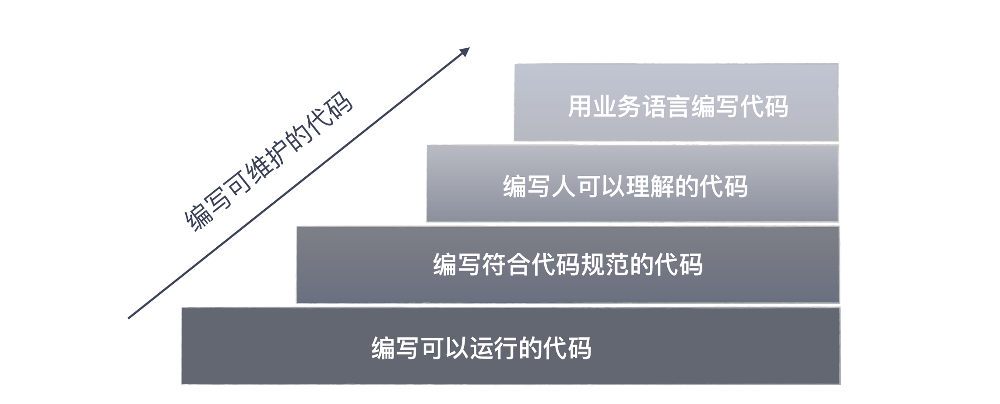
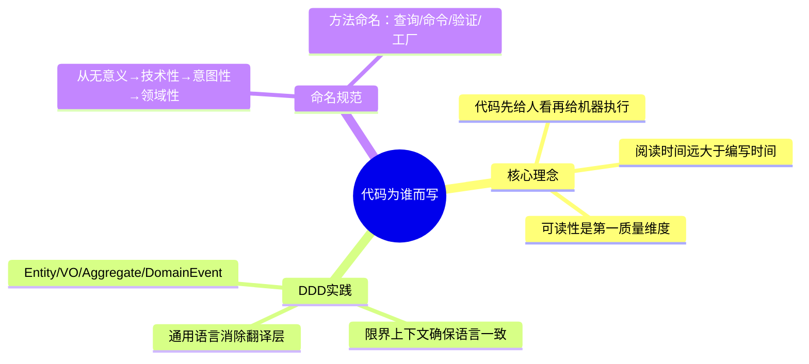

# 你的代码为谁而写

## 核心命题

代码首先是写给人看的，其次才是给机器执行的。**可维护性**是代码质量的第一评价维度——代码的生命周期中，阅读时间远大于编写时间。通过领域驱动设计（DDD）的**通用语言（Ubiquitous Language）**和**限界上下文（Bounded Context）**，使代码成为业务意图的精确表达——当代码的业务语义一目了然时，维护成本最低，沟通效率最高。

---

## 1. 代码的读者与生命周期

### 1.1 代码时间分配的真相

> "读代码的时间是写代码时间的 10 倍以上。" —— Robert C. Martin, *Clean Code*

**推论**：代码优化的首要目标是**可读性**，而非运行效率——因为阅读占了 60% 的时间。

### 1.2 代码质量的演进标准

| 阶段 | 质量标准 | 关注点 | 典型表现 |
|------|---------|--------|---------|
| **初级** | 功能正确 | 算法、数据结构、框架使用 | "能跑就行" |
| **中级** | 可维护 | 命名、结构、设计模式 | "改起来不痛苦" |
| **高级** | 可沟通 | 代码即文档，表达业务意图 | "读代码如读需求" |

**郑晔的学习路径注记**：写出可维护的代码有方法可循。他在这方面的学习从《程序设计实践》（The Practice of Programming）开始，该书作者是 Brian Kernighan 和 Rob Pike——两人都出身于大名鼎鼎的贝尔实验室，参与过 Unix 的开发。初涉编程的程序员往往觉得能把功能实现出来的代码就是好代码，这个阶段主要需要掌握各种算法、数据结构、典型处理手法、常用框架；随着搜索与问答网站的蓬勃发展，常见代码模式随手一搜即可获得；再往后，更有追求的程序员会明白：仅仅实现功能是不够的，还需要写出可维护的代码。

---

## 2. DDD：代码与业务的桥梁

### 2.1 通用语言（Ubiquitous Language）

**核心原则**：代码中的命名与业务术语一一对应，消除"翻译层"。

| 反模式 | 问题 | DDD 修正 | 业务语义恢复 |
|--------|------|---------|-------------|
| `DataManager` | 业务含义模糊 | `OrderRepository` | 订单数据访问 |
| `process()` | 动作不明确 | `placeOrder()` | 下单 |
| `flag` | 业务语义丢失 | `isEligibleForDiscount` | 是否符合折扣条件 |
| `dto1` | 完全无意义 | `OrderConfirmation` | 订单确认 |
| `calc()` | 计算什么？ | `calculateTotalWithTax()` | 计算含税总价 |

> **检验标准**：如果产品经理能读懂代码中的类名和方法名，说明通用语言到位了。

### 2.2 限界上下文（Bounded Context）

同一术语在不同业务上下文中含义不同——Bounded Context 确保每个上下文内部语言一致：

> **关键洞察**：同一个"Order"在不同上下文中有不同含义。Bounded Context 确保每个上下文内部语言一致，上下文之间通过映射（Anti-Corruption Layer）转换，而非共享同一模型。

### 2.3 代码中的 DDD 模式

| DDD 概念 | 代码实现 | 作用 |
|----------|---------|------|
| **Entity** | 有唯一标识的可变对象 | `Order`（有 orderId） |
| **Value Object** | 无唯一标识的不可变对象 | `Money`、`Address` |
| **Aggregate** | 一致性边界 | `Order` + `OrderItem`（事务边界） |
| **Domain Service** | 跨聚合的业务逻辑 | `PricingService` |
| **Repository** | 持久化接口 | `OrderRepository` |
| **Domain Event** | 领域事件 | `OrderPlacedEvent` |

---

## 3. 命名：可维护性最简单也最难的一件事

### 3.1 命名难题

> 计算机科学中只有两大难题：缓存失效和命名。
>
> —— Phil Karlton

这是行业里流传的经典说法，无论哪本写代码风格的书，都会把命名放在靠前的位置。刚写程序不久就会有人提醒不要用 a、b、c 做变量名（因为没有意义）；步入职场会拿到一份必须遵循的编程规范。

但编码规范给出的要求大多是**格式上的要求**（如 Java 风格的 camelCase、常量全大写），这只是底线，不应成为程序员的追求——很多编码规范的要求如今都可以用静态检查工具扫描了。多数人理解为什么要避免无意义的名字，但对"什么样的名字是有意义的"理解各不相同。

**名字起得是否够好，一个简单的评判标准是：拿着代码给人讲，需要额外解释多少东西。**

郑晔给出一个代码评审中的典型场景：

> 评审者：这个叫 map 的变量是做什么用的？
>
> 程序员：它是用来存放账户信息的，它的键值是账户 ID，值就是对应的账户信息。
>
> 评审者：那为什么不直接命名成 accounts？

很多人遇到这类建议会委屈：这个变量本来就是一个 map，命名成 map 怎么了？这背后牵扯到一个重要问题——**代码到底是给谁写的？**

### 3.2 代码为谁而写

> 任何人都能写出计算机能够理解的代码，只有好程序员才能写出人能够理解的代码。
>
> —— Martin Fowler

代码是程序员与机器沟通的重要途径，但机器是直白的：只要代码符合语言规则，机器一定认——写得再奇怪它都认，行业里甚至有专门的混乱代码比赛，如著名的 IOCCC（The International Obfuscated C Code Contest，国际 C 语言混乱代码大赛）。

**但写代码的目的是与人沟通，因为要在团队里与人协同工作。** 人和机器不同：人需要理解的不仅是语言规则，还需要将业务背景融入其中——人的目的不是执行代码，而是理解、扩展和维护这段代码。人要负责将业务问题和机器执行连接起来，缺少业务背景是不可能写出好代码的。从沟通的角度看，输出时的编码器很重要，它是保证信息输出准确性的关键。

map 是一种数据结构的名字，是面向计算机的；而评审者建议的 accounts 是一个业务的名字。虽然只是一个简单的名字修改，但从理解上这是一步巨大的跨越——缩短了其他人理解这段代码所需填补的鸿沟，工作效率自然得到提高。

### 3.3 案例：电商下单的"订单"拆分

凭直觉构建电商下单的订单类 Order，会不断往里塞信息：商品信息（合理）、送货信息（要送货）、支付信息（要支付），然后会员信息、折扣信息也可能加入——这个类越来越大，每个修改都要维护者来处理，不知不觉陷入疲于奔命的状态。如果只站在让代码运行的角度，这几乎是无解的。

有了看业务的视角，就可以问一个问题：**这些信息都放在"订单"里是合理的吗？** 与业务人员交流，询问这些信息到底在什么场景下使用，就会发现：商品信息主要的用途在下单环节，送货信息在物流环节，支付信息用在支付环节。虽然用的是同一个"订单"概念，不同场景下用到的信息是不同的。更好的做法是把"订单"概念拆分：**交易订单、物流订单和支付订单**。原先陷入的困境，正是因为缺乏业务知识，只能笼统地用一个"订单"去涵盖各种场景。

类似的错误在很多代码里都能看到。比如很多系统特别喜欢"用户"这个概念，把很多信息都塞进去——但不同场景下它也应该是不同的东西：在项目管理软件中，它应该是**项目管理员和项目成员**；在借贷场景下，它应该是**借款方和贷款方**。

### 3.4 命名背后的 DDD

要把这些概念很好地区分出来，需要对业务语言有理解。把这些概念在代码中体现出来、给出好名字，最好和业务人员使用同样的语言——这正是领域驱动设计（Domain Driven Design，DDD）：

- 把不同的概念分解出来，是**限界上下文（Bounded Context）**的作用；
- 在代码里尽可能使用业务语言，是**通用语言（Ubiquitous Language）**的作用。

好的命名需要对业务知识有深入理解——这不是程序员的强项，需要额外学习，但也是想写好代码的前提。

---

## 4. 代码可读性的实践规范

### 4.1 命名的四个层次

| 层次 | 命名特征 | 示例 | 可读性 |
|------|---------|------|--------|
| **L1：无意义** | 缩写/单字母 | `d`, `tmp`, `x1` | ❌ 需要注释才能理解 |
| **L2：技术性** | 描述数据结构 | `userList`, `dataMap` | ⚠️ 知道"是什么"但不知"为什么" |
| **L3：意图性** | 描述意图 | `eligibleUsers`, `taxRateByRegion` | ✅ 理解业务含义 |
| **L4：领域性** | 使用业务术语 | `vipCustomers`, `regionalTaxPolicy` | ✅✅ 产品经理也能读懂 |

### 4.2 方法命名的模式

| 模式 | 命名模板 | 示例 |
|------|---------|------|
| **查询** | `get`/`find`/`query` | `findEligibleCustomers()` |
| **命令** | 动词 | `placeOrder()`, `cancelSubscription()` |
| **验证** | `is`/`has`/`can`/`should` | `isEligibleForRefund()` |
| **工厂** | `create`/`from`/`of` | `Order.from(cart)` |

---

## 5. 总结

**核心要义**：代码为"后来的读者"而写。写好代码的提升路径是：最初的层次是编写可以运行的代码，然后是编写符合代码规范的代码；对命名最粗浅的理解是不起无意义的名字、遵循编码规范，但名字起得是否够好，主要看是否还需要额外的解释；再进一步，要写出人可以理解的代码——代码更重要的作用是人和人沟通的桥梁，起一个降低其他人理解门槛的名字才是好名字。很多没写好的程序，部分原因就是名字起错、概念混淆。想命好名，就要学会用业务语言写代码，尽可能多地学习业务知识，把业务领域的名字用在代码中。一句话总结：**用业务的语言写代码。** 想系统学习如何写好代码，推荐 Robert Martin 的《代码整洁之道》（Clean Code）——这本书几乎覆盖了把代码写好的方方面面。

---

> **延伸阅读**
>
> - Eric Evans, *Domain-Driven Design* (2003): 通用语言与限界上下文
> - Vaughn Vernon, *Implementing Domain-Driven Design* (2013): DDD 实现模式
> - Robert C. Martin, *Clean Code* (2008): 命名与可读性
> - Brian Kernighan, Rob Pike, *The Practice of Programming*: 可维护代码的起点
