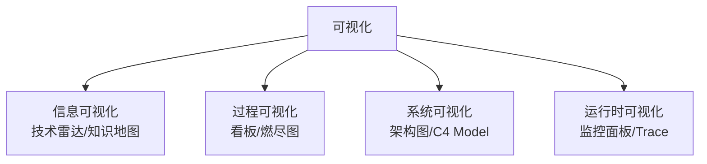
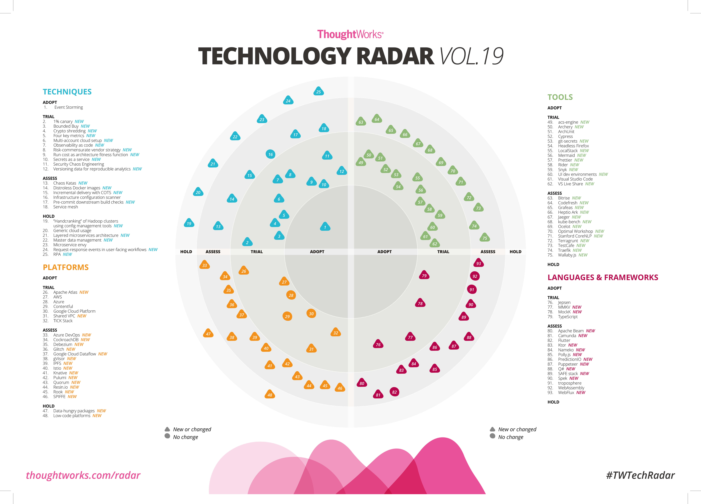
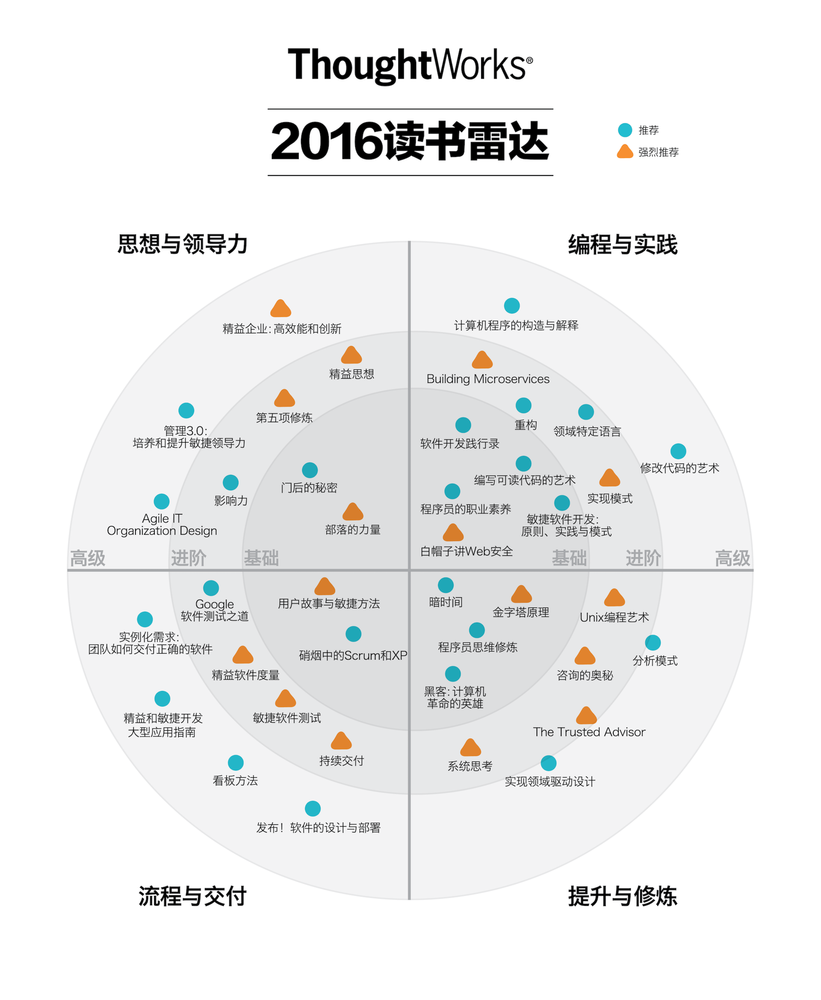
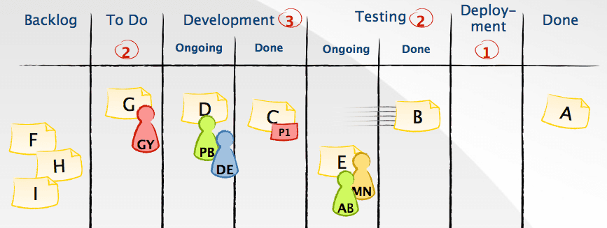

# 可视化：一种更为直观的沟通方式

## 核心命题

**可视化是降低沟通成本的最有效手段**。人类视觉系统处理图形信息的速度是处理文字的 60,000 倍（3M 研究）。在软件工程中，从技术雷达到架构图、从看板到监控面板，可视化将抽象信息转化为直觉可理解的形态。

---

## 1. 可视化的认知基础

### 1.1 为什么可视化有效？

| 通道 | 处理速度 | 信息密度 | 适用场景 |
|------|---------|---------|---------|
| **文字** | 慢（需解码） | 低（序列化） | 精确定义、法律条文 |
| **图形** | 快（直觉处理） | 高（并行处理） | 趋势、关系、模式 |
| **交互式** | 实时（探索性） | 最高 | 数据分析、根因定位 |

### 1.2 软件工程中的可视化层次

---

## 2. 技术雷达：知识组织的可视化范式

### 2.1 ThoughtWorks 技术雷达的结构

| 维度 | 说明 |
|------|------|
| **象限（Quadrant）** | 技术、平台、工具、语言与框架 |
| **圆环（Ring）** | 采用（Adopt）、试验（Trial）、评估（Assess）、暂缓（Hold） |

### 2.2 构建团队级技术雷达

| 圆环 | 含义 | 示例 |
|------|------|------|
| **采用** | 新项目默认选择 | Java 17、Spring Boot 3、React |
| **试验** | 准备在非关键项目试用 | Rust、htmx、Bun |
| **评估** | 值得了解和评估 | WebAssembly、AI Agent Framework |
| **暂缓** | 新项目不再使用 | Maven、jQuery、REST（推荐 gRPC/GraphQL） |

---

## 3. 过程可视化：看板方法

### 3.1 看板的核心原则

| 原则 | 实践 |
|------|------|
| **可视化工作流** | 所有工作项在看板上可见 |
| **限制 WIP** | 每列设置在制品上限 |
| **管理流动** | 关注 Lead Time 和吞吐量 |
| **显式化策略** | 拉动规则和优先级标准可见 |
| **实施反馈环** | 定期回顾与调整 |

### 3.2 WIP 限制的数学逻辑

> **Little's Law**：平均 Lead Time = WIP 数量 / 吞吐率
>
> 在吞吐率不变的情况下，**减少 WIP → 降低 Lead Time → 加快交付速度**。

---

## 4. 系统可视化：C4 Model

| 层级 | 视图 | 受众 | 关注点 |
|------|------|------|--------|
| **Context** | 系统上下文图 | 所有人 | 系统与外部参与者的关系 |
| **Container** | 容器图 | 开发者 | 系统内部的应用/服务划分 |
| **Component** | 组件图 | 架构师 | 单个应用内部的模块划分 |
| **Code** | 代码图 | 开发者 | 类/方法级别（通常由工具生成） |

---

## 5. 技术雷达的实践论据（源自郑晔的实践）

### 5.1 技术雷达是什么

[ThoughtWorks 技术雷达](http://www.thoughtworks.com/radar) 是由 ThoughtWorks 技术咨询委员会（Technology Advisory Board）编写的技术趋势报告，每 6 个月发布一次。由于 ThoughtWorks 的项目多样性足够丰富，它能够发现诸多技术趋势；因此，相比于行业中其他的预测报告，技术雷达更加具体、更具可操作性。

郑晔曾就职于 ThoughtWorks，接触技术雷达的时间很早：早在 2013 年就开始与人讨论微服务，并在项目中尝试使用 Docker——这些信息的来源都是技术雷达。此外，通过关注 InfoQ 等技术网站可以快速了解技术动向（新东西出现、重大更新、新的应用场景），而技术雷达则是一种更系统地了解新知识的方式。

### 5.2 雷达图的核心术语

技术雷达用来追踪技术。在雷达图的术语里，每一项技术表示为一个 **blip**（雷达上的一个光点），再用两个分类元素组织这些 blip：

- **象限（Quadrant）**：表示一个 blip 的种类，目前有四个：技术、平台、工具、语言与框架。
- **圆环（Ring）**：表示一个 blip 在技术采纳生命周期中所处的阶段，目前包含四个阶段：采用（Adopt）、试验（Trial）、评估（Assess）和暂缓（Hold）。

（图片来源： [ThoughtWorks 技术雷达](http://www.thoughtworks.com/radar)）

### 5.3 阅读重点："采用"与"暂缓"

每次技术雷达发布之后，最值得特别关注的是**"采用"**和**"暂缓"**两项：

- **"采用"表示强烈推荐**，可用于对照实际应用是否跟进。例：2018 年 11 月的技术雷达将事件风暴（Event Storming）放入"采用"环；不了解 [事件风暴](http://www.eventstorming.com) 的从业者强烈建议补课。
- **"暂缓"表示新项目别再用这项技术**，它提醒该技术可能已有更优秀的替代品。例：Java 世界中最常见的构建工具 Maven 很早就被放入"暂缓"，但时至今日很多人启动新项目依然选择 Maven——多半是不了解技术趋势。
- 从这几年的发展趋势看，技术雷达在"采用"和"暂缓"两项上给出的推荐大部分是靠谱的。
- 至于"试验"和"评估"，多半属于新兴技术的试验区，主要作用是开拓视野。

**雷达图是一种很好的知识分类组织形式**：一目了然地看到所有知识点，并根据需要决定是否深入了解。

### 5.4 雷达图的推广：读书雷达与团队雷达

- 郑晔的前同事们借鉴该形式，做出了一个程序员的读书雷达，将程序员应该阅读的书籍做了整理。

（图片来源： [ThoughtWorks读书雷达](http://insights.thoughtworks.org/reading-radar-2016/)）

- 这种将内容通过可视化方式组织起来的形式非常好用。ThoughtWorks 鼓励每个组织都建立自己的知识雷达，甚至提供了工具辅助构建雷达图。
- **雷达图不仅适用于组织，也适用于团队。** 郑晔曾按雷达图的方式组织自己团队用到的技术：
  - 最需要了解的技术放在内环。例如一个 Java 项目，要求程序员了解 Java；
  - 向外扩展的是团队工作中会逐渐接触到的技术，例如 Docker 这类与部署相关的知识；
  - 最外一层是被放弃掉的技术，例如 Maven。
- 这样做的收益：团队成员可以更清晰地了解团队中所用的技术；当有新人加入团队时，雷达可以帮助新人迅速抓住重点——学习路径就是从内环向外学习。

> [构建技术雷达](https://www.thoughtworks.com/cn/radar/byor)
>
> [构建雷达的程序库](https://github.com/thoughtworks/build-your-own-radar)

---

## 6. 可视化的认知依据

为什么雷达图的形式能帮助理解知识？**因为人的大脑更擅长处理图像。**

- 进化论据：远古时代人脑处理的内容大多是图像（哪里有新的果实、哪里猛兽出没），文字则是很久之后才产生的。现在普遍的说法是，大约在公元前 3500 年左右，许多文明才刚刚发展出书写系统——相比于人类的历史，这几乎是微不足道的。
- 结论：就人脑的进化而言，**处理图像的速度远远快于处理文字**，所以有"一图胜千言"的说法。
- 定义：通过创建图像、图标或动画等进行信息交流的形式，就是可视化（Visualization）。可视化的分类很多，最常用的应该是数据可视化和信息可视化。
- 示例：郑晔在 [数据衡量主题的论述](http://time.geekbang.org/column/article/76929) 中提到，上班第一件事是"看"数字——这就是典型的数据可视化；而技术雷达属于信息可视化。

### 软件工程中的可视化应用

- 很多做软件的人习惯用文字沟通，软件开发过程中需要编写各种文档，但并非所有场景文字都是好的沟通方式，因此不少人尝试将可视化应用在软件开发过程中。
- 大多数程序员最熟悉的表达方式是流程图；做过软件设计的人可能还听说过 UML（统一建模语言，Unified Modeling Language）。使用得当，这种方式会极大地提高表达的准确性，降低其他人理解的门槛。
- 日常工作中最熟悉的可视化方式是在纸上或白板上画的图。经验观察：很多人画图太随意。改进建议：**先写字后画框**，这样图会显得整洁一些。

---

## 7. 看板：可视化工作管理的典型案例

### 7.1 看板的来源与定义

看板是将"可视化"应用在工作中的典型案例：一种项目管理工具，把正在进行的工作变得可视化。这个实践来自精益生产——"精益"是来自丰田公司的管理理念，精益理念在软件行业已经非常流行，很多软件开发实践都从"精益"而来，看板是其中之一。

看板属于几乎是看一眼就知道怎么用的实践：

- 将工作分成几个不同的阶段，把分解出来的工作做成一张卡片，根据当前状态放置到不同的阶段中。
- 采用用户故事方法的团队，每个用户故事就是一张卡片。
- 工作完成之后，就可以挪到下一个阶段；工作怎么算完成由 DoD（Definition of Done）决定。
- 小技巧：用不同颜色的卡表示不同类型的工作；给每个人一个头像，增添一些乐趣。

### 7.2 看板暴露问题

看板可以帮助管理者一眼看出许多问题：

- **人力与在制品不匹配**：团队中有 5 个人，却有 8 个正在进行的任务，那一定是有问题——一个人多线程工作效果不会好。用"精益"的术语说，应该限制 WIP（Work-In-Progress）。
- **瓶颈定位**：如果待开发的卡最多，就证明现在的瓶颈在开发，而不是其他阶段。

### 7.3 实体墙 vs 电子墙

运用看板还有一个有趣的细节：使用实体墙还是电子墙。

| 形式 | 定义 | 优势 | 劣势 |
|------|------|------|------|
| **实体墙** | 找一面墙把看板做出来 | 方便调整；可当作站会的集合地点；能让他人看见团队的工作或问题——最大优势是增强人与人的互动 | 受办公空间限制 |
| **电子墙** | 协同办公软件中的项目管理功能（其项目管理部分用到的就是看板理念） | 随处可访问、数据不会丢失、便于统计等 | 每次访问都需要专门打开电脑，比较麻烦 |

郑晔的建议：如果团队在一起工作，考虑使用实体墙，除非办公空间实在太小。一种将二者结合的办法是使用一个大电视，专门用来展示电子墙。

**总之，看板就是要让工作在大家面前展现出来。**

---

## 8. 总结

**核心要义**：可视化是降低沟通成本的最有效手段。技术雷达组织知识、看板可视化过程、C4 Model 可视化系统、监控面板可视化运行时状态——选择合适的可视化方式，让信息"一目了然"。雷达图不仅可以用在组织技术，还可以用来组织其他信息（如读书雷达）；每个公司、每个团队都可以利用雷达图组织自己的技术，方便成员结构化地理解所用技术，也方便新人的学习。大多数软件过程习惯采用文字表达，对"可视化"的利用还不够；流程图、UML、看板等都是可立即落地的切入点。

**只记一件事**：多尝试用可视化的方式进行沟通。

**实践检验**：检视当前工作中可用可视化方法解决沟通问题的场景——知识组织可用技术雷达，工作流转可用看板，系统结构可用 C4 Model。

---

> **延伸阅读**
>
> - ThoughtWorks 技术雷达: https://www.thoughtworks.com/radar
> - C4 Model: https://c4model.com/
> - David J. Anderson, *Kanban* (2010): 看板方法
