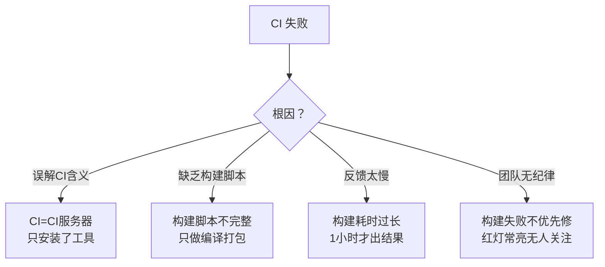
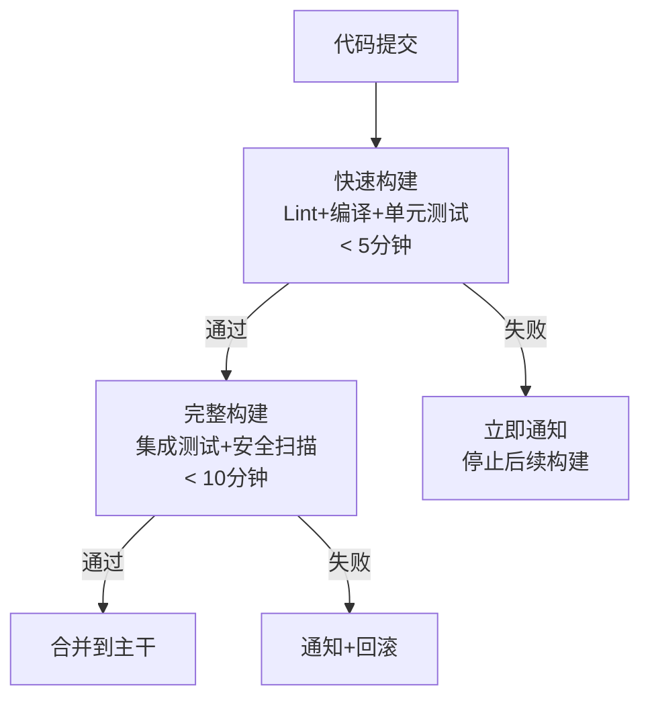
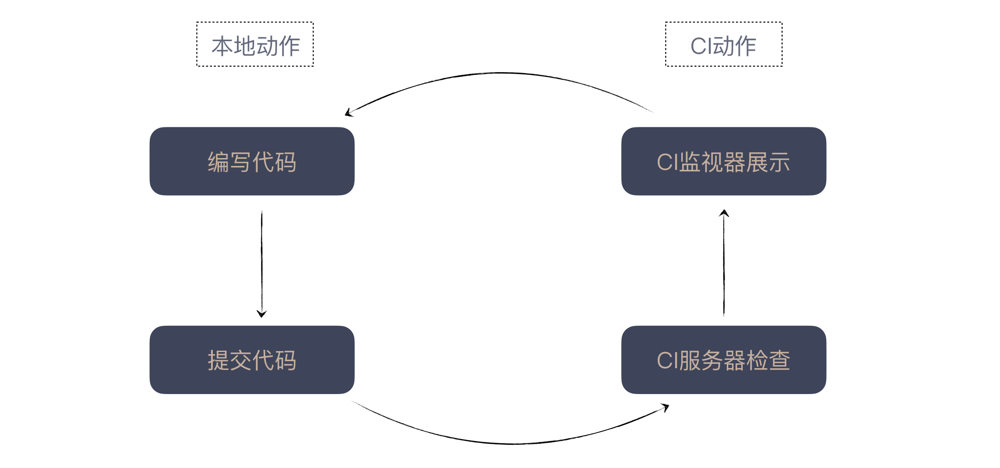
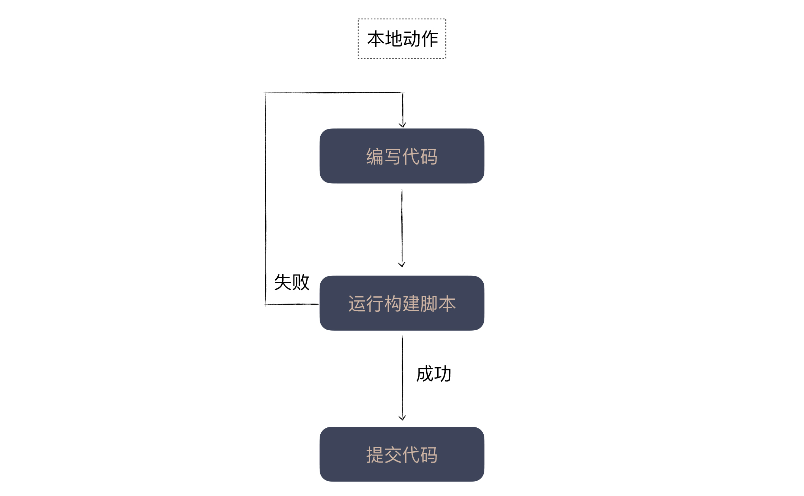
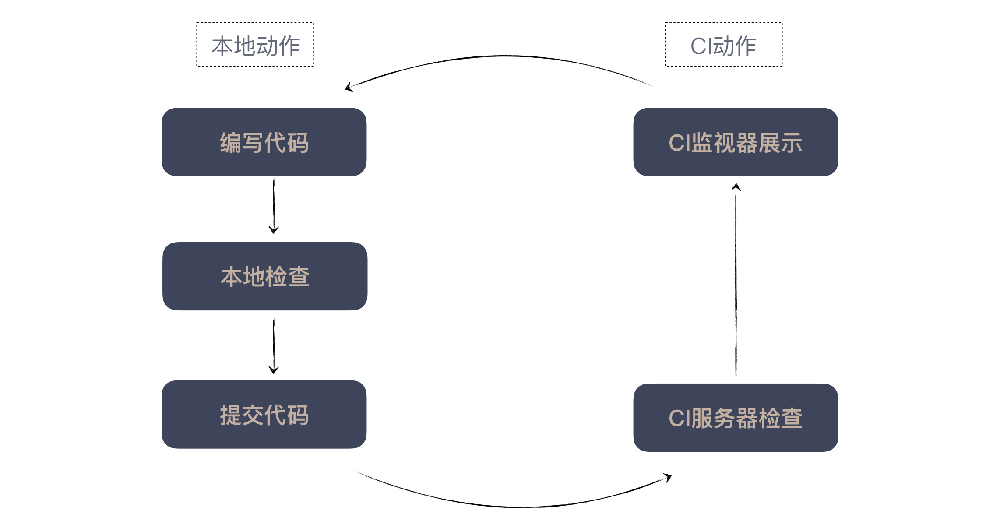
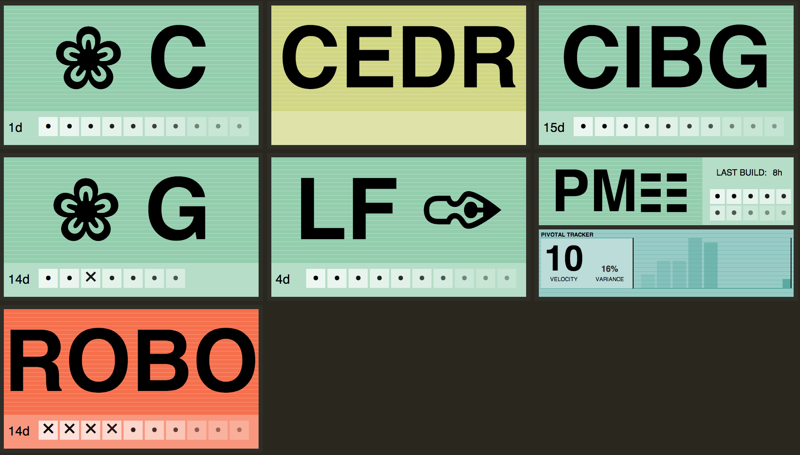

# 快速反馈：为什么你们公司总是做不好持续集成

## 核心命题

持续集成失败的根本原因不是"没有 CI 服务器"，而是**缺乏快速反馈的文化与实践**。CI 的核心价值是**尽早发现集成问题**，其实现依赖于：构建脚本的质量、反馈的速度、团队对构建失败的反应速度。将 CI 等同于"安装 Jenkins"是最大的误解——CI 是一组工程实践纪律，而非一个工具。

---

## 1. CI 失败的根因分析

### 1.1 "安装 Jenkins ≠ 持续集成"

### 1.2 CI 健康度的衡量指标

| 指标 | 目标 | 不达标的后果 |
|------|------|-------------|
| **构建时长 P95** | < 10 分钟 | 开发者不愿等待，不频繁提交 |
| **构建成功率** | > 90% | 团队对 CI 丧失信任 |
| **构建失败修复时间** | < 30 分钟 |红灯常亮成为常态 |
| **提交到构建启动延迟** | < 2 分钟 | 反馈不及时，问题难定位 |

---

## 2. 快速反馈的工程实践

### 2.1 构建脚本的最佳实践

| 构建阶段 | 内容 | 时间预算 |
|----------|------|---------|
| **快速检查** | Lint + 编译 | 1-2 分钟 |
| **单元测试** | 核心逻辑测试 | 3-5 分钟 |
| **集成测试** | Testcontainers | 2-5 分钟 |
| **安全扫描** | Snyk/Trivy | 1-3 分钟 |
| **总计** | - | **< 10 分钟** |

### 2.2 分层构建策略

### 2.3 CI 红灯 = 停线

> **Toyota Production System 的 Andon Cord 原则**：任何工人发现问题时，拉动安灯绳，整条生产线停止。所有人聚集解决问题，恢复后才继续生产。

在 CI 中：**构建失败时，全团队停止新功能开发，优先修复构建。红灯不过夜。**

---

## 3. CI 的可视化

| 可视化方式 | 作用 |
|-----------|------|
| **CI 监视器** | 大屏显示构建状态，红灯立即引起注意 |
| **Slack/Teams 通知** | 构建失败推送通知到团队频道 |
| **物理指示器** | 红绿灯/声音报警，感官刺激更强 |
| **Dashboard** | 构建趋势、成功率、时长可视化 |

---

## 4. 持续集成的两个目标与两条纪律（郑晔）

### 4.1 观点：CI ≠ CI 服务器，本质是快速反馈

郑晔此前在 [《持续集成：集成本身就是写代码的一个环节》](http://time.geekbang.org/column/article/75977) 中已从"以终为始"的角度阐述了集成尤其是持续集成的重要性；如何做好持续集成，才是更多人真正关心的内容。

他指出，很多人对持续集成的第一印象是 CI 服务器（当年是 CruiseControl，今天换成了 Jenkins），并因此把 CI 服务器等同于持续集成。他接触过这样的团队：恨不得把所有事情都放在 CI 服务器上做——编译、代码检查、单元测试、测试覆盖率统计等。这种做法可行，但不是最佳实践。

回到持续集成的本质：持续集成的诞生，就是人们尝试缩短集成周期的结果；缩短周期是为了尽早得到反馈，知道自己的工作结果是否有效。由此得出持续集成的关键点——**快速反馈**，它分解为两个目标：

1. **怎样快速地得到反馈**；
2. **什么样的反馈是有效的**。

### 4.2 快速得到反馈：用好本地构建脚本

**执行同样的操作，本地环境会快于 CI 服务器环境。** 把所有检查放在 CI 服务器上时，程序员的动作序列是：写好代码→提交代码→等待 CI 服务器运行检查→用 CI 监视器查看结果；没问题则继续下一个任务，有错误则修复后再走一遍全流程。而在本地执行时：运行构建脚本，一切正确即可选择提交代码或继续下一个任务，失败则立即修复。

本地运行的优势不只是快：不需要提交、不需要等 CI 服务器开始执行、不需要跑到额外的地方查看结果，而且操作是连续的——一旦检查出错立即进入修复环节。郑晔用程序员熟悉的"心流"状态类比：打游戏感觉不到时间流逝即是心流（概念提出者为米哈里·契克森米哈赖，可参考其著作 [《心流》](http://book.douban.com/subject/27186106/)）；而提交代码后等待 CI 结果，等于强迫程序员停下来，心流被打断。

**团队协作放大了 CI 服务器集中检查的成本。** 假设团队把检查都放在 CI 服务器上执行：开发者写完代码准备提交时，隔壁同事先提交了，就不得不停下来等；如果同事的检查失败且是大问题，修复时间很长，等待者除了等待没有更好的选择，大把时间被浪费。

由此引出持续集成的重要提交纪律：

> **纪律一：只有 CI 服务器处于绿色的状态才能提交代码。** 有检查在运行不能提交，有错误不能提交。

原因很简单：如果此时多个人提交了代码、检查失败，问题算谁的难以判定；反之，一次只有一个人提交代码，责任明确。执行方式上——团队不大，提交之前看一眼或喊一声即可；团队稍有规模，可以用一个小物件当作令牌，谁拿到令牌谁来提交；若真有人在 CI 运行时提交了代码，则谁提交谁负责，错了就由他修。

**解决方案：用好本地构建脚本（build script），保证各种各样的检查都可以在本地环境执行。** 一旦有了构建脚本，CI 服务器上的动作就变得简单——调用同一个脚本，即本地检查和 CI 服务器上的动作是一致的。郑晔同时强调"小"动作的价值：小动作完成得越快，工作反馈得到得也越快；只有坚持不懈地做"小"动作，才能缩短反馈周期。

结合上述要点，工作流程变为：每完成一个任务，在本地运行构建脚本，有问题就修复；没问题则同步代码；若 CI 服务器上没有正在运行的检查，就可以提交代码。

提交代码中最麻烦的动作其实是合并代码。但因为做的是小任务、改动代码量不大，即便需要合并，量也不会很大，所需脑力和工作时间都会少很多——开发效率才能真正得到提高。

**本地检查变慢的应对。** 团队真正实施持续集成后，随着时间增加，本地检查的时间会越来越长（代码越来越多、测试也越来越多），从而影响集成速度。本着快速反馈的理念，可采取的办法包括：有的团队做了分布式测试运行；有的团队按测试金字塔对测试分类——本地执行单元测试和集成测试，把更复杂的系统测试放到 CI 服务器上运行。简言之，目的就是快速地得到反馈。

### 4.3 得到有效的反馈：即时且引人注目

即使本地和 CI 服务器执行同样的脚本，仍要关心 CI 服务器的反馈——比如最简单的漏提交一个文件的场景。而反馈方式本身决定反馈的时效。

**反面案例：邮件反馈。** 有些团队用邮件作为持续集成的反馈方式。问题在于邮件不是即时反馈工具——以郑晔自己的习惯为例，一天查看几次邮件就算不错；以邮件为反馈方式，很可能出错了很长时间都无知无觉。持续集成链条中一旦有邮件这一环，无论如何快不起来。

**正解：CI 监视器。** CI 服务器在构建完成之后，把结果以 API 的方式暴露出来（早期是 RSS 和 ATOM 格式，后来是 JSON 格式），再用不同方式进行呈现。市面上有很多 CI 监视器软件，有的做视觉呈现，有的做桌面通知。

（图片来源： [CI 监视器的示例 projectmonitor](http://github.com/pivotal-legacy/projectmonitor)）

**呈现原则：怎么引人注目，怎么呈现。** 郑晔列举的团队实践包括：

- 用大屏幕持续展示集成结果，所有人都能看到，一旦出错，即便当事人一时疏忽，也会有人提醒；
- 用红绿灯做物理指示，测试失败则红灯闪烁；
- 配上语音，用喇叭高喊"测试失败了，请赶紧修复"；
- 更夸张的做法（他在视频中见过）：用玩具枪，出错了就瞄准提交者开上一枪。

这些做法的目的是让整个团队都关注持续集成、提高其关注度。否则，即便持续集成的技术环节做得再出色，人的注意力不在，持续集成也很难起到作用。持续集成的反馈（尤其是出错之后的反馈方式）几乎是所有实践中最为高调的，目的就是要引人注目。

> **纪律二：CI 服务器一旦检查出错，要立即修复。**

原因很直接：不修，别人就不能提交，很多人的工作会因此停顿，团队的工作流被打断，耽误的是整个团队。如果一时半会修不好，就撤销自己的提交。更关键的原因是对持续集成的重视度——长时间不修复，持续集成就会失去意义，人们就会放弃它，持续集成在项目中也就发挥不出任何作用。

### 4.4 小结

- 持续集成是软件开发中的重要实践，做好它的关键在于快速反馈；两个目标分别是怎样快速地得到反馈、什么样的反馈是有效的。
- 快速反馈：把本地能做好的事情在本地做好（本地构建脚本与 CI 一致），并以小步提交加快代码开发节奏。
- 有效的反馈：一是即时的反馈，二是引人注目的反馈；CI 监视器等工具可以帮助达成。
- 两条纪律：只有 CI 服务器处于绿色状态才能提交代码；CI 服务器一旦检查出错要立即修复（修不好先撤销提交）。
- 郑晔给出的核心记忆点：**做好持续集成的关键在于，快速反馈。**

---

## 5. 总结

**核心要义**：CI 的核心是快速反馈，而非 CI 服务器。构建失败 = 停线，红灯不过夜。CI 的成功依赖于构建脚本质量、反馈速度和团队纪律。

---

> **延伸阅读**
>
> - Martin Fowler, "ContinuousIntegration": https://martinfowler.com/articles/continuousIntegration.html
> - DORA CI/CD Best Practices: https://dora.dev/guides/ci-cd/
