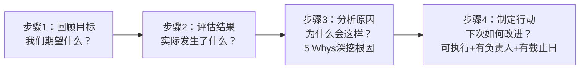
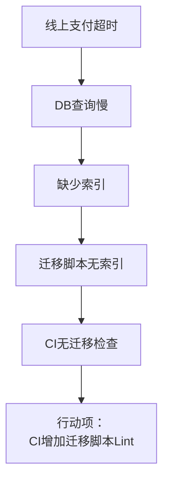
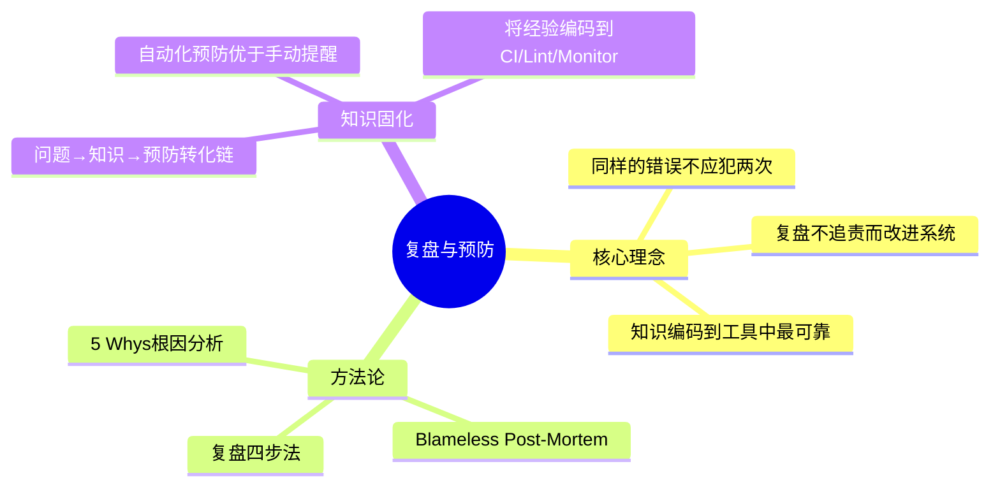

# 开发中的问题一再出现，应该怎么办

## 核心命题

同样的问题反复出现，说明团队**未建立有效的复盘（Retrospective）机制**——问题被修复但根因未被消除。复盘不是追责，而是**系统性地从问题中提取知识并转化为预防措施**。每次线上故障、每个反复出现的 Bug，都应触发一次结构化复盘，产出可执行的改进行动项。**圣斗士不会被同样的招数击败两次——软件团队也不应犯同样的错误两次。**

---

## 1. 复盘方法论

### 1.1 复盘四步法



### 1.2 Blameless Post-Mortem：无罪复盘

| 原则 | 含义 | 反模式 |
|------|------|--------|
| **无罪推定** | 假设每个人在当时条件下都做了最佳决策 | "谁犯的错？追责！" |
| **系统性归因** | 寻找流程/工具/系统的改进点 | "这个人不仔细" |
| **可执行行动** | 每个发现必须有对应的改进行动 | "以后注意"（无法验证） |
| **跟踪闭环** | 行动项有人负责、有截止日期、有验证 | 复盘完就忘了 |

> **Etsy 的实践**：每个线上故障必须在 48 小时内完成 Blameless Post-Mortem，产出公开的复盘报告和行动项。

### 1.3 5 Whys 根因分析

```
问题：线上支付接口超时
Why1：数据库查询慢
  Why2：缺少索引
    Why3：新增字段未加索引
      Why4：数据库迁移脚本不含索引创建
        Why5：CI 中无数据库迁移检查
→ 行动项：在 CI 中增加迁移脚本 Lint，确保新表/字段包含索引定义
```



---

## 2. 知识固化：从复盘到预防

### 2.1 问题→知识→预防的转化链

| 阶段 | 产出 | 责任方 | 工具 |
|------|------|--------|------|
| **问题发生** | 故障报告 | On-call 工程师 | PagerDuty/Opsgenie |
| **复盘分析** | 根因 + 行动项 | 团队 | Confluence/Notion |
| **预防措施** | 代码检查/CI 规则/监控 | 行动项负责人 | 自动化工具 |
| **知识沉淀** | Runbook/SOP | 团队 | 内部 Wiki |

### 2.2 自动化预防：将知识转化为工具

| 问题类型 | 手动预防（❌） | 自动化预防（✅） |
|----------|-------------|----------------|
| 缺少索引 | "以后注意加索引" | CI 中检查迁移脚本 |
| 依赖安全漏洞 | "定期检查依赖" | Dependabot/Renovate 自动 PR |
| 代码规范违反 | "Code Review 时检查" | Lint + Pre-commit Hook |
| 配置错误 | "仔细检查配置" | Schema 验证 + 配置漂移检测 |
| 遗漏测试 | "记得写测试" | CI 中检查覆盖率阈值 |

> **原则**：如果一条经验只能靠"记住"来执行，它迟早会被遗忘。**将知识编码到工具中**，是防止问题再次出现的最可靠方式。

---

## 3. 复盘的组织实践

### 3.1 复盘的触发时机

| 触发条件 | 频率 | 参与者 |
|----------|------|--------|
| **线上故障** | 每次故障后 48h 内 | On-call + 相关开发者 |
| **迭代回顾** | 每迭代结束 | 全团队 |
| **项目里程碑** | 里程碑完成后 | 项目组 |
| **重复 Bug** | 同类 Bug 第 2 次出现 | 相关开发者 |

### 3.2 复盘报告模板

```markdown
# Post-Mortem: [故障标题]

## 时间线
- HH:MM - 告警触发
- HH:MM - 确认影响范围
- HH:MM - 执行回滚/修复
- HH:MM - 服务恢复

## 影响范围
- 持续时间：X 分钟
- 影响用户：Y 人
- 业务损失：Z

## 根因分析（5 Whys）
...

## 行动项
| # | 行动 | 负责人 | 截止日 | 状态 |
|---|------|--------|--------|------|
| 1 | CI 增加迁移检查 | @alice | 2024-01-15 | Done |
```

---

## 4. 复盘为什么有效：客体化（郑晔的分析）

### 4.1 复盘的定义与渊源

- 复盘原本是一个围棋术语：对弈者下完一盘棋之后，重新把对弈过程摆一遍，看看哪些地方下得好、哪些下得不好、哪些地方可以有不同甚至更好的下法。**这种把过程还原，进行研讨与分析的方式，就是复盘。**
- 复盘的概念如今已被用到很多方面，比如股市的复盘、企业管理的复盘，成为帮助个体和企业不断提升的重要工具。其中最有名的是联想创始人柳传志，他甚至把"复盘"写到了联想的核心价值观里。
- 现实中的常见困境：同样的线上故障反复出现，类似的 Bug 在不同地方一再惹祸，能力强的工程师每天在"灭火"中消耗。如果在开发过程中同样的问题反复出现，说明团队没有做好复盘。

### 4.2 客体化：复盘有效的原因

俗话说，当局者迷，旁观者清。以软件开发为例：解决问题时，注意力更多在问题本身上，很少思考这个问题是怎么引起的。

复盘时则站在另一个视角去思考引起问题的原因——不再是当事者，而变成了旁观者；观察原来那件事的发生过程，就好像别人在做的一样，由主观视角变成了客观视角。

> **用别人的视角看问题，这就是客体化。** 这是复盘之所以好用的重要原因。

---

## 5. 回顾会议的完整操作流程（郑晔的实践）

回顾会议是一个常见的复盘实践，定期回顾是一个团队自我改善的前提。以下为郑晔作为组织者的通常做法。

### 5.1 第一步：确定主题分类

- 在白板上给出一个主题分类。常用的是三类：**"做得好的、做得欠佳的、问题或建议"**。
- 还有其他分类方式，比如海星图，分成五大类：**"继续保持、开始做、停止做、多做一些、少做一些"**。
- 分类方式可以根据团队的喜好选择。选择三类分类的原因是它简单直观，几乎不需要对各个分类做更多解释。

### 5.2 第二步：写便签（限时 5 分钟）

给与会者五分钟时间，针对这个开发周期内团队的表现，按照分类在便签上写下事实，例如：做得好的是按时交付了，做得不好的是 Bug 太多。

两个重点：

- **写事实，不要写感受。** 事实是明摆在那里的东西，而感受无法衡量——感觉好的东西，别人也许感觉很糟糕。
- **每张便签只写一条。** 因为后面要对便签归类；大家分头写会有重复内容，所以要进行归类。

### 5.3 第三步：贴便签、念便签、归类

五分钟后，号召大家把便签贴到白板上，然后一张一张地念过去。这样做是为了让与会者了解其他人写了什么、知道不同人的关注点是什么；一旦有哪一项不清楚，就请这张便签的作者出来解释，保证大家对问题的理解一致。念便签的同时，顺便完成便签归类。

### 5.4 第四步：投票排序，确定讨论顺序

- 归好类的便签成为后续讨论的主题，与会者也由此对大家的关注点和看到的问题有了整体了解。
- 做得好的部分是值得自我鼓励、继续保持的部分；但开回顾会议的主要目的是改善和提升，重点在于解决做得不好的部分和出现问题的地方。
- 开始针对性讨论之前，先让大家投票选出最重要的几项：通常给每人三票，投给认为重要的主题；如果认为哪一项极其重要，可以把所有的票都投给它。
- 根据投票结果对所有主题排出顺序，这就是讨论的顺序。会议时间有限，通常只有最重要的几个主题才会得到讨论。无论个人选择希望讨论的主题，还是团队选择最终讨论的主题，所有人心里都要有"优先级"的概念。

### 5.5 第五步：逐主题讨论——现状、原因、行动项

讨论一个具体主题的固定顺序：

1. **关注现状**：让写下反馈的人详细介绍看到的现象。例如测试人员会说：最近的 Bug 比较多，相比上一个开发周期，Bug 增加了 50%。
2. **分析原因**：例如有人会说，最近的任务量很重，没有时间写测试。
3. **给出行动项**：例如针对任务重，让项目经理更有效地控制需求输入、减少非必要需求；针对测试被忽略，把测试覆盖率加入构建脚本，覆盖率不足时不允许提交代码。

> **所有给出的行动项应该都是可检查的，而不是无法验证的内容。** 如果行动项是让每个程序员都"更仔细一些"，这是做不到的——"仔细"很主观，说程序员不仔细、程序员说自己仔细了，就是扯皮的开始。可检查的行动项如：控制需求输入用工作量衡量（看每个阶段开发的总点数是否比上一阶段少）；测试覆盖率直接写进构建脚本，跑不过就不允许提交代码。

### 5.6 第六步：指定责任人，形成闭环

列好行动项后要找责任人，责任人要对行动项负责。例如：项目经理负责需求控制，技术负责人负责将覆盖率加入构建脚本。有了责任人，任务就不是无头公案；下一次做回顾时，就可以拿着一个个检查项询问负责人任务的完成情况。

---

## 6. 5个为什么：追问根因（郑晔的案例）

### 6.1 方法渊源与适用性

- 无论是否采取回顾会议的方式进行复盘，分析问题、找到根因都是重要的一环。团队能一下洞见根因固然好；如果不能，最好多问一些为什么。
- 常见做法是 **5个为什么（5 Whys）**，由丰田集团创始人丰田佐吉提出，后来随着丰田生产方式而广为人知。
- 为什么要多问：初始的提问只能得到表面原因，只有多问几个为什么，才有可能找到根本原因。

### 6.2 案例：服务器经常返回 504

1. 为什么会出现 504？因为服务器处理时间比较长，超时了。
2. 为什么会超时？因为服务器查询后面的 Redis 卡住了。
3. 为什么访问 Redis 会卡住？因为另外一个更新 Redis 的服务删除了大批量的数据然后重新插入，服务器阻塞了。
4. 为什么它要大批量删除数据重新插入？因为更新算法设计得不合理。
5. 为什么一个设计得不合理的算法能上线？因为这个设计没有按照流程进行评审。

问到这里就发现了根本原因：设计没有经过评审。解决之道随之浮出水面：一个核心算法一定要经过相关人员的评审。

### 6.3 使用注意事项

- 有时这个答案还不足以解决问题，可以继续追问下去，比如"为什么没有按流程评审"等。**"5个为什么"中的"5"只是一个参考数字，不是目标。**
- 问题是顺着一条主线追问，不能问 5 个无关的问题。
- 最需要注意的一点：无论回顾会议还是 5个为什么，都不要用这些方法责备某个人——目标是解决问题、不断改进，而不是针对某个人发起情感批判。

---

## 7. 总结



**核心要义**：同样的错误不应犯两次。复盘是提取知识、制定预防措施的系统性方法。Blameless Post-Mortem 确保复盘不追责而改进系统，5 Whys 深挖根因，自动化预防将知识转化为工具——如果一条经验只能靠"记住"来执行，它迟早会被遗忘。

> **郑晔的小结**：在软件研发中，许多问题会反复出现，很多开发团队因此陷入无限"救火"。解决这类问题的一个好办法就是复盘——过程还原、研讨分析、找到自我改进方式，借助客体化视角更客观地看待曾经发生过的一切。软件开发中的落地实践是回顾会议；无论哪种做法，分析问题、找到根因都是重要环节，"5个为什么"是常用的找根因方式。
>
> **如果只能记住一件事：定期复盘，找准问题根因，不断改善。**

---

> **延伸阅读**
>
> - Etsy, "Blameless Post-Mortems": https://codeascraft.com/2012/05/22/blameless-postmortems/
> - Google SRE Ch. 15: Post-Mortem 文化与最佳实践
> - Sidney Dekker, *The Field Guide to Understanding 'Human Error'* (2014): 系统性归因方法论
