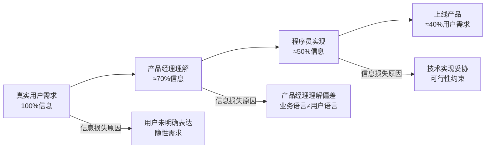
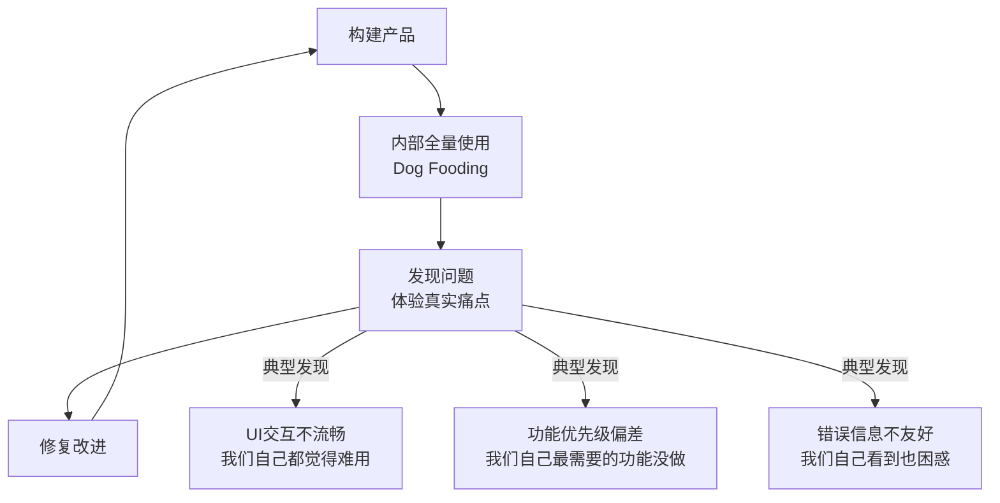
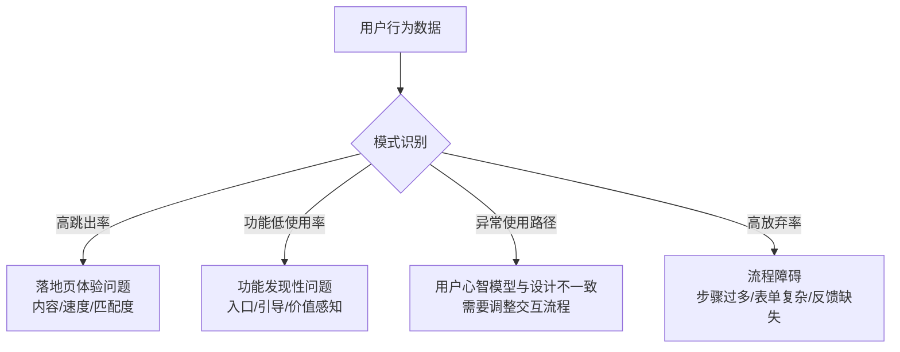
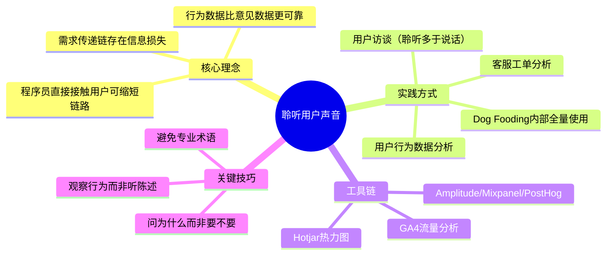

# 作为程序员，你也应该聆听用户声音

## 核心命题

产品经理的需求未必代表用户真实需求——需求经过"用户→产品经理→程序员"的传递链后，信息损失和扭曲不可避免。程序员通过**直接接触用户**——观察用户行为、聆听用户反馈、使用自家产品（Eat Your Own Dog Food）——可以获得超出产品经理传达范围的洞察，形成来自真实世界的**直接反馈**，这是纠正需求偏差的关键维度。

---

## 1. 需求传递链的信息损失

### 1.1 信息传递的衰减效应

> **核心洞察**：经过三级传递后，最终产品仅满足约 40% 的原始用户需求。程序员直接接触用户，可以缩短传递链，显著减少信息损失。

### 1.2 程序员获取用户视角的方式

| 方式 | 深度 | 成本 | 信息类型 | 适用场景 |
|------|------|------|---------|---------|
| **Eat Your Own Dog Food** | 最高 | 零 | 体验级 | 内部工具/开发者产品 |
| **用户访谈** | 高 | 中 | 意见+行为 | 任何产品 |
| **用户行为数据分析** | 中 | 低 | 行为级 | 有埋点基础设施 |
| **客服/工单分析** | 低 | 低 | 问题级 | 已有客服体系 |
| **社区/论坛反馈** | 低 | 低 | 意见级 | 开源/公开产品 |
| **Sales/运营反馈** | 中 | 低 | 商业级 | 商业产品 |

---

## 2. Dog Fooding：最深度的用户视角

### 2.1 定义与行业实践

> **Eat Your Own Dog Food**：公司内部员工率先使用自己的产品，在真实使用场景中发现问题。这一概念因 1988 年微软的 Paul Maritz 发出的"Eating our dog food"邮件而流行开来。

### 2.2 Dog Fooding 的行业案例

| 公司 | Dog Fooding 实践 | 关键发现 |
|------|-----------------|---------|
| **Microsoft** | 内部率先使用 Windows/Office | 安装体验、兼容性问题 |
| **Google** | 内部使用 Chrome/Gmail | 内存占用、搜索体验 |
| **Stripe** | 开发者使用自家 API | API 文档、错误信息可读性 |
| **Slack** | 内部全量使用 Slack | 通知策略、频道管理、搜索体验 |
| **Apple** | 内部使用 iPhone/Mac | 硬件手感、生态系统流畅度 |
| **Netflix** | 内部使用自家流媒体 | 播放延迟、推荐算法效果 |

### 2.3 Dog Fooding 的实施要点

| 要点 | 说明 |
|------|------|
| **全量使用** | 不只是测试，而是日常工作中真正依赖自家产品 |
| **真实场景** | 在生产环境中使用，而非在干净的测试环境中 |
| **反馈机制** | 内置"一键反馈"按钮，降低反馈门槛 |
| **数据追踪** | 内部用户行为数据与外部用户对比，发现差异 |

---

## 3. 数据驱动的用户洞察

### 3.1 行为数据 vs 意见数据

| 数据类型 | 来源 | 特点 | 局限 |
|----------|------|------|------|
| **行为数据** | 埋点/日志/分析 | 用户实际做了什么 | 无法解释"为什么" |
| **意见数据** | 用户访谈/问卷 | 用户说什么 | 可能与行为不一致 |

> **关键洞察**：用户说的和做的往往不一致。行为数据比意见数据更可靠，但需要意见数据解释"为什么"。

### 3.2 行为数据分析工具链

| 工具 | 核心能力 | 适用规模 | 特色 |
|------|---------|---------|------|
| **Amplitude** | 行为分析+归因+实验 | 中大型 | 最全面的产品分析平台 |
| **Mixpanel** | 事件级分析+用户画像 | 中型 | 交互式分析界面 |
| **PostHog** | 开源产品分析+Feature Flag | 初创-中型 | 开源、自托管 |
| **Google Analytics 4** | 流量+转化+事件 | 所有规模 | 免费、生态完善 |
| **Hotjar** | 热力图+录屏+问卷 | 中型 | 可视化用户行为 |

### 3.3 数据洞察的典型模式

---

## 4. 用户访谈的实践

### 4.1 访谈的类型与场景

| 类型 | 时长 | 目的 | 方法 |
|------|------|------|------|
| **探索性访谈** | 30-60 分钟 | 发现未知需求 | 开放式问题，让用户讲故事 |
| **验证性访谈** | 15-30 分钟 | 验证假设 | 结构化问题，聚焦特定功能 |
| **可用性测试** | 15-20 分钟 | 发现交互问题 | 观察用户完成特定任务 |

### 4.2 访谈的关键技巧

| 原则 | 说明 | 反模式 |
|------|------|--------|
| **聆听多于说话** | 80% 听 + 20% 问 | 向用户推销自己的想法 |
| **问"为什么"而非"要不要"** | 深挖动机而非表面需求 | "你需要这个功能吗？"（诱导性） |
| **观察行为而非听陈述** | 用户做的比说的更真实 | 只听用户说，不看用户做 |
| **避免专业术语** | 用用户的语言提问 | 用技术术语与普通用户交流 |

> **Steve Portigal 的建议**：不要问"你喜欢这个功能吗？"，而问"你上次遇到这个问题时是怎么解决的？"——前者诱导偏好，后者揭示真实行为。

---

## 5. 获取用户视角的实践（郑晔）

### 5.1 程序员为什么需要用户视角

郑晔指出，产品经理无论要做什么，都必须有一个立足的根基：为用户服务。因此，只有了解用户怎么想，才有资本判断产品经理给出的需求是否真的是用户需要的。

- 欠缺用户视角的程序员，在与产品经理的交流中是不可能有话语权的——对方很容易用一句话就结束讨论："这就是用户需求。"
- 很多程序员只希望安安静静地写好代码，但事实上，对大多数人来说，安安静静不太可能写好代码；只有不断扩大自己的工作范围，才可能对准"靶子"。扩大方向就是：**由听产品经理的话，扩大成倾听用户的声音**。
- 在挑毛病找问题这件事上，人是不需要训练的——哪里用着不舒服，一下子就能感受到。不断使用自家产品，程序员自己就是产品的用户，这会促使其不断思考怎么改进产品；再与产品经理讨论时，就自然而然拥有了更多的维度。

### 5.2 出处与案例：吃自家的狗粮

"Eat your own dog food"（吃自家的狗粮）有几种不同来源，本意是说卖狗粮的公司真的用了自家的狗粮。1988 年，微软的保罗·马瑞兹（Paul Maritz）写了一封"Eating our dog food"的邮件，提出要"提高自家产品在内部使用的比例"，这个说法从此在微软迅速传播开来。如今，自己公司用自己的产品几乎成了全行业的共识。

**案例（郑晔做 P2P 产品的经历）**：在该项目中，郑晔以普通用户身份在产品上进行操作，随即发现一些令人不爽的细节——最初设计的代金券只能一次性使用，如果代金券金额较大而订单本金不足，用户只能使用代金券的一部分，会产生"代金券浪费了"的感觉。他随即提出把代金券改为可多次使用，产品很快改进了设计。

> 这种改进很细微，如果不是用户，只从逻辑推演的角度很难看到这种差异。

### 5.3 当吃不到狗粮时：走进真实场景

不是每家公司的产品都那么"好吃"。"吃自家狗粮"的策略对拥有 to C 产品的公司相对有效；但有些产品，开发者自己根本没有机会用到。

**案例（郑晔做五星级酒店审计平台）**：除了能对界面上的内容稍微有点感觉之外，郑晔对使用场景完全不了解。应对办法是尽可能找机会到真实场景，看用户如何使用软件——他与客户一起走进一家五星级酒店，观察酒店人员如何一条一条地按照审计项核查，再把审计结果登记在平台上。那些曾经只在写程序时见到的名词，从此活生生地呈现在眼前；后来再面对代码时，看到的不再是一个死板的程序，与产品经理的讨论也就更加扎实了。

有的团队在这方面有较好的意识，会主动创造机会让开发成员与用户接触，典型做法是**让开发团队到客服团队轮岗**：接电话、听用户的抱怨甚至谩骂。现场心情往往非常不好，但静下来就会意识到软件有哪些问题、软件做得不好影响会有多大——也就能理解为什么业务人员有时会对开发团队大发雷霆，因为业务人员是直接面对用户"炮火"的人。

为什么要不断了解用户的使用情况？因为**用户的声音是来自真实世界的反馈**；不去聆听用户声音，很容易盲目自信。郑晔在"为什么世界和你的理解不一样"一篇中提过一个只接收好消息的花剌子模国国王的例子（[为什么世界和你的理解不一样](http://time.geekbang.org/column/article/80755)）。华为总裁任正非也说过："让听得见炮声的人来做决策。"做一个有价值的产品，这个"价值"不是对产品经理有价值，而是要对用户有价值——做什么产品，本质上不是由产品经理决定的，而是由用户决定的。只有听见"炮声"、站在一线，才更有资格判断产品经理给出的需求是否真的是用户所需。

### 5.4 当产品还没有用户时：用户测试

如果团队做的是新产品、还没有真正的用户，可以采用"用户测试"的方法。

**案例（郑晔参与海外客户项目的用户测试）**：项目尚处于启动阶段，郑晔被派到客户现场。客户在项目还没开始开发、只做了几个页面的情况下，就组织了一次用户测试，邀请他一起参加——这正是精益创业和 MVP 的思路：通过最小的代价获取用户反馈。

测试的组织方式如下：

1. **准备**：找几个各有特点、能代表不同类型人群的普通用户；准备一台摄像机记录测试全过程；准备一些表格，把关注的问题罗列上去。
2. **执行**：先向用户介绍测试目的、流程等基本信息，然后请用户执行几个任务。过程中测试者适时请用户描述当时的感受；用户遇到问题时适当介入，询问情况并提供适当的帮助。
3. **收尾**：让用户为这个产品打分、做一番评价。测试者的主要工作是观察和记录用户的反应，寻找对用户使用造成影响的部分——目的是看用户会怎样使用这个网站，这样的网站设计会对用户的使用有什么影响。
4. **迭代**：当天测试结束后，大家一起整理用户反馈，重新讨论那些给用户体验造成影响的设计，调整一版，再做一次用户测试。

郑晔的收获是：第一次这么近距离地接触用户，他们的关注点、使用方式都与曾经的假设有很多不同。后面再来设计这个系统时，开发人员便有了更多发言权——因为产品经理有的角度，开发人员也有。

### 5.5 和产品经理建立"共同语言"

郑晔还指出一个程序员常见的问题：和产品经理没有"共同语言"。产品经理说的是业务语言，程序员口中基本上是计算机语言，这是两个领域的东西，很难互通。

前面讨论代码时提到要用业务的语言写代码，这种做法就是领域驱动设计中的**通用语言（Ubiquitous Language）**：

- 通用语言不只是写代码要用到，而是要让所有人说一套语言；
- 这套语言应该来自业务，来自大家一起构建出的领域模型；
- 这样大家在交流时才可能消除歧义。

想让项目顺利进行，先邀请产品经理一起坐下来，确定通用语言。

### 5.6 小结

- 倾听用户声音是开发团队普遍欠缺（更准确地说，是忽略）的一种能力——正因如此，"吃自家的狗粮"这种听上去理所当然的事情才被反复强调，成为 IT 行业的经典。
- 了解用户需求的各种做法，归根结底就是一句话：**想办法接近用户**。无论是自己做用户，还是找机会接触已有用户，亦或是没有用户就创造用户（用户测试）。
- 只有多多听取来自真实用户的声音，才不至于盲目自信，或是偏颇地相信产品经理。**谁离用户近，谁就有发言权，无论角色是什么。**
- 郑晔的核心结论：**多走近用户。**

---

## 6. 总结

**核心要义**：程序员应主动获取用户视角——通过 Dog Fooding、行为数据分析、用户访谈。仅依赖产品经理的需求传达，会缺失来自真实世界的直接反馈。用户说的和做的往往不一致，行为数据比意见数据更可靠。

---

> **延伸阅读**
>
> - Steve Portigal, *Interviewing Users* (2013): 用户访谈方法论
> - Tomer Sharon, *Validating Product Ideas* (2016): Lean 用户研究
> - PostHog: https://posthog.com/
> - Amplitude: https://amplitude.com/

---

> **原文出处**：本文第 5 节的方法论与案例整理自郑晔原文《26 | 作为程序员，你也应该聆听用户声音》，观点与案例细节均已署名保留。
