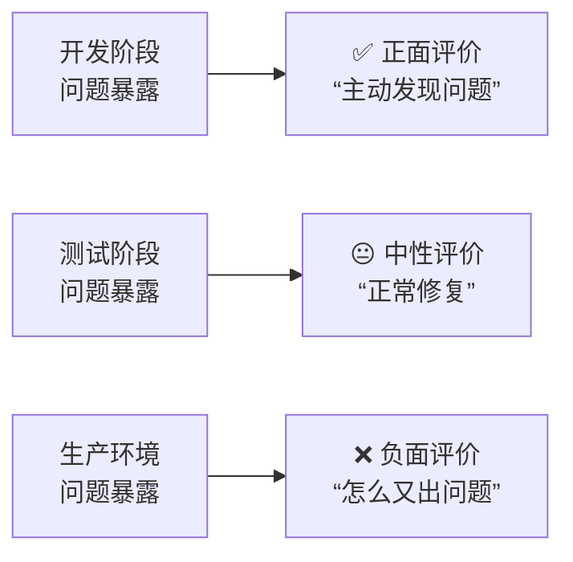
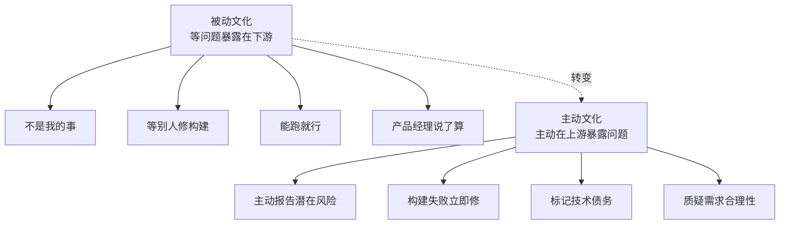
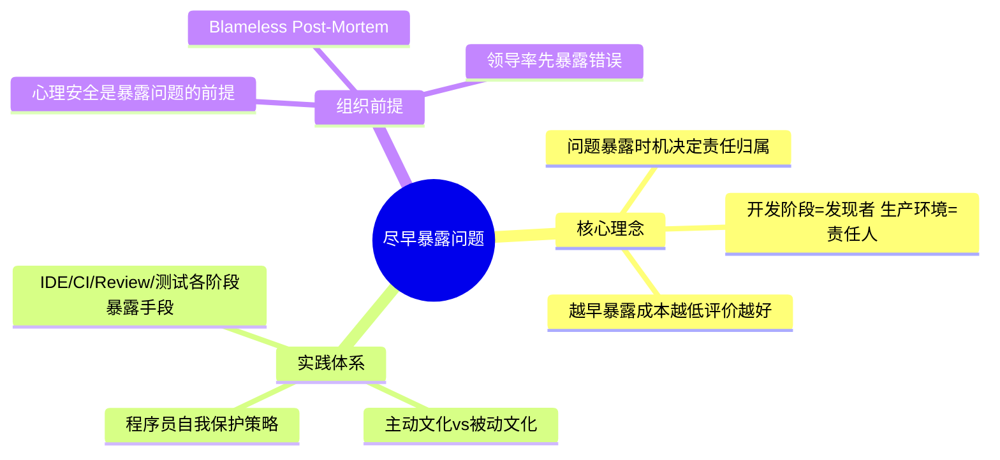

# 尽早暴露问题：为什么被指责的总是你

## 核心命题

"辛苦工作却总被指责"的根因是**问题暴露在下游而非上游**。当问题在开发阶段暴露，开发者是"发现者"（获得正面评价）；当问题在生产环境暴露，开发者是"责任人"（受到负面评价）。尽早暴露问题（Shift-Left）不仅是工程实践，更是一种**保护自己职业口碑的策略**——问题暴露越早，修复成本越低，当事人的评价越好。

---

## 1. 问题暴露时机与责任归属

### 1.1 时机决定评价

> **核心洞察**：同样的问题，暴露时机不同，责任归属完全不同。开发阶段暴露 = 发现者（英雄），生产环境暴露 = 责任人（被指责）。

### 1.2 代价曲线：越早越低

| 暴露时机 | 修复成本 | 影响范围 | 当事人评价 |
|----------|---------|---------|---------|
| **编码时（IDE/编译）** | 1x | 仅自己 | 正面 |
| **提交时（CI 构建）** | 10x | 团队可见 | 正面 |
| **Code Review 时** | 10-50x | 2-3 人可见 | 正面-中性 |
| **QA 测试时** | 100x | QA 团队可见 | 中性 |
| **生产环境** | 1000x | 用户+管理层可见 | 负面 |

---

## 2. 尽早暴露问题的实践体系

### 2.1 各阶段的暴露手段

| 阶段 | 暴露手段 | 发现的问题类型 | 速度 |
|------|---------|--------------|------|
| **编码时** | IDE 提示、编译错误、TDD Red | 语法错误、逻辑错误 | 秒级 |
| **提交时** | CI 构建、Lint、静态分析 | 规范违反、安全漏洞 | 分钟级 |
| **Code Review** | PR Review | 设计问题、边界遗漏 | 小时级 |
| **测试环境** | 集成测试、契约测试 | 服务间兼容性 | 分钟级 |
| **预发环境** | 冒烟测试、性能测试 | 环境差异、性能退化 | 小时级 |

### 2.2 主动暴露问题的文化

| 行为 | 被动文化 | 主动文化 |
|------|---------|---------|
| **发现潜在问题** | "不是我的事" | 主动报告并提出修复建议 |
| **构建失败** | "等别人修" | 立即停止手头工作优先修复 |
| **技术债务** | "能跑就行" | 标记并排入 Backlog |
| **需求疑问** | "产品经理说了算" | 主动质疑并要求澄清 |
| **线上异常** | "没报错就行" | 关注指标趋势，主动排查 |

### 2.3 程序员的职场自保策略

| 策略 | 做法 | 保护效果 |
|------|------|---------|
| **CI 红灯即停** | 构建失败后立即修复，不继续开发 | 避免问题累积 |
| **小步提交** | 每次提交增量小，问题范围窄 | 快速定位问题 |
| **主动报告风险** | 在站会/Review 中提前指出风险 | 问题由当事人先发现而非被别人发现 |
| **沙盘推演** | 编码前推演上线路径 | 预判上线风险 |
| **监控告警** | 上线后主动配置关键指标监控 | 第一时间感知异常 |

---

## 3. 心理安全：尽早暴露的组织前提

### 3.1 心理安全（Psychological Safety）

> Amy Edmondson 的研究指出：**高心理安全的团队更愿意主动暴露问题**——因为暴露问题不会被惩罚。

| 组织特征 | 低心理安全 | 高心理安全 |
|----------|-----------|-----------|
| **暴露问题** | 隐藏、掩盖 | 主动报告 |
| **犯错** | 被惩罚 | 被视为学习机会 |
| **提问** | 怕被嘲笑 | 被鼓励 |
| **创新** | 只做安全的事 | 敢于尝试 |

### 3.2 建立心理安全的实践

| 实践 | 说明 |
|------|------|
| **领导率先暴露自己的错误** | 树立"犯错不丢人"的榜样 |
| **Blameless Post-Mortem** | 复盘不追责而改进系统 |
| **奖励问题发现者** | "发现构建失败的人值得表扬" |
| **公开承认不确定性** | "我不确定这个方案是否可行，需要验证" |

---

## 4. 案例与 Fail Fast 原则（郑晔）

### 4.1 典型案例：闷头苦干的小李

郑晔讲述了一个程序员小李的故事：系统要做性能提升——原先所有订单都下到数据库，后来很多订单撤单，反复操作数据库影响了真正成交过程的性能，技术负责人老赵决定把订单先放到缓存里。这牵扯到技术选型，老赵找了几家可用的缓存中间件，让小李做一个测试、给出测试结果，供大家一起评估。

- 老赵问"多长时间可以搞定"，小李答"一个星期"；老赵爽快答应，但提了一个要求：**不能纯测中间件，得带着业务跑**，并特意嘱咐只测最简单的下单撤单环节就好。
- 真正动手后小李发现，带着业务跑没那么容易：原来的代码耦合度太高，想把新的中间件加进去，得先把下单和撤单环节隔离开来，而这两个操作遍布在很多地方，需要先做一些调整。
- 于是小李不分白天黑夜地干，随着工作深入越发觉得这个活是个无底洞——时间已经过半，代码还没调整完。老赵来询问进展时，小李才满面愁容地说估计干不完了。老赵很震惊："不就是测试几个中间件吗？"小李一脸委屈："为什么要带着业务跑？这几天的时间都在调整代码，以便把中间件的调用加进去。"老赵则很疑惑："为什么要这么做？"小李答："不是说要带着业务跑吗？"老赵说："是要带着业务跑，但可以自己写一个下单撤单的程序，主要过程保持一致就好了。"小李无奈，心里暗骂：怎么不早说呢？

### 4.2 案例复盘：问题出在暴露时机

郑晔对案例的分析：

- 小李和老赵都算有"以终为始"的思维，一开始就确定了目标（做新中间件测试，要带着业务跑）；做的过程中小李发现了问题——原有代码很复杂、改造工作量大、可能无法按时完成。到此为止，所有做法都没有错。
- **但接下来，发现问题的小李选择了继续埋头苦干，直到老赵来询问，才把问题暴露出来。** 老赵看来这并不是大事，调整一下方案就好了；小李却心生怨气，觉得老赵明明有简单方案却不早说。
- 站在老赵的角度：要求是带着业务跑，最理想的方案当然是和系统在一起，能搞定最好；既然搞不定，退而求其次，自己写一个隔离出来的方案也能接受。老赵的选择没有任何问题。
- 问题就出在：**小李发现自己可能搞不定任务的时候，选择继续闷头做，而不是把问题暴露出来、寻求帮助。**

### 4.3 不是所有问题都值得独自扛

郑晔由此提炼出几条观点：

- 克服技术难题是程序员工作的重要组成部分，一旦有困难，人会下意识地把自己投入进去。但这并不是最好的做法——**不是所有的问题，都是值得解决的技术难题**。
- 在工作中遇到问题，是正常得不能再正常的事。既然是当事人遇到的问题，其必然是第一个知道问题发生的人；如果不把问题暴露出来，别人想帮忙也有心无力。
- 如果老赵不过问，结果必然是小李一条路跑到黑：时间到了，任务没完成。更关键的是，项目计划通常一环套一环，小李的失败会让项目后续部分受到影响，项目整体延期几乎必然——这种让人措手不及的情况，是很多项目负责人最害怕见到的。
- 单从个人角度看，这只是工作习惯问题；但实际上，处于关键节点的人可能会给项目带来风险。问题被提前发现，调整的空间会大很多。

> **遇到问题，最好的解决方案是尽早把问题暴露出来。** 这个道理在写程序时其实已经用到了——Fail Fast。

### 4.4 Fail Fast：程序世界的"尽早暴露"

[Fail Fast](http://www.martinfowler.com/ieeeSoftware/failFast.pdf) 是写程序的一个重要原则：如果遇到问题，尽早报错。

**案例一（参数校验的位置）**：一个查询服务支持按月份查询信息，一年 12 个月，查询参数是 1 到 12。参数校验应该在哪做？如果什么都不做，这个查询参数会穿透系统，直接传到数据库上——合法参数自然没问题，但无意义的参数（比如"13"）也会传到数据库。很多不经心的系统就是这么做的；一旦系统出了状况，很难判断问题的根源。在这个极度简化的例子里，一眼就能看出问题出在输入参数上；一旦系统稍具规模，请求来自不同的地方、最终都汇集到数据库上，识别来源的难度就会大幅增加——尤其系统并发起来后，很难从日志中找出这个请求的来源。有人会提出"给每个请求加上唯一的请求 ID"——系统就是这么一步步变复杂的；郑晔调侃这种解决方案是"没有困难创造困难也要上"。其实解决方法很简单：**参数校验应该放在入口的位置上，不合法的请求就不让它往后走**。这种把可能预见的失败拦在外面的做法就是 Fail Fast——有问题不可怕，让失败尽早到来。

**案例二（缺省值的陷阱）**：如果配置文件缺少一个重要参数，比如数据库最大连接数，很多人会选择给一个缺省值——这不是 Fail Fast。既然是重要参数，少了就报错，这才叫 Fail Fast。

Fail Fast 有一些反直觉的味道：很多人以构建健壮系统为由，兼容了很多奇怪的问题而不是把它们暴露出来，反而把系统中的 Bug 隐藏起来。靠 debug 定位问题是最费时费力的做法——别怕系统有问题，有问题就早点报出来。

附带说明：上面透传参数的例子还有几个额外问题——一是会给数据库带来额外的压力，如果有人用无意义查询作为攻击手段，它会压垮数据库；二是安全问题，一些 SQL 攻击利用的正是这种无脑透传。

### 4.5 克服心理障碍，更进一步：工作透明化

在程序中尽早暴露问题容易被接受，但在工作中暴露自己的问题却是很大的挑战——担心让别人觉得自己不行。

- 郑晔指出这种担心是多余的：每个人能力的强弱，大家看得清清楚楚；只有能把问题解决了，大家才会高看一眼，而把问题遮盖住并不能改善自己在别人心目中的形象。既然是问题，藏是藏不住的——就像案例里的小李，即便试图隐藏问题，最后也不可能完成，问题还是会出来，到那时别人对他的评价只会更加糟糕。
- 比尽早暴露问题更进一步的工作方式，是**把自己的工作透明化**：让别人尽可能多地了解自己的工作进展、了解自己的想法。做到这一点，其他人在遇到与相关工作的事情时，都会提供信息、帮助把工作做得更好。当然，这种做法对人的心理挑战比尽早暴露问题更大。
- 把事情往前做有两方面的理由：一方面是从软件变更成本的角度考虑，另一方面是从与人打交道的角度考虑——越往前做，给人留下的空间和余地越大，调整的机会也就越充足；在最后一刻出现问题，成本高到让人无法负担。

### 4.6 小结

- 事前通过"以终为始"和"任务分解"早点发现问题；做事过程中，一旦在有限时间内搞不定，尽早让其他人知道。
- 这个原则在写程序中的体现就是 Fail Fast。很多程序员因为没有坚持这个原则而不断妥协，造成程序越来越复杂，团队陷入无尽的泥潭。
- 原则很简单，真正的挑战在于克服自己的心理障碍。很多人会下意识地隐瞒问题，但队友都是聪明人，问题是藏不住的。
- 郑晔的核心结论：**事情往前做，有问题尽早暴露。**

---

## 5. 总结

**核心要义**：尽早暴露问题，既是工程实践，也是职业策略。问题暴露越早，修复成本越低，当事人的评价越好。主动暴露问题的人是"发现者"，被动暴露问题的人是"责任人"。心理安全是尽早暴露的组织前提。

---

> **延伸阅读**
>
> - Amy C. Edmondson, *The Fearless Organization* (2018): 心理安全与问题暴露
> - Google SRE Ch. 15: Post-Mortem 文化
> - Sidney Dekker, *The Field Guide to Understanding 'Human Error'* (2014)

---

> **原文出处**：本文第 4 节的方法论与案例整理自郑晔原文《27 | 尽早暴露问题：为什么被指责的总是你？》，观点与案例细节均已署名保留。
