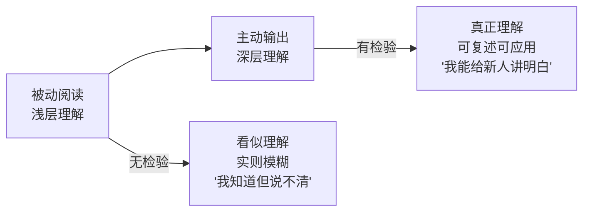
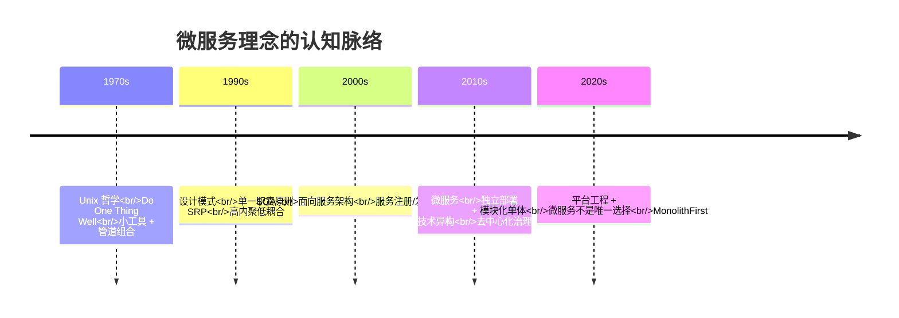
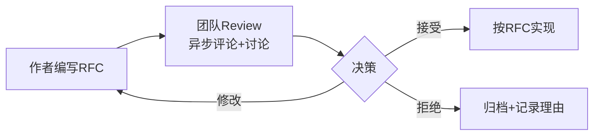
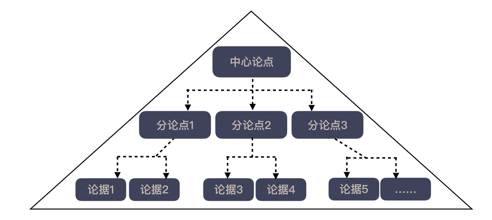
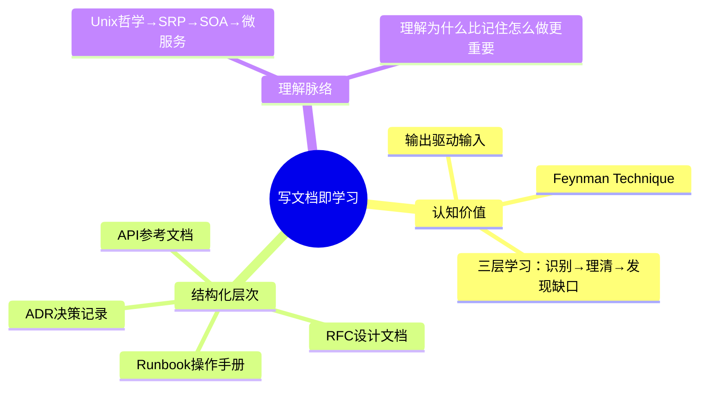

# 结构化：写文档也是一种学习方式

## 核心命题

写文档不是"额外负担"，而是**结构化学习的过程**。通过将知识组织为有层次、有逻辑的文档结构，强制自己理解概念间的关联与因果——**输出是最好的输入**。郑晔以微服务理念为例，从 Unix 哲学 → SOA → 微服务的认知脉络说明：理解"为什么"比记住"怎么做"更有价值，而写文档正是促进"理解为什么"的最有效手段。

---

## 1. 写文档的认知价值

### 1.1 输出驱动学习（Feynman Technique）



> **Feynman Technique**：如果不能用简单语言解释一件事，说明还没有真正理解它。写文档就是"用简单语言解释"的过程——发现写不清楚时，就是理解不到位的地方。

### 1.2 写文档的三层学习效果

| 层次 | 写文档时的思考 | 学习效果 |
|------|--------------|---------|
| **第一层：识别概念** | "这个概念叫什么？" | 从"模糊感知"到"命名定义" |
| **第二层：理清关系** | "这些概念之间是什么关系？" | 从"孤立知识"到"结构化认知" |
| **第三层：发现缺口** | "这里写不下去了，因为不理解" | 从"不知道自己不知道"到"知道自己不知道" |

---

## 2. 微服务理念的认知脉络（结构化学习范例）

### 2.1 从 Unix 哲学到微服务



| 理念 | 核心原则 | 对微服务的贡献 |
|------|---------|--------------|
| **Unix 哲学** | Do One Thing Well + 组合 | 单一职责 + 通过管道组合 |
| **SRP** | 一个模块只有一个变更原因 | 服务按职责划分 |
| **SOA** | 服务是自治的计算单元 | 服务独立部署与管理 |
| **微服务** | 小而自治 + 去中心化 | 解决 SOA 的复杂编排问题 |

> **认知价值**：理解了这条脉络，就知道微服务不是凭空出现的，而是 Unix 哲学在分布式系统领域的延续。理解了"为什么"，才能在"是否用微服务"时做出合理判断。

### 2.2 写文档如何促进这一理解

| 写作活动 | 思考过程 | 学习收获 |
|----------|---------|---------|
| 画时间线 | "微服务之前是什么？" | 理解演进脉络 |
| 写概念对比表 | "SOA 和微服务的区别？" | 精确区分相似概念 |
| 写"为什么" | "为什么从 SOA 演进到微服务？" | 理解驱动力 |
| 发现缺口 | "ESB 在微服务中对应什么？" | 识别知识盲点 |

---

## 3. 文档的结构化层次

### 3.1 四层文档体系

| 层次 | 文档类型 | 目的 | 读者 | 更新频率 |
|------|---------|------|------|---------|
| **概念层** | 架构决策记录（ADR） | 记录决策上下文与理由 | 架构师、新入职者 | 按决策 |
| **设计层** | 设计文档 / RFC | 描述方案设计与权衡 | 开发团队 | 按功能 |
| **操作层** | Runbook / SOP | 描述操作步骤 | 运维、On-call | 按故障 |
| **参考层** | API 文档 / README | 描述接口与使用方式 | 使用者 | 按版本 |

### 3.2 ADR：架构决策的结构化记录

```markdown
# ADR-001: 选择 PostgreSQL 作为主数据库

## Status: Accepted

## Context
系统需要持久化存储用户数据和订单数据，要求高可用、强一致性。

## Decision
选择 PostgreSQL 16，理由：
1. ACID 事务支持满足订单处理需求
2. JSONB 类型支持灵活扩展
3. 丰富的索引类型（B-tree、GIN、BRIN）
4. 成熟的备份与高可用方案（Patroni）

## Consequences
- 优势：强一致性、丰富生态、成熟工具链
- 限制：写入吞吐有上限（需配合缓存层）
- 风险：运维复杂度高于 MySQL（需 PostgreSQL 专家）
```

### 3.3 RFC 流程：设计文档的协作机制



**RFC（Request for Comments）** 的核心价值：

- 设计在编码前讨论，而非实现后再改
- 异步讨论比会议评审更高效（可搜索、可追溯）
- 记录决策过程，新入职者可理解"为什么这样做"

---

## 4. 文档认知的矛盾与真正障碍（郑晔的观察）

### 4.1 对文档的矛盾情感

程序员对文档有一种矛盾情感：一方面讨厌写文档，另一方面工作学习又高度依赖文档——大量阅读文档本就是程序员日常工作的一部分。郑晔到过很多公司，能比较快上手的，通常都有比较详尽的文档；而文档缺失的公司，想要把信息梳理清楚，往往要花很长时间。

### 4.2 CMM 企业的反面教材

郑晔的职业生涯从一个通过了 CMM 5 级认证的大企业开始。CMM（Capability Maturity Model for Software，能力成熟度模型）用于评估一个组织的软件开发能力，曾在国内风靡一时，许多软件公司都以拥有 CMM 认证为努力方向。

在那家极其重视过程的企业里，文档是非常重要的一环，但真实场景却是：一个软件已经上线运行了，大家才开始为了应付过程纷纷补写文档；每个部门都有专门的过程负责人，要求严格按照格式写文档、保证字体字号的正确性；然后文档用 A4 纸打印出来，封存在仓库里，再也无人问津。传统流程写了太多无用的文档，正是文档在程序员心目中"形象不佳"的主要原因。

### 4.3 回避写文档的真正原因：知识无法结构化

**很多人回避写文档的真正原因是，掌握的内容不能很好地结构化。**

- **读者与作者的角色差异**：读文档时是读者，按照作者梳理的结构走，呈现出来的内容多数已经结构化，读起来自然顺畅；写文档时是作者，没有人告诉结构应该是什么样，必须创造出一个结构来——而这正是很多人不擅长的。
- **知识结构决定学习效率**：当知识都是零散的，任何新技术的出现都是新东西；建立起自己的知识结构之后，任何新东西都只是原有知识上的增量叠加，学习效率会大幅提高。
- **微服务的例子**：小粒度的理念脱胎于 Unix 哲学中的"只做一件事，把它做好"，服务化的理念则是当年 SOA（Service-Oriented Architecture）的产物。理解了这些背后的动机，微服务就只剩下工具层面的问题；构建应用时只需把工具适配进去，再有针对性地学习相应知识即可。

### 4.4 知识输出：把知识连接起来

**输出的过程，本质上就是把知识连接起来的过程。** 自以为懂的东西，当需要按照一个完整的逻辑呈现出来时，缺失的细节就会冒出来；补齐这些细节，一张知识地图就逐渐成型。就像学生时代给同学讲题：明明已经把知识学得很好，讲解起来却总是讲不明白——因为同学总能从想不到的角度问问题。很多人自以为对知识的理解已经很深入，给别人一讲却发现怎么也讲不清楚，这说明理解的程度远未到达自以为的高度。

对程序员来说，最常接触的两种输出方式是**写作与演讲**。软件行业的很多大师级程序员都是对外输出的高手：

| 输出者 | 代表输出 | 贡献 |
|--------|---------|------|
| **Eric Raymond** | 《大教堂与集市》 | 推开了开源的大门 |
| **Kent Beck** | 《极限编程解析》《测试驱动开发》《实现模式》 | 系统化输出极限编程与 TDD 思想 |
| **Martin Fowler** | 重构、依赖注入（Dependency Injection）等概念的整理 | 重新整理似是而非的概念，让讨论有了更标准的词汇 |
| **高德纳** | 《计算机程序设计艺术》+ TeX | 系统整理算法概念，为好好写作甚至创造了排版软件 TeX |

### 4.5 金字塔原理：输出的基本模型

输出的第一目标不是成为作家或演讲家，而是把事情说清楚、把知识清晰地呈现出来。金字塔原理给出最经典的模型：



- **结构**：先确定想要表达的中心论点，再确定支撑论点的分论点，再找到支撑每个分论点的论据。从中心论点、分论点至论据一层层向下展开，从结构上看像金字塔一样，故称**金字塔原理**。
- **表达顺序**：可以自上而下表达——先说中心论点，再说分论点 1 并用论据证明，接着分论点 2，以此类推；也可以自下而上表达——先用证据得出分论点 1、分论点 2，最后归纳总结出中心论点。
- **练习**：懂得金字塔原理只是起点，还需要更多的练习。一个人不擅长输出，更多是因为缺乏知识的结构化；借助金字塔原理可以把某个知识结构化起来，有了结构，剩下的就是怎么输出。

### 4.6 无他，唯手熟尔

**写作需要大量练习**。郑晔刚开始工作不久赶上市面流行写 blog，抱着好奇的心态开始写作之旅：把写好的东西分享给周边的朋友，朋友给出反馈——有赞许、有调侃、也有针对细节的讨论，这让他觉得写的东西有人看，由此产生了坚持的原动力；他还经常模仿他人的手法不断改进写作技巧；读者从身边的人逐渐扩展开来，反馈越来越多，正向循环逐渐建立，写东西成了习惯并坚持至今。经过 blog 写作的锻炼，写的东西有了自己的章法和套路，也有了更多机会去不同的地方写：给杂志写稿子、在网站上写文章。此外，时间的累积还带来了更多机会：人生中第一次公开演讲的机会来自 blog 的一位读者的邀请，后来的一些职业机会也来自写 blog 认识的朋友——身处 IT 边缘的东北，能有后来的职业发展，很大程度归功于常年坚持对外输出。

**演讲同样需要大量练习**。1977 年《Book of List》杂志曾做过[一个关于"最恐惧事物"的调查](http://joyfulpublicspeaking.blogspot.com/2009/10/14-worst-human-fears-according-to-1977.html)，结果显示公开演讲名列第一、超过了死亡——害怕公开演讲是很正常的。郑晔至今记得自己第一次公开演讲时手抖的样子；第一次在几百人的大会上演讲时，居然有一段时间只顾着看大屏、背对着听众。而即便强如乔布斯，他的演讲也是经过大量练习的（见[《乔布斯的魔力演讲》](http://book.douban.com/subject/4860526/)）。郑晔的公开演讲看上去正常一些，是在经过一个咨询项目的大量练习之后——当时几乎每天要给客户讲东西，只能不停地准备、不停地讲。**本质上，对演讲的惧怕只是因为练习不足。无他，唯手熟尔。**

---

## 5. 总结



**核心要义**：写文档是结构化学习的过程——通过组织知识，强制自己理解概念间的关联与因果。Feynman Technique 的核心：如果不能用简单语言解释一件事，说明还没有真正理解它。很多人不愿意写文档，本质上是因为知识不能很好地结构化；有结构的知识会让新知识的学习更加容易——学习新知识就只是在学习增量。输出（写作与演讲）是帮助把知识连接起来的好方式，金字塔原理提供了从中心论点到分论点再到论据的输出模型，而输出能力最终靠大量练习提升。一句话总结：**多输出，让知识更有结构。**

---

> **延伸阅读**
>
> - ADR: https://adr.github.io/
> - Richard Feynman, *Surely You're Joking, Mr. Feynman!* (1985): Feynman 学习法
> - RFC Process: https://rfc.stripe.com/（Stripe 的 RFC 实践）
> - 1977 年《Book of List》"最恐惧事物"调查：http://joyfulpublicspeaking.blogspot.com/2009/10/14-worst-human-fears-according-to-1977.html
> - 《乔布斯的魔力演讲》：http://book.douban.com/subject/4860526/
