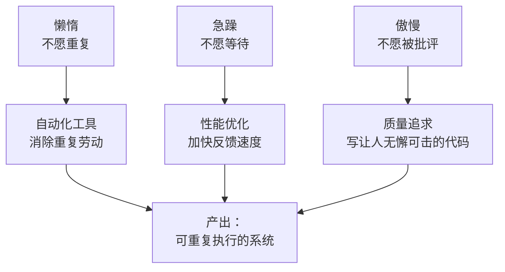
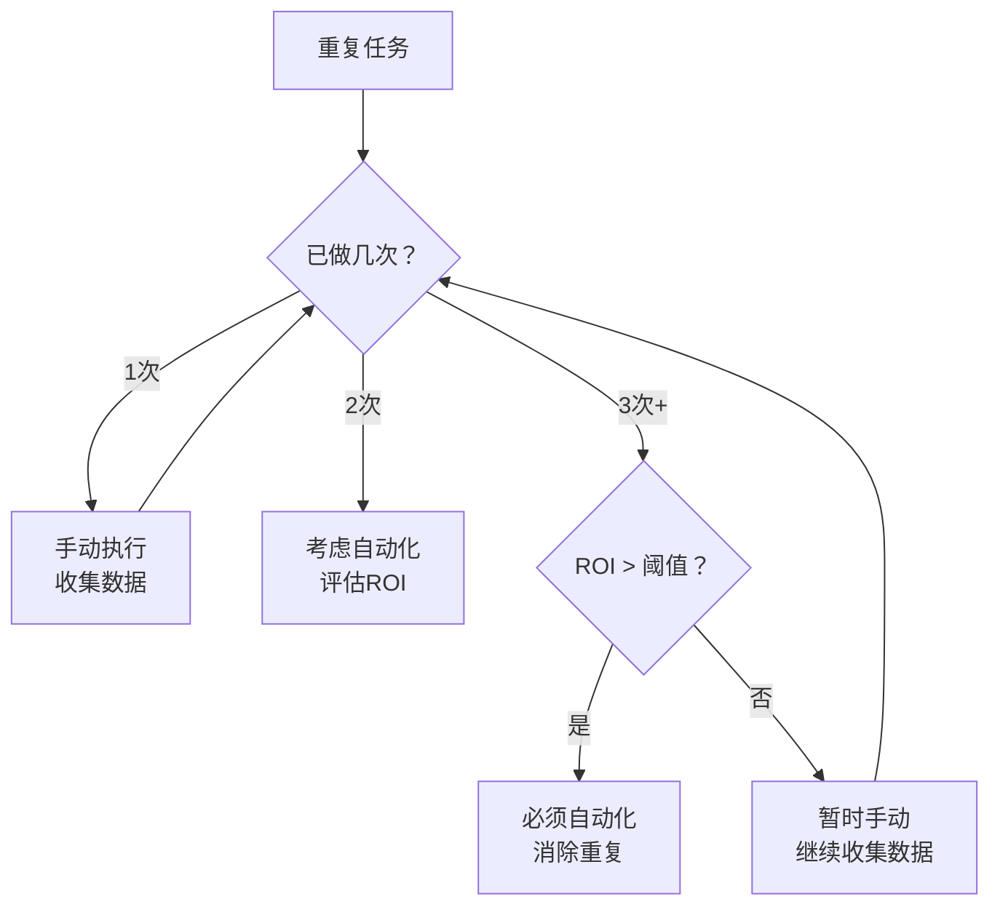
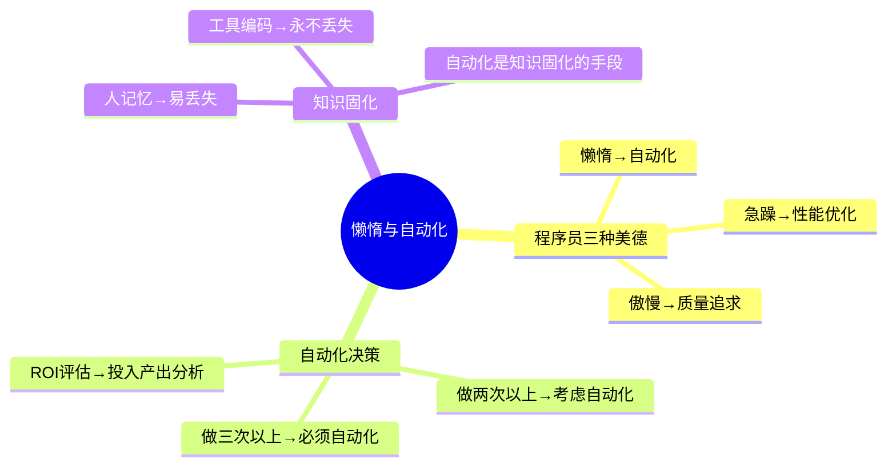

# “懒惰”应该是所有程序员的骄傲

## 核心命题

程序员的"懒惰"不是消极怠工，而是**追求自动化的驱动力**。Larry Wall 将"懒惰"列为程序员的三大美德之首（另外两项是急躁和傲慢）——因为懒惰，所以编写自动化程序避免重复劳动；因为急躁，所以让程序运行更快；因为傲慢，所以编写高质量代码让人无法挑剔。**自动化的本质是将人的经验编码为可重复执行的程序**——"如果一件事需要做两次以上，就值得自动化。"

---

## 1. 程序员的三种美德

### 1.1 Larry Wall 的定义

| 美德 | 驱动力 | 工程表现 | 典型产出 |
|------|--------|---------|---------|
| **懒惰（Laziness）** | 不愿重复劳动 | 编写自动化脚本、构建工具、生成器 | Moco（模拟服务器）、Gradle 任务 |
| **急躁（Impatience）** | 不愿等待 | 优化性能、加快构建速度 | 缓存、增量构建、异步处理 |
| **傲慢（Hubris）** | 不愿被批评 | 编写高质量代码、完善测试 | 精致的 API 设计、完善的文档 |

> 懒惰，是一种品质，它会使程序员花很大力气去规避过度的精力消耗，敦促程序员写出节省体力的程序，别人也能很好地利用，还会为此写出完善的文档，以免别人来问问题。

> 急躁，是计算机偷懒时感到的一种愤怒。它会促使程序员写出超越预期的程序，而不只是响应需求。

> 傲慢，极度自信，写出（或维护）别人挑不出毛病的程序。

---

## 2. 自动化的层次与决策

### 2.1 自动化的投入-回报分析

| 自动化类型 | 一次投入时间 | 回报频次 | 累计 ROI（1年内） | 示例 |
|-----------|------------|---------|----------------|------|
| **构建脚本** | 2-4 小时 | 每日 5-10 次 | 极高 | `gradle build` 替代手动编译 |
| **CI 流水线** | 4-8 小时 | 每日 10+ 次 | 极高 | 自动构建+测试+检查 |
| **部署自动化** | 4-8 小时 | 每周 1-5 次 | 高 | Argo CD 替代手动部署 |
| **数据库迁移** | 2-4 小时 | 每周 1-2 次 | 高 | Flyway 替代手动 DDL |
| **环境搭建** | 4-8 小时 | 每人入职1次 | 中 | DevContainer 替代手动配置 |
| **代码生成** | 2-4 小时 | 每次新模块 | 中 | OpenAPI Generator |

### 2.2 自动化的决策规则

> **原则**：如果一件事需要做两次以上，就值得自动化。做三次以上，必须自动化。

### 2.3 自动化的知识固化价值

> 自动化不仅仅是节省时间，更本质的价值是**将人的经验编码为可重复执行的程序**——当知识被编码到自动化工具中，它就不会因人员离职而丢失。

| 知识类型 | 依赖人记忆（❌） | 编码到工具（✅） |
|----------|-------------|----------------|
| 部署步骤 | "按照Wiki手动操作" | CI/CD Pipeline 自动执行 |
| 安全检查 | "记得检查依赖漏洞" | Dependabot 自动扫描 |
| 代码规范 | "Review时注意风格" | Lint 自动检查 |
| 环境配置 | "新人入职手动配环境" | DevContainer 一键启动 |
| 故障处理 | "按Runbook手动操作" | 自动化修复脚本 |

---

## 3. 懒惰驱动的经典案例

### 3.1 Moco：懒惰催生的模拟服务器

原文作者郑晔的 Moco 项目就是一个典型案例：

> "2012 年，我在项目中受困于集成问题，却找不到一个我想要的、能在单元测试框架里用的模拟服务器，于是，我写了 Moco。"

**懒惰驱动的创新模式**：

### 3.2 行业中的懒惰驱动创新

| 工具 | 懒惰驱动力 | 解决的重复问题 |
|------|-----------|--------------|
| **Make** (1976) | Stuart Feldman 不想手动编译 | 重复编译+链接 |
| **JUnit** (1997) | Kent Beck 不想手动验证 | 重复运行测试 |
| **CruiseControl** (2001) | 不想手动构建 | 重复集成构建 |
| **Docker** (2013) | 不想手动配环境 | 重复环境搭建 |
| **GitHub Actions** (2019) | 不想手动配CI | 重复CI配置 |

---

## 4. 反向原则：先判断"不要自动化"

### 4.1 不做不该做的事

自动化讨论的起点恰恰是"不要自动化"：程序员技术能力强，做一个技术方案太符合直觉，结果是忠实地把一个个需求做出来，把"全世界"都自动化了。但**这个世界太多的浪费，就是做了不该做的东西**。

郑晔反复强调要多问问题，目的就是为了不做那些不该做的事。从需求的角度先判断哪些工作可以不做，同时防止技术人员自己"加戏"。

### 4.2 案例：主动取消项目也是一种成功

郑晔在 ThoughtWorks 工作时，两位同事曾被一家公司请去启动一个视频网站项目——当时不少公司看到了视频网站的苗头，这家公司也觉得自己能分一杯羹。两个星期后，两位同事回来，结果是**项目停止了，而且是他们建议客户停掉的**。

他们结合客户的想法算了一笔账：这个项目需要大量的资金投入，投入规模之大超出客户想象，按照现有的规划投入，项目肯定会亏本；要么重新规划，要么取消。客户认真研究后，最终决定取消项目。

这件事大约发生在郑晔职业早期的十年前，如今各大视频网站在烧钱上的投入印证了这一判断——以那家公司的实力，参加这场比拼确实还差太多。郑晔将其视为职业生涯中见到的**第一个通过"主动取消项目"获取成功的案例**：做有价值的事是重要的，"有价值"不仅仅是"做"了什么，**通过"不做"节省时间和成本也是有价值的**——两位同事阻止了客户的浪费，这个项目就是成功的。

### 4.3 小心 NIH 综合症

**NIH 综合症（Not Invented Here Syndrome）**：特别看不上别人做的东西，非要自己做出一套来，原因只是"那东西不是自己做的"，可能存在各种问题。

- 开源运动兴起之前，这种现象尤为流行：很多公司都要做自己的中间件、自己的数据库封装。虽然一些公司因此有了特色框架，但因水平有限，做出来的东西通常极为难用，很多人一边骂一边还要继续在上面开发。
- 开源兴起之后乱象依旧：前端领域各种框架层出不穷，让很多前端程序员哭诉"实在学不动了"。
- 典型案例：郑晔面试过一位较早接触 Go 的程序员，恨不得把所有框架都自己写——因为学 Go 时框架确实少；但如今的 Go 已不是他学习时的那个 Go，各种框架已经很丰富，不需要什么都自己做。被问及"如果有一天离开了，公司怎么办"，他从来没考虑过这个问题。

**方法论**：写代码之前，先问问自己真的要做吗？能不做就不做，直到有了足够的理由去做。对应到 Larry Wall 的说法——要懒惰，花大力气去规避精力消耗。

---

## 5. 做好自动化：先自动化自己的工作

**为别人打造自动化工具的同时，自己的工作过程够不够自动化？** 更具体的问题：写的代码要上线，会经过怎样的过程？

### 5.1 案例：手工部署的代价

郑晔刚工作不久，有一次出差到客户现场。临近下班时发现程序的一个 Bug。那个年代的程序按官方推荐做法用 EJB（Enterprise JavaBean）编写，只有部署到应用服务器才能运行。解决方案只能是：加上一些打印语句，部署到应用服务器，看输出的结果，再加另外一些语句，再部署，如此往复。当时完全手工打包上传，每次至少要十几分钟。最终定位到了问题，只修改了一行代码，但几个小时的时间就这样被无谓消耗了。

那之后，郑晔花了很长时间研究自动化增量部署，最终让这个过程简化下来。这件事的影响很大——第一次认识到部署过程可能对开发造成的影响。相比当年，如今在工具层面做类似的事已经容易很多。

### 5.2 检验清单

| 检查项 | 自动化做法 |
|--------|-----------|
| 编译打包 | 构建脚本一键完成，而非手工打包上传 |
| 测试执行 | CI 流水线自动运行 |
| 代码检查 | Lint/静态扫描自动执行 |
| 部署 | 自动化部署（增量部署），而非手工上传 |
| 数据库变更 | 迁移工具自动执行 |

---

## 6. 要打造自动化工具，先要懂软件设计

### 6.1 大多数人混淆了设计和实现

软件设计是很多人既熟悉又陌生的词：说熟悉，很多人都知道做软件要设计，还能顺嘴说出几个设计模式的名字；说陌生，是因为郑晔在职业生涯中遇到真正懂软件设计的程序员少之又少——**大多数人混淆了设计和实现**。

### 6.2 案例：连接器的"设计语言"与"实现语言"

郑晔要在两个系统之间做一个连接器，让上游系统向下游系统发消息，所需能力比消息队列更丰富一些（例如要将重复的消息去除）。一位同事推荐了 Kafka 作为连接器的基础。但在后续设计讨论中，双方经常出现话语体系的分歧：一方说"这个连接器要有怎样的能力"，另一方说"Kafka 能够如何如何"。究其根因，一方讨论的是**设计**，另一方说的是**实现**，问题很难讨论到一起。

### 6.3 为什么如此看重设计

**在软件开发中，其它的东西都是易变的，唯有设计的可变性是可控的。** Kafka 当下比较火热，但不敢保证未来不会被换掉——就在几年前，消息队列还是传统中间件的强项，现在也渐渐被人淡忘。

不应让设计随着某一个技术选型而不断摇摆。如果工作许多年，知识体系只能靠各种新框架新工具支撑，程序员就只剩下疲于奔命。不懂软件设计、只专注各种工具，结果一定是被新技术遗弃——这也是很多人经常抱怨 IT 行业变化快的重要原因。

幸运的是，软件设计这些年的变化真不大；掌握了软件设计再来看很多框架和工具，学习起来会容易很多。要写出别人挑不出毛病的程序，先要懂得软件设计。

---

## 7. 总结

**核心要义**：程序员的"懒惰"是自动化的驱动力。做两次以上就考虑自动化，做三次以上必须自动化。自动化不仅仅是节省时间，更本质的价值是**将人的经验编码为可重复执行的程序**——知识不再依赖人的记忆，而是固化在工具中。

学习自动化，先要知道哪些东西不要自动化，尽最大的努力不做浪费时间的事：一方面从需求上规避没必要做的事，另一方面防止 NIH 综合症，争取做一个懒惰的程序员。对于要自动化的事，需要反思自己的工作过程有没有很好地自动化；而想打造良好的自动化工具，需要对软件设计有充分的理解。郑晔给出的最终提醒是：**请谨慎地将工作自动化。**

---

> **延伸阅读**
>
> - Larry Wall, *Programming Perl* (1991): 程序员三种美德
> - Thomas Limoncelli, *The Practice of System and Network Administration* (2016): 自动化最佳实践
> - Moco: https://github.com/dreamhead/moco
