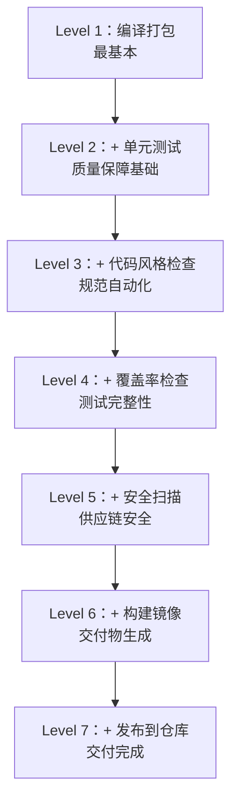
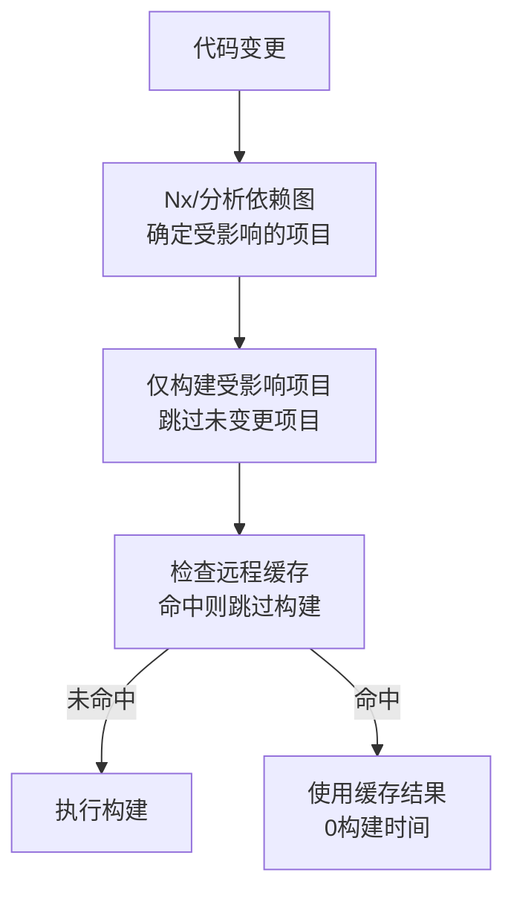

# 一个好的项目自动化应该是什么样子的

## 核心命题

项目自动化的核心是**构建脚本**——它定义了从代码到可部署制品的全流程。构建脚本不是 CI 服务器的一部分，而是**项目本身的一部分**，应与代码一同版本管理。一个完整的构建脚本应涵盖：编译、测试、代码检查、安全扫描、覆盖率、镜像构建。Gradle 因其灵活性优于 Maven（ThoughtWorks 技术雷达自 2012 年将 Maven 列入"Hold"），现代 Monorepo 工具（Nx/Turborepo/Bazel）进一步提升了构建效率。

---

## 1. 构建脚本的演进标准

### 1.1 从编译到完整构建的七级模型



| 级别 | 内容 | 工具示例 | 缺失后果 |
|------|------|---------|---------|
| **L1** | 编译打包 | `gradle build` / `pnpm build` | 无法生成制品 |
| **L2** | + 单元测试 | `gradle test` / `pnpm test` | 无质量保障 |
| **L3** | + 代码风格 | ESLint / Checkstyle | 规范无法自动执行 |
| **L4** | + 覆盖率 | JaCoCo / Istanbul | 测试完整性不可见 |
| **L5** | + 安全扫描 | Snyk / Trivy | 安全漏洞不可自动检测 |
| **L6** | + 镜像构建 | Docker Build | 无可部署制品 |
| **L7** | + 发布推送 | Docker Push / npm publish | 交付流程断裂 |

### 1.2 构建脚本即项目文档

> **构建脚本定义了"如何从代码到制品"的全流程**——它是项目最核心的"可执行文档"。新人阅读构建脚本即可理解项目的技术栈、构建流程和质量门。

---

## 2. Gradle vs Maven（2024-2026 视角）

### 2.1 技术雷达的判断

ThoughtWorks 技术雷达自 2012 年将 Maven 列入 **Hold（暂缓）**，建议新项目采用 Gradle。

郑晔给出的理由是：Maven 不够灵活。回想一下有多少次用 Maven 实现过特定需求——大部分人的答案是没有。随着持续集成、持续交付的兴起，构建脚本的订制能力变得越来越重要，Maven 在这方面力有不逮。

| 维度 | Maven | Gradle |
|------|-------|--------|
| **配置方式** | XML（声明式，冗长） | Kotlin DSL / Groovy（编程式，简洁） |
| **灵活性** | 低（需插件，插件间冲突常见） | 高（自定义 Task，编程式扩展） |
| **构建速度** | 慢（全量构建） | 快（增量构建 + Build Cache + Configuration Cache） |
| **多模块支持** | 有限 | 完善（复合构建、依赖替换） |
| **CI 集成** | 有限 | Develocity（原 Gradle Enterprise：构建扫描+远程缓存） |
| **学习曲线** | 低（XML 易读） | 中（DSL 需学习） |
| **生态** | 成熟（大量插件） | 成熟（插件生态已追平） |

### 2.2 Gradle 性能优化

| 优化手段 | 效果 | 配置 |
|----------|------|------|
| **增量构建** | 仅重新构建变更部分 | 默认启用 |
| **Build Cache** | 跨机器复用构建结果 | `buildCache { local { enabled = true } }` |
| **Configuration Cache** | 缓存配置阶段 | `configurationCache { active = true }` |
| **并行执行** | 多模块并行构建 | `parallel = true` |
| **Develocity** | 远程缓存+构建扫描（原 Gradle Enterprise） | 商业版 |

---

## 3. 现代 Monorepo 构建工具

### 3.1 工具对比

| 工具 | 适用场景 | 核心能力 | 构建速度 |
|------|---------|---------|---------|
| **Nx** | 前端/全栈 Monorepo | 增量构建 + 任务图 + 远程缓存 + 依赖图可视化 | 快 |
| **Turborepo** | 前端 Monorepo | 增量构建 + 远程缓存（Vercel 集成） | 快 |
| **Bazel** | 大型多语言项目 | 增量构建 + 远程缓存 + 可重现构建 + 沙盒执行 | 最快（但配置复杂） |
| **Gradle** | Java/Kotlin/Android | 增量构建 + Build Cache + 复合构建 | 快 |
| **pnpm workspace** | 纯前端 Monorepo | 依赖去重 + workspace 协议 | 中 |

### 3.2 增量构建的核心原理



---

## 4. 构建脚本的最佳实践

### 4.1 构建脚本的质量标准

| 标准 | 说明 | 检验方法 |
|------|------|---------|
| **可重现** | 相同输入→相同输出 | 在不同机器上构建结果一致 |
| **幂等** | 多次执行结果不变 | 重复运行不产生副作用 |
| **快速** | P95 < 10 分钟 | CI 构建时长监控 |
| **自包含** | 不依赖本地环境 | 新克隆后仅需 `./gradlew build` |
| **可调试** | 构建失败时有清晰错误信息 | 构建扫描/日志 |

### 4.2 Demo 项目示例

郑晔以 Spring Boot + Gradle 的 Java REST 服务 Demo（功能：向 `/users` POST 请求实现用户注册；访问 `/users` 查看已注册用户）说明构建脚本核心结构：

```kotlin
// build.gradle.kts
plugins {
    id("org.springframework.boot") version "3.3.0"
    id("io.spring.dependency-management") version "1.1.5"
    kotlin("jvm") version "2.0.0"
    kotlin("plugin.spring") version "2.0.0"
    jacoco  // 覆盖率
    id("org.jlleitschuh.gradle.ktlint") version "12.1.0"  // 代码风格
}

tasks.test {
    useJUnitPlatform()
    finalizedBy(tasks.jacocoTestReport)  // 测试后生成覆盖率报告
}

tasks.jacocoTestCoverageVerification {
    violationRules {
        rule { limit { minimum = "0.60".toBigDecimal() } }  // 覆盖率门 60%
    }
}
```

---

## 5. 实战全程：一个典型项目的自动化清单

以下以郑晔的示例项目（[github.com/dreamhead/geektime-zero](https://github.com/dreamhead/geektime-zero)，Spring Boot + Gradle）为例，逐项展开一个最基本的项目自动化应做到的样子。

### 5.1 Gradle 工程与 IDE 工程生成

**两个 Gradle 配置文件**：

- `build.gradle`：Gradle 的配置文件。Gradle 由 Groovy 编写而成，`build.gradle` 本质上就是一个 Groovy 脚本，其中的配置就是 Groovy 代码——这也是 Gradle 能够灵活订制的基础。
- `settings.gradle`：支持多模块的配置文件。一个项目的每个模块都可以有一个 `build.gradle`，而整个项目只有一个 `settings.gradle`。

Gradle 里许多能力以插件形式提供，例如生成 IDEA 工程只需一行配置：

```groovy
apply plugin: 'idea'
```

```bash
./gradlew idea
```

这个命令会生成一个 `.ipr` 文件（IDEA 的工程文件），用 IDEA 打开即可。两点说明：

1. **gradlew 是 Gradle 命令的封装**：它会自动下载构建该项目所需的 Gradle，重点是通过该命令锁定了 Gradle 的版本，避免因构建脚本差异造成"有人成功有人失败"的情况。
2. **IDE 工程由 Gradle 生成**：很多团队的项目里有多个构建文件，用哪个打开不去问人根本不知道，这对新人非常不友好；生成的做法还避免了本地安装不同版本 IDE 造成的问题。项目新增程序库依赖后，只需重新执行一次该命令——现在的 IDE 都有很好的自动加载能力，检测到工程文件变化就会重新加载。若团队使用其他 IDE，把 `apply plugin: 'idea'` 换成对应的 IDE 插件即可。

（注：示例项目采用 [Lombok](http://projectlombok.org) 简化代码，在 IntelliJ IDEA 中编译运行需安装 Lombok 插件，并在 "Build, Execution, Deployment" -> "Compiler" -> "Annotation Processors" 中选中 Enable annotation processing。郑晔推荐 IntelliJ IDEA——自从社区版免费之后，它就成为其向他人推荐的首选 Java IDE。）

### 5.2 代码组织：分模块与目录约定

- **分模块**：除非代码库规模非常小，否则分模块几乎是必然。恰当的划分方式是**按业务划分**：把用户相关的内容放到一个模块，把交易订单信息放到一个模块，把物流信息放到另一个模块。如果未来打算做微服务，每一个模块就可以成为一个独立的服务。示例项目划分了两个模块：`zero-identity`（用户信息模块）与 `zero-bootstrap`（把多个模块打包成一个可部署应用的模块）。

```groovy
include 'zero-bootstrap'
include 'zero-identity'
```

- **目录结构**：`src/main/java` 放源代码，`src/main/resources` 放配置文件，`src/test/java` 放测试代码。这是约定优于配置（Convention over Configuration）思想的体现；如果所用工具没有约定，就只能自己定好、让团队遵守。

### 5.3 检查：编译、风格与覆盖率

`./gradlew check` 依赖配置决定检查内容。应用 Java 插件后即可编译 Java 文件、检查代码能否正常编译、运行测试。在此之上：

```groovy
apply plugin: 'checkstyle'
```

```groovy
style.excludePackages = [
]

style.excludeClasses = [
]
```

- **CheckStyle 代码风格检查**：缺省只需应用 Checkstyle 插件，可订制排除某些文件不做检查。

```groovy
apply plugin: 'jacoco'
```

```groovy
coverage.excludePackages = [
]

coverage.excludeClasses = [
]
```

- **JaCoCo 测试覆盖率**：同样缺省即用，可订制生成结果的 HTML 报表，也可忽略某些文件不做检查。最特别之处：郑晔将测试覆盖率固定在 1.0，即 100% 的测试覆盖——这是他做新项目的缺省配置，也是对团队的要求。
- **小结**：一个新项目如果能通过这几项检查，腐坏的速度就不会那么快；当然也可以根据需要添加更多检查。

### 5.4 数据库迁移：Flyway

示例项目选择 [Flyway](http://flywaydb.org) 作为数据库迁移工具：

```groovy
plugins {
    id "org.flywaydb.flyway" version "5.2.4"
}
```

```groovy
flyway {
    url = 'jdbc:mysql://localhost:3306/zero_test?useUnicode=true&characterEncoding=utf-8&useSSL=false'
    user = 'zero'
    password = 'geektime'
    locations = ["filesystem:$rootDir/gradle/config/migration"]
}
```

修改数据库的做法：添加一个数据库迁移文件（示例项目中的迁移文件为 `gradle/config/migration/V2019.02.15.07.43__Create_user_table.sql`，在其中创建 User 表），然后执行 `./gradlew flywayMigrate` 即可。

```sql
CREATE TABLE zero_users(
    id bigint(20) not null AUTO_INCREMENT,
    name varchar(100) not null unique,
    password varchar(100) not null,
    primary key(id)
);
```

**迁移文件命名**：示例采用时间戳命名，另一种是版本号命名（V1、V2）。时间戳命名的好处是不同的人可以同时开发，命名冲突几率很小；版本号命名冲突的概率会大一些。

### 5.5 构建与运行

```bash
./gradlew build
```

- 该命令会在 `zero-bootstrap/build/libs` 下生成一个可执行 JAR 包——最终构建产物。`build` 任务依赖于 `check` 任务，即构建之前会先对代码进行检查。
- 得益于基础设施的进步，可以省去部署到应用服务器的环节——这个包本身就是可执行的：

```bash
java -jar zero-bootstrap/build/libs/zero-bootstrap-*-boot.jar
```

- 开发过程中不必每次打出 JAR 包，可以直接用 Gradle 命令运行应用；更常用的方式是在 IDE 中找到 Bootstrap 入口类直接运行：

```bash
./gradlew bootRun
```

- 测试验证：通过 Postman 或 Curl，把下面的内容 POST 到 `http://localhost:8080/users`，再通过浏览器访问 `http://localhost:8080/users` 即可看到刚注册的用户：

```json
{
	"username": "foo",
	"password": "bar"
}
```

### 5.6 项目自动化的基本清单与 CI 衔接

郑晔通过示例展示的最基本项目自动化过程包括：

1. 生成 IDE 工程；
2. 编译；
3. 打包；
4. 运行测试；
5. 代码风格检查；
6. 测试覆盖率；
7. 数据库迁移；
8. 运行应用。

但这不是自动化的全部——几乎每个重复的或繁琐的工作都应该自动化，不应把时间和精力浪费在那些机器可以很好完成的工作上。今天的基础设施已经让自动化工作比以往容易很多（可执行 JAR 包比从前部署到应用服务器简化太多，Gradle 也让订制构建脚本的难度降低很多）。

项目自动化也是**持续集成的基础**：在持续集成服务上执行的命令，就应该是构建脚本中写好的命令，例如：

```bash
./gradlew build
```

早在 2011 年，郑晔就在 InfoQ 上发表过《[软件开发地基](http://www.infoq.cn/article/zy-software-development-foundation)》，讨论一个项目的构建脚本应该是什么样子——其中用到的工具今天虽已不再流行，但一些基础内容今天看来依然有效。

---

## 6. 总结

**核心要义**：构建脚本是项目自动化的核心，应与代码一同版本管理。从编译到镜像发布的全流程应通过构建脚本统一管理。Gradle 优于 Maven（增量构建+编程式配置），Monorepo 工具（Nx/Bazel）进一步提升构建效率。一句话总结：**将工作过程自动化。**

---

> **延伸阅读**
>
> - ThoughtWorks 技术雷达: https://www.thoughtworks.com/radar
> - Nx: https://nx.dev/
> - Bazel: https://bazel.build/
> - Gradle Build Cache: https://docs.gradle.org/current/userguide/build_cache.html
> - 示例项目: https://github.com/dreamhead/geektime-zero
> - Gradle 官网: http://gradle.org
> - Lombok: http://projectlombok.org
> - Flyway: http://flywaydb.org
> - 《软件开发地基》（2011, InfoQ）: http://www.infoq.cn/article/zy-software-development-foundation
