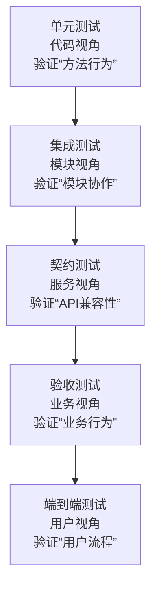
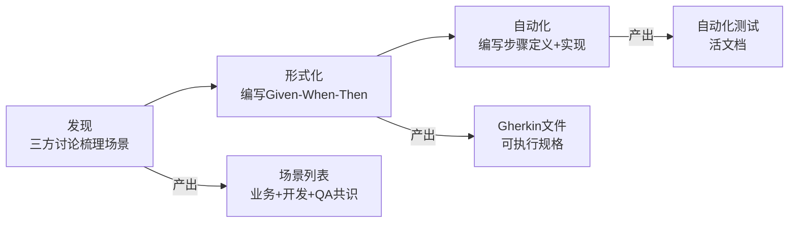

# 如何做好验收测试

## 核心命题

验收测试（Acceptance Testing）是站在**业务视角**验证系统行为的测试层级。与单元测试（代码视角）不同，验收测试用**业务语言**描述系统行为，使业务人员、开发者和测试人员共享同一份"活文档"。BDD（Behavior Driven Development）通过 Given-When-Then 格式，将验收测试从"功能清单"转变为**可执行的需求规格说明**。

---

## 1. 验收测试的定位与价值

### 1.1 测试层级中的位置



| 层级 | 视角 | 语言 | 读者 | 工具 |
|------|------|------|------|------|
| **单元测试** | 代码 | 编程语言 | 开发者 | JUnit / pytest |
| **集成测试** | 模块 | 编程语言 | 开发者 | Testcontainers |
| **契约测试** | 服务 | 编程语言 | 开发者 | Pact |
| **验收测试** | 业务 | 业务语言（GWT） | 业务+开发+QA | Cucumber / SpecFlow |
| **端到端测试** | 用户 | 编程语言 | QA | Playwright |

### 1.2 验收测试的核心价值

> **BDD 的目标不是"写测试"，而是"建立业务与开发的共享语言"。**

| 传统验收测试 | BDD 验收测试 |
|-------------|-------------|
| 功能清单（模糊、静态） | Given-When-Then 场景（精确、动态） |
| Word 文档（与代码脱节） | 活文档（与代码同步） |
| 仅测试人员关注 | 业务+开发+QA 共同维护 |
| 无法自动执行 | 自动化验证 |

---

## 2. BDD 的实践

### 2.1 Given-When-Then 格式

```gherkin
Feature: 用户登录
  Scenario: 正确密码登录成功
    Given 用户 "alice" 已注册且密码为 "password123"
    When 用户使用 "alice" 和 "password123" 登录
    Then 用户应收到有效的 JWT Token
    And 登录状态应记录到审计日志

  Scenario: 密码错误登录失败
    Given 用户 "alice" 已注册且密码为 "password123"
    When 用户使用 "alice" 和 "wrongpassword" 登录
    Then 系统应返回 401 状态码
    And 连续失败次数应加 1

  Scenario: 连续三次失败后锁定账户
    Given 用户 "alice" 已连续失败登录 2 次
    When 用户使用 "alice" 和 "wrongpassword" 登录
    Then 账户应被锁定 30 分钟
```

### 2.2 BDD 的流程



### 2.3 BDD 工具生态（2024-2026）

| 工具 | 语言 | Gherkin 支持 | 特色 |
|------|------|-------------|------|
| **Cucumber** | Java/Ruby/JS/Go | ✅ | 最成熟的 BDD 框架，跨语言 |
| **SpecFlow** | .NET | ✅ | 2024 年底已停止维护，.NET 社区主流继任者为 Reqnroll |
| **Playwright+BDD** | JS/TS | ✅ | 端到端测试 + BDD 描述 |
| **Karate** | Java/JS | ✅（简化版） | API 测试 + BDD 内置 |
| **pytest-bdd** | Python | ✅ | pytest 生态集成 |

---

## 3. 验收测试的常见反模式

| 反模式 | 表现 | 改进 |
|--------|------|------|
| **UI 驱动** | 所有验收测试通过 UI 操作 | 优先通过 API 层验证业务逻辑 |
| **过度细节** | GWT 中包含技术实现细节 | 聚焦业务行为，隐藏技术细节 |
| **场景爆炸** | 为每种边界条件写场景 | 用参数化场景（Scenario Outline） |
| **与单元测试重复** | 验收测试验证与单元测试相同的内容 | 验收测试验证业务行为，单元测试验证实现 |

---

## 4. 验收测试的定位与发展脉络（郑晔的分析）

### 4.1 定义与归属

- 验收测试（Acceptance Testing）是确认应用是否满足设计规范的测试，往往站在用户的角度，看整个应用能否满足业务需求。
- 从名字上看，验收应该是业务人员的事，但业务人员能做的最多只是验收，测试是他们无论如何也不太可能做仔细的。所以验收测试往往由技术团队自己完成，而且在很多公司，这就是测试人员的事。
- 时至今日，很多测试团队都拥有自动化能力，自动化验收测试自然是重点考虑对象。
- 在项目自动化的全貌中：程序员写好程序，用构建脚本执行检查，提交代码，在服务器上打出发布镜像，部署到各个环境进行检查，检查好了随时可以发布上线——"怎么检查"这一环，正是测试发挥作用的地方。开发者测试通常停留在单元测试和集成测试的范畴，对整个应用该怎么测，就要靠验收测试。

### 4.2 从各自为战到体系化

- 验收测试可以说是人们最早想到的自动化测试：早在单元测试还不流行的年代，人们就开始了对自动化验收测试的探索。
- 有不少团队构建了自己的框架——不是今天理解的通用测试框架，而是针对一个应用的测试框架。郑晔曾见过有人为通信软件构建了一套完整的测试框架，甚至构建了专属语言，测试人员的工作就是用这种特定语言对系统进行设置、运行，看它是否满足预期。相对来说，这种做法已经非常成熟。
- 但更多团队的现实情况是：把对应用的访问做一个简单封装，写测试就是编写代码调用这个封装，处于各自为战的混乱状态。
- 让验收测试逐渐有了体系的，是行为驱动开发（Behavior Driven Development，BDD）概念的诞生。

### 4.3 BDD 的概念与历史

- BDD 中的"行为"指的是业务行为。BDD 希望促进业务人员与开发团队之间的协作，换句话说，**想做 BDD，就应该用业务语言进行描述**。
- 与传统系统测试的差别：传统意义上的系统测试站在开发团队的角度，更多描述系统与外部系统之间的交互，用的都是计算机术语；BDD 换了一个视角，用业务语言做系统测试，是一个更高级别的抽象。
- BDD 由 Dan North 于 2003 年提出。他不仅提出概念，还践行想法，创造了第一个 BDD 框架 [JBehave](http://jbehave.org)；后来又改写出基于 [Ruby](http://www.ruby-lang.org/en/) 的版本 [RBehave](http://dannorth.net/2007/06/17/introducing-rbehave/)，这个项目后来被并入 [RSpec](http://rspec.info)。
- 今天最流行的 BDD 框架是 [Cucumber](http://cucumber.io)，它的作者是 RSpec 的作者之一 Aslak Hellesøy。Cucumber 从最开始的 Ruby BDD 框架，发展成支持多种程序设计语言的 BDD 测试框架，比如常见的 Java、JavaScript、PHP 等。

---

## 5. BDD 的格式与实现：以 Cucumber 为例（郑晔）

### 5.1 描述格式：Given-When-Then

BDD 框架最直观的感受是提供一套语言体系，用于描述应用的行为。下面是一个交易场景的例子——应用需要根据交易结果判定是否发出警告：

```
Scenario:  trader is not alerted below threshold

Given a stock of symbol STK1 and a threshold of 10.0
When the stock is traded at 5.0
Then the alert status should be OFF

Scenario:  trader is alerted above threshold

Given a stock of symbol STK1 and a threshold of 10.0
When the stock is traded at 11.0
Then the alert status should be ON

```

对格式的两个关注点：

- **描述结构**："Given…When…Then" 对应测试用例的执行步骤。Given 表示一个假设前提，When 表示具体的操作，Then 对应这个用例要验证的结果。它与测试结构（前置准备、执行、断言和清理）一一对应：Given 对应前置条件，When 对应执行，Then 对应断言；至于清理，它做的是资源释放，属于实现层面的内容，在业务层面上意义不大。
- **描述内容**：这里描述的行为都站在业务的角度叙述，而且 Given、When、Then 是独立的、可以自由组合的。也就是说，一旦基础框架搭好，就可以用这些组成块编写新的测试用例，甚至可以不需要技术人员参与。

### 5.2 步骤定义：连接用例与实现的胶水层

用例内容都是站在业务角度的描述，没有任何实现的内容——实现放在胶水层：把测试用例与实现联系起来的胶水层，在 Cucumber 的术语里称为**步骤定义（Step Definition）**。对应上面交易场景的步骤定义示例：

```
public class TraderSteps implements En {
    private Stock stock;

    public TraderSteps() {
        Given("^a stock of symbol {string} and a threshold of {double}", (String symbol, double threshold) -> {
            stock = new Stock(symbol, threshold);
        });

        When("^the stock is traded at {double}$", (double price) -> {
            stock.tradeAt(price);
        });

        Then("the alert status should be {string}", (String status) -> {
            assertThat(stock.getStatus().name()).isEqualTo(status);
        });
    }
}

```

---

## 6. 写好验收测试用例（郑晔的方法论）

### 6.1 关键点：用业务视角描述

以登录测试用例为例。Cucumber 本身支持本地化，可以用熟悉的语言编写用例。第一种写法：

```
假定 张三是一个注册用户，其用户名密码分别是 zhangsan 和 zspassword
当 在用户名输入框里输入 zhangsan，在密码输入框里输入 zspassword
并且 点击登录
那么 张三将登录成功

```

这个用例看似不错，但它是站在程序员的视角——BDD 需要站在业务的角度，而这个例子完全站在实现的角度。如果登录方式有所调整，比如用户输完用户名密码自动登录、不需要点击，这个用例就需要修改。换一种描述方式：

```
假定 张三是一个注册用户，其用户名密码是分别是 zhangsan 和 zspassword
当 用户以用户名 zhangsan 和密码 zspassword 登录
那么 张三将登录成功

```

这是站在业务视角的描述：除非做业务的调整、不再用用户名密码登录，否则这个用例不需要改变；即便实现的具体方式调整了，需要改变的也只是具体的步骤定义。

> **想写好 BDD 的测试用例，关键点在用业务视角描述。**

### 6.2 经常被忽略的点：业务测试模型

- 编写验收测试用例的步骤定义时，还有一个经常被忽略的点：业务测试的模型。很多人的第一直觉是"一个测试要啥模型"——但好测试应具备的属性中有一点是 Professional（专业性）。想要写好测试，同写好代码是一样的，一个好的模型不可或缺。
- 一个可以参考的例子是 Web 测试常用的 [Page Object](http://martinfowler.com/bliki/PageObject.html) 模型：它把对页面的访问封装起来。即便写的是步骤定义，也不应该在代码中直接操作 HTML 元素，而应该访问不同的页面对象。
- 以前面的登录为例，可能会定义这样的页面对象：

```
public class LoginPage {
    public boolean login(String name, String password) {
      ...
    }
}

```

- 如此一来，在步骤定义中就不必关心具体怎么定位到输入框，代码的抽象程度得到提升。
- 这只是一个参考：面对具体的应用，应该考虑构建自己的业务测试模型。

---

## 7. 总结

**核心要义**：验收测试应站在业务视角，用业务语言描述系统行为。BDD 的 Given-When-Then 格式使业务、开发、测试共享同一份"活文档"，消除需求与实现的脱节。BDD 的核心不是"写测试"，而是"建立共享语言"。

> **郑晔的小结**：验收测试是技术交付必经的环节，各团队实践水平有所差异——有的靠人工，有的用简单自动化，做得比较好的团队才有完善的自动化。自动化验收测试是一个逐步发展的过程：从最开始各自为战，到后来逐渐形成完整的体系。BDD 由 Dan North 在 2003 年提出，如今已成为一套比较完善的体系；以 Cucumber 为样例，可以掌握"Given…When…Then"的基本格式，并通过步骤定义（Step Definition）将测试用例与实现连接起来。编写 BDD 测试用例的最佳实践是用业务视角描述，同时为步骤设计业务测试模型。
>
> 验收测试的方法不止 BDD 一种，[实例化需求](http://en.wikipedia.org/wiki/Specification_by_example)（Specification by Example，SbE）也是一种常见的方法；验收测试框架也不止 BDD 框架一类，像 Concordion 这样的工具甚至可以把一个验收用例写成一个完整的参考文档。无论哪种做法，都是为了缩短业务人员与开发团队之间的距离，让开发变得更加高效。
>
> **如果只能记住一件事：将验收测试自动化。**

---

> **延伸阅读**
>
> - Dan North, "Introducing BDD" (2006): BDD 的起源
> - Cucumber: https://cucumber.io/
> - Gojko Adzic, *Specification by Example* (2011): 活文档方法论
