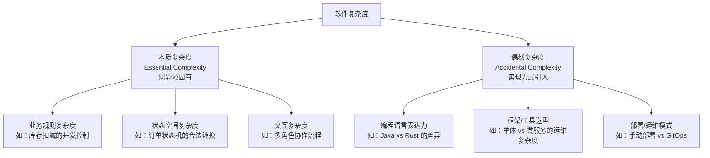
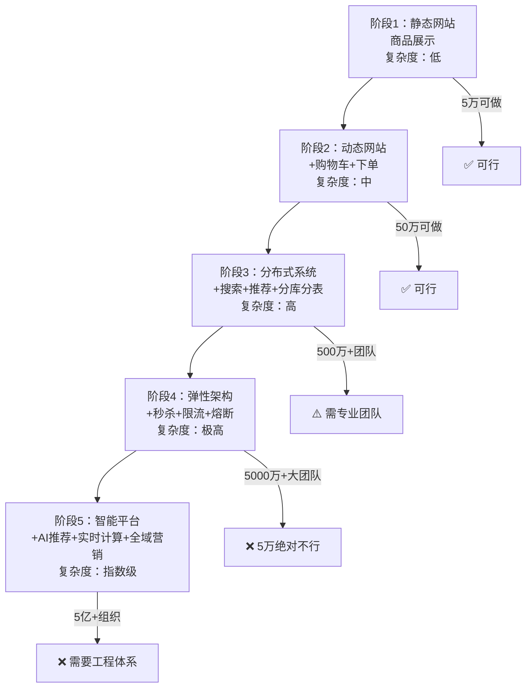
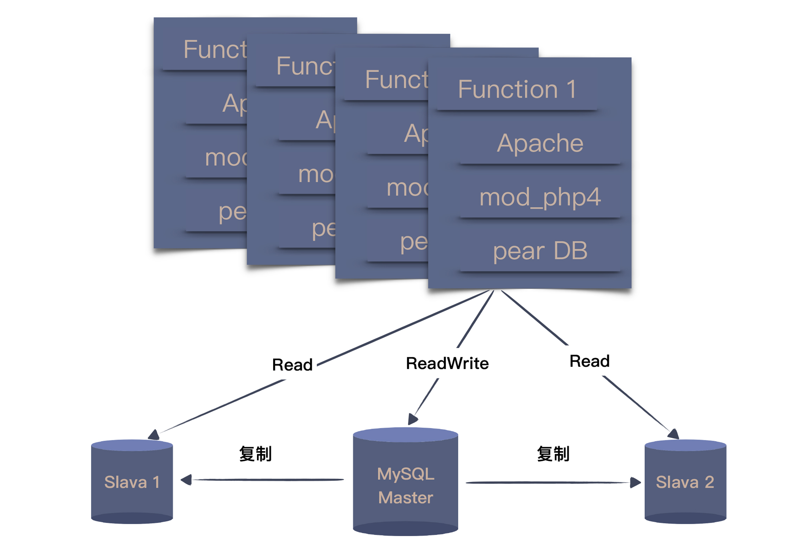
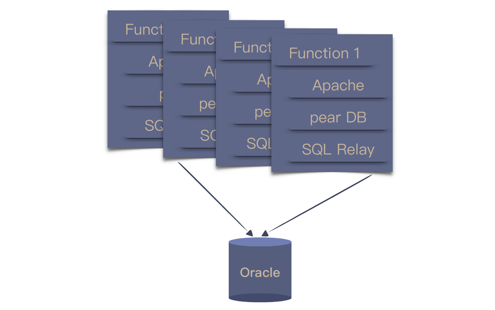
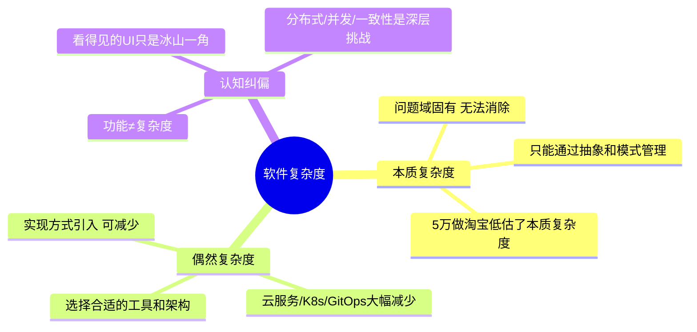

# 为什么总有人觉得5万块钱可以做一个淘宝

## 核心命题

"5万块做一个淘宝"的荒谬，源于**对软件复杂度的系统性低估**。Fred Brooks 在 1986 年的经典论文"No Silver Bullet"中将软件复杂度分为**本质复杂度（Essential Complexity）**——问题域固有的复杂性，和**偶然复杂度（Accidental Complexity）**——实现方式引入的复杂性。淘宝的复杂度不是"一个购物网站"那么简单，而是**分布式系统、高并发、数据一致性、运维体系**等多维度的综合。低估本质复杂度，是"5万做淘宝"思维的根源。

---

## 1. 软件复杂度的双维度模型

### 1.1 Brooks 的复杂度分类

> **核心论断**：本质复杂度无法消除（因为问题就在那里），只能通过好的设计来**管理**；偶然复杂度可以通过更好的工具、语言、架构来**减少**。

### 1.2 "5万做淘宝"低估了什么？

| 维度 | 用户认知 | 淘宝实际 | 本质复杂度 |
|------|---------|---------|-----------|
| **功能** | "能买东西就行" | 搜索、推荐、比价、评价、客服、物流追踪… | 电商业务规则的组合爆炸 |
| **并发** | "几百人用" | 双11峰值 58.3 万笔/秒 | 高并发下的数据一致性 |
| **数据** | "存到数据库" | PB 级数据，数百个分库分表 | 数据分布与查询效率的矛盾 |
| **一致性** | "买了就减库存" | 分布式事务、超卖防护、最终一致性 | 并发环境下的状态正确性 |
| **可用性** | "能访问就行" | 99.99% SLA，全年故障 < 52 分钟 | 容错、降级、熔断机制 |
| **运维** | "部署上去就行" | 全链路监控、灰度发布、混沌工程 | 大规模分布式系统的可观测性 |

---

## 2. 从"购物网站"到"淘宝"的复杂度阶梯

### 2.1 各阶段的本质复杂度增长

### 2.2 关键技术挑战的本质复杂度分析

| 挑战 | 5万方案 | 本质复杂度 | 专业方案 |
|------|---------|-----------|---------|
| **库存扣减** | `UPDATE stock SET count=count-1` | 并发下超卖 | 分布式锁 + 乐观锁 + 库存预热 |
| **订单状态** | 简单状态字段 | 状态机合法转换约束 | 状态机引擎 + Saga 编排 |
| **搜索** | `SELECT * LIKE '%keyword%'` | 分词+相关性+实时性 | Elasticsearch + 向量搜索 |
| **推荐** | 无 | 用户画像+实时计算 | 协同过滤 + 深度学习 + 实时特征 |
| **支付** | 无 | 资金安全+对账+幂等 | 分布式事务 + TCC + 对账系统 |

---

## 3. 偶然复杂度的减少策略

### 3.1 工具与平台的进步

| 偶然复杂度来源 | 2010 年方案 | 2024-2026 方案 | 复杂度减少 |
|---------------|-----------|---------------|-----------|
| **服务器运维** | 自建机房+物理机 | 云服务 + K8s + Serverless | 大幅减少 |
| **数据库运维** | 自建 MySQL 主从 | 云 RDS + PlanetScale + Neon | 大幅减少 |
| **CI/CD** | 手动构建+部署 | GitHub Actions + Argo CD | 大幅减少 |
| **监控** | 自建 Zabbix | Datadog + OpenTelemetry | 大幅减少 |
| **搜索** | 自建 Solr 集群 | Elastic Cloud + Meilisearch | 中等减少 |

### 3.2 本质复杂度的管理策略

> 本质复杂度无法消除，但可以通过**抽象**和**模式**来管理：

| 本质复杂度 | 管理策略 | 设计模式 |
|-----------|---------|---------|
| 业务规则复杂 | 领域建模 + DDD | 聚合、值对象、领域事件 |
| 状态空间复杂 | 有限状态机 | State Pattern、Saga |
| 并发控制复杂 | CQRS + Event Sourcing | 事件溯源、最终一致性 |
| 交互复杂 | 流程编排 | BPMN、工作流引擎 |

---

## 4. 一个段子：双方想的根本不是一个东西（郑晔的分析）

行业里流传着一个调侃客户不懂需求的段子：甲方想要做个电商网站，乙方程序员问"要做个什么样的"，甲方说"像淘宝那样就好"；程序员问"打算出多少钱"，甲方想了想——"5万块钱差不多了吧"。

为什么在甲方看来并不复杂的系统，程序员却觉得困难重重？

> **因为双方想的根本不是一个东西。**

- 甲方视角：要的不就是一个能买东西的网站吗？只要能上线商品，用户能看到、能购买不就好了，5万块钱差不多了。
- 程序员视角：淘宝得是多大的技术挑战，每年一到"双11"就要考虑各种并发抢购；淘宝得有多少程序员——5万块想做一个，门都没有。

理解这种认知鸿沟的关键，是搞清楚**系统是怎么一步步变复杂的**。

---

## 5. 淘宝的技术演化历程（郑晔的梳理）

以下梳理基于子柳 2013 年出版的《[淘宝技术这十年](http://book.douban.com/subject/24335672/)》，该书讲述了淘宝一步步的技术变迁。如今的淘宝比书中描述的更加完整复杂。

### 5.1 起点：2000 美元买来的 LAMP 系统

- 第一个淘宝是"买来的"：买的是一个叫 PHPAuction 的系统，即便选择了最高配，也才花了 2000 美元左右。
- 这是一个采用 LAMP 架构的系统（Linux + Apache + MySQL + PHP），在当年是典型的开源架构。
- 团队所做的主要是订制化工作，最大的调整是将单一数据库的读写进行拆分，变成一个主库和两个从库——这种结构在今天来看，依然是很多团队做调整的首选。

### 5.2 数据库演进：从 MySQL 到 Oracle，再到 IOE

- 当访问量和数据量不断提升，MySQL 数据库率先扛不住了。当年的 MySQL 默认采用 MyISAM 引擎，写数据时会锁住表，读也会被卡住——这只是诸多问题中的一个。
- 2003 年底，团队将 MySQL 换成了 Oracle。由于 Oracle 的性能好上许多，主从的数据库架构又改回了单一数据库。但 PHP 访问数据库的缺省方案没有连接池，只好采用开源的 SQL Relay，这也为后续的改进埋下了伏笔。

- 当数据量继续加大，本地存储无法满足，只能引入网络存储解决；数据量进一步增大后，存储节点一拆再拆依然不能解决问题，淘宝踏上了购买小型机的道路。
- IBM 的小型机、Oracle 的数据库和 EMC 的存储——这个阶段踏上了 IOE 之路。

### 5.3 更换程序设计语言：向 Java 的渐进式迁移

- 2004 年初，SQL Relay 已经成了一个挥之不去的痛点，只能从更根本的方案上动脑筋：更换程序设计语言。作为当时的主流，Java 成了不二之选。
- 替换方案是给业务分模块、一块一块地替换：老模块只维护、不增加新功能；新功能只在新模块开发，新老模块共用数据库；新功能上线则关闭老模块对应功能；所有功能替换完毕，老模块下线。

### 5.4 分库分表、缓存与 CDN

- 淘宝的数据量继续增长，单台 Oracle 很快到了上限，团队采用了今天常见的"分库分表"模式。"分库分表"带来新问题：跨数据库的数据怎么整合？于是打造了一个 DBRoute，用以处理分库的数据。
- 但这种做法又带来新的问题：同时连接多个数据库，任何一个数据库出了问题，都会导致整个网站的故障。
- 数据量再次增长，每次访问都到了数据库，数据库很难承受。一个解决方案是引入缓存和 CDN（Content Delivery Network，内容分发网络），只读数据的压力就从数据库解放了出来。
- 当时的缓存系统还不像今天这么成熟，团队基于一个开源项目改出了一个缓存系统；CDN 最开始用的是商用系统，流量的增加导致它也支撑不住，只好开始搭建自己的 CDN。
- 后来，因为 CDN 要消耗大量服务器资源，为了降低成本，淘宝又开始研发自己的低功耗服务器。

### 5.5 服务化与基础设施成型

- 随着业务不断发展、开发人员越来越多，系统越来越臃肿、耦合度逐渐提升、出错概率逐渐上升，不得不对系统进行分解，将复用性高的模块拆分出来，比如用户信息。
- 业务继续发展，拆分从局部向更大规模发展：底层业务和上层流程逐渐剥离，并逐渐将所有业务都模块化。
- 有了相对清晰的业务划分之后，更多的底层业务可以应用于不同场景，一个基础设施就此成型；新的业务使用基础设施进行构建，上层业务便如雨后春笋一般蓬勃发展起来。

### 5.6 自研技术清单

在这个过程中，有很多技术问题在当时还没有好的解决方案，或者不适合它们所在的场景，淘宝的工程师不得不打造自己的解决方案，比如：分布式文件系统（TFS）、缓存系统（Tair）、分布式服务框架（HSF）等。还有一些技术探索则是为了节省成本，比如去 IOE、研发低功耗服务器等。

---

## 6. 同样的业务，不同的系统（郑晔的论断）

- 为什么要了解一个系统的演化过程？**因为程序员需要知道自己面对的到底是一个什么样的系统。**
- 5万块钱可不可以做一个淘宝？答案是：取决于要的是一个什么样的系统。最开始买来的"淘宝"甚至连5万块钱都不用，而今天的淘宝和那时的淘宝显然不是一个系统。
- 从业务上说，今天的淘宝固然已经很丰富，但最核心的业务相差并不大：无非是卖家提供商品，买家买商品。那本质差别在哪？
- 回顾演化过程可以看到：每次随着业务量的增长，原有技术无法满足需要，就需要用新的技术去解决这个问题。这里的关键点在于：**不同的业务量。**
- 一个只服务于几个人的系统，单机就够了，一个刚入行的程序员也能很好地实现；当业务量到达一台机器抗不住的时候，就需要用多台机器处理，必须考虑分布式系统的问题，可能要适当地引入中间件；而当系统变为海量业务提供服务，就没有哪个已经打造好的中间件可以提供帮助，需要自己从更底层解决问题。
- 虽然在业务上看来这些系统是一样的，但在技术上看来，不同阶段的一个系统面对的问题是不同的，因为它面对业务的量级不同。**更准确地说，不同量级的系统根本就不是一个系统。**
- 只要业务在不断地发展，问题就会不断出现，系统就需要不断地翻新。一个很形象的比喻：把奥拓开成奥迪。

---

## 7. 技术选型的误区：为技术而技术（郑晔的告诫）

- 程序员都知道技术的重要性，会努力地学习各种新技术；当一个技术带有大厂光环时，很多人迫不及待地去学习。技术大会上大厂有人分享时，通常都是人山人海，大家都想学习大厂的"先进"技术。
- 知道了，然后呢？很多人迫不及待地把这些技术应用在项目中。郑晔面试过很多程序员，对方讲起技术滔滔不绝，称自己在设计时考虑各种分布式场景、系统压力上来时会如何处理；再问一句"这个系统有多少人用"，结果做的只是一个内部系统，使用频率也不高。
- 为技术而技术的程序员不在少数，过度使用技术造成的结果就是引入不必要的复杂度。即便用牛刀杀鸡，因为缺乏真实场景检验，也不可能得到真实反馈，对技术理解的深度也只能停留在很表面的程度上。
- 在淘宝的例子中，**工程师之所以要改进系统，真实的驱动力不是技术，而是不断攀升的业务量带来的问题复杂度。**
- 所以，评估系统当前所处的阶段、采用恰当的技术解决，是最应该考虑的问题。
- 如果所做的系统没有那么大的业务量，还想提高技术怎么办？答案是：到有好问题的地方去。IT 行业提供给程序员的机会很多，找到一个有好问题的地方并不是一件困难的事——前提是自己得有解决问题的基础能力。

---

## 8. 总结

**核心要义**：软件复杂度 = 本质复杂度 + 偶然复杂度。好的设计减少偶然复杂度，但无法消除本质复杂度。"5万块做淘宝"低估的是本质复杂度——分布式一致性、高并发、数据规模等问题的固有难度。理解复杂度的双维度模型，才能做出合理的技术决策和资源评估。

> **郑晔的小结**：一方面，有人会因为对业务量级理解不足，盲目低估其他系统的复杂度；另一方面，也有人会盲目应用技术，给系统引入不必要的复杂度，让自己陷入泥潭。采用恰当的技术解决当前的问题，是每个程序员都应该仔细考虑的问题。
>
> **如果只能记住一件事：用简单技术解决问题，直到问题变复杂。**

---

> **延伸阅读**
>
> - Fred Brooks, "No Silver Bullet: Essence and Accidents of Software Engineering" (1986): 本质复杂度 vs 偶然复杂度的奠基论文
> - Martin Kleppmann, *Designing Data-Intensive Applications* (2017): 分布式系统的本质复杂度分析
> - Eric Evans, *Domain-Driven Design* (2003): 用领域建模管理本质复杂度
