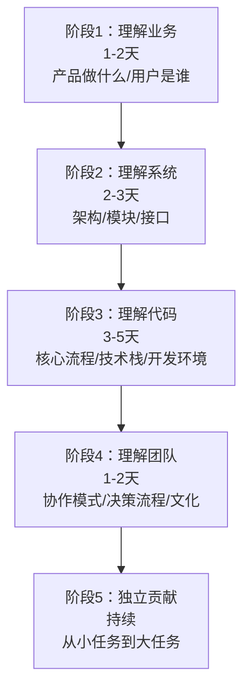
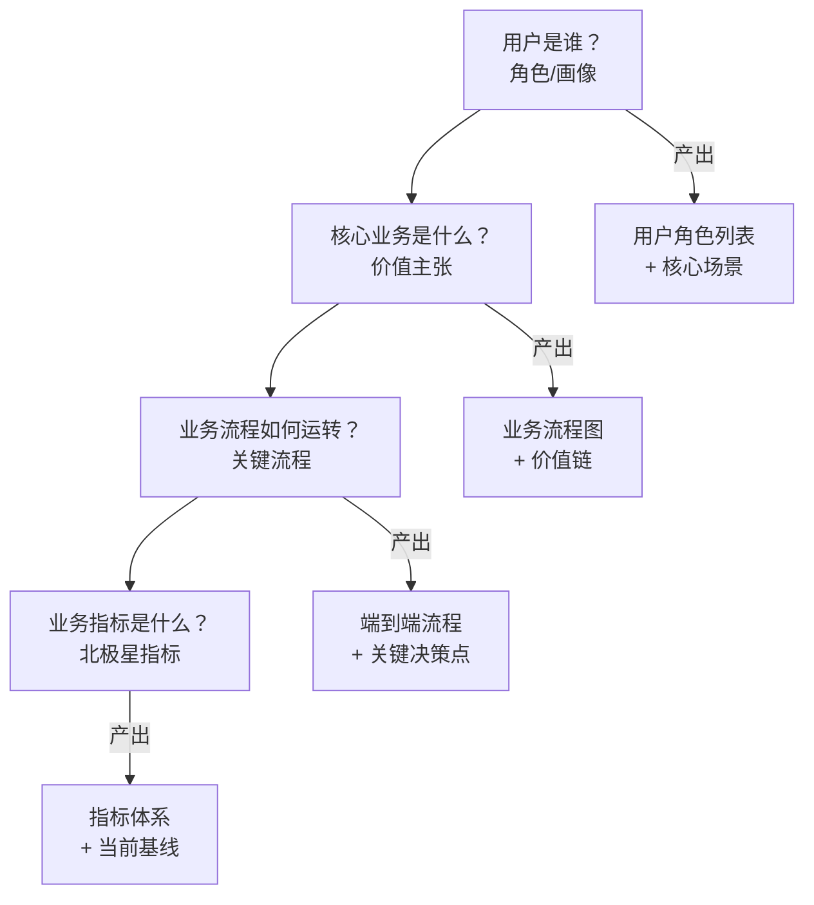
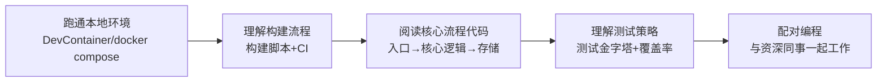
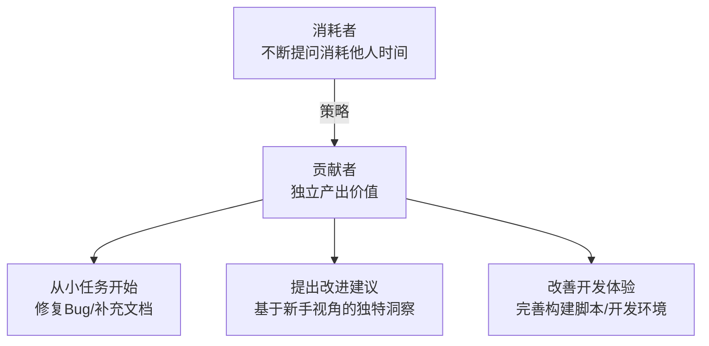
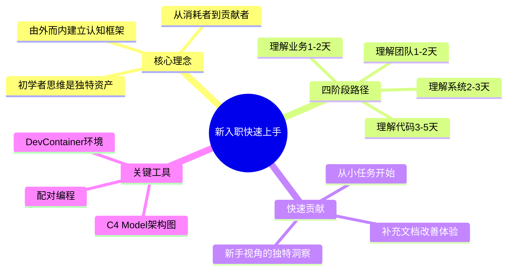
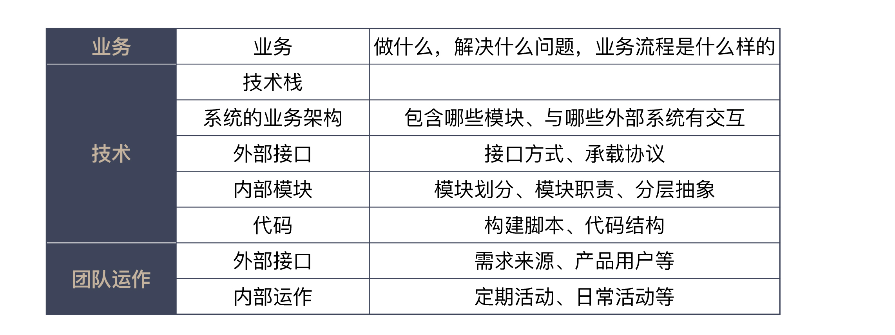

# 新入职一家公司，怎么快速进入工作状态

## 核心命题

新入职的核心挑战不是"学技术"，而是**快速建立系统全貌的认知框架**。通过由外而内、由上而下的系统性理解路径——从业务→系统→代码→团队——在短期内构建足够的工作上下文，使自己的产出从"执行任务"升级为"理解任务"。郑晔强调的"以终为始"在此场景下的"终"是：**尽快从"消耗者"（消耗团队时间获取信息）转变为"贡献者"（独立产出价值）**。

---

## 1. 新入职的系统化路径

### 1.1 四阶段理解模型

### 1.2 各阶段的具体行动与产出

| 阶段 | 时长 | 关键行动 | 产出物 |
|------|------|---------|--------|
| **理解业务** | 1-2 天 | 读产品文档、体验产品、与产品经理交流、理解用户画像 | 业务流程图、核心用例列表 |
| **理解系统** | 2-3 天 | 读架构文档、画 C4 图、理解接口协议（REST/gRPC/MQ）、理解部署架构 | 系统架构图、接口清单 |
| **理解代码** | 3-5 天 | 跑通本地环境、阅读核心流程代码、配对编程、理解构建与部署流程 | 能独立完成小任务 |
| **理解团队** | 1-2 天 | 了解角色分工、决策流程、沟通机制、Code Review 规范 | 知道"找谁解决什么问题" |

---

## 2. 各阶段的深入实践

### 2.1 理解业务：建立业务心智模型

**具体行动清单**：

- [ ] 阅读产品 PRD / 用户手册
- [ ] 亲自使用产品，走完核心用户旅程
- [ ] 与产品经理 30 分钟交流：核心用例、当前痛点、近期规划
- [ ] 查看业务指标 Dashboard，理解当前基线

### 2.2 理解系统：绘制架构认知地图

| 理解维度 | 关键问题 | 工具/方法 |
|----------|---------|---------|
| **系统边界** | 系统与哪些外部系统交互？ | C4 Context 图 |
| **模块划分** | 系统由哪些模块/服务组成？ | C4 Container 图 |
| **接口协议** | 模块间如何通信？ | API 文档（OpenAPI/Proto） |
| **数据流** | 核心数据如何流转？ | 数据流图 |
| **部署架构** | 系统如何部署？ | 部署拓扑图 |

### 2.3 理解代码：从跑通环境到理解核心

**代码阅读策略**：

| 策略 | 方法 | 目的 |
|------|------|------|
| **自顶向下** | 从入口点追踪核心流程 | 理解"系统做什么" |
| **按场景阅读** | 选择一个用户场景，追踪完整路径 | 理解"端到端如何工作" |
| **按变更阅读** | 阅读最近的 Git 提交历史 | 理解"团队最近在做什么" |
| **配对编程** | 与资深同事结对 | 快速获得上下文和隐性知识 |

### 2.4 理解团队：组织与文化的隐性知识

| 维度 | 关键问题 | 信息来源 |
|------|---------|---------|
| **角色与职责** | 谁负责什么？决策权在谁？ | 组织架构图、RACI 矩阵 |
| **协作模式** | 团队间如何协作？同步还是异步？ | 观察会议节奏、沟通工具 |
| **Code Review** | Review 的标准和 SLA 是什么？ | CONTRIBUTING.md、Review 历史 |
| **技术文化** | 团队看重什么？质量还是速度？ | 技术雷达、架构决策记录 |
| **入职伙伴** | 谁是自己的 Onboarding Buddy？ | 主动询问 |

---

## 3. 快速贡献的策略

### 3.1 从"消耗者"到"贡献者"的转换

### 3.2 新手视角的独特价值

> **新入职者的"初学者思维（Beginner's Mind）"是独特的资产**——能看到老员工已经习以为常的问题。

| 新手可贡献的洞察 | 原因 | 示例 |
|-----------------|------|------|
| **文档缺失** | 老员工靠记忆，新人靠文档 | 补充 README/Runbook |
| **入职流程问题** | 老员工已忘记入职时的困难 | 改善 Onboarding 体验 |
| **代码坏味道** | 老员工已习惯 | 识别并建议重构 |
| **工具链改进** | 老员工有工作绕过方案 | 提出自动化改进 |

---

## 4. 郑晔的实践：用思考框架规划上手过程

### 4.1 背景：频繁流动行业中的快速上手问题

- IT 行业快速发展、机会涌现，程序员频繁流动是这个行业的典型特征。频繁换工作，无论对公司还是对个人都是成本很高的一件事；如何在新公司快速融入、尽快发挥价值，是技术人面对的重要问题。
- 以行业标准来看，郑晔换工作的速度很低，但因为之前工作的原因，需要到不同的公司与不同的人合作：每到一个新公司，工作内容都是全新的，如同换了一份新工作。合作周期有限，不可能像普通员工入职那样花几个月慢慢熟悉，只能在尽可能短的时间内快速上手，而且还要提出新想法。

### 4.2 用三个问题分解目标

郑晔将通用的思考框架应用到入职场景，先问三个问题：

- Where are we?（现在在哪？）
- Where are we going?（要到哪儿去？）
- How can we get there?（如何到达那里？）

**现状**：刚加入一家公司，哪怕不是一脸懵，也只对公司业务有简单的了解。

**目标**："在新公司大展身手"过于宽泛，需要细化。长远发展是以后的事，第一步目标应定为达到上手工作的程度，例如能够解决日常的项目问题。

**路径**：对目标做分解。大多数人的第一反应是技术优先，进项目就一头扎进代码，从各种细节研究起来——技术肯定要了解，但不应该放在第一位。

> **技术解决的是"怎么做"的问题，第一个应该了解的问题是"做什么"。** 一个软件到底在做什么，能够回答这个问题的就是业务。所以排在第一优先级的事情是业务。

此外，了解业务和技术都只是扮演好个人角色，但工作通常在团队内展开，还要解决与其他人协作的问题，这就需要了解团队本身是如何运作的。

由此分解出三个小目标：

- 业务；
- 技术；
- 团队运作。

---

## 5. 从大图景入手：业务、技术、团队运作

### 5.1 业务：程序员最容易忽略的点

- 没有结构的知识是零散的。不管做任何项目，都要先从大图景入手；只有了解了大图景，各种知识才能各归其位。**对于一个普通的程序员来说，业务就是这个大图景。**
- 业务是程序员入手新项目时最容易忽略的点。了解了业务，就可以推演出基本的代码结构；反过来，看了代码再推演出业务，几乎是不可能的。
- 郑晔的习惯做法：每次了解到一个业务，先在脑子中过一遍"如果由自己来做这个业务，会怎么做"，从而先在整体上有一个预判，后面对应到实际代码时就不会陌生。
- 具体方式：请熟悉的人讲解这个业务是做什么的、解决什么样的问题、具体的业务流程是什么样子。初期的了解不试图弄懂所有细节，目标只是建立基本框架；有了初步了解，后续再有问题就知道该从哪里问起。
- 常见陷阱：很多人分不清业务和技术，经常把二者混在一起讲，跟着对方的思路走很容易陷入细节讨论。因此了解业务时要明确：这个阶段要了解的只是业务，先不涉及技术。

### 5.2 技术：从宏观到细节的固定顺序

**第一步：技术栈。** 第一个问题是这个系统的技术栈——Java、JavaScript 还是 .NET，从而对用到的工具和框架有大致预期。

**第二步：系统业务架构。** 这个系统包含哪些模块、与哪些外部系统有交互等。最好能有一张或几张图展现架构；现实是不少项目并没有现成的图，那就一起讨论，在白板上一起画一张出来，之后再慢慢整理。

**第三步：从外向内了解外部。** 这里的外部包括两个部分：

- 这个系统对外提供哪些接口，对应着系统提供的能力；
- 这个系统需要集成哪些外部系统，对应着它需要哪些支持。

一旦涉及与外部打交道，就涉及外部接口的形态，比如是 REST 接口还是 RPC（Remote Procedure Call，远程方法调用）调用，抑或是通过 MQ（Message Queue，消息队列）传递消息。不要简单地认为所有接口都是熟悉的——郑晔见过有系统用 FTP 做接口。

所有这些都属于信息承载方式，再进一步就是了解具体信息的格式，也就是协议：今天常见的是 JSON 格式，或基于某个开源项目的二进制编码，比如 [Protocol Buffers](http://developers.google.com/protocol-buffers/)、[Thrift](http://thrift.apache.org) 等；一些有年头的系统可能采用当年流行的 XML；还有一些系统采用特定领域的协议，比如通信领域有大量 3GPP 定义的协议。一般来说，从外部接口就能看出一个项目所处的年代，至少是技术负责人对技术理解的年代。

**第四步：了解内部。** 了解内部系统也要从业务入手：这个系统由哪些模块组成、每个模块承担怎样的职责；如果系统已经是微服务，每个服务就应该是一个独立的模块。这通常也是一个发现问题的点：很多系统的模块划分职责不清，会产生严重的依赖问题。用限界上下文的视角衡量这些模块，通常会发现问题，这些问题可以成为后续工作改进的出发点。

**第五步：分层。** 郑晔此前指出，[分层结构反映着系统的抽象](http://time.geekbang.org/column/article/88309)。了解一个模块内部分了多少个层、每个层的职责是什么，对系统的设计也就有了整体认识。

**第六步：构建脚本。** 设计之后就到了动手环节，但还不到写代码的时候：先从构建脚本开始，了解项目的常用命令。预期从版本控制里得到一个可以构建成功的脚本；如果不是这样，就知道哪里需要改进。

**第七步：代码。** 最后才是代码，比如代码的目录结构、配置文件的位置、模块在源码上的体现等。作为初步接触，了解基本的东西就够了——代码是后期会投入大量精力的地方，不用太着急。

### 5.3 团队运作：判断团队专业程度

**外部接口**：这个团队有哪些外部接口——需求从哪来、产品最终会由谁使用、团队需要向谁汇报；如果有外部客户，日常沟通是怎么安排的。

**内部活动**：

- 定期活动：站会、回顾会议、周会等，以及这些活动的时间安排；
- 日常活动：是否有每天的代码评审、是否有内部的分享机制等。

通过了解这些内容，基本可以大致判断出一个团队的专业程度，也能知道需要帮助时可以找谁帮忙，为融入团队打下基础。

**时间成本**：只需要从整体上有认知，如果有人很清楚团队现状，去请教也许一天就够了——这也是郑晔往往能够快速上手的原因。

---

## 6. 总结

**核心要义**：新入职快速进入状态的路径是"由外而内"——先理解业务，再理解系统，再深入代码，最后融入团队。构建系统全貌的认知框架比掌握具体技术更重要。新手的"初学者思维"是独特资产——能看到老员工已习以为常的问题。

> **郑晔的小结**：大多数程序员习惯的工作方式往往是从细节入手，很难建立起完整的图景，常常"只见树木不见森林"；他的方式是**从大到小、由外而内**，将要了解的内容层层分解——有了大图景之后，很容易知道自己做的事情在整体上处于什么位置。
>
> **附赠一点小技巧：使用"行话"。** 在交流的过程中学习一点"行话"，会让人觉得懂行，很快得到信任，尽早融入团队。
>
> **如果只能记住一件事：了解一个项目，从大图景开始。**

---

> **延伸阅读**
>
> - Michael D. Watkins, *The First 90 Days* (2013): 新入职的系统性策略
> - Shunryu Suzuki, *Zen Mind, Beginner's Mind* (1970): 初学者思维
> - C4 Model: https://c4model.com/
> - DevContainer: https://containers.dev/
