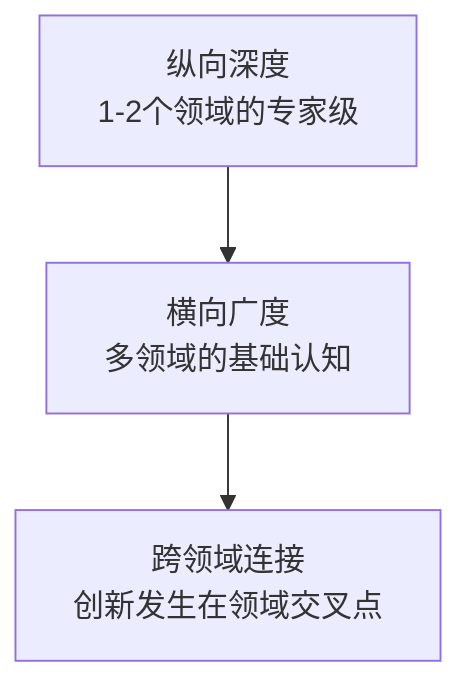
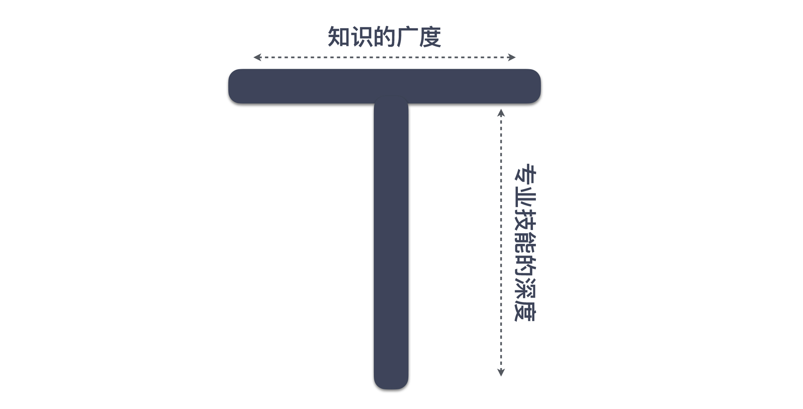

# 我们应该如何保持竞争力

## 核心命题

保持竞争力的核心不是"学更多技术"，而是**构建持续学习的能力与习惯**。技术迭代速度远超个人学习速度，因此关键策略是：**构建T型知识结构**（纵向深度+横向广度）、**以输出驱动输入**（写文档/做分享/造工具）、**在实践边界探索**（做稍微超出能力范围的事）。

---

## 1. 持续学习的策略

### 1.1 T型知识结构

| 维度 | 策略 | 示例 |
|------|------|------|
| **纵向深度** | 在1-2个领域做到专家级 | Java/JVM 深度、分布式系统 |
| **横向广度** | 了解多领域核心概念 | DDD、DevOps、安全、产品设计 |
| **跨领域连接** | 在领域交叉点发现创新 | DDD + 微服务、DevOps + 安全 |

### 1.2 输出驱动输入

| 输出形式 | 学习效果 | 示例 |
|----------|---------|------|
| **写技术博客** | 强制结构化理解 | 系统化整理某个主题 |
| **做技术分享** | 面对提问检验理解深度 | 团队内 Tech Talk |
| **造工具/开源** | 解决真实问题驱动学习 | Moco（模拟服务器） |
| **参与社区** | 接触不同视角和反馈 | 开源贡献、技术大会 |

---

## 2. 学习的节奏与方法

### 2.1 学习的三个层次

| 层次 | 方法 | 示例 |
|------|------|------|
| **跟随** | 学习已有知识 | 读书、看教程、上课 |
| **实践** | 在真实场景中应用 | 项目中运用新技术 |
| **创造** | 创造新知识/新工具 | 写框架、提新方法、做研究 |

### 2.2 刻意练习

> **刻意练习的核心**：在能力边界附近练习，获得即时反馈，持续调整。

| 要素 | 含义 | 在软件工程中的应用 |
|------|------|-----------------|
| **目标明确** | 每次练习有具体目标 | "今天掌握 TDD 的 Red-Green-Refactor" |
| **即时反馈** | 知道做得对不对 | CI 反馈、Code Review、测试结果 |
| **挑战边界** | 做稍微超出能力的事 | 尝试更复杂的重构、更精细的分解 |
| **重复迭代** | 反复练习直到内化 | 每天用 TDD 写代码 |

---

## 3. 程序员的能力模型演进

### 3.1 Staff+ 工程师的能力要求

| 级别 | 核心能力 | 上下文范围 |
|------|---------|-----------|
| **Senior** | 技术深度 + 独立交付 | 系统/模块级 |
| **Staff** | 跨团队技术影响力 | 项目/组织级 |
| **Principal** | 技术战略 + 组织影响力 | 组织/行业级 |
| **Distinguished/Fellow** | 行业级技术贡献 | 行业级 |

> **Will Larson 的洞察**：Staff+ 的差异化能力不是技术深度，而是在更大上下文中定义和解决技术问题的能力。

---

## 4. 程序员职业焦虑的成因（郑晔的分析）

### 4.1 现状观察

- IT 行业是一个快速发展变化的行业：一方面不断有人快速取得成功，另一方面充满焦虑的声音。获得大的成功始终是小概率事件，大多数人面对的是日常的柴米油盐。
- 郑晔认为，焦虑来自于对未来的不确定性，而这种不确定性是**特定时代加上特定行业的产物**。
- 把时间倒回上世纪 80 年代之前，虽然生活条件一般，但很少有人为未来的发展焦虑，因为那时人们可以清晰看到自己未来的人生，尽管那种人生可能是平淡的。
- 今天处于人类历史上少有的快速发展时代，人们看不清以后的人生，大脑却还停留在上一代人的思维习惯上。
- IT 行业在国内的大发展只有最近 20 多年，行业里很少有走过完整职业生涯的程序员，这也是各种焦虑频发的原因。

### 4.2 一线时间线（郑晔亲历）

| 职业阶段 | 当时的讨论 |
|------|-----------|
| 刚入行 | 有人问：程序员能做到 30 岁吗 |
| 快 30 岁 | 有人问：35 岁还能做程序员吗 |
| 35 岁 | 讨论变成：40 岁的程序员该怎么办 |

郑晔预计，等国内有越来越多的程序员走完整个职业生涯，就会有人关心程序员退休之后的生活应该是什么样子。

### 4.3 长期判断

- 从长期看，只要生活中还有需要用自动化解决的问题，程序员这个群体就很有前景。
- 但随着时间的推移，程序员这个职业的溢价会越来越低，单纯凭借身处这个行业就获得好发展的可能性越来越低；想让职业生涯走得更顺畅，还需要找到更好的目标，不断努力。

---

## 5. 成为 T 型人（郑晔的目标设定）

- T 型人即"一专多能"。**有了"一专"，"多能"才有意义**，否则就是低水平重复——这正是很多人职业生涯不见起色的真正原因。
- 这里的"专"不是熟练，而是深入：有 10 年丰富经验的程序员，可能只是重复了 10 年解决同样难度的问题，这根本不算深入，也就没有做到真正意义上的"一专"。
- 很多优秀的人在很多方面都很优秀，这是"一专"带来的触类旁通。拥有深厚的技术功底、通晓怎么做软件之后：
  - 还能带着其他人一起做好，就成了技术领导者；
  - 能够分享对技术的理解，就有机会成为培训师；
  - 能够在实战中帮助别人解决问题，就可以成为咨询师。
- 反过来，"多能"可以拓宽视野，帮助认清自己的"一专"怎样更好地发挥价值，而不是狭隘地认为有了技术就天下尽在掌握。视野窄、缺乏大局观，是许多程序员再进一步的阻碍。
- 只做一个公司的专家，受一个公司的波动影响太大；成为行业专家，才会降低自己职业生涯的风险。

### 5.1 自检问题：以行业标准衡量专业度

> 郑晔在面试时常问候选人："如果让你在一次技术大会上做分享，你会讲什么呢？"真正的问题是：以行业标准衡量，哪个方面可以称得上专家。

大多数人从来没有思考过这个问题：只是日常完成自己的工作，即便在某一方面已经做得不错，因为缺乏深度思考，依然算不上专家。

### 5.2 案例：熟悉 Kafka 不等于专家

- 表面熟悉：知道 Kafka 的各种参数、读过它的实现原理——这只是熟悉别人的思考结果。
- 深度思考：Kafka 为什么把自己定位成分布式流平台？它要想成为一个流平台，还要在哪方面做得更好？——这是一个没有现成答案的问题。
- 郑晔的类比：学习微积分有难度，但同发明微积分相比，难度根本不在一个层次上。不必熟悉所有工具的发展过程，但要在一个特定的方面拥有深度思考。
- 这确实是很高的要求，但"取法于上，仅得为中；取法于中，故为其下"。很多人的焦虑正源自目标太低、找不到前进的动力；给自己定下一个可以长期努力的目标，走在职业道路上才不至于很快丧失动力。

---

## 6. 在学习区成长（郑晔的实践路径）

### 6.1 向行业大师学习

IT 行业中的许多人愿意分享，可以读到大量大师级程序员的作品。郑晔在入行时读过的经典包括：

- 出身贝尔实验室的大师级程序员作品：《[C 程序设计语言](http://book.douban.com/subject/1139336/)》《[程序设计实践](http://book.douban.com/subject/1173548/)》《[Unix 编程环境](http://book.douban.com/subject/1033144/)》；
- Eric Raymond 这类沉浸编程几十年的人写出的《[Unix 编程艺术](http://book.douban.com/subject/1467587/)》；
- Kent Beck、Martin Fowler、Robert Martin 等人的作品。

读这些书的好处在于视野会打开，不会把目标放在"用别人已经打造好的工具做一个特定的需求"上——这可能是必经之路，但只是沿途的风景，而不是目标。

### 6.2 找一个好问题去解决

提高水平的答案是找一个好问题去解决：解决一个好问题能让水平快速提升。什么是好问题？就是比当前能力略高一点的问题：

- 还什么都不会 → 有一份编程的工作就好；
- 已经能写好普通的代码 → 就应该尝试去编写程序库；
- 实现一个具体功能都没问题 → 就去做设计，让程序有更好的组织；
- 已经能完成一个普通的系统设计 → 就应该去设计业务量更大的系统。

### 6.3 学习区模型

Noel Tichy 提出了"学习区"模型：

| 区域 | 位置 | 特征 |
|------|------|------|
| 舒适区（Comfort Zone） | 最内层 | 感觉良好但没有挑战，成长甚微——相当于做最熟悉的事情 |
| 学习区（Learning Zone） | 中间 | 事情有难度，又刚好是努力一下可以完成的，成长最快的区域 |
| 恐慌区（Panic Zone） | 最外层 | 压力极大，完全超出能力范围，只会感到无比焦虑 |

根据这个模型，只有一直身处学习区才能得到足够的成长：既选择比自己能力高一点的问题去解决，不要总做自己习惯的事；也不要好大喜功，一下子把热情全部打散。同时不要满足于当前已经取得的成绩——那已经成为舒适区；完成日常工作只不过是个人成长路上的台阶。

### 6.4 成长机会靠自己争取

- 别人只会关心工作是否完成，成长是自己的事情，很多机会要靠自己争取；上述做法完全可以在工作范围内自己努力实现。
- 如果当前的工作已经不能提供足够好的问题，那就去寻找一份更有挑战性的工作。很多人跳槽时并不以提升自己为目标，结果是不断地做同一个层面的工作，自然难以提升水平。
- 程序员愿意到大厂工作，是因为那里有高水平的人和好的问题；但如果只是到大厂做低水平的事，就是浪费时间。与谁一起工作、做什么事，远比进入大厂本身重要得多。

### 6.5 案例：从受困者到工具作者（Moco）

2012 年，郑晔在项目中受困于集成问题，找不到一个想要的、能在单元测试框架里使用的模拟服务器，于是编写了 [Moco](http://github.com/dreamhead/moco)。不断向前进步，迟早会遇到前面已经没有铺就好的道路——这时就轮到自己创造一个工具给别人去使用了。

### 6.6 输出创造行业影响力

郑晔在另一篇讨论写文档的文章（[结构化：写文档也是一种学习方式](http://time.geekbang.org/column/article/84663)）中指出：输出是一种将知识连接起来的方式，它会让人摆脱固步自封，也会帮助创造自己的行业影响力；机会会随着行业影响力逐渐增多，有了行业影响力，才有资格成为行业专家。成为行业级别的专家之后，就可以在这条路上一直走下去，不必担心拼不过年轻人——因为自己也在一直前进。

---

## 7. 总结

**核心要义**：保持竞争力的核心是构建持续学习的能力——T型知识结构、输出驱动输入、刻意练习。技术会过时，但学习能力和解决问题的能力不会。

> **郑晔的小结**：程序员是一个充满焦虑的群体，焦虑的本质是对未来的不确定。IT 行业依然非常有前景，但想在这条路上走好，需要成为"T"型人才——"一专多能"。一专多能的前提是"一专"：成为某个方面的专家，且要放在行业标准下去看，才能降低一个公司波动带来的影响。向行业的大师学习，给自己定下一个高目标，然后脚踏实地，找适合自己的问题去解决，让自己一直在学习区成长。
>
> **如果只能记住一件事：在学习区工作和成长。**

---

> **延伸阅读**
>
> - Will Larson, *Staff Engineer* (2021)
> - Anders Ericsson, *Peak: Secrets from the New Science of Expertise* (2016)
> - Cal Newport, *Deep Work* (2016)
