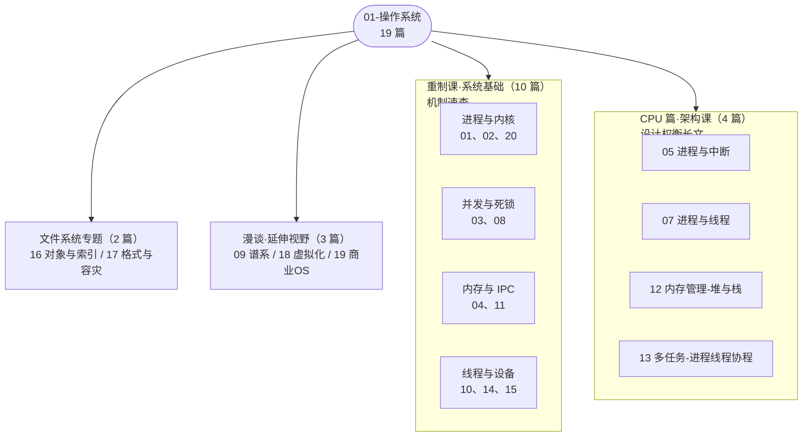

# 操作系统导览

本目录 19 篇文章来自两条来源线：一套**重制课系统基础**（短平快、面向速查的机制整理），以及许式伟《架构课》的**CPU 篇章节体系**（长文、面向设计权衡的深度展开）。另有文件系统专题两讲与三篇漫谈延伸。本页是导航入口：先看分组与分工，再按建议顺序阅读。

姊妹目录：[02-计算机组成原理导览](../02-计算机组成原理/00-导览.md)（操作系统跑在硬件上，中断、MMU、存储分级的硬件底座在那边）与 [03-计算机网络导览](../03-计算机网络/00-导览.md)（网络的本职是跨主机的进程间通信）。

> 合并说明：原 06-文件系统（FAT/inode 概览篇）已并入 [16-文件系统-对象与索引](16-文件系统-对象与索引.md)，目录现无 06 编号，其余编号保持不变。

## 一、按来源分组（19 篇）

### 1. 重制课·系统基础（10 篇：01-04、08、10、11、14、15、20）

操作系统最核心的机制速查篇：每篇聚焦一个机制，篇幅短、结构统一（机制 → 图解 → 小结），适合建立骨架与按需回顾。

| 篇目 | 内容 |
|------|------|
| [01-进程生命周期与上下文切换](01-进程生命周期与上下文切换.md) | 进程状态机、fork/exec、PCB、上下文切换 |
| [02-操作系统内核与态切换](02-操作系统内核与态切换.md) | 内核职责、用户态/内核态、系统调用 |
| [03-并发控制与线程调度](03-并发控制与线程调度.md) | 原子操作、锁、信号量、调度算法、哲学家就餐 |
| [04-内存管理](04-内存管理.md) | 虚拟内存、页表/MMU/TLB、置换算法、GC 原理 |
| [08-死锁：必要条件、检测与避免](08-死锁：必要条件、检测与避免.md) | 死锁四条件、资源分配图、银行家算法 |
| [10-进程和线程：进程的开销比线程大在了哪里](10-进程和线程：进程的开销比线程大在了哪里.md) | 资源分配视角：进程/线程的开销差在哪 |
| [11-进程间通信：进程间通信都有哪些方法](11-进程间通信：进程间通信都有哪些方法.md) | 管道、消息队列、共享内存、信号量、套接字 |
| [14-分析服务的特性：我的服务应该开多少个进程、多少个线程](14-分析服务的特性：我的服务应该开多少个进程、多少个线程.md) | 计算密集 vs I/O 密集的进程线程规划 |
| [15-设备管理与驱动模型](15-设备管理与驱动模型.md) | 设备分类、统一文件视角、Linux 设备模型 |
| [20-习题与解析](20-习题与解析.md) | 各模块例题与解析，配套自测 |

### 2. CPU 篇·架构课章节（4 篇：05、07、12、13）

许式伟《架构课》"基础设施"章节的长文重制：从冯·诺依曼体系出发，沿"进程与中断 → 进程与线程 → 内存运行时 → 多任务"推进，重点在设计动机与工程权衡。

| 篇目 | 内容 |
|------|------|
| [05-CPU篇-进程与中断](05-CPU篇-进程与中断.md) | 进程抽象与中断机制如何构成多任务基石 |
| [07-CPU篇-进程与线程](07-CPU篇-进程与线程.md) | CPU 的多任务调度：执行体与调度器设计 |
| [12-内存管理-堆与栈](12-内存管理-堆与栈.md) | 运行时视角：地址空间布局、堆/栈分配模型 |
| [13-多任务-进程、线程与协程](13-多任务-进程、线程与协程.md) | 三类执行体对比、调度模型与 goroutine |

### 3. 文件系统专题（2 篇：16、17）

| 篇目 | 内容 |
|------|------|
| [16-文件系统-对象与索引](16-文件系统-对象与索引.md) | 对象模型、FAT/inode/Extent、B+ 树、HDFS/GFS |
| [17-文件系统-格式与容灾](17-文件系统-格式与容灾.md) | Journaling、COW、RAID、校验和与恢复 |

### 4. 漫谈·延伸视野（3 篇：09、18、19）

跳出机制细节，从历史、产业与设计理念看操作系统，适合作为调剂与视野拓展。

| 篇目 | 内容 |
|------|------|
| [09-操作系统的谱系：Unix、Linux、Windows、macOS 与 Android 的源流](<09-操作系统的谱系：Unix、Linux、Windows、macOS 与 Android 的源流.md>) | 主流 OS 的技术源流与开源漏洞观察 |
| [18-虚拟化与容器](18-虚拟化与容器.md) | 虚拟机、Docker 与 K8s 编排的概念地图 |
| [19-商业操作系统：设计理念与进程-资源-策略模型](19-商业操作系统：设计理念与进程-资源-策略模型.md) | 把电商系统类比为操作系统的设计思维 |

## 二、同名主题分工说明

目录内同一主题有多篇不同来源、不同视角的文章，口径如下：

### 内存管理 × 2（04 vs 12）

- [04-内存管理](04-内存管理.md)：**操作系统视角**。虚拟内存如何工作：页表、MMU、TLB、大页、置换算法与 GC 原理。
- [12-内存管理-堆与栈](12-内存管理-堆与栈.md)：**程序运行时视角**。内存如何被组织：地址空间布局、堆与栈的分配模型、分配器与 GC 的工程权衡。

两篇互补而非重复，文内已互设分工卡；先读 04 建立"地址翻译"的世界观，再读 12 理解"程序怎么用内存"。

### 进程线程 × 3（01 / 10 / 13）

- [01-进程生命周期与上下文切换](01-进程生命周期与上下文切换.md)：**Linux 机制层**。状态机、fork/exec、PCB、上下文切换的具体实现。
- [10-进程和线程](10-进程和线程：进程的开销比线程大在了哪里.md)：**资源分配视角**。回答"进程的开销为什么比线程大"这一个问题。
- [13-多任务-进程、线程与协程](13-多任务-进程、线程与协程.md)：**设计与权衡视角**。三类执行体横向对比、调度模型选型与 goroutine 案例。

三篇角度互异不合并，文内互设分工卡。快速口径：查机制去 01，答面试题去 10，做并发选型去 13。

### 文件系统 × 2（16 vs 17）

- [16-文件系统-对象与索引](16-文件系统-对象与索引.md)：**正常路径**。数据怎么组织、怎么被找到（含数据库 B+ 树与分布式文件系统扩展）。
- [17-文件系统-格式与容灾](17-文件系统-格式与容灾.md)：**异常路径**。断电与崩溃时数据怎么不丢（Journaling、COW、RAID）。

原 06-文件系统的 FAT/inode 概览与分布式文件系统内容已并入 16，17 专管容灾，两者一正一奇配套阅读。

## 三、建议阅读顺序

| 阶段 | 目标 | 篇目顺序 |
|------|------|---------|
| 阶段一：机制骨架 | 进程、内核、并发、内存的核心机制 | 01 → 02 → 03 → 08 → 04 |
| 阶段二：I/O 与设备 | 补齐 I/O 侧机制 | 15 → 11 |
| 阶段三：架构课深潜 | 设计动机与工程权衡 | 05 → 07 → 12 → 13 |
| 阶段四：文件系统 | 组织与容灾两条线 | 16 → 17 |
| 阶段五：延伸与自测 | 视野拓展 + 习题检验 | 09 → 18 → 19 → 10 → 14 → 20 |

> 阶段五把 10（进程线程开销）与 14（容量规划）放在收尾，是因为它们是"用前面所有机制回答一个工程问题"的实践篇。

时间紧张时的**最短路径**（8 篇）：01 → 02 → 04 → 08 → 05 → 13 → 16 → 11。覆盖进程、内核、内存、死锁、中断、多任务、文件系统与 IPC 的主干。

### 每阶段过关自测

- **阶段一**：进程切换时究竟保存了什么？死锁的四个必要条件破坏哪一个最实用？
- **阶段二**：为什么说"Unix 下一切皆文件"简化了设备管理？管道与共享内存分别适合什么场景？
- **阶段三**：中断为什么是多任务的前提？goroutine 为什么要在用户态重新实现调度与 I/O？
- **阶段四**：inode 如何支撑硬链接？日志文件系统靠什么保证崩溃一致性？
- **阶段五**：一个 4 核 8G 的容器，I/O 密集服务应该开多少线程？依据是什么？

## 四、按问题检索

- **进程/线程创建与切换**：01（机制）、07（调度器设计）、10（开销对比）
- **并发同步选型**：03（锁与信号量）、13（协程适用边界）
- **内存问题**：04（页表/TLB/置换）、12（堆栈与泄漏）
- **服务容量规划**：14（进程线程数）、18（容器化）
- **文件/存储**：16（索引与查找）、17（容灾与恢复）
- **面试自测**：20（习题与解析）

## 五、维护说明

- 新增机制类短文入"重制课·系统基础"组并顺延编号；架构课体系的长文入 CPU 篇或文件系统专题（保持"章节导言 → 核心概念与原理 → 设计原则与权衡 → 小结"结构）。
- 同一主题出现第二篇时，必须在两篇文首互设分工卡（本页"同名主题分工"同步登记），避免无口径重叠。
- frontmatter 采用完整 schema（title/description/keywords/category/tags 及版本信息）。
