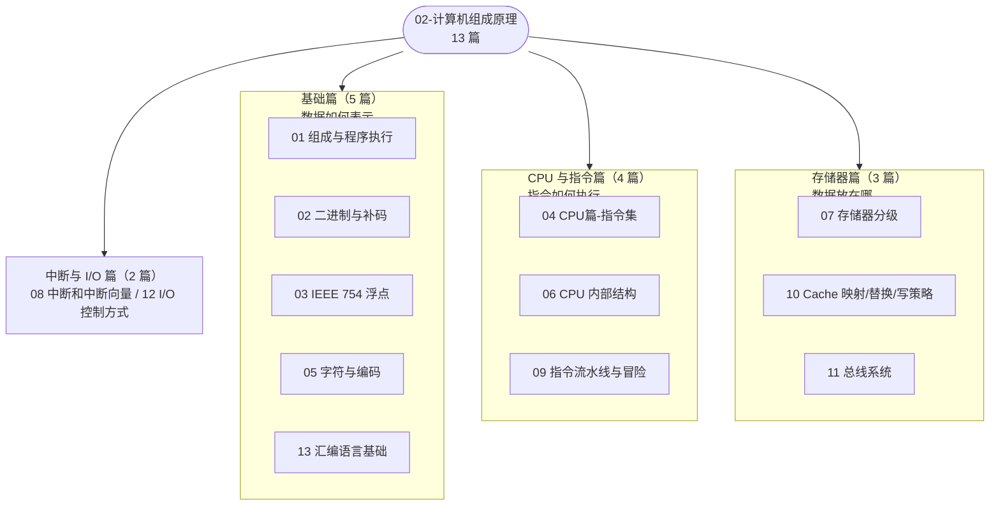
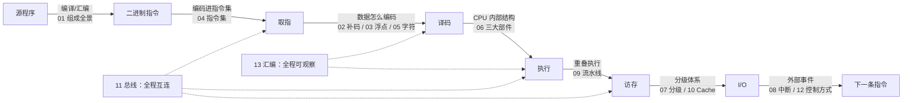

# 计算机组成原理导览

本目录 13 篇文章回答一个问题：**程序在硬件上是如何执行的**。主线沿"数据如何表示 → 指令如何组织 → CPU 如何执行 → 存储如何分级 → I/O 如何交互"推进。本页是导航入口：先看分组与阅读顺序，再按需检索。

姊妹目录：[01-操作系统导览](../01-操作系统/00-导览.md)（组成原理讲硬件机制，操作系统讲软件如何驾驭这些机制，两目录多处互为底座）与 [03-计算机网络导览](../03-计算机网络/00-导览.md)（网卡与 I/O 是网络收发的硬件入口）。

## 一、知识主线：一条指令的一生

13 篇文章串起来正是"一条指令的一生"。按这条主线读，每一篇都知道自己处在链路的哪一环：

## 二、按主题分组（13 篇）

### 1. 基础篇·数据表示与全景（5 篇：01、02、03、05、13）

从"计算机是什么"与"数据怎么编码"开始；汇编是本章的落地出口，把前面的表示与指令串成可操作的知识。

| 篇目 | 内容 |
|------|------|
| [01-计算机组成与程序执行](01-计算机组成与程序执行.md) | 计算机基本构成、可计算性、编译到执行全流程 |
| [02-数据的二进制表示：原码、反码、补码与溢出](02-数据的二进制表示：原码、反码、补码与溢出.md) | 整数三种编码、补码优势与溢出判断 |
| [03-浮点数表示：IEEE 754 标准](03-浮点数表示：IEEE 754 标准.md) | 单/双精度组成、转换、特殊值与精度陷阱 |
| [05-字符与编码：ASCII、Unicode 与 UTF-8](05-字符与编码：ASCII、Unicode 与 UTF-8.md) | 编码演进、UTF-8 变长原理、码点 vs 编码单元 |
| [13-汇编语言基础：寄存器、指令与函数调用](13-汇编语言基础：寄存器、指令与函数调用.md) | x86-64 寄存器、常用指令、栈帧与调用约定 |

### 2. CPU 与指令篇（4 篇：04、06、09 + 04 与 06 的关系说明）

指令从定义到流水执行的完整链路。04 是许式伟架构课的长文（指令集设计视角），06-09 是机制速查线。

| 篇目 | 内容 |
|------|------|
| [04-CPU篇-指令集](04-CPU篇-指令集.md) | 指令集的角色、CISC 与 RISC 的架构权衡 |
| [06-CPU 内部结构与指令系统](06-CPU 内部结构与指令系统.md) | 运算器/控制器/寄存器组、指令执行过程 |
| [09-指令流水线与冒险](09-指令流水线与冒险.md) | 流水线原理、性能与三类冒险的应对 |

> 分工：04 回答"指令集为什么这样设计"（架构视角）；06 回答"CPU 内部长什么样、一条指令怎么走"（组成视角）；09 回答"流水线为什么快、冒险从哪来"（优化视角）。三者可独立阅读，按此顺序串读收益最大。

### 3. 存储器篇（3 篇：07、10、11）

存储分级的三层展开：为什么分级（07）、Cache 如何工作（10）、部件之间如何互连（11）。

| 篇目 | 内容 |
|------|------|
| [07-存储器分级：L1 Cache 比内存和 SSD 快多少倍](07-存储器分级：L1 Cache 比内存和 SSD 快多少倍.md) | 寄存器→Cache→内存→外存的分级体系与命中率 |
| [10-Cache 映射、替换与写策略](10-Cache 映射、替换与写策略.md) | 直接映射/组相联、LRU 替换、写直通/写回 |
| [11-总线系统](11-总线系统.md) | 总线类型、时序与仲裁，互连对性能的影响 |

### 4. 中断与 I/O 篇（2 篇：08、12）

CPU 如何感知并响应外部世界：中断是机制（硬件事件 → 内核 → 应用），I/O 控制方式是演进（CPU 全程参与 → 设备自主搬运）。

| 篇目 | 内容 |
|------|------|
| [08-中断和中断向量：Java 等语言为什么可以捕获到键盘输入](08-中断和中断向量：Java 等语言为什么可以捕获到键盘输入.md) | 从按键到应用事件的完整中断链路 |
| [12-I-O 控制方式：查询、中断、DMA 与通道](12-I-O 控制方式：查询、中断、DMA 与通道.md) | 四种 I/O 控制方式的原理与适用场景 |

## 三、与姊妹目录的分工边界

本目录与 [01-操作系统](../01-操作系统/00-导览.md) 多处相邻，边界口径如下：

- **中断**：本目录 [08](08-中断和中断向量：Java 等语言为什么可以捕获到键盘输入.md) 讲硬件到内核的中断链路；操作系统目录的 [05-CPU篇-进程与中断](../01-操作系统/05-CPU篇-进程与中断.md) 讲中断如何支撑进程调度与多任务。
- **存储**：本目录 [07](07-存储器分级：L1 Cache 比内存和 SSD 快多少倍.md) 讲硬件分级与 Cache；操作系统目录的 [04-内存管理](../01-操作系统/04-内存管理.md) 讲虚拟内存、页表与 TLB（TLB 本质是页表的 Cache，两边互为印证）。
- **I/O**：本目录 [12](12-I-O 控制方式：查询、中断、DMA 与通道.md) 讲控制方式演进；操作系统目录的 [15-设备管理与驱动模型](../01-操作系统/15-设备管理与驱动模型.md) 讲设备抽象与驱动。

## 四、建议阅读顺序

| 阶段 | 目标 | 篇目顺序 |
|------|------|---------|
| 阶段一：全景与数据 | 知道计算机怎么跑、数据怎么存 | 01 → 02 → 03 → 05 |
| 阶段二：指令与 CPU | 指令集、执行路径、流水线 | 04 → 06 → 09 |
| 阶段三：落地汇编 | 用汇编印证前面的知识 | 13 |
| 阶段四：存储体系 | 分级、Cache、互连 | 07 → 10 → 11 |
| 阶段五：中断与 I/O | 外部事件的感知与搬运 | 08 → 12 |

时间紧张时的**最短路径**（7 篇）：01 → 02 → 04 → 06 → 07 → 10 → 08。覆盖组成全景、数据表示、指令系统、存储分级与中断的主干。

### 每阶段过关自测

- **阶段一**：为什么补码能让减法用加法器实现？0.1 + 0.2 ≠ 0.3 的根源是什么？
- **阶段二**：RISC 与 CISC 的取舍在现代 CPU 里如何融合？流水线的三类冒险分别怎么缓解？
- **阶段三**：函数调用的参数、返回值、局部变量各自放在哪里？
- **阶段四**：为什么 L1 Cache 能比内存快上百倍？写回策略为什么需要脏位？
- **阶段五**：键盘按下到 Java 收到事件经过了几层？DMA 解决了什么瓶颈？

## 五、按问题检索

- **整数溢出 / 位运算**：02（补码与溢出）
- **浮点精度 / 金融计算**：03（IEEE 754）
- **乱码 / 编码问题**：05（字符编码）
- **性能调优想理解 Cache**：07（分级）、10（映射与写策略）
- **看懂汇编 / 调试栈帧**：13（汇编基础）
- **理解 epoll/网卡中断的前提**：08（中断）、12（I/O 控制方式）

## 六、维护说明

- 新增文章按主题入组：数据表示与汇编入基础篇；指令系统与流水线入 CPU 与指令篇；Cache 与互连入存储器篇；外部事件与搬运入中断与 I/O 篇。
- 涉及"硬件 vs 操作系统"交叉主题时，先检查 01-操作系统对应篇目（04/05/15），在分工边界处加互链而非重复展开。
- frontmatter 采用完整 schema（title/description/keywords/category/tags 及版本信息）。
