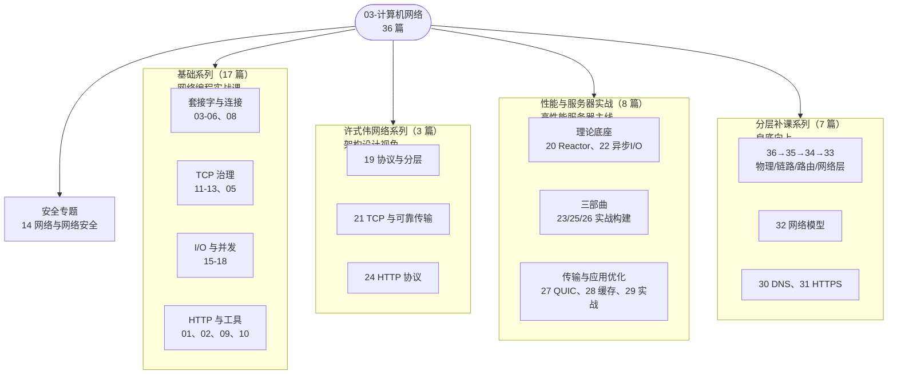

# 计算机网络导览

本目录汇集 36 篇网络主题文章，内容来自三条来源线：一套完整的**网络编程实战课**（套接字 → TCP/UDP → I/O 模型 → 高并发服务器）、许式伟《架构课》的**网络三讲**（协议与分层的架构视角）、以及一套**网络分层补课系列**（自底向上补齐 OSI 各层）。本页是唯一导航入口：先讲清楚每篇从哪来、负责什么，再给出建议阅读顺序。

姊妹目录：[01-操作系统导览](../01-操作系统/00-导览.md)（进程/内存/文件系统）与 [02-计算机组成原理导览](../02-计算机组成原理/00-导览.md)（CPU/存储/中断）。网络的本职是"跨主机的进程间通信"，套接字编程与操作系统 I/O 子系统关系密切，建议配合阅读。

## 一、按来源分组（36 篇）

### 1. 基础系列（网络编程实战课，17 篇：01-13、15-18）

以"写出一个能扛住高并发的服务器"为主线：从客户端-服务器模型与套接字 API 开始，经 TCP 连接与数据传输，到 I/O 多路复用与并发模型。

| 篇目 | 内容 |
|------|------|
| [01-HTTP协议：基础、报文与版本演进](01-HTTP协议：基础、报文与版本演进.md) | HTTP 特性、报文格式、状态码，HTTP/1.1→2→3 演进 |
| [02-追古溯源：TCP/IP与Linux的发展演进](02-追古溯源：TCP-IP与Linux的发展演进.md) | 从 ARPANET/NCP 到 TCP/IP 的历史脉络 |
| [03-客户端-服务器网络编程模型与基础概念](03-客户端-服务器网络编程模型与基础概念.md) | C/S 模型、B/S 模型与网络编程基本概念 |
| [04-套接字与地址格式](04-套接字与地址格式.md) | Socket 编程接口、IPv4/IPv6/本地地址格式 |
| [05-TCP连接建立：套接字接口与三次握手](05-TCP连接建立：套接字接口与三次握手.md) | 连接建立全流程与三次握手 |
| [06-套接字数据读写与缓冲区机制](06-套接字数据读写与缓冲区机制.md) | send/recv、读写缓冲区、粘包问题 |
| [07-UDP协议与套接字编程：数据报、已连接套接字与性能优化](07-UDP协议与套接字编程：数据报、已连接套接字与性能优化.md) | UDP 编程、connect 的妙用与性能优化 |
| [08-本地套接字（UNIX域套接字）](08-本地套接字（UNIX域套接字）.md) | 本机进程间通信的套接字方案 |
| [09-网络编程调试与分析工具](09-网络编程调试与分析工具.md) | ping/tcpdump/netstat/ss/strace 等工具链 |
| [10-网络编程答疑合集：环境、连接、性能与框架设计](10-网络编程答疑合集：环境、连接、性能与框架设计.md) | 各阶段高频答疑汇总 |
| [11-TCP连接生命周期：关闭、TIME_WAIT与有效性检测](11-TCP连接生命周期：关闭、TIME_WAIT与有效性检测.md) | 四次挥手、TIME_WAIT、Keep-Alive 与心跳 |
| [12-TCP数据传输、字节流与可靠性](12-TCP数据传输、字节流与可靠性.md) | 流量控制、拥塞控制、Nagle 与字节流语义 |
| [13-地址复用：SO_REUSEADDR与SO_REUSEPORT](13-地址复用：SO_REUSEADDR与SO_REUSEPORT.md) | "Address already in use" 的成因与解法 |
| [15-I-O多路复用：select、poll与epoll详解](15-I-O多路复用：select、poll与epoll详解.md) | select/poll/epoll 原理、API 与触发模式 |
| [16-非阻塞I-O模型](16-非阻塞I-O模型.md) | 阻塞/非阻塞 I/O 与轮询 |
| [17-高并发网络模型：从C10K到C10M](17-高并发网络模型：从C10K到C10M.md) | 高并发方法论：C10K 问题的系统解法 |
| [18-阻塞I-O并发模型：进程与线程](18-阻塞I-O并发模型：进程与线程.md) | fork 进程模型与 pthread 线程模型 |

### 2. 许式伟网络系列（3 篇：19、21、24）

出自《许式伟的架构课》"基础设施"章节，回答"网络协议为什么长成这样"——从单机到分布式的架构动机，而非 API 细节。

| 篇目 | 内容 |
|------|------|
| [19-网络-协议与分层](19-网络-协议与分层.md) | 从单机存储到跨机协作：协议分层的设计必然性 |
| [21-网络-TCP与可靠传输](21-网络-TCP与可靠传输.md) | 可靠传输的设计哲学：IP 尽力交付之上如何补齐可靠性 |
| [24-网络-HTTP协议](24-网络-HTTP协议.md) | HTTP 的设计动机：因 Web 而生、因开放而繁荣 |

### 3. 性能与服务器实战专题（8 篇：20、22、23、25-27、28、29）

围绕"高性能服务器"展开：Reactor 与异步 I/O 是理论底座，三部曲（23/25/26）是一次完整的实战构建，27/28 覆盖传输与应用层的性能设计。

| 篇目 | 内容 |
|------|------|
| [20-Reactor模式：单线程与主从多线程并发模型](20-Reactor模式：单线程与主从多线程并发模型.md) | 事件驱动、单 Reactor 与主从 Reactor 模型 |
| [22-异步I-O机制：从POSIX AIO到io-uring](22-异步I-O机制：从POSIX AIO到io-uring.md) | 同步/异步之辨、io_uring 与 Proactor |
| [23-高性能HTTP服务器设计（一）：架构与Reactor模式](23-高性能HTTP服务器设计（一）：架构与Reactor模式.md) | 三部曲之一：TCP 网络框架与 Reactor 架构 |
| [25-高性能HTTP服务器设计（二）：I-O模型与多线程实现](25-高性能HTTP服务器设计（二）：I-O模型与多线程实现.md) | 三部曲之二：I/O 模型与多线程设计 |
| [26-高性能HTTP服务器设计（三）：TCP字节流处理与HTTP协议](26-高性能HTTP服务器设计（三）：TCP字节流处理与HTTP协议.md) | 三部曲之三：字节流处理与 HTTP 解析落地 |
| [27-传输层协议：TCP-UDP与QUIC的设计哲学](27-传输层协议：TCP-UDP与QUIC的设计哲学.md) | 从首次绘制时间看 TCP/UDP/QUIC 的取舍 |
| [28-HTTP请求流程：缓存策略与连接优化](28-HTTP请求流程：缓存策略与连接优化.md) | 浏览器视角：强缓存/协商缓存与连接管理 |
| [29-网络编程实战：期中大作业与解答剖析](29-网络编程实战：期中大作业与解答剖析.md) | 实战检验：select + 半关闭的命令交互程序 |

### 4. 分层补课系列（7 篇：30-36）

自底向上补齐网络体系结构各层，与基础系列"自顶向下（从套接字往下走）"互补；每篇独立成章，适合按层检索。

| 篇目 | 内容 |
|------|------|
| [30-DNS域名解析](30-DNS域名解析.md) | 域名系统：分层 DNS 服务器与解析流程 |
| [31-HTTPS协议](31-HTTPS协议.md) | SSL/TLS 加密、证书与 HTTPS 握手 |
| [32-网络模型](32-网络模型.md) | OSI 七层与 TCP/IP 分层对照速览 |
| [33-网络层与 IP 编址：IPv4、IPv6、子网与 NAT](33-网络层与 IP 编址：IPv4、IPv6、子网与 NAT.md) | IP 地址结构、子网划分、NAT 与分片 |
| [34-路由算法：静态、动态、距离向量与链路状态](34-路由算法：静态、动态、距离向量与链路状态.md) | RIP/OSPF/BGP 与 ARP |
| [35-数据链路层与以太网：MAC、帧与交换](35-数据链路层与以太网：MAC、帧与交换.md) | MAC 地址、以太网帧、交换机与 VLAN |
| [36-物理层与传输介质](36-物理层与传输介质.md) | 信号编码、双绞线/光纤/无线与复用技术 |

### 5. 安全专题（1 篇：14）

| 篇目 | 内容 |
|------|------|
| [14-网络与网络安全](14-网络与网络安全.md) | TCP/IP 分层与多路复用回顾 + 公私钥体系、证书信任链、中间人攻击 |

## 二、同名主题分工说明

三个主题各有多篇来自不同来源的文章，视角与深浅不同，按需取用：

### HTTP × 3（01 / 24 / 28）

- [01-HTTP协议](01-HTTP协议：基础、报文与版本演进.md)：**协议正文**。报文结构、状态码、版本演进的完整参考，查协议细节以本篇为准。
- [24-网络-HTTP协议](24-网络-HTTP协议.md)：**设计视角**。回答"HTTP 为什么因万维网而生又超出静态网页的设计预期"，适合理解架构动机。
- [28-HTTP请求流程](28-HTTP请求流程：缓存策略与连接优化.md)：**工程视角**。浏览器从发起到渲染的完整请求链路，缓存策略与连接优化是性能调优的抓手。

三篇依次对应"协议是什么 → 为什么这样设计 → 工程上怎么用得更快"，可按此顺序串读。

### TCP × 2（基础系列 05/11/12 vs 许式伟 21）

- 基础系列（[05 连接建立](05-TCP连接建立：套接字接口与三次握手.md)、[11 连接生命周期](11-TCP连接生命周期：关闭、TIME_WAIT与有效性检测.md)、[12 数据传输](12-TCP数据传输、字节流与可靠性.md)）：**机制与编程**。握手挥手、状态机、TIME_WAIT、流控拥塞，以"写对网络程序"为目标。
- [21-网络-TCP与可靠传输](21-网络-TCP与可靠传输.md)：**设计原理**。在 IP 尽力交付之上，为什么需要确认重传、滑动窗口与拥塞控制这组机制。

先读 21 建立设计直觉，再用 05/11/12 落到 API 与参数；调试问题（TIME_WAIT 堆积、拥塞退让）时两线互查。

### 网络分层 × 2（32 vs 19）

- [32-网络模型](32-网络模型.md)：**速查表**。OSI 七层与 TCP/IP 模型的对照关系，5 分钟建立分层地图。
- [19-网络-协议与分层](19-网络-协议与分层.md)：**架构讲义**。从"单机能力不够所以联网"讲起，推导出协议分层、复用与解耦的必然性。

建议先 32 后 19：先有骨架，再理解骨架为何如此。

## 三、建议阅读顺序

按五阶段推进，每阶段内按序号顺序阅读：

| 阶段 | 目标 | 篇目顺序 |
|------|------|---------|
| 阶段一：建立分层地图 | 知道每层干什么、协议为什么分层 | 32 → 19 → 36 → 35 → 33 → 34 → 30 → 31 |
| 阶段二：网络编程入门 | 会用套接字建立连接、收发数据 | 02 → 03 → 04 → 05 → 06 → 07 → 08 → 09 |
| 阶段三：TCP 深入 | 理解可靠传输与连接治理 | 21 → 11 → 12 → 13 → 10 |
| 阶段四：HTTP 与 Web 性能 | 掌握应用层协议与优化抓手 | 01 → 24 → 28 → 27 |
| 阶段五：高并发与实战 | 从 I/O 模型到完整服务器 | 18 → 15 → 16 → 17 → 20 → 22 → 23 → 25 → 26 → 29 |

> 安全专题 [14-网络与网络安全](14-网络与网络安全.md) 是一篇"回顾 + 安全"的收束篇，建议在阶段一之后、任意时刻阅读；它也能作为 HTTPS（31）的前置或后置补充。

时间紧张时的**最短路径**（12 篇）：32 → 19 → 03 → 04 → 05 → 06 → 11 → 12 → 15 → 17 → 20 → 01。这条线覆盖"分层认知 + 套接字 + TCP 治理 + I/O 模型 + HTTP"的主干。

### 每阶段过关自测

读完一个阶段，用下面的问题检验是否可以进入下一阶段：

- **阶段一**：OSI 七层各自解决什么问题？为什么 TCP/IP 没有严格照搬七层？DNS 用的是哪层协议、为什么？
- **阶段二**：`socket → bind → listen → accept` 每一步在内核里发生了什么？为什么 UDP 也可以"connect"？
- **阶段三**：TIME_WAIT 为什么存在、出现在哪一侧、如何安全缩短？Nagle 与延迟确认为何常常一起关闭？
- **阶段四**：强缓存与协商缓存的头字段分别是什么？HTTP/2 的多路复用解决了 1.1 的哪个缺陷？
- **阶段五**：select/poll/epoll 的本质差异是什么？Reactor 的"事件分发"分发的是什么事件？阻塞 I/O 模型在什么场景下反而更合适？

## 四、按问题检索

- **连不上 / 地址被占用**：05（握手失败）、13（SO_REUSEADDR）、10（答疑）
- **TIME_WAIT / 连接泄漏**：11（生命周期与检测）
- **粘包 / 半包 / 字节流**：06（缓冲区）、12（字节流语义）、26（三部曲之三的流处理）
- **并发上不去**：15（epoll）、16（非阻塞）、17（C10K）、20（Reactor）、22（io_uring）
- **首屏慢 / 缓存不生效**：28（请求流程与缓存）、27（QUIC）、01（HTTP 版本演进）
- **证书 / 中间人**：31（HTTPS）、14（安全体系）
- **抓包 / 验证行为**：09（tcpdump、ss、strace 工具链）、10（答疑中的实测案例）
- **本地进程通信选型**：08（UNIX 域套接字）、15（对比 IPC 各方案）

## 五、与其他目录的联动

- [01-操作系统导览](../01-操作系统/00-导览.md)：套接字读写、epoll 与进程/线程调度、I/O 子系统直接相关；本地套接字（08）是进程间通信（IPC）的一种。
- [02-计算机组成原理导览](../02-计算机组成原理/00-导览.md)：网卡中断、DMA 与 I/O 控制方式（12-I/O 控制方式）是网络收发路径的硬件底座。
- [11-设计模式](/docs/design-patterns/index)：Reactor 模式（20）与主从多线程模型是设计模式在网络框架中的典型应用。
- [06-安全](../../06-安全/)：Web 安全、加密体系的安全实战内容另行展开，14 篇提供网络侧的桥接视角。

## 六、维护说明

- 新增文章入组规则：套接字/协议机制类入基础系列（按主线插入空位号）；架构设计视角类入许式伟系列（保持"网络-"前缀命名）；服务器构建与调优类入性能实战专题；分层科普类入补课系列。
- 每新增一篇，需同步更新：分组表、"按问题检索"（若命中新问题域）、以及与既有篇目的分工说明（避免同名主题无口径）。
- 图片统一使用 `/os-images/` 下的课程配图，新增配图放入对应资源目录后以绝对路径引用。
