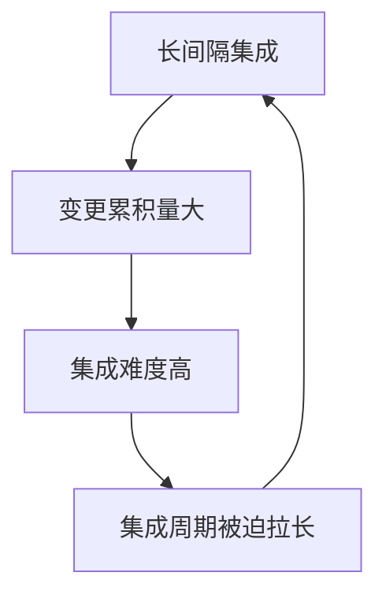
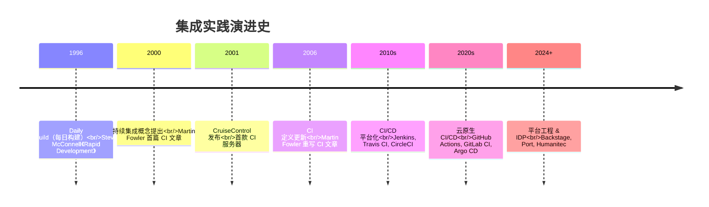
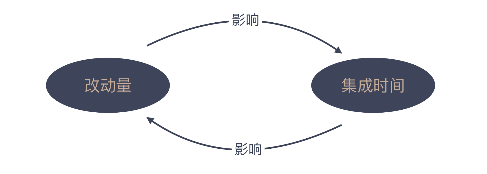
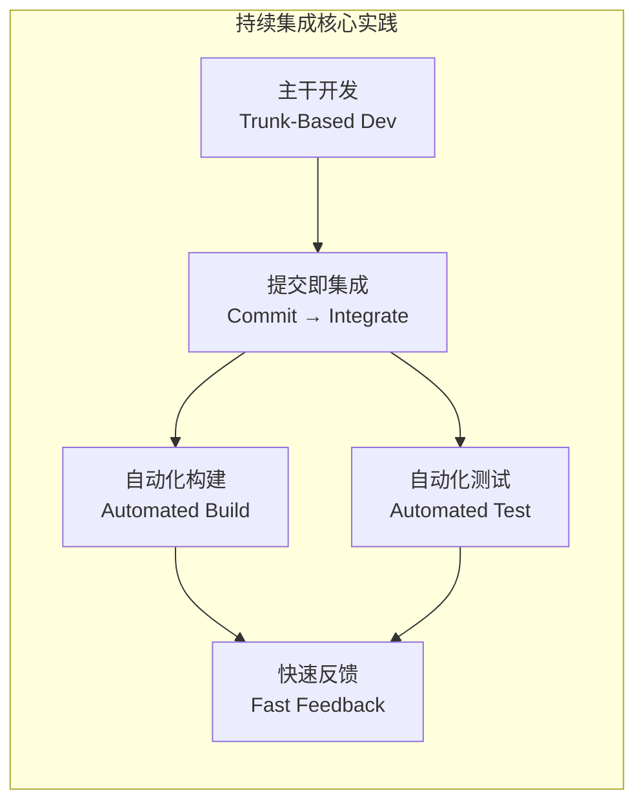
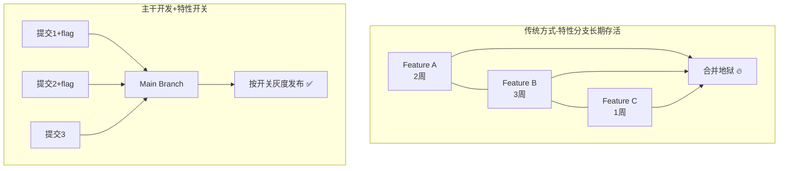
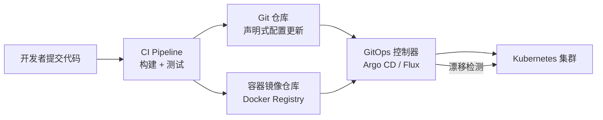
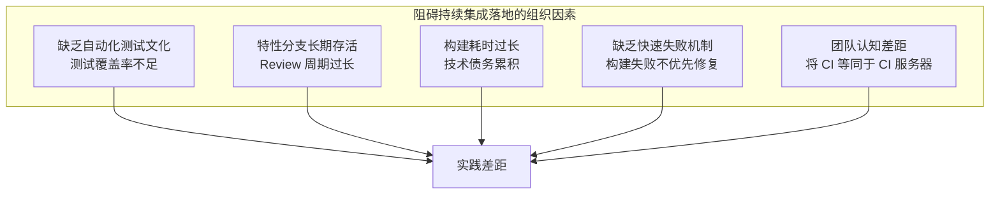
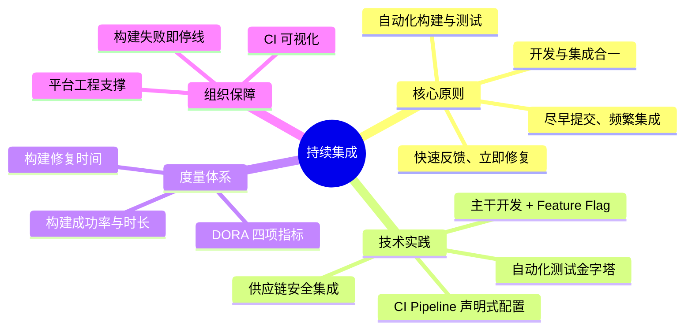

# 持续集成：集成本身就是写代码的一个环节

## 核心命题

软件工程中，代码编写并非交付的终点——**可运行的软件**才是团队的交付物。当多人协作时，将各分支代码合并为可工作整体的过程即为**集成（Integration）**。集成的频率与质量，直接决定了软件交付的效能与可靠性。

---

## 1. 集成困境：从"集成地狱"到"持续集成"

### 1.1 集成问题的本质

集成问题的根源在于**变更累积量与集成间隔时间之间的正反馈循环**：

这一恶性循环在业界被称为 **Integration Hell（集成地狱）**。其核心特征为：

| 维度 | 长间隔集成 | 短间隔集成 |
|------|-----------|-----------|
| 变更累积量 | 大（数周至数月） | 小（数分钟至数小时） |
| 冲突概率 | 高 | 低 |
| 问题定位难度 | 高（需在大量变更中排查） | 低（最近一次提交即可定位） |
| 回滚成本 | 高 | 低 |
| 心理压力 | 大（"集成周"焦虑） | 小（日常行为） |

### 1.2 行业实践演进

集成实践的演进遵循一条清晰的逻辑线——**不断缩短集成间隔**：

**关键转折点解析**：

- **Daily Build → 持续集成**：1996 年，Steve McConnell 在《Rapid Development》（国内译作《快速软件开发》）中首次系统提出 **Daily Build（每日构建）** 实践，即每天集成一次。从"每天一次"到"每次提交即集成"，集成间隔从天级压缩到分钟级，这一质变的实现依赖于**自动化构建流水线**的支撑。
- **自动化脚本 → CI 服务器**：持续集成的早期实现并不复杂——脚本定期从源码服务器拉取代码，发现程序更新即自动完成构建。由于这段脚本与任何具体项目无关，被逐步整理、发布并迭代为通用工具。2000 年 Martin Fowler 发表文章 [Continuous Integration](http://martinfowler.com/articles/continuousIntegration.html)；2001 年其所在的 ThoughtWorks 发布市面上第一款持续集成服务器 CruiseControl，后续 CI 服务器大多在其基础上改良而来；2006 年 Fowler 重写该文 [Continuous Integration](http://martinfowler.com/articles/continuousIntegration.html)，此后业界又以持续集成为基础拓展出**持续交付**概念。CI 服务器的出现，将持续集成从小众实践推为行业的"事实"标准。
- **CI 服务器 → CI/CD 平台**：CruiseControl 作为鼻祖开启了 CI 服务器时代，但真正推动行业规模化的是 Jenkins（原 Hudson）的插件生态。然而，Jenkins 的声明式 Pipeline 和 Groovy DSL 在云原生时代面临挑战，促使 GitHub Actions、GitLab CI 等以 YAML 声明式配置为核心的现代 CI 平台崛起。
- **CI/CD → 平台工程**：2024 年后，行业焦点从"如何构建 CI/CD 流水线"转向"如何为开发团队提供自助式的交付平台"（Internal Developer Platform, IDP）。Gartner 将此趋势定义为 **Platform Engineering**。

### 1.3 案例复盘：月度集成模式的"联调"灾难

行业咨询中的典型案例：2009 年，某大型企业的一个部门由多个小组共同研发一个 C 语言项目，其工作流程为：先集中开发一个月，待开发阶段告一段落，再由大项目经理抽调各小组最精锐的成员集中集成。集成在该团队被视为一项高难度的大事，因此要聚集精英参与：第一步是编译链接，把各小组的程序模块编译到一起，哪个模块出问题就由对应小组的骨干出手解决；第一天所有模块能编译链接到一起已属幸运，之后才进入正式的"联调"阶段，目标是把最基本的流程跑通。

该案例中"联调"近乎灾难，原因在于：一个月内所有团队的模块汇总后体量庞大，出错需要改动的概率与改动量都非常大，集成所需时间随之拉长。即便抽调各组骨干，完成一次集成至少需要 2～3 天，改动量稍大则需一周。

值得注意的是时间坐标：这一案例发生在 Martin Fowler 最初发表 [Continuous Integration](http://martinfowler.com/articles/continuousIntegration.html) 9 年、该文更新版发布 3 年、McConnell 提出"每日构建" 13 年之后——即使以当时的时间坐标衡量，该项目的集成实践水平也至少落后行业 10 年以上。不同团队虽处于同一时代，技术实践水平却可能相差一个"年代"；持续集成虽已高度成熟，仍有大量团队停留在集成依赖少数关键人物的阶段。

### 1.4 从每日构建到持续集成的逻辑推导

每日构建与"最后统一集成"两种做法处理的是同一对关系——**改动量与集成时间**：前者瞄准"短"的方向（缩小间隔），后者朝"长"的方向（拉长间隔）努力。事实证明："长"的陷入恶性循环，"短"的成为最佳实践。

既然提高集成频率能保证每次集成时改动量更小、难度更低，问题便转化为：集成间隔可以缩短到什么程度——半天、两小时，还是一小时？将这一思路推演到极致，就是**只要有代码提交，就执行集成**。这正是持续集成的起点：将原本分成两个阶段的开发与集成合二为一，一边开发一边集成。

持续集成并不依赖专人盯守——由脚本定期拉取代码并自动构建即可实现，程序员解决问题的方案就是将这一过程自动化。每日构建与持续集成最根本的区别只在构建时机，而这在 CI 服务器上仅是一个配置选项；也正因如此，部分尚未实现持续集成的团队，借助 CI 服务器反而先做到了每日构建。

---

## 2. 持续集成的技术定义与核心实践

### 2.1 定义

**持续集成（Continuous Integration, CI）** 是一种软件开发实践，要求团队成员**频繁地将代码变更合并到共享主干分支**，每次合并均触发**自动化构建与测试**，以快速检测集成错误。

> Martin Fowler 在其 2006 年修订的定义中明确指出：持续集成的核心不在于工具，而在于**实践纪律**——"每个人每天至少向主干提交一次代码"是最低标准。

### 2.2 核心实践矩阵

基于 DORA（DevOps Research and Assessment）研究团队 2024 年报告的验证，持续集成的有效性依赖于以下实践的系统性实施：

| 实践 | 要求 | 现代工具支撑 |
|------|------|-------------|
| **单一主干分支** | 所有开发基于 main/trunk 分支，特性分支存活时间 < 1 天 | GitHub Flow、Trunk-Based Development |
| **自动化构建** | 代码提交即触发构建，包含编译、依赖解析、静态分析 | GitHub Actions、GitLab CI、Bazel、Nx |
| **自动化测试** | 单元测试、集成测试、契约测试全覆盖 | Jest、pytest、JUnit 5、Pact |
| **快速反馈** | 构建失败时，修复为最高优先级；反馈时间 < 10 分钟 | CI Monitor、Slack/Teams 通知、CI 可视化 |
| **频繁提交** | 每人每日至少提交一次 | 任务分解、小步提交 |

### 2.3 Trunk-Based Development 与 Feature Flag

在现代实践中，实现频繁集成（"尽早提交代码去集成"）的关键技术手段是 **Trunk-Based Development（主干开发）** 配合 **Feature Flag（特性开关）**：

**Feature Flag 的核心价值**：

- 将"代码集成"与"功能发布"解耦——代码可以安全合入主干，但功能通过开关控制对用户可见性
- 支持灰度发布（Canary Release）、A/B 测试、紧急回滚
- 主流实现：LaunchDarkly、Unleash、Flagr、自研开关服务

频繁提交的前提是**任务分解**：将大需求拆分为可在一天内完成的小任务，才能保证特性分支短存活、小步提交，使"开发完成"的标志从"代码写完"变为"代码已集成分支"。

---

## 3. 现代 CI 技术生态（2024-2026）

### 3.1 CI 平台演进对比

| 维度 | 传统 CI（Jenkins） | 云原生 CI（GitHub Actions） | 下一代（平台工程） |
|------|-------------------|---------------------------|-------------------|
| 配置方式 | Groovy DSL / Jenkinsfile | YAML 声明式 | Golden Path 模板 |
| 执行环境 | 固定 Agent / Slave | 临时容器（ephemeral runner） | 按需容器 + 缓存 |
| 扩展机制 | 插件（>1800 个） | Marketplace Actions | 自定义组件 |
| 安全模型 | 凭据硬编码 / Credential Plugin | OIDC / GitHub Token | Secret 管理集成 |
| 适用场景 | 企业内部复杂流水线 | 开源 + 云原生项目 | 组织级标准化交付 |
| 学习曲线 | 陡峭（Groovy + 插件生态） | 中等（YAML + Actions） | 低（开发者自助） |

### 3.2 关键技术趋势

#### 3.2.1 GitOps 与声明式交付

GitOps 将 Git 仓库作为**系统期望状态的唯一事实来源（Single Source of Truth）**，CI/CD 流水线的职责从"执行部署"变为"更新 Git 仓库中的声明式配置"，由独立的同步引擎（如 Argo CD、Flux）将期望状态与实际状态对齐。

#### 3.2.2 平台工程与内部开发者平台（IDP）

2024 年 Gartner 将 **Platform Engineering** 列为十大战略技术趋势之一。其核心理念是：

> **将基础设施和交付能力封装为可自助消费的服务，让开发团队无需理解底层复杂性即可完成从代码到生产的全流程。**

IDP 的典型架构（参考 CNCF TAG App Delivery 白皮书）：

| 层级 | 组件 | 职责 |
|------|------|------|
| **开发者界面** | Backstage / Port / Service Catalog | 服务模板、文档、创建向导 |
| **平台编排** | Crossplane / Terraform / Pulumi | 基础设施编排 |
| **CI/CD** | GitHub Actions / GitLab CI / Tekton | 构建、测试、镜像推送 |
| **交付引擎** | Argo CD / Flux | GitOps 同步、渐进式发布 |
| **运行时** | Kubernetes / Serverless | 工作负载执行环境 |

#### 3.2.3 Supply Chain Security（供应链安全）

CI 流水线已成为软件供应链攻击的主要目标（SolarWinds、Codecov 等事件后），现代 CI 实践必须集成安全控制：

- **SLSA（Supply-chain Levels for Software Artifacts）**：Google 主导的供应链完整性框架，v1.x 规范将构建保障分为 Build Track 的 Level 0–3（早期 v0.x 版本曾定义至 Level 4，已废弃）
- **SBOM（Software Bill of Materials）**：强制生成软件物料清单（美国 EO 14028 行政令要求）
- **Sigstore / Cosign**：容器镜像签名与验证
- **OIDC 联邦认证**：CI Pipeline 通过 OIDC Token 获取临时凭证，替代长期密钥

---

## 4. 持续集成的实施度量

### 4.1 DORA 四项关键指标

Google Cloud 的 DORA 研究团队通过多年大规模调研，确立了衡量软件交付效能的四项核心指标：

| 指标 | 定义 | 高效能团队基准（DORA 历年报告口径） |
|------|------|----------------------|
| **Deployment Frequency** | 部署到生产的频率 | 按需（每天多次） |
| **Lead Time for Changes** | 代码提交到部署生产的耗时 | < 1 天 |
| **Change Failure Rate** | 部署导致故障的比例 | 0–15% |
| **MTTR（近年报告称 Failed Deployment Recovery Time）** | 从故障到恢复的平均时间 | < 1 小时 |

> **关键洞察**：DORA 历年报告均表明，实施持续集成的团队在这四项指标上显著优于未实施团队。需注意 DORA 2024 年报调整了 Change Failure Rate 的统计口径（仅统计一日内恢复的失败变更），且未再单列精英档阈值。

### 4.2 CI 特定度量

除 DORA 指标外，持续集成本身的健康度还需关注：

| 度量项 | 计算方式 | 目标值 |
|--------|---------|--------|
| **Build Success Rate** | 成功构建次数 / 总构建次数 | > 90% |
| **Build Duration (P95)** | 构建耗时的第 95 百分位 | < 10 分钟 |
| **Time to Fix Broken Build** | 构建失败到修复的时间 | < 30 分钟 |
| **Commit-to-Build Latency** | 代码提交到构建启动的延迟 | < 2 分钟 |
| **Flaky Test Rate** | 不稳定测试的比例 | < 1% |

---

## 5. 持续集成的组织维度

### 5.1 行业实践现状与差距

即便持续集成已发展多年，行业应用水平仍存在巨大差异。以下为对行业现状的归纳性示例数据（非权威调研实测值）：

- 相当一部分开发团队实施了某种形式的 CI/CD
- 真正达到"每次提交即集成"持续集成标准的团队仍是少数
- 大量团队仍处于"集成依赖英雄"的阶段

这一差距的根源往往不是技术问题，而是**组织因素**：

对于尚未建立集成实践的团队而言，无需复刻"精英集成""每日构建"的历史阶段，可以直接采用持续集成的现代实践，一步到位进入当前行业的先进状态。

### 5.2 从"安装 Jenkins"到"持续集成文化"

持续集成不是工具的部署，而是**工程实践纪律的内化**。其落地路径为：

1. **建立主干开发共识**：团队约定特性分支存活不超过 24 小时
2. **构建自动化测试基线**：从单元测试覆盖率 > 60% 开始，逐步提升
3. **设定构建时长目标**：P95 < 10 分钟，超时则优化瓶颈
4. **定义"构建失败即停线"**：构建失败时，全团队停止新功能开发，优先修复
5. **可视化 CI 健康度**：部署 CI 监视器（如 ci-overview、Buildkite Dashboard）

---

## 6. 总结

持续集成的核心认知框架可归纳为：

**核心要义**：集成本身就是写代码的一个环节。不是"写完代码后去集成"，而是"边写代码边集成"。这一认知的转变，是从"集成依赖英雄"到"持续集成成为日常"的关键跃迁。

一句话概括：**尽早提交代码去集成。**

---

> **延伸阅读**
>
> - Martin Fowler, "Continuous Integration" (2006 revision): https://martinfowler.com/articles/continuousIntegration.html
> - DORA State of DevOps Report (2024): https://dora.dev/research/
> - CNCF TAG App Delivery, "Platform Engineering Whitepaper": https://tag-app-delivery.cncf.io/whitepapers/platform-eng/
> - SLSA Specification: https://slsa.dev/spec/v1.0/
> - Trunk-Based Development: https://trunkbaseddevelopment.com/
