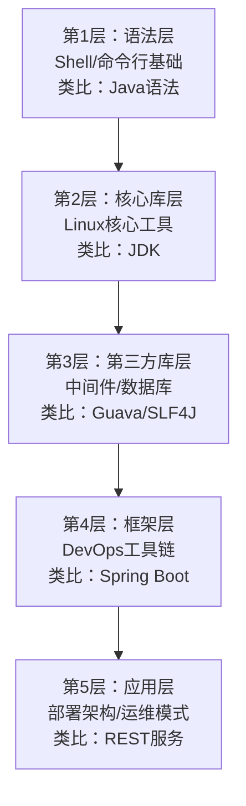
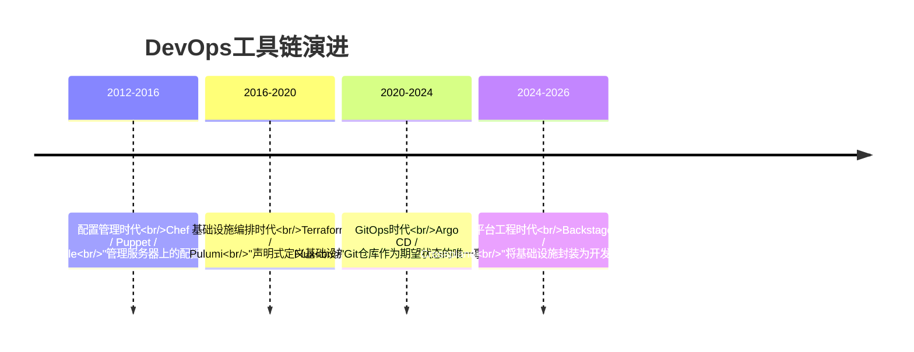
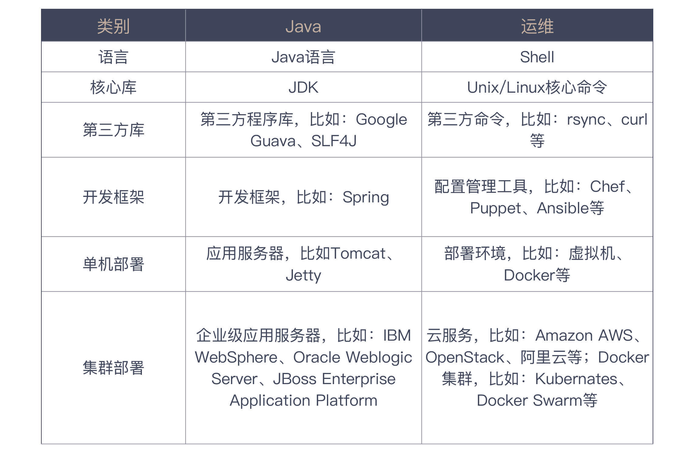

# 程序员怎么学习运维知识

## 核心命题

运维知识的结构可类比编程知识的层次：**语法层→核心库层→第三方库层→框架层→应用层**。一旦理解了这个层次结构，运维学习就不再是无序的"工具堆砌"，而是系统性的知识构建——从 Shell 基础到 Linux 核心工具，从中间件到 DevOps 工具链，再到部署架构，每一层都有清晰的边界和递进关系。

---

## 1. 运维知识的层次模型

### 1.1 类比编程知识的五层结构

| 层次 | 编程类比 | 运维对应 | 学习内容 | 现代（2024-2026） |
|------|---------|---------|---------|-----------------|
| **语法** | Java 语法 | Shell 基础 | 命令行操作、脚本编写 | Shell + YAML（声明式配置） |
| **核心库** | JDK | Linux 核心工具 | 进程/网络/文件/权限 | Linux + Kubernetes 基础对象 |
| **第三方库** | Guava/SLF4J | Redis/PostgreSQL | 安装、配置、调优、备份 | Redis / PostgreSQL / NATS |
| **框架** | Spring Boot | Terraform/Crossplane | 基础设施编排、配置管理 | Terraform / Pulumi / Crossplane |
| **应用** | REST 服务 | 部署模式 | GitOps、渐进式发布、混沌工程 | GitOps + 平台工程 |

### 1.2 各层的学习路径

| 层次 | 学习方法 | 建议时长 | 验证方式 |
|------|---------|---------|---------|
| **语法层** | 阅读+练习 | 1-2 周 | 能写 Shell 脚本 |
| **核心库层** | 实操+排查 | 2-4 周 | 能排查 Linux 系统问题 |
| **第三方库层** | 安装+配置+调优 | 按需 | 能独立部署中间件 |
| **框架层** | 项目实践 | 2-4 周 | 能编写 Terraform 配置 |
| **应用层** | 综合实践 | 持续 | 能设计部署架构 |

---

## 2. DevOps 工具链的演进

### 2.1 三代演进

### 2.2 各代工具的对比

| 代际 | 核心工具 | 管理对象 | 声明方式 | 状态管理 |
|------|---------|---------|---------|---------|
| **第1代** | Ansible/Chef/Puppet | 服务器配置 | Playbook/Recipe | 过程式（按步骤执行） |
| **第2代** | Terraform/Pulumi | 云资源 | HCL/TypeScript | 声明式+状态文件 |
| **第3代** | Argo CD/Flux | K8s 资源 | YAML/Kustomize | GitOps（Git 为 Source of Truth） |
| **第4代** | Backstage/Crossplane | 开发者平台 | Component/CompositeResource | 平台抽象 |

---

## 3. 关键运维概念速查

| 概念 | 定义 | 程序员类比 |
|------|------|-----------|
| **Infrastructure as Code** | 基础设施用代码定义和管理 | 配置文件即"运维代码" |
| **Immutable Infrastructure** | 部署后不可修改，变更需重建 | 不可变对象模式 |
| **Blue-Green Deployment** | 两个完整环境交替部署 | 双缓冲区模式 |
| **Canary Release** | 逐步放量验证 | Feature Flag + 灰度 |
| **Chaos Engineering** | 主动注入故障验证韧性 | 系统级单元测试 |

---

## 4. 程序员为什么需要学习运维知识

### 4.1 岗位分工的现状

在稍具规模的公司，部署工作通常由专有职位（运维）承担，该岗位的职责不止于部署，还包括维护线上系统的稳定。团队规模较小或项目处于初始阶段时，这些工作往往由程序员自行完成。

### 4.2 学习运维知识的价值

- **完整理解软件**：既要了解软件的逻辑，也要了解它的物理部署，出现问题时才能定位并修复。
- **设计期规避问题**：在设计阶段即可提前规避部署带来的问题，而不是等到上线才发现。
- **自动化的最佳切入点**：部署是最适合发挥自动化能力的环节，运维知识是构建自动化流水线的基础。

---

## 5. 体系化学习：从 Java 知识体系到运维知识体系

### 5.1 零散知识与结构化知识的学习差异

知识是否成体系，直接决定学习效率：

- **零散知识**：工具之间没有联系，原有知识无法辅助理解新知识，学习效率极低，过程痛苦。
- **结构化知识**：学习新知识等同于学习增量，真正需要理解的新内容有限，效率大幅提高。

不同时期入行的开发者联想到的运维工具各不相同：新入行者联想到 [Docker](http://www.docker.com)、[Kubernetes](http://kubernetes.io)；较早入行者还会想到 [Chef](http://www.chef.io)、[Puppet](http://puppet.com)、[Ansible](http://www.ansible.com)；更早入行的开发者首先想到的是 Shell 脚本。这些工具散落在不同层次上，若无体系贯穿，就只能逐一孤立地学习。

本知识体系的原始框架来自 Odd-e 讲师 [柴锋](https://chaifeng.com/about/) 面向程序员的 [DevOps 课](http://chaifeng.com/devops-tech-stack/)，此处按知识点结构重新整理——这一过程本身也是一次 [知识输出](http://time.geekbang.org/column/article/84663) 实践。

### 5.2 Java 知识体系的五层参照

以最常见的 Java 开发为参照，成为一名合格的 Java 程序员所需的知识层次如下：

1. **语言层**：Java 语言的各种语法特性。只了解语法写不出像样的程序，还需掌握核心库。
2. **核心库层**：JDK 中的各种类，如最常见的 String、List、Map 等。
3. **第三方库层**：为避免重新发明"轮子"、减少不必要的工作量而引入的类库，如 [Google Guava](http://github.com/google/guava)、[SLF4J](http://www.slf4j.org) 等。
4. **框架层**：REST 服务中的对象-表映射、结果转 JSON、系统组件组装等结构性代码反复出现，为减少结构上的代码重复，开发框架应运而生，Java 中最常见的是 [Spring](http://spring.io)。
5. **运行时与部署层**：开发者很少直接接触最底层的 HTTP 实现，这些职责由运行时环境承担；在 Java 世界里，这是 Tomcat、Jetty 之类容器的职责，应用包只需部署到容器之上。若上来就使用 Spring Boot 之类框架，往往感知不到这一部署过程，因为这些框架已将容器封装其中、简化了部署。

Tomcat、Jetty 通常只解决单机部署；现实生产场景中一台机器往往不够，需要的是集群。常见方案有二：用 Nginx 做负载均衡，或采用企业级应用服务器，如 IBM WebSphere、Oracle WebLogic Server、JBoss Enterprise Application Platform 等。至此，一套完整的 Java 应用解决方案才算部署完成。

### 5.3 运维知识体系的对应映射

Java 体系的每一层在运维知识中都有对应物，可用同一方式理解运维：

- **语言层 → Shell**：运维的"语言"是 Shell，最常用的是 Bash。Shell 是操作系统与内核之间的接口——无法直接使用操作系统内核，Shell 提供了访问内核服务的入口。Shell 本身就是一门编程语言，但多数开发者并不把它当作编程语言系统学习，而是需要时搜索一下、照猫画虎地复制代码，结果就是每次写脚本都要花大量时间与语法纠缠，只为让它运行起来。
- **核心库层 → Unix/Linux 核心命令**：即 Shell 提供的各种操作系统核心命令，如 ls、cd、ps、grep、kill、cut、sort、uniq 等。它们几乎与操作系统绑定，随操作系统一起发布。
- **第三方库层 → 非核心命令**：不属于操作系统核心命令的工具，如 rsync、curl 等。
- **框架层 → 配置管理工具**：运维同样存在通用能力需求——安装某个包之前检查该包是否已安装、启动一个服务之前检查该服务是否已启动等。把这些通用工作按定义自动完成的工具，就是运维的"框架"，即 Chef、Puppet、Ansible 之类的配置管理工具。
- **单机运行时 → 虚拟机与容器**：软件环境完成基本配置后，需要运行时环境将其跑起来；虚拟机、Docker 等技术解决的就是单机部署问题。掌握以上内容即可构建开发环境或测试环境；除非用户非常少，生产环境一般不会停留在单机部署。
- **集群与高可用 → 云与编排技术**：需要集群或高可用环境时，涉及更复杂的技术——云技术（Amazon AWS、OpenStack，包括国内的阿里云），以及基于 Docker 的 Kubernetes、Docker Swarm 等编排技术。

至此，一张相对完整的运维知识地图成形：

### 5.4 实践要点

- 先建立层次模型，再按层填充工具细节；新工具出现时，先定位其所属层次，再学习增量。
- 部署工作非常适合自动化，运维知识的学习应以自动化实践为导向。
- 云原生时代新增的工具（Terraform、Argo CD、Backstage 等）同样可以纳入这一层次模型定位学习。

---

## 6. 总结

**核心要义**：运维学习应有层次——从 Shell 基础到 Linux 核心工具再到 DevOps 工具链和部署架构，而非零散地逐个学习工具。理解层次结构后，运维学习变为系统性的知识构建。2024-2026 的运维焦点已从"配置管理"演进到"GitOps + 平台工程"。

一句话概括：**有体系地学习运维知识。**

---

> **延伸阅读**
>
> - Chaifeng DevOps Tech Stack: http://chaifeng.com/devops-tech-stack/
> - Terraform: https://www.terraform.io/
> - Crossplane: https://crossplane.io/
> - Argo CD: https://argoproj.github.io/argo-cd/
