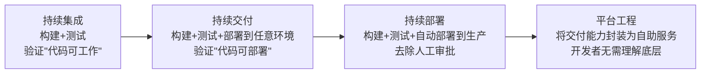
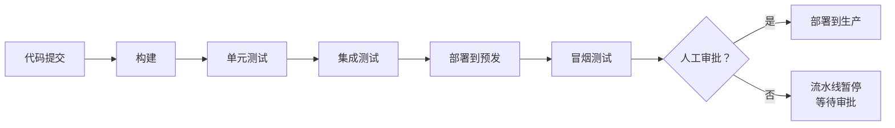
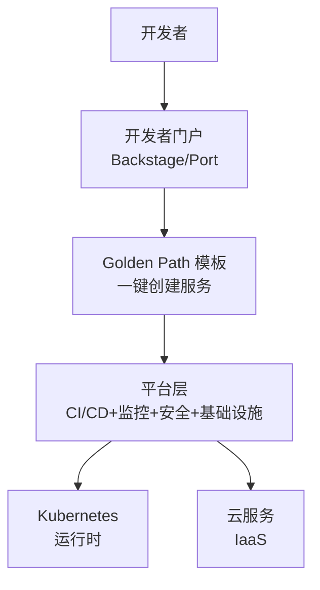
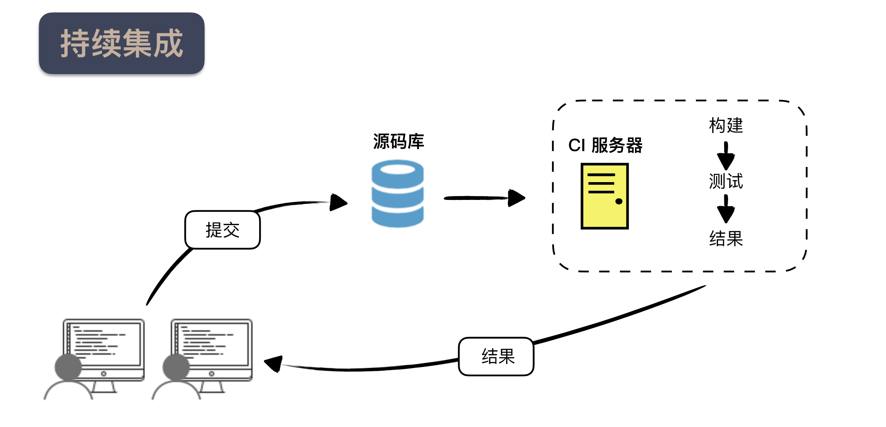
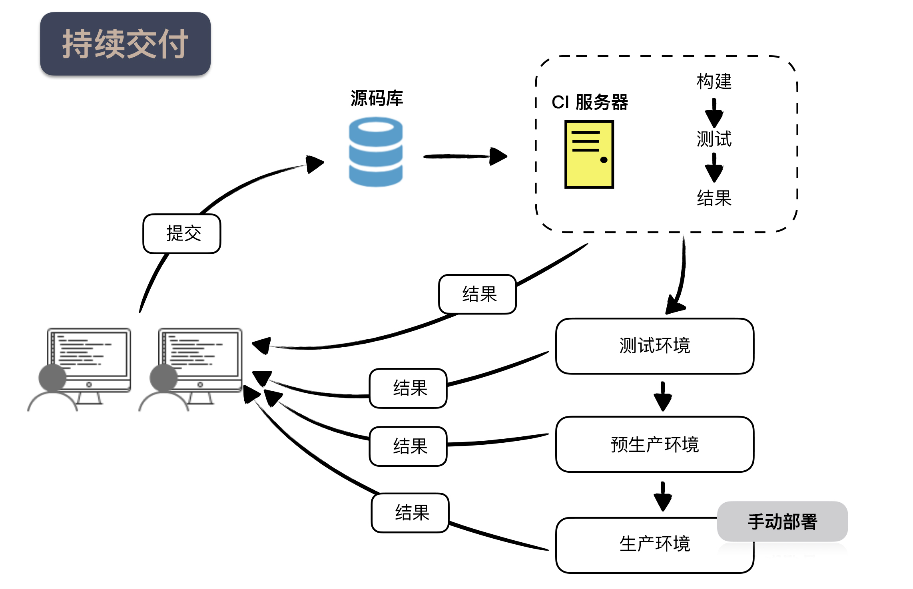
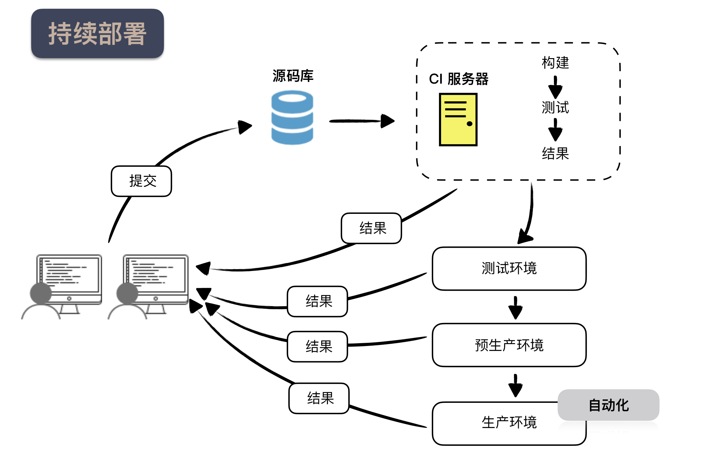
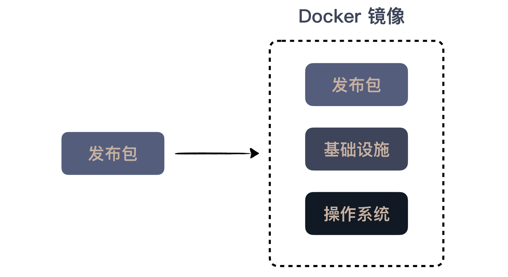

# 持续交付：有持续集成就够了吗

## 核心命题

持续集成（CI）确保代码可以构建和测试，而**持续交付（CD）确保代码可以随时部署到生产环境**。CI 是 CD 的子集——CI 验证"代码正确性"，CD 验证"代码可部署性"。从 CI 到 CD 再到 DevOps，是"代码质量保障"→"交付能力保障"→"组织能力变革"的递进；2024-2026 年，这一演进进一步走向**平台工程**——将交付能力封装为开发者自助服务。

---

## 1. CI → CD → DevOps → 平台工程的演进

### 1.1 四级递进模型

| 阶段 | 定义 | 关键能力 | 组织要求 |
|------|------|---------|---------|
| **CI** | 每次提交触发构建+测试 | 构建脚本、自动化测试 | 开发团队自律 |
| **CD（Continuous Delivery）** | 代码可随时部署到生产 | 部署自动化、环境管理 | 开发+运维协作 |
| **Continuous Deployment** | 代码通过测试后自动部署 | 全链路自动化、Feature Flag | 全自动化+监控 |
| **DevOps** | 文化+流程+工具的系统性变革 | 全链路可观测、快速反馈 | 组织级变革 |
| **Platform Engineering** | 将交付能力封装为自助服务 | IDP、Golden Path、自助服务 | 平台团队+开发团队分离 |

---

## 2. 持续交付流水线

### 2.1 典型 CD 流水线

### 2.2 部署策略对比

| 策略 | 机制 | 回滚方式 | 零停机 | 适用场景 |
|------|------|---------|--------|---------|
| **滚动部署** | 逐个替换实例 | 回滚到上一版本 | 近似 | 无状态服务 |
| **蓝绿部署** | 切换流量到新环境 | 切换回旧环境 | ✅ | 需要零停机 |
| **金丝雀发布** | 逐步放量（1%→10%→100%） | 停止放量 | ✅ | 需要渐进验证 |
| **Feature Flag** | 开关控制功能可见性 | 关闭开关 | ✅ | 需要精确控制 |
| **A/B 测试** | 按用户分组分配 | 切换分组 | ✅ | 需要数据驱动决策 |

---

## 3. DevOps 的现代演进：平台工程

### 3.1 DevOps 的问题 → 平台工程的解决方案

| DevOps 痛点 | 平台工程方案 |
|-------------|-------------|
| 开发者需要理解 K8s/Terraform | Golden Path 模板一键创建 |
| 每个团队重复搭建 CI/CD | 平台提供标准化流水线 |
| 运维知识散落在各团队 | 平台团队集中维护 |
| 安全合规难以统一 | 平台内置安全策略 |

### 3.2 内部开发者平台（IDP）架构

---

## 4. DORA 指标：交付效能的衡量

| 指标 | 定义 | 精英级基准 | 衡量对象 |
|------|------|-----------|---------|
| **Deployment Frequency** | 部署到生产的频率 | 按需（每天多次） | 交付吞吐量 |
| **Lead Time for Changes** | 提交→部署生产的耗时 | < 1 天 | 交付速度 |
| **Change Failure Rate** | 部署导致故障的比例 | < 5% | 交付质量 |
| **MTTR** | 故障→恢复的平均时间 | < 1 小时 | 恢复能力 |

---

## 5. 持续交付的两大关键点

### 5.1 定义与出处

**持续交付（Continuous Delivery, CD）** 是一种让软件随时处于"可部署到生产环境"状态的能力。让这一概念广为人知的是 Jez Humble 与 Dave Farley 的著作《 [持续交付](http://book.douban.com/subject/6862062/)》（Continuous Delivery）。

历史脉络：CruiseControl 是持续集成服务器的鼻祖；2007 年，ThoughtWorks 有意以 CruiseControl 为基础提供企业级服务，成立了打造更好 CI 服务器的团队，Jez Humble 即在这个团队中工作。同团队工作的还有乔梁——《持续交付》中文版译者，并在原书出版近十年后写了《 [持续交付 2.0](http://book.douban.com/subject/30419555/)》，将自己多年关于持续交付的新理解整理成书。该团队当年打造的先锋持续交付工具受产品推广策略所限并未成为主流，后来开源，即 [GoCD](http://www.gocd.org)。

从"打好发布包"到"部署到生产环境可用"，中间还差两件事：**验证发布包**与**部署**。持续集成专题的两篇进阶参考：[为什么要做持续集成](http://time.geekbang.org/column/article/75977)、[怎么做好持续集成](http://time.geekbang.org/column/article/83461)。

### 5.2 验证发布包：多环境与构建流水线

CI 阶段已经做过验证，CD 为什么还要再验证？因为 CI 环境往往是单机的，主要强调功能验证，与生产环境相关的测试常常欠缺。因此，**环境**是持续交付的首要关注点。构建持续交付基础设施时，通常包含以下环境：

- **持续集成环境**：持续集成是持续交付的前提，这个过程主要执行基本检查，打出一个可以发布的包。
- **测试环境（Test）**：通常是单机环境，负责功能验证；这里运行的测试基本都是验收测试级别，而单元测试、集成测试等执行较快的测试放在持续集成环境中执行。
- **预生产环境（Staging）**：与生产环境配置相同——负载均衡、集群等齐备，只是机器数量上少一些；负责验证部署环境，例如发现多机并发带来的问题。
- **生产环境（Production）**：真实的线上环境。

每个环境的作用有差异，验证不应集中在一处执行，而应分阶段进行：一个阶段不通过，不能进入下一阶段。这种按照不同阶段组织构建的方式，称为**构建流水线（Build Pipeline）**。

### 5.3 生产发布与持续部署

通过全部验证后，到达构建流水线的最后一个阶段——生产发布。生产发布这一步通常不自动化：持续交付的关注点是让软件具备"随时可以发布"的能力，但并不等于要立刻上线，最后是否上线由人来决定。

把"由人决定是否上线"变成自动化，就成了另一个实践：**持续部署（Continuous Deployment）**。由于发布决策通常需要谨慎对待，最后一步人工拍板更为稳妥，因此持续交付是当前的主流形态。

---

## 6. DevOps 与交付物的演进

### 6.1 DevOps 的起源与影响

早期部署靠手写 Shell 脚本完成，Chef、Puppet、Ansible 等工具在业界的兴起与一个概念密切相关：**DevOps**。DevOps 是一种软件交付的理念和方法，目的是增强软件的可靠性；从名字即可看出，它将开发（Development）与运维（Operations）组合在一起。

传统 IT 公司中，开发和运维往往是互不干涉的两个职位，甚至是两个不同的部门，由此带来很多问题，例如开发人员修改了配置但没有通知运维，造成新代码不能运行。DevOps 提倡将二者融合、打破壁垒。

2009 年，Flickr 做了题为《 [每天部署10次](http://www.slideshare.net/jallspaw/10-deploys-per-day-dev-and-ops-cooperation-at-flickr)》的分享，整个行业受到极大冲击，DevOps 运动自此风起云涌。做好 DevOps 需要在文化、流程和工具等诸多方面不断改善；对开发者日常工作最直接的影响体现在工具上——Chef、Puppet、Ansible 基本都是在那之后兴起或广为人知的。

### 6.2 配置管理工具与基础设施即代码

配置管理工具为行业带来了**部署规范**。此前写 Shell 的方式是"各村有各村的高招"：在 A 公司学会的东西到 B 公司没法用，甚至在很多人的印象中，部署这件事只属于某个特定场景，换台机器脚本都要重写——这种局面如同 Spring 出现之前几乎所有公司都在写自己的框架。Spring 的出现让 Java 技能从归属于一个公司变成行业通用；运维体系中的配置管理工具起到了同样的作用，并带来一个新的理念：**基础设施即代码（Infrastructure as Code）**——将计算机的管理与配置变成代码。

配置一旦成为代码，就可以到处运行、可以版本管理，那种强烈依赖"英雄"的机器配置工作得以平民化。这些工具采用的都是**声明式接口**：从 Shell 式的"描述怎么做"，到"描述做什么"，抽象程度上了一个台阶，让开发者或系统管理员从琐碎细节中脱身，把更多注意力用于思考应该把机器配置成什么样子。

### 6.3 Docker：交付物从发布包到镜像

配置管理工具仍需要一台具体的机器去部署，在持续交付中只能扮演部署环境的次要角色；Docker 的出现则彻底改变了**最终交付物**。Docker 相当于一台可用代码描述的机器：在配置文件中描述预期中那台机器的样子，然后生成镜像、部署到具体的机器上。

既然是描述机器的样子，就可以在 Docker 的配置文件中使用前述配置工具，配置工作随之简化；进而可以通过配置工具将发布包部署到最终镜像中——最终生成的镜像就是包含了应用的镜像。至此，生成产物由"一个发布包"变成"一个 Docker 镜像"。

Docker 在开发中扮演的角色，是构建在应用与具体机器之间的**中间层**：对应用而言它就是机器，对机器而言它只是一个可部署的镜像。它统一了各种应用千奇百怪的部署差异，让部署本身变得更简单。这也重新定义了"交付"：交付物不再是一个发布包，而是一个可以部署的镜像。

---

## 7. 总结

**核心要义**：有持续集成不够，还需要持续交付——确保代码可随时部署到生产。CI→CD→DevOps→平台工程是递进关系。部署策略选择取决于业务需求，DORA 指标衡量交付效能。2024-2026 年的核心趋势是平台工程——将交付能力封装为开发者自助服务。

一句话概括：**将部署纳入开发的考量。**

---

> **延伸阅读**
>
> - Jez Humble, *Continuous Delivery* (2010)
> - DORA Research: https://dora.dev/
> - Platform Engineering Whitepaper: https://tag-app-delivery.cncf.io/whitepapers/platform-eng/
