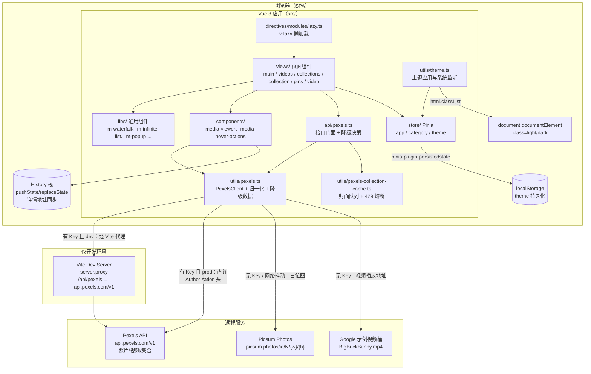
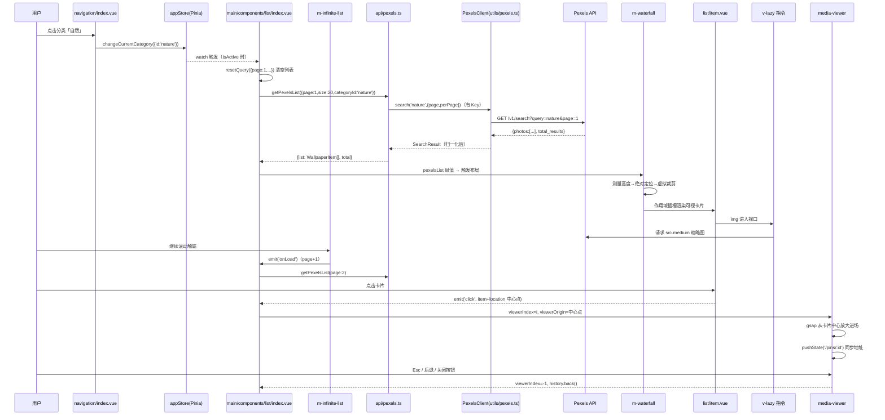

# 01 系统架构
> 项目：PEXELS 壁纸应用 ｜ 版本：v1.0 ｜ 生成日期：2026-10-06 ｜ 依据：源码分析

## 1. 整体架构图

本项目没有任何自建后端。浏览器里的 Vue 应用是唯一的运行时主体，它面向三类"外部世界"：Pexels 官方 API（真实数据源）、Picsum 等公共占位资源（降级数据源）、以及浏览器自身的 localStorage 与 History 栈（本地存储）。开发环境下还有第四个参与者——Vite Dev Server 的 `/api/pexels` 代理。

这张图里有三条最值得记住的边界：

1. **`src/api/pexels.ts` 是"降级决策边界"**。它知道"有没有配置 Key"、知道哪些错误该降级（网络抖动）、哪些错误必须抛出（401/403/429），页面层永远只面对 `{ list, total }` 或 `{ items, total, totalPages }` 这类规整形状，不感知数据是真是假。
2. **`src/utils/pexels.ts` 是"协议边界"**。PexelsClient 类只负责拼 URL、带鉴权头、解析 JSON、把 Pexels 原始结构归一化为 `NormalizedWallpaper` / `NormalizedVideo` / `NormalizedCollection`，它不知道调用方是谁，也不知道降级策略。
3. **持久化边界极窄**。全项目只有 theme store 一个 `persist: true`（`src/store/index.ts`），localStorage 中只存主题类型一个字符串；其余一切（列表、滚动位置、合集封面缓存、请求序号）都活在内存里，刷新即复位。

## 2. 分层与模块职责

| 层 | 目录 | 职责 | 依赖方向 |
| --- | --- | --- | --- |
| 入口装配层 | `src/main.ts`、`src/App.vue` | 创建应用、注册 router/pinia/组件库/指令、初始化主题、挂载全局 `unhandledrejection` 兜底 | → 全部 |
| 路由层 | `src/router/index.ts` | 单一路由表；懒加载所有页面；`catchAll` 重定向 `/404` | → views |
| 状态层 | `src/store/index.ts` | pinia 实例 + app/category/theme 三个 store；挂 persistedstate 插件 | → constants |
| 接口门面层 | `src/api/pexels.ts` | 8 个导出函数（getPexelsList、getPexelsFromId、searchVideos、getPopularVideos、getVideoById、getFeaturedCollections、getMyCollections、getCollectionMedia）；统一做参数钳制（page≥1、perPage∈[1,80]）、无 Key 短路降级、错误分级、total 截断（≤8000） | → utils/pexels、utils/pexels-collection-cache |
| 协议层 | `src/utils/pexels.ts` | PexelsClient（fetch 封装、鉴权、错误分级）、9 个接口方法、全部 TS 类型、归一化函数、Picsum/示例视频降级生成器 | 无业务依赖 |
| 调度层 | `src/utils/pexels-collection-cache.ts` | 合集封面 N+1 问题的专用调度器：内存缓存、3 并发 + 250ms 批间隔、429 熔断 5 分钟冷却 | → api/pexels、libs/message |
| 页面层 | `src/views/**` | 路由页面与其私有组件；持有各自的分页状态（query/page/isFinished/requestSequence） | → api、store、libs、components、utils |
| 跨页面组件层 | `src/components/**` | media-viewer（详情弹层）、media-hover-actions（hover 下载/复制） | → utils/viewer、libs、gsap、file-saver |
| 通用组件库 | `src/libs/**` | m-* 系列 UI 积木；`src/libs/index.ts` 用 `import.meta.glob` 异步全局注册（排除 message） | 仅内部依赖 |
| 指令层 | `src/directives/**` | `v-lazy` 图片懒加载 | → @vueuse/core |
| 主题与工具 | `src/utils/theme.ts`、`src/utils/helpers.ts`、`src/utils/viewer.ts` | 主题 class 切换与系统监听；isMobileTerminal/randomTint/formatDuration/useScrollRestore；详情弹层数据归一化 | → store、constants |
| 样式层 | `src/styles/index.css` | Tailwind 4 入口：根字号 `min(10vw, 40px)`、`@custom-variant dark`、`@theme` 调色板与字号、`@utility` scrollbar 系列 | 无 |

依赖纪律相当严格，值得点名的是两条反向依赖：`src/api/pexels.ts` → `src/utils/pexels-collection-cache.ts` 是不存在的（调度器在 api 之上）；`src/libs/**` 不 import `src/views`、`src/api`、`src/store` 的任何内容，唯一的"越界"是 `pexels-collection-cache.ts` 使用了 `libs/message`——方向是业务层用 UI 层，合法。

分层带来的实际收益在改动时最能体现：换一个图片供应商，只需要重写 `src/utils/pexels.ts` 的协议层与 `src/api/pexels.ts` 的降级矩阵，页面层认的 `WallpaperItem` 形状可以原样保留；反过来，把弹层从 gsap 换成 CSS 过渡，也只动 `src/components/media-viewer/index.vue` 的三个动画钩子，数据层零感知。反过来也有代价：一个"点击卡片"动作要穿过卡片组件（拿中心点）→ 列表容器（换下标）→ 弹层（动画与地址）三层，改动交互时需要同时理解三处状态（`viewerIndex`、`viewerOrigin`、列表数据），这是本架构最主要的复杂度集中点。

## 3. 一次图片浏览的端到端数据流

以用户打开首页、滚动加载、点击卡片查看大图的完整链路为例：

几个在源码中有明确注释支撑的数据流细节：

- **请求序号防竞态**（`src/views/main/components/list/index.vue` 的 `requestSequence`）：快速连续切换分类时多个请求并发且返回顺序不定，序号不匹配的响应直接丢弃；组件卸载时 `requestSequence += 1` 让最后一个在途响应也不写回。
- **页码成功后才自增**：`query.page += 1` 放在请求成功之后，失败重试不会跳过失败的那一页。
- **keep-alive 期间的变更挂起**：home/videos/collections 三个页面被 `src/views/layout/index.vue` 的 `CACHE_NAMES` 缓存，失活期间 store 变化只更新 `appliedQuery` 不发请求（避免在视频页搜索时首页白烧一次配额），重新激活时在 `onActivated` 里比对补拉。
- **弹层与列表同序**：`viewerItems = computed(() => toViewerItems(pexelsList.value))`，弹层左右切换的下标就是列表下标，数据永不错位；接近末尾 `loadMoreOffset=3` 时提前触发 `load-more`，保证切换不断档。

上图只画了成功路径，失败路径同样有明确归属：列表请求抛出 401/403/429 时，`getPexelsData` 的 catch 把 `hasError` 置真并弹 `message('error', err.message)`（文案来自 `PexelsApiError` 构造，如"Pexels 请求过于频繁，请稍后再试"），`m-infinite-list` 随即把加载动画替换成"加载失败，点击重试"——重试走独立的 `retry` 事件，不再经过 IntersectionObserver 的自动触发判断，因此失败不会引发请求风暴。若错误发生在序号过期的响应上，则静默丢弃，什么都不弹。这套"谁的错误谁消费"的约定，让协议层、门面层、页面层各自只处理自己能理解的失败形态。

另有一条不容易看见的数据流——**缓存与主题流**：theme store 的 `themeType` 经 `pinia-plugin-persistedstate` 写入 localStorage，再经 `src/utils/theme.ts` 翻译成 html class，最终由 Tailwind 的 `dark:` 变体作用于每一个工具类；这条流是全项目唯一"写本地存储"的流，其余一切状态（列表、封面缓存、滚动位置）都随刷新蒸发。理解了这一点，就能解释为什么本项目没有"状态管理失控"的经典问题——没有共享可变状态，自然没有同步问题。

## 4. 关键设计决策与设计模式

**决策一：错误分级降级，而非一刀切兜底。** `src/api/pexels.ts` 的 `isAuthOrLimitError` 只把 401/403/429 视为"必须向上抛"的错误，其余（网络抖动、5xx 等）才降级为 Picsum 占位。注释给出了理由：Key 失效或配额耗尽时若仍返回兜底图，用户与页面层都无法区分真实与假数据，页面里的 429 熔断与配额提示会变成死分支。这是整个数据层最重要的一条不变量。

**决策二：门面 + 适配器模式（API 层）。** `getPexelsList` 的返回形状刻意保持 `{ list, total }`，"与改造前的后端代理一致，调用方无需改动"（源码注释原文）；`toWallpaperItem` 把归一化模型适配成卡片组件需要的字段名（`photo`/`photoDownLink` 等）。外部 API 的形状变化被隔离在 `src/utils/pexels.ts` 一个文件内。

**决策三：调度器模式（合集封面）。** `src/utils/pexels-collection-cache.ts` 针对合集封面 N+1（每张卡要多发一次 `collectionMedia`）实现了模块级单例调度：`coverCache` 内存缓存、`waiters` 订阅者表、`queue` + `drain()` 的 3 并发/250ms 批间隔队列、`rateLimited`/`rateLimitUntil` 的 429 熔断与 5 分钟冷却、`requestCover` 返回取消函数供虚拟滚动回收卡片时反注册。`src/views/collections/components/collection-item.vue` 再用 `useIntersectionObserver`（rootMargin 200px）保证只有真正接近视口的卡片才入队。

**决策四：单一数据模型收敛多源差异（viewer.ts）。** 详情弹层的数据可能来自三种形状：首页的 `WallpaperItem`（字段名 `photo`/`photoWidth`）、合集内照片 `NormalizedWallpaper`、视频 `NormalizedVideo`（有 `videoFiles`）。`src/utils/viewer.ts` 的 `toViewerItem` 把它们统一成 `ViewerItem`（`src`/`poster`/`downloadUrl`/`videoFiles`...），弹层模板零判空。类型判别用鸭子测试：唯一带 `videoFiles` 数组的视为视频。`pickVideoFile` 过滤掉 `video/` 之外的文件类型（Pexels 会返回原生 `<video>` 放不了的 HLS m3u8），优先 hd，否则取宽度最大者。

**决策五：地址栏即状态（弹层路由化）。** `media-viewer` 在打开时 `pushState` 写入 `/pins/:id` 或 `/videos/:id`，弹层内切换时 `replaceState`（避免后退变成逐张回退），监听 `popstate` 在浏览器后退时关闭弹层；关闭时若是自己 push 过的就 `history.back()`。而 `/pins/:id`、`/videos/:id` 路由本身又有独立页面（`src/views/pins/index.vue`、`src/views/video/index.vue`）以 `embedded=false` 模式复用同一弹层组件，实现"刷新直达详情"。这是"URL 可分享、可刷新、可后退"与"弹层体验不跳页"两个目标的折中实现。

**决策六：配额是一等公民。** Pexels 默认约 200 次/小时的限流渗透在多处设计里：分类本地静态化（省请求）；`PEXELS_MAX_TOTAL = 8000` 截断 total（Pexels 分页上限 page×per_page≤8000）；合集页每页 12 条而非 18 条（`src/views/collections/index.vue` 注释：把单页配额消耗从 18→13）；封面按需排队 + 熔断；合集详情页查元信息最多翻 3 页×80 条（`src/views/collection/index.vue` 的 `loadCollectionMeta`）并写缓存。

**决策七：双端一套路由，分支收敛在组件内。** `isMobileTerminal`（`src/utils/helpers.ts`）用"UA 正则 + maxTouchPoints/ontouchstart + 视口宽 <1024"三条件判定，规避 iPadOS 13+ UA 伪装成 Mac 的盲区。布局差异（移动端 tabbar、导航滑块 vs PC 墨条、hover 浮层仅在 PC）全部是组件内 `v-if` 分支，没有两套路由或两个构建入口。

**决策八：积木自动注册 + 关键组件按需异步。** `src/libs/index.ts` 与 `src/directives/index.ts` 都用 `import.meta.glob` 扫描目录完成注册——组件库走异步 glob（每个 m-* 组件单独成 chunk，模板零 import），指令库走 eager glob（指令轻量，且 `v-lazy` 首屏就要用）。与之互补的是**业务重型组件的手动异步**：三个列表页都用 `defineAsyncComponent(() => import('@/components/media-viewer/index.vue'))` 加载弹层，`src/views/main/components/list/index.vue` 注释点明动机——弹层依赖 gsap，异步化后 gsap（vendor-animation chunk）不会进首屏，点开详情才拉取。

**决策九：缓存放指令层，不放浏览器层。** `src/directives/modules/lazy.ts` 维护模块级 `loadedCache: Set<string>`，图片加载成功才登记；瀑布流虚拟滚动销毁又重建卡片时，命中缓存的图片直接显示真实地址、跳过占位与观察器。这个设计解决的是"IntersectionObserver 懒加载 + DOM 复用"组合下的重复请求问题——浏览器 HTTP 缓存虽在，但透明占位图与真实地址的切换仍会引发布局抖动，内存缓存把这条路径整个剪掉了。

**设计模式速查**：门面（`api/pexels.ts`）、适配器（`toWallpaperItem`/`toViewerItem`）、单例（PexelsClient 模块级实例、collection-cache 模块级状态）、观察者/发布订阅（cover 调度器的 waiters 订阅表）、对象池思想（瀑布流虚拟滚动的 DOM 裁剪）、命令式工厂（`message()` 每条消息独立容器渲染）、插件化自动注册（`libs/index.ts` 与 `directives/index.ts` 的 `import.meta.glob`）。

## 5. 构建期架构：Vite 8 配置的四个关键点

`vite.config.ts` 承担了四个架构级决策，均源自 `docs/dependency-upgrade-plan.md` 记录的实战踩坑：

1. **px→vw 只作用于 `.vue`**：`postcssPxToViewport` 配置 `include: [/\.vue/]`、`viewportWidth: 375`、`mediaQuery: false`、`minPixelValue: 1`。Tailwind 产物由 `styles/index.css` 输出、不匹配 include 规则，因此其 rem 间距由根字号 `min(10vw, 40px)` 驱动，任意值 px（如 `w-[15px]`）不会被转 vw，成为精确尺寸的逃生通道。
2. **开发代理同源化**：`/api/pexels` → `https://api.pexels.com/v1`（rewrite 去前缀、changeOrigin），规避 localhost 来源直连被 Cloudflare 拦截；生产不走此代理。
3. **manualChunks 语义化分包**：vendor-vue（vue、@vue、vue-router、pinia）、vendor-utils（@vueuse/core）、vendor-animation（gsap）、vendor-media（file-saver）、vendor-misc 兜底。注释特别强调 `@vue` 必须单独列出，否则整个 Vue 运行时会落进 vendor-misc 并被入口预加载；`chunkSizeWarningLimit: 300` 保持敏感，作为分包退化的唯一报警信号。
4. **不产出 sourcemap、不算压缩体积**：前者避免暴露源码结构，后者显著缩短构建耗时。

这四个点与 `src/styles/index.css` 的根字号设定共同构成了本项目"移动端 vw 适配 + 桌面断点共存"的响应式架构基础，具体视觉规则见 02-页面设计.md。

从产物视角看，这套构建架构的最终形态是：首屏只需要 `vendor-vue`（框架运行时）+ `vendor-utils`（VueUse）+ 业务入口与首页 chunk；`vendor-animation`（gsap）与 `vendor-media`（file-saver）随 `media-viewer` 的异步 chunk 在用户第一次点开详情时才加载；视频页、合集页各自懒加载自己的页面 chunk。`src/libs` 的异步 glob 让六个 UI 积木各自成块、用到谁加载谁。这种"入口极薄、重物后置"的包结构，是移动端首屏体验的底座——也是为什么 `chunkSizeWarningLimit` 被刻意压到 300 字节级别来守着它。
