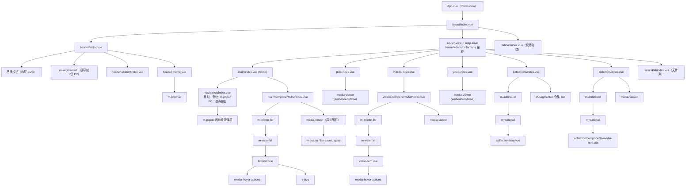

# 02 页面设计
> 项目：PEXELS 壁纸应用 ｜ 版本：v1.0 ｜ 生成日期：2026-10-06 ｜ 依据：源码分析

## 1. 路由与页面总表

路由表位于 `src/router/index.ts`，使用 `createWebHistory`，全站仅两级：一级是 `layout` 骨架，二级是 6 个业务页面；另有独立的 404 页与 catchAll 重定向。所有页面组件均路由级懒加载（`() => import(...)`）。

| 路由路径 | 路由名 | 页面组件 | keep-alive | 布局职责 |
| --- | --- | --- | --- | --- |
| `/` | home | `src/views/main/index.vue` | 是（CACHE_NAMES） | 图片瀑布流首页：分类导航 + 无限滚动列表 + 图片详情弹层 |
| `/pins/:id` | pins | `src/views/pins/index.vue` | 否 | 图片详情直达页：刷新/直链进入时独立加载单张图片并复用弹层（`embedded=false`，`exitPath='/'`） |
| `/videos` | videos | `src/views/videos/index.vue` | 是 | 视频页：无关键词热门视频、有关键词搜索结果 |
| `/videos/:id` | video | `src/views/video/index.vue` | 否 | 视频详情直达页（`embedded=false`，`exitPath='/videos'`），支持清晰度切换 |
| `/collections` | collections | `src/views/collections/index.vue` | 是 | 合集列表：特色合集/我的合集双 Tab |
| `/collections/:id` | collection | `src/views/collection/index.vue` | 否 | 合集详情：元信息头 + 照片视频混排瀑布流 |
| `/404` | 404 | `src/views/error/404/index.vue` | 否 | 兜底页，「返回首页」按钮 |
| `/:catchAll(.*)` | error | —（redirect） | — | 未匹配路由重定向 `/404` |

骨架 `src/views/layout/index.vue` 的结构是纵向三段：`header-vue`（60px 顶栏，shrink-0）→ `main`（flex-1 min-h-0，二级路由出口）→ `tabbar-vue`（仅 `isMobileTerminal` 时渲染）。路由出口使用作用域插槽写法，`<keep-alive :include="CACHE_NAMES">` 包裹 `<component :is="Component" :key="$route.fullPath" />`——`CACHE_NAMES = ['home', 'videos', 'collections']`，即三个一级导航页常驻缓存，详情直达页（pins/video/collection）不缓存。`include` 按组件 `name` 匹配，因此每个缓存页面都用 `defineOptions({ name: 'home' })` 等显式声明了与路由名一致的 name（`src/views/videos/index.vue` 注释特别指出默认推断名 `index` 会导致 include 无法命中）。

## 2. 布局骨架与全局导航

**Header（`src/views/layout/components/header/index.vue`）**，PC 端从左到右四个元素：品牌按钮（内联绘制的光圈图标 + 渐变底，点击回首页，hover 旋转 -8°）、`m-segmented` 一级导航（图片/视频/集合，仅 PC 渲染）、`header-search-vue`（flex-1，max-w 420px）、`header-theme-vue`。当前激活导航由 `matchMainTabKey(route.path)`（`src/views/layout/components/main-tabs.ts`）按路径前缀计算：`/collections*` → collection，`/videos*` → video，其余（含 `/pins/*`）→ photo。搜索框占位文案随导航变化：「搜索图片」「搜索视频」「搜索图片（合集暂不支持搜索）」。整条 header 高 60px、`bg-white/85 dark:bg-zinc-800/85 backdrop-blur-xl`，注释说明因 `backdrop-blur` 创建独立层叠上下文，根节点必须显式 `relative z-30` 才能压过内容区 `z-10` 的吸顶工具栏。

**移动端 Tabbar（`src/views/layout/components/tabbar/index.vue`）**：底部固定导航，与 PC 的 segmented 共用同一份 `MAIN_TABS` 配置（图标 + label + path），激活项 `text-main`（品牌红 #f44c58）。两端共用配置保证了导航项永不分叉。

**全局搜索（`src/views/layout/components/header/header-search/index.vue`）**：受控输入 `inputValue` 初值取 `appStore.searchText`，并反向 watch store（页面内「清除」按钮清空关键词时输入框同步清空）。回车触发 `onSearchHandler`：若当前在合集 Tab 且有关键词，先 `router.push('/')` 切回图片页再写 store——注释解释这是为了避免"输入了关键词但页面毫无反应"的错觉（合集列表无搜索接口）。

**主题切换（`src/views/layout/components/header/header-theme.vue`）**：`m-popover` 包一个 30px 图标按钮，hover 弹出 140px 菜单，三个选项（极简白/极夜黑/跟随系统）写入 `useThemeStore().changeThemeType`。按钮图标随当前主题变化，`svgIconName` 计算属性兜底取第一项的 icon。

## 3. 核心页面逐个说明

### 3.1 图片首页 `/`

`src/views/main/index.vue` 是滚动容器（`h-full overflow-auto`），内部两段：`sticky top-0 z-10` 的吸顶工具栏（内嵌分类导航，毛玻璃背景）与 `max-w-7xl` 的列表区。页面用 `useScrollRestore()`（`src/utils/helpers.ts`）恢复滚动位置——keep-alive 缓存组件的 DOM 会被移出文档导致 scrollTop 归零，该 composable 在 `onActivated` 时用 `useScroll` 记录的 `y` 写回 `scrollTop`。

**分类导航（`src/views/main/components/navigation/index.vue`）** 两端两套模板：移动端是横向滚动的 `<ul>` + 绝对定位滑块（`sliderStyle` 由选中项的 `getBoundingClientRect` 与 `ulScrollLeft` 计算得出）+ 右侧固定的汉堡按钮（点击开 `m-popup` 底部弹层展示全部分类，`h-[80vh]` 可滚动）；PC 端是一排 46px/52px 高的文字按钮，选中项底部有 15px 宽的"墨条"从中心展开。数据来自 `useCategoryStore().categories`（13 项本地静态词表），点击调用 `appStore.changeCurrentCategory(item)`（同时清空 searchText）。

**列表容器（`src/views/main/components/list/index.vue`）** 是全站最核心的业务组件，状态机为 `isLoading / isFinished / hasError / pexelsList` 四个 ref + 非-响应式的 `query` 对象与 `requestSequence` 序号。`getPexelsData` 负责按 `query` 请求 `getPexelsList` 并按序号丢弃过期响应；`resetQuery` 在分类/搜索变化时清空重来并**显式发起请求**（注释：不依赖"清空后 loading 元素重新进视口"的副作用，否则首屏已铺满时不会刷新）。瀑布流列数响应式梯度为 `[{0,2},{640,3},{1024,4},{1280,5}]`。卡片点击打开 `media-viewer`（异步组件），并把被点卡片的中心点坐标作为放大动画起点。

**图片卡片（`src/views/main/components/list/item.vue`）**：容器背景色 `computed(() => props.data.avgColor || randomTint())`（注释说明用 computed 而非模板内联，避免瀑布流每次重排所有卡片换色闪烁）；`img` 高度按 `(列宽/原图宽)×原图高` 推算，保证图片加载前布局即稳定；`v-lazy` 懒加载；PC 端 hover 出现 `media-hover-actions`（下载原图 + 复制链接，文件名 `pexels-{id}.{ext}`，扩展名从原图 URL 推导）。

### 3.2 视频页 `/videos`

`src/views/videos/index.vue` 吸顶工具栏左侧固定「视频」标题；右侧根据 `appStore.searchText` 切换两种形态：无关键词显示「热门视频」，有关键词显示「“xxx”的搜索结果 + 清除按钮」。页面把 `mode`（popular/search）与 `query` 作为 props 传给 `src/views/videos/components/list/index.vue`，后者结构与首页列表一致（infinite-list + waterfall + media-viewer），差异有三点：每页 18 条；列数梯度少一档（最多 4 列）；请求在 `searchVideos` 与 `getPopularVideos` 之间二选一。`applied` 初值为 `{mode: null, query: null}` 并对 props watch `immediate: true`，保证首帧必然发起首次加载。视频卡片 `video-item.vue` 在封面右下角叠加时长标签（`formatDuration`），hover 时中心浮现播放按钮；下载地址由 `pickVideoFile` 挑选默认清晰度，文件名固定 `pexels-{id}.mp4`。

### 3.3 视频详情直达页 `/videos/:id`

`src/views/video/index.vue` 极薄：watch `route.params.id`（immediate）→ `getVideoById` → `viewerItems = toViewerItems([video])` → `viewerIndex = 0` 打开弹层（`embedded=false`）。加载失败 `message('error', ...)`。关闭时优先 `router.back()`，无历史则 `router.push('/videos')`。

### 3.4 合集列表 `/collections`

`src/views/collections/index.vue` 吸顶工具栏含标题「合集」+ `m-segmented` 双 Tab（featured 特色合集 / mine 我的合集）+ 条件提示文案（我的合集为空时显示"当前账号暂无合集 / 需要在 Pexels 登录"）。每页 12 条（注释：N+1 封面策略下把单页配额消耗从 1+18 降到 1+12）。列表卡片 `collection-item.vue` 的封面是本页设计重点：Pexels 合集接口不返回封面，卡片用 `useIntersectionObserver`（rootMargin 200px）观察封面容器，进入视口才调用 `requestCover(id, cb)` 入队拉取（详见 05 核心流程）；`img` 始终渲染、用 `v-show` 控制显隐（注释：`v-if` + 动态 src 场景下浏览器可能不把图片识别为"应进入视口"而永不加载）；封面右下角覆盖「N 张 / N 个视频」统计胶囊，私密合集左上角显示琥珀色「私密」标签。卡片 DOM 按下标复用，因此 watch `data.id` 在本卡已相交时立即重取封面。

### 3.5 合集详情 `/collections/:id`

`src/views/collection/index.vue` 吸顶头部显示合集标题与「N 张照片 · N 个视频」统计；元信息来自 `loadCollectionMeta`——先查模块缓存（`getCachedCollectionMeta`），未命中则在特色合集中最多翻 3 页×80 条按 id 匹配，再兜底查我的合集；查不到时展示「合集 ID：xxx（未在特色/我的合集中找到，已展示其全部内容）」。媒体区是照片与视频混排的瀑布流，`media-item.vue` 按 `data.type` 分支渲染（视频叠加时长/播放按钮，标题/副标题字段不同），点击统一在 `media-viewer` 内查看（注释：不再把照片踢到 /pins 路由，合集内左右切换才连续）。路由参数变化（合集 A→B）时 watch 触发 `resetQuery`。

### 3.6 图片详情直达页 `/pins/:id` 与 404 页

`src/views/pins/index.vue` 与视频详情页同构：按路由 id 调 `getPexelsFromId`，单元素列表交给弹层（`exitPath='/'`）。404 页 `src/views/error/404/index.vue` 居中显示大号「404」与提示文案，`m-button` 返回首页。

## 4. 组件树



`src/libs/index.ts` 通过 `import.meta.glob(['./*/index.vue', '!**/message/index.vue'])` 把 m-button、m-popup、m-popover、m-segmented、m-waterfall、m-infinite-list 全部注册为**异步**全局组件（模板里无需 import）；message 例外，它通过 `message()` 函数命令式渲染（`src/libs/message/index.ts` 用 `h` + `render` 挂独立容器到 body，避免多条消息互相覆盖，并按 `visibleCount` 依次下移 44px）。

## 5. Pinia 状态管理设计

状态层刻意保持极薄，三个 store 全部定义在 `src/store/index.ts`（Options 风格），pinia 实例挂载 `pinia-plugin-persistedstate`。

| Store | state | actions | 持久化 | 消费方 |
| --- | --- | --- | --- | --- |
| app | `currentCategory: CategoryItem`（默认「全部」）、`searchText: string` | `changeCurrentCategory`（同时清空 searchText）、`changeSearchText` | 否 | navigation、header-search、三个列表页 watch |
| category | `categories: CategoryItem[]`（初值含「全部」的完整词表） | `setCategories`（自动头部插入「全部」）、`useCategoryData`（本地静态化，异步空壳） | 否 | navigation |
| theme | `themeType: ThemeType`（默认 light） | `changeThemeType` | `persist: true`（localStorage） | header-theme、utils/theme.ts |

设计要点：**全局状态只放"跨页面意图"**——当前分类与搜索词是首页与视频页共享的筛选条件，主题是全站外观，其余一切（分页游标、列表数据、弹层下标、请求序号）都是页面局部 ref，随组件销毁或缓存清理。**搜索与分类的互斥语义**内聚在 `changeCurrentCategory` 里（切分类必清搜索词），列表页再把两个字段合并为单一 watch 入口（`src/views/main/components/list/index.vue` 的 `syncWithStore`），避免"切分类不清搜索词导致列表不变"与"一次操作连发两次请求"两个缺陷。**持久化只有一项**：theme store 刷新后由插件从 localStorage 还原，`src/utils/theme.ts` 的 `watch(themeType, changeTheme, { immediate: true })` 在应用启动时立即应用一次。

## 6. 关键 UI 交互流程

**详情弹层的打开/关闭与地址同步**（`src/components/media-viewer/index.vue`）：

```mermaid
flowchart TD
    A[点击卡片<br/>viewerIndex=i] --> B[gsap 进场：从卡片中心点<br/>scale 0→1 + 位移归零]
    B --> C{embedded?}
    C -->|是| D["pushState('/pins/:id' 或 '/videos/:id')<br/>保留 history.state"]
    C -->|否| E[地址已是详情路由，不动]
    D --> F[展示媒体]
    F --> G{操作}
    G -->|左右按钮/方向键/滑动| H["切换 modelValue<br/>replaceState 更新地址"]
    G -->|接近末尾 3 项| I[emit load-more 预加载下一页]
    G -->|Esc / 关闭 / popstate 后退| J[关闭流程]
    H --> F
    I --> F
    J --> K{是本组件 push 的地址?}
    K -->|是| L[history.back() 回列表]
    K -->|否 embedded=false| M{history.state.back 存在?}
    M -->|是| N[router.back]
    M -->|否| O["router.push(exitPath)"]
```

**移动端触屏与键盘适配**：弹层媒体区监听 `touchstart/touchend`（passive），水平位移 ≥50px 且大于垂直位移才切换，避免与纵向滚动冲突；键盘 Escape 关闭、←/→ 切换（`useEventListener(window, 'keydown')`）。视频播放用原生 `<video controls autoplay playsinline>`，`:key` 含清晰度序号，切换清晰度即重建节点；清晰度胶囊仅当可播放文件多于 1 个时展示。

**响应式与样式基座**：`src/styles/index.css` 设定根字号 `min(10vw, 40px)`——移动端 1rem≈视口宽 1/10，`@theme` 里的字号（`--text-xs: 0.25rem` 等）随视口缩放；`vite.config.ts` 的 px-to-viewport 把 `.vue` 内裸 px 转 vw（375 设计稿），两者叠加实现整页流式缩放。桌面断点用 Tailwind `xl:`（1280px）变体写死像素级细节（如 `w-[15px]` 墨条、`xl:h-4` 按钮），且 `mediaQuery: false` 保证断点内 px 不被转换。README 的「设计约定」强调两条红线：精确尺寸用任意值 px（Tailwind rem 间距在本项目约为常规 2.5 倍）；lucide 描边图标一律 `text-*` 上色，禁用 `fill-*`（会把描边图形涂成实心色块）。

**可访问性与语义化**：虽是小工具，组件层的语义标签使用得相当规矩。`m-segmented` 的每个选项是 `role="tab"` 且带 `aria-selected`（`src/libs/segmented/index.vue`）；主题按钮有 `aria-label="切换主题"`；全部可点击元素统一用 `<button type="button">`（避免表单内误触发提交）；`media-viewer` 的"原页"外链带 `rel="noreferrer"`；视频播放用 `playsinline` 阻止 iOS 全屏接管。键盘侧弹层支持 Escape 关闭与方向键切换，配合 focus 后的搜索框高亮环（`focus:shadow-[0_0_0_3px_...]`），构成基础的无障碍底线。

**层叠上下文与弹层卫生**：全站的 z 轴约定是——吸顶工具栏 `z-10`、`m-popup` 蒙版 `z-40`、消息与详情弹层 `z-50`、header `z-30`。header 的 `z-30` 不是随意的：`src/views/layout/components/header/index.vue` 注释说明 `backdrop-blur-xl` 会创建独立层叠上下文，若不给 header 显式提高层级，它内部的弹层永远压不过内容区 `z-10` 的工具栏。弹层的"状态卫生"同样被注释反复强调：`m-popup`（`src/libs/popup/index.vue`）teleport 到 body，蒙版点击关闭，`useScrollLock` 锁定 body 滚动，并在 `onUnmounted` 与 `onDeactivated` 双保险解锁——keep-alive 页面离开只触发 deactivated，漏掉解锁会让整站永久不可滚动；`m-popover`（`src/libs/popover/index.vue`）hover 展开、200ms 延迟关闭防抖，四向 placement 在展开后的 `nextTick` 里按触发元素与内容的尺寸计算，并过滤空插槽避免"无内容也弹层"。

**滚动体系的分工**：页面滚动容器不是 body 而是各页面自己的 `div.h-full.overflow-auto`（如 `src/views/main/index.vue`），这个决定连带影响了三个模块——瀑布流必须向上查找滚动祖先绑定 scroll 监听（`findScrollParent`），`useScrollRestore` 绑定的是该容器 ref，`m-infinite-list` 的 IntersectionObserver 以视口为根。改动布局时若引入新的滚动容器，务必确认这三处仍然指向同一个元素。
