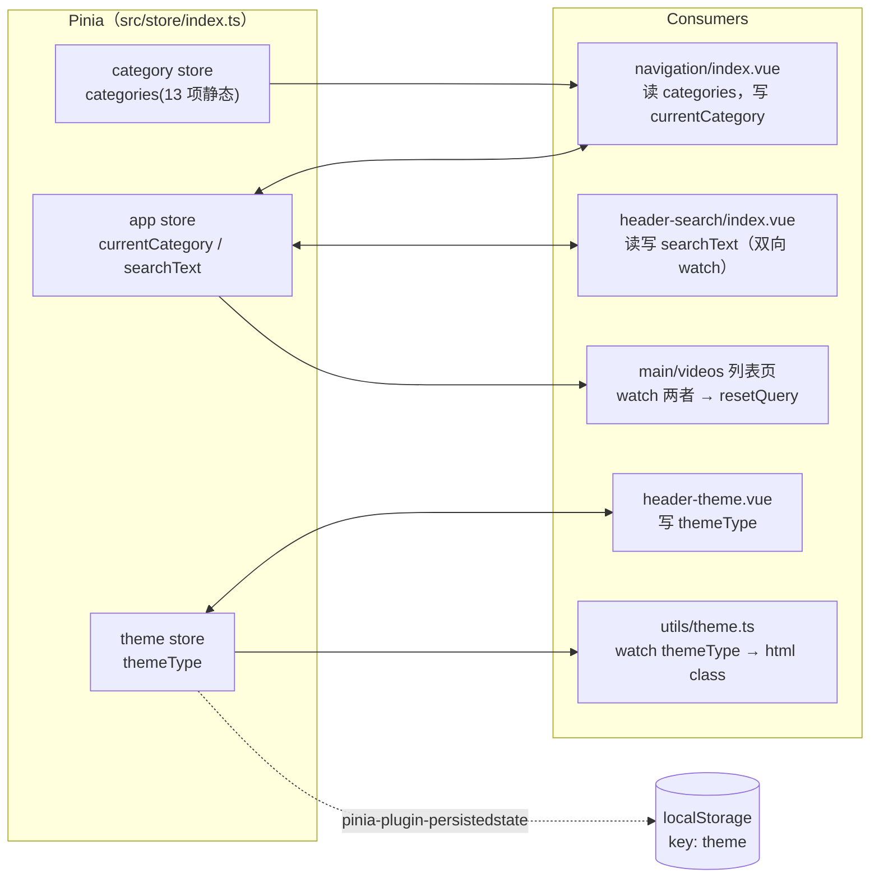
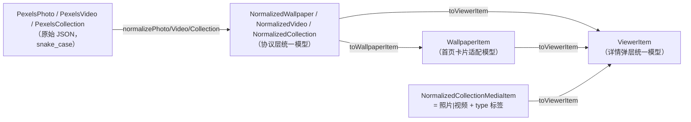
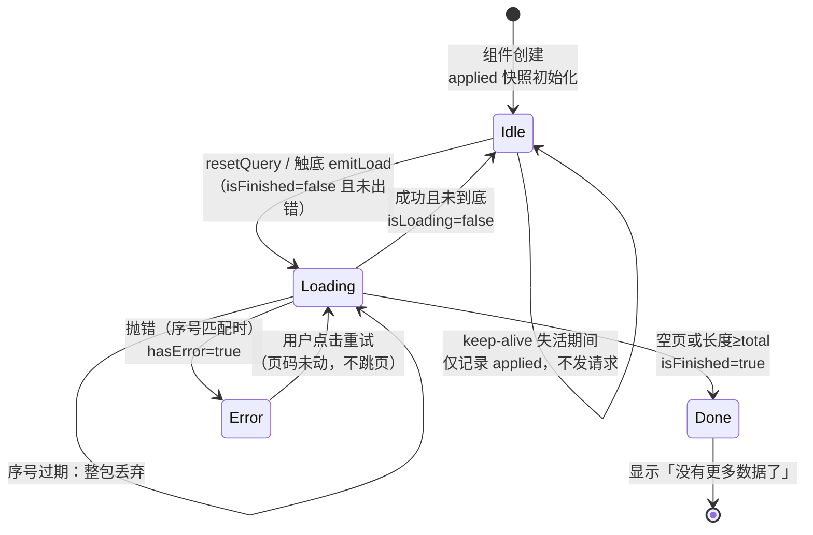
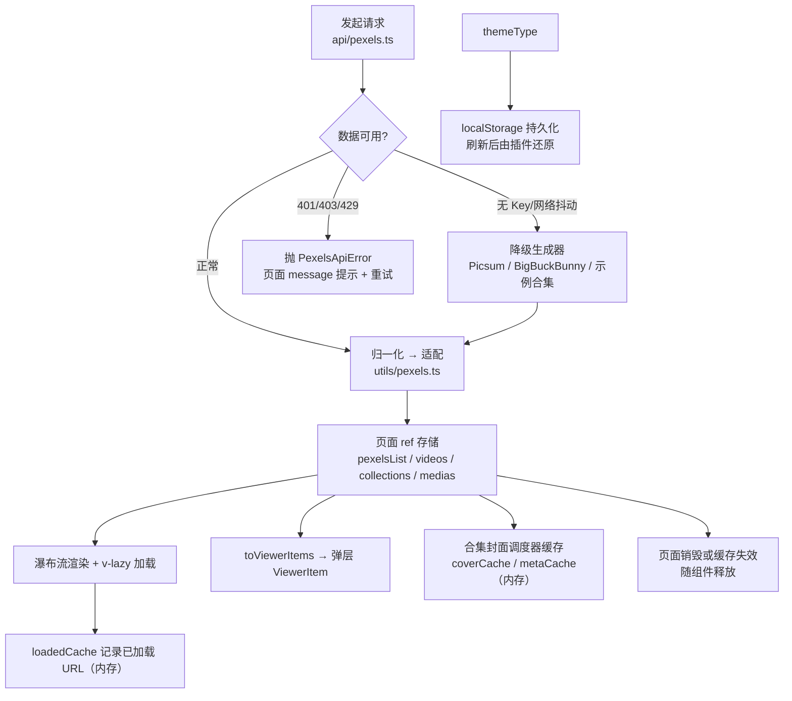

# 04 数据模型
> 项目：PEXELS 壁纸应用 ｜ 版本：v1.0 ｜ 生成日期：2026-10-06 ｜ 依据：源码分析

本项目的数据模型可以概括为"**四层流水线 + 一份持久化**"：Pexels 原始结构（协议层，`src/utils/pexels.ts`）→ 归一化模型（同文件）→ 适配模型（`WallpaperItem` / `ViewerItem`）→ 组件局部状态（页面 ref）；持久化则只有主题一项（localStorage）。没有收藏、浏览历史等业务持久化——README 明确说明这些能力已随账号体系移除，"只有主题持久化，其余状态仅存于内存"。

## 1. Pinia store 状态结构

三个 store 全部定义在 `src/store/index.ts`，Options 风格。

| Store | 字段 | 类型 | 初值 | 说明 |
| --- | --- | --- | --- | --- |
| app | `currentCategory` | `CategoryItem` | `ALL_CATEGORY_ITEM`（`{id:'all', name:'全部'}`） | 当前选中分类；`changeCurrentCategory` 同时清空 searchText |
| app | `searchText` | `string` | `''` | 全局搜索词；图片/视频页 watch 它触发列表重置 |
| category | `categories` | `CategoryItem[]` | `CATEGORY_NOMAR_DATA` 副本 | 13 项本地静态词表；`setCategories` 会把「全部」插到头部；`useCategoryData` 是本地化后的异步空壳（保留调用形状） |
| theme | `themeType` | `ThemeType`（`'light'\|'dark'\|'system'`） | `THEME_LIGHT` | 唯一持久化 store（`persist: true`） |

配套常量类型（`src/constants/index.ts`）：

```ts
export interface CategoryItem { id: string; name: string }
export const CATEGORY_NOMAR_DATA: CategoryItem[] = [
  ALL_CATEGORY_ITEM,                       // {id:'all', name:'全部'}
  { id:'nature', name:'自然' }, { id:'landscape', name:'风景' },
  { id:'city', name:'城市' },   { id:'animal', name:'动物' },
  { id:'people', name:'人物' }, { id:'abstract', name:'抽象' },
  { id:'minimalist', name:'极简' }, { id:'dark', name:'暗黑' },
  { id:'space', name:'太空' },  { id:'ocean', name:'海洋' },
  { id:'forest', name:'森林' }, { id:'mountains', name:'山川' }
]
export const THEME_LIGHT='light'; export const THEME_DARK='dark'; export const THEME_SYSTEM='system'
export type ThemeType = typeof THEME_LIGHT | typeof THEME_DARK | typeof THEME_SYSTEM
```

注释记录了一个历史缺陷：早期词表后 4 项 id 全部误写成 `industrial_design`，列表 `:key="item.id"` 报重复 key、`findIndex` 定位永远命中第一项，选中滑块错位——因此注释强调"id 即 Pexels 搜索 query 词，必须唯一"。



## 2. 本地持久化结构

**唯一的持久化条目是主题**。`pinia-plugin-persistedstate` 默认以 store id 作为 localStorage key、序列化整个 state，因此浏览器里只有一条记录（近似）：

```
key:   "theme"
value: {"themeType":"dark"}          // light / dark / system 三选一
```

`src/utils/theme.ts` 在应用启动时（`main.ts` 调用 `useTheme()`）`watch(themeType, changeTheme, { immediate: true })`：恢复的值被立即翻译成 `<html>` 上的 `light`/`dark` class，无需等任何用户交互。除此之外：

- **内存级缓存**：`src/utils/pexels-collection-cache.ts` 的 `coverCache: Map<string,string>`（合集封面 URL）、`metaCache: Map<string,unknown>`（合集元信息）、`waiters`/`queue`/`enqueued`（调度状态）与 `loadedCache: Set<string>`（`src/directives/modules/lazy.ts` 已加载图片 URL）全部是模块级单例，跨组件共享、刷新即失。
- **页面级状态**：每个列表页的 `query/req`（分页游标）、`pexelsList/videos/collections/medias`（已加载数据）、`requestSequence`（请求序号）、`viewerIndex/viewerOrigin`（弹层状态）都是组件内 ref 或普通变量，不进 store。
- **History 栈**：`media-viewer` 用 `pushState/replaceState` 把详情地址写入浏览器历史（`history.state` 被刻意保留，注释说明 vue-router 在其中存放滚动位置等信息），构成一种"可后退的弹层状态"。刷新后由 `/pins/:id`、`/videos/:id` 路由的独立页面接管。

## 3. 媒体数据实体

### 3.1 数据形态流水线



### 3.2 核心实体字段说明

**NormalizedWallpaper**（`src/utils/pexels.ts`）——协议层照片模型：

| 字段 | 类型 | 说明 |
| --- | --- | --- |
| `id` | string | Pexels 数字 id 转字符串；降级数据为 `fallback-{n}` |
| `url` / `thumb` | string | 展示大图（large2x→large→original 逐级回退）/ 列表缩略（medium→small） |
| `description` | string | `alt` 缺失时兜底「壁纸 {id}」 |
| `author` / `authorUrl` / `authorId` | string/number | 摄影师信息 |
| `width` / `height` | number | 原始尺寸，卡片按宽高比推算展示高度 |
| `src` | 8 档尺寸对象 | original/large2x/large/medium/small/portrait/landscape/tiny |
| `pexelsUrl` | string | Pexels 原页地址（弹层「原页」外链）；降级为空串 |
| `avgColor` | string | 平均色，卡片加载占位底色 |
| `liked` | boolean | Pexels 点赞态，仅展示透传（本项目无点赞功能） |

**WallpaperItem**（同文件 `toWallpaperItem`）——首页瀑布流卡片专用适配：`photo`（=url）、`photoWidth/photoHeight`、`title`（=description）、`author`、`avatar`（**恒为空串**，注释：Pexels 照片接口不返回摄影师头像，组件 v-if 兜底隐藏）、`photoDownLink`（=src.original）、`liked`、`avgColor`、`pexelsUrl`、`photographerUrl`。这个形状是为兼容改造前的旧后端接口而保留的，首页组件因此零改动。

**NormalizedVideo**——协议层视频模型：`id`（字符串化）、`url`（Pexels 页面地址）、`image`（预览封面）、`duration`（秒）、`width/height`、`user{id,name,url}`、`videoFiles: PexelsVideoFile[]`（`{id, quality:'hd'|'sd'|'hls', file_type, width, height, fps?, link}`）、`videoPictures: PexelsVideoPicture[]`（`{id, picture, nr}` 预览帧，本项目仅透传未消费）。

**NormalizedCollection**——`{id, title, description, mediaCount, photosCount, videosCount, private, cover?}`；`cover` 不由协议层填充，由封面调度器按需回填到卡片局部状态。

**NormalizedCollectionMediaItem**——联合类型：`(NormalizedWallpaper & {type:'photo'}) | (NormalizedVideo & {type:'video'})`，`src/utils/pexels.ts` 的 `normalizeCollectionMediaResponse` 按 Pexels 的 `type: 'Photo'|'Video'` 判别字段分派归一化。

**ViewerItem**（`src/utils/viewer.ts`）——详情弹层统一模型：`{id, type:'photo'|'video', src`（大图或播放地址）`, poster, width, height, title, author, avatar, downloadUrl, sourceUrl, avgColor, duration`（图片为 0）`, videoFiles`（图片为空数组）`}`。`toViewerItem` 用鸭子测试判别来源（唯一带非空 `videoFiles` 的即视频），并按三种来源形状分别取数：视频经 `pickVideoFile` 选默认清晰度（过滤 `video/*` 之外如 HLS，优先 hd，否则宽度最大）；首页卡片走 `photo/photoWidth/photoDownLink` 字段；其余照片走 `src.original || src.large2x || url`。

**CategoryItem / ThemeType / MainTab**——见第 1 节；`MainTab`（`src/views/layout/components/main-tabs.ts`）为 `{key, label, path, icon: Component}`，是导航配置而非业务数据。

这些实体的字段取舍都有一致的原则，理解原则比背字段更有用。**id 一律字符串化**（`String(p.id)`）：页面层大量使用 `String(it.id) === String(item.id)` 做查找比对，字符串化在归一化时一次完成，避免路由参数（`route.params.id` 天然是 string）与数字 id 的类型对不上。**avatar 恒为空串**：Pexels 照片接口不返回摄影师头像，`toWallpaperItem` 注释写明"avatar 置空串，由组件 v-if 兜底隐藏"——保留字段而不是删掉，是为了兼容历史组件模板。**avgColor 是一等公民**：它同时服务卡片占位底色（加载前的视觉占位）与弹层大图底色（`media-viewer` 的 img 背景），降级数据没有该值时由 `randomTint()` 生成低饱和随机淡彩兜底。**src 八档尺寸全量透传**：协议层不擅自决定用哪档（只在 `url`/`thumb` 里给了推荐档），下载、portrait 场景等仍可按需取用原始 src。**videoFiles 原样保留**：清晰度选择、下载地址、可播放判断全都依赖这份文件列表，归一化只补空数组兜底、不做任何裁剪。

**ViewerItem 的派生规则**再展开一步：`src/utils/viewer.ts` 的 `toViewerItem` 是三入一出——视频来源（`NormalizedVideo` 或带 type 标签的混排项）经 `pickVideoFile` 得到默认播放地址，标题兜底「{作者} 的视频」或「Pexels 视频」，下载地址即当前选中清晰度的 link；首页卡片来源（`WallpaperItem`）以 `'photo' in item` 判别，字段名整体平移（photo→src、photoWidth/photoHeight→width/height、photoDownLink→downloadUrl）；其余照片来源按 `src.original → src.large2x → url` 的顺序取大图。所有缺失字段统一回退空串/0，弹层模板因此没有任何判空表达式。视频时长 `duration` 对照片恒为 0，信息区据此用 `v-if` 决定是否显示时长段。

## 4. 页面级状态机（列表页通用模型）

三个列表页（图片首页、视频列表、合集列表/详情）共享同一套非 store 的局部状态模型，字段虽分散在各组件，形态完全一致：



该模型的四条不变量：`isLoading` 无论成败必须复位（`finally` 块，注释警告不复位会让 infinite-list 永远不再触发）；页码只在成功后自增；过期序号的响应与错误都静默丢弃；组件卸载时 `requestSequence += 1` 终结全部在途写回。合集列表页在此基础上多了 `activeTab` 维度（watch 它触发 `resetQuery`），合集详情页多了 `route.params.id` 维度（watch 路由参数触发重置）与 `metaLoading`（区分"加载中"与"查不到"两种头部文案）。

## 5. 内存缓存结构明细

两处模块级缓存承担跨组件的数据复用，刷新即失是它们的共同契约：

**封面调度器缓存**（`src/utils/pexels-collection-cache.ts`）：`coverCache: Map<合集id, 封面URL>` 只在成功取到封面时写入，失败绝不写（注释：下次仍可重试）；`metaCache: Map<合集id, NormalizedCollection>` 的唯一写入点是合集详情页元信息匹配成功时；`waiters: Map<id, Set<回调>>` 是同一封面多个订阅者的登记表（列表页同一合集可能出现多张卡的滚动重建场景）；`queue: string[]` 与 `enqueued: Set<string>` 组成"待拉取 + 已登记"对，保证同一 id 不会重复入队；`rateLimited / rateLimitUntil / rateLimitNotified` 三个布尔与时间戳构成熔断状态机，`isRateLimited()` 在每次读取时惰性判断冷却是否到期并自动复位。

**懒加载缓存**（`src/directives/modules/lazy.ts`）：`loadedCache: Set<图片URL>` 只在 `load` 事件成功后登记（`{ once: true }` 的一次性监听），失败的图片不进缓存，滚回视口时仍可重试；配套的 `stateMap: WeakMap<HTMLImageElement, LazyState>` 挂在元素上记录真实地址与观察器停止函数，`updated` 钩子据此处理 `:src` 动态变化（注释：地址只能以 binding.value 为准，读 el.src 会把透明占位图误当新地址）。

## 6. 数据生命周期



逐条说明生命周期规则：

1. **请求产物**：进入页面 ref 后，仅存在两种出口——同数组追加（无限滚动 push）或整体替换（切分类/搜索时重新赋值）。`m-waterfall` 靠"数组引用是否变化 + 长度是否变化"区分这两种情形，决定全量重排还是追加重排（`src/libs/waterfall/index.vue` 的 watch 注释）。
2. **弹层视图数据**：`viewerItems` 是 `computed(() => toViewerItems(列表))`，不复制数据，列表更新时弹层同步更新；`viewerIndex` 关闭后置 -1。
3. **内存缓存**：封面与合集元信息缓存命中后不再发请求，但仅存活于当前页面会话；`metaCache` 的写入点在合集详情页 `loadCollectionMeta` 成功匹配时（`src/views/collection/index.vue`）。
4. **持久化**：只有 `themeType`。刷新后：主题由插件还原、一切列表与缓存复位、若 URL 是详情路由则由直达页重新请求单条数据重建弹层。
5. **失效与竞态防护**：`requestSequence` 保证过期响应不写回（组件卸载时再 +1 一次）；页码成功后自增保证重试不跳页；`isFinished` 判定用 `>=` 而非 `===`（`src/views/main/components/list/index.vue` 注释：Pexels 返回条数可能轻微超出被截断的 total，`===` 会永不成立导致无限翻页）。

**按数据类型细看生命周期**。图片列表数据（`WallpaperItem[]`）的旅程最短：请求 → 归一化适配 → 列表 ref → 瀑布流/弹层双向消费，缓存失效即整体替换，从不回写。视频数据多一段"清晰度决策"：`videoFiles` 原样存进弹层模型，`qualityIndex` 这类选择状态属于 UI 层、不污染数据。合集数据分两股：元信息走 `metaCache` 长期复用（本次会话内跨页面有效），封面走 `coverCache` + 队列，两者都只增不清（Map 无淘汰策略，数据量以百计，内存可忽略）。主题数据独享持久化通道，写读都经插件之手，业务代码只与 store 打交道。值得强调的是"不存在"的数据：收藏、浏览历史、搜索历史、用户偏好（除主题外）在本项目里没有任何落点——README 明示无账号体系后这些能力已整体移除，若未来要恢复，需重新引入持久化 store 并评估 `pinia-plugin-persistedstate` 的 `pick` 选项（4.x 语法，见 `docs/dependency-upgrade-plan.md` 踩坑记录）。

## 7. 类型声明的组织

`src/env.d.ts` 是"模块文件"（有顶层 import/export），承载 `ImportMetaEnv` 的全局声明（`VITE_PEXELS_API_KEY`、`VITE_PEXELS_PROXY_BASE`，以及已无读取方的遗留声明 `VITE_BASE_API`、`VITE_APP_SECRET`）与 `@vue/runtime-core` 模块增强；文件头注释解释了"模块增强 vs 环境模块声明"的区别，并说明刻意**不**声明 `declare module '*.vue'` shim——那会把所有 SFC 类型抹平成 `DefineComponent<Record<string, unknown>, ...>`，让 `vue-tsc` 的模板检查形同虚设。`src/types/vendor.d.ts` 是全局脚本，目前只剩历史遗留的 `md5` 模块声明（依赖已随账号体系移除，`package.json` 中已不存在该依赖，属待清理项）。业务类型不做全局注册，统一从 `@/utils/pexels`、`@/utils/viewer`、`@/constants` 具名导入。
