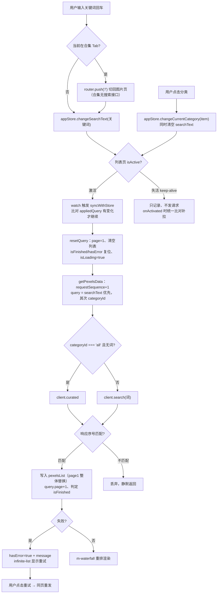
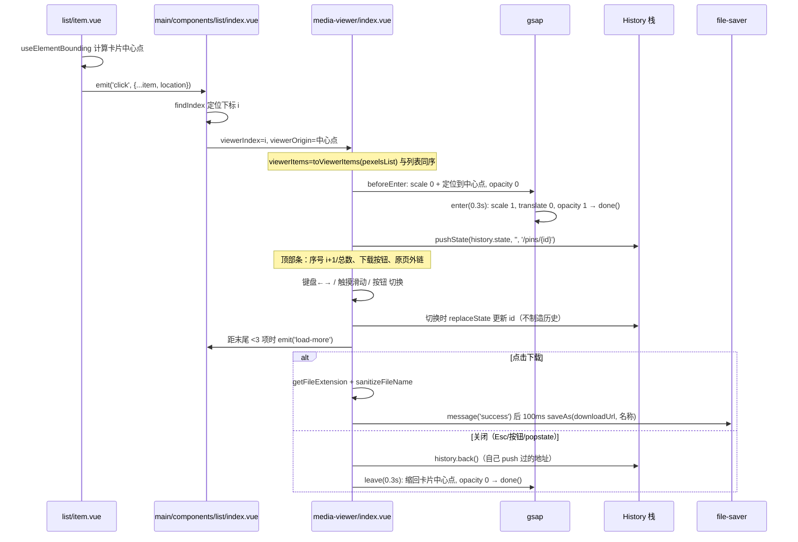
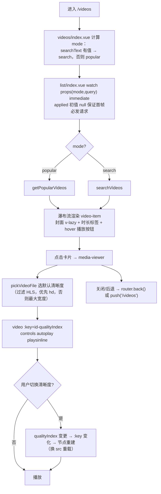
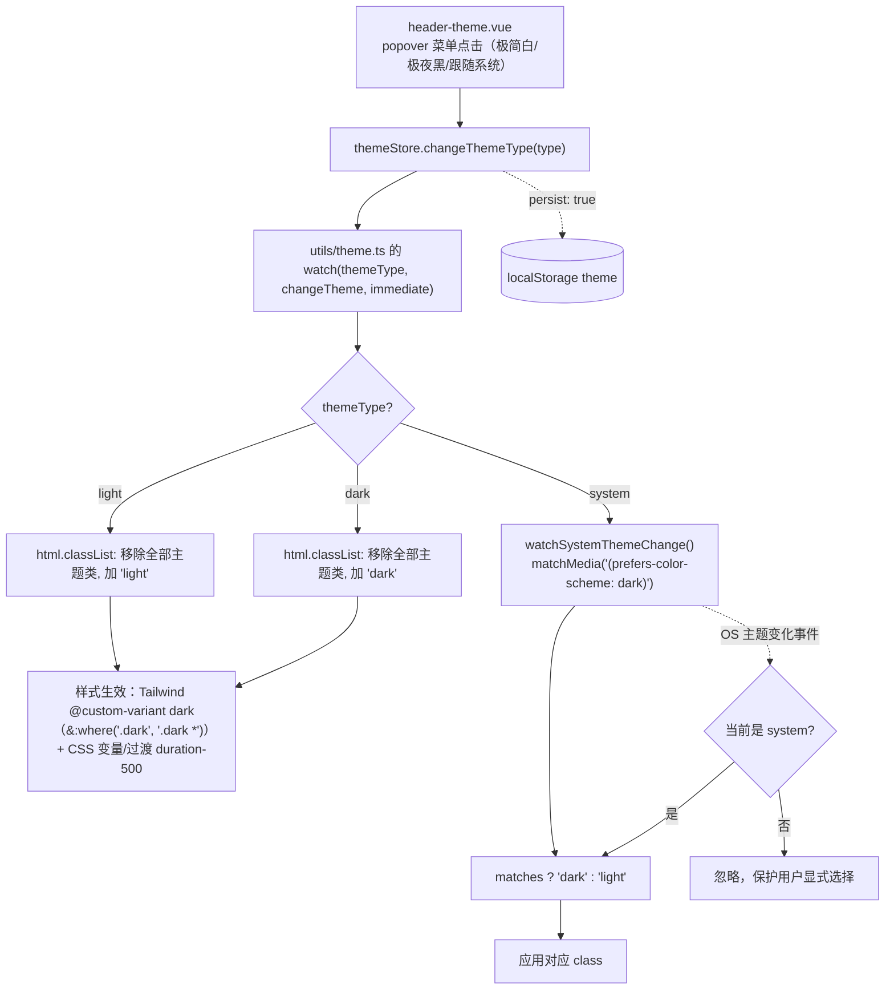
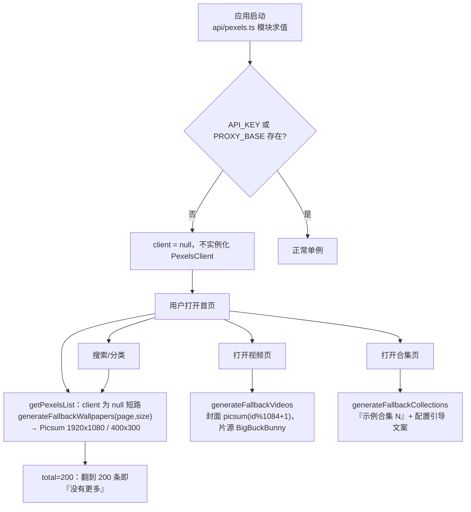
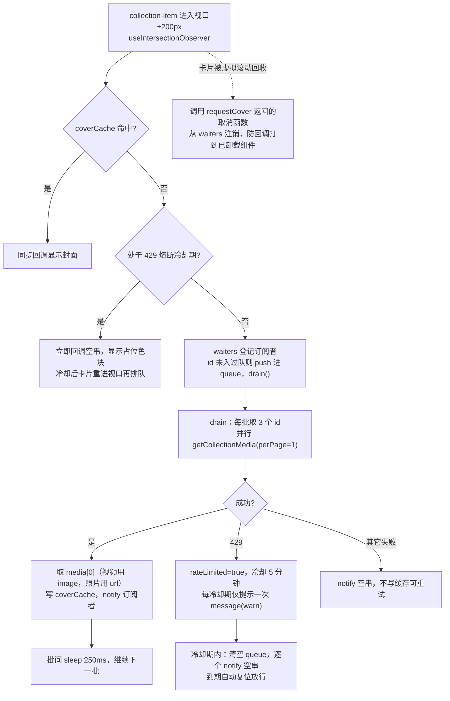

# 05 核心流程
> 项目：PEXELS 壁纸应用 ｜ 版本：v1.0 ｜ 生成日期：2026-10-06 ｜ 依据：源码分析

本文选取 5 条贯穿多个模块的端到端流程：图片搜索浏览、图片详情与下载、视频浏览与播放、主题切换、无 Key 降级。每条流程配流程图/时序图、分步说明与涉及文件清单。01 篇已给出的"首页端到端时序图"不再重复，这里补充它未覆盖的分支与细节。

## 1. 图片搜索与分类浏览

**触发点**：顶部搜索框回车（`src/views/layout/components/header/header-search/index.vue`）或点击分类（`src/views/main/components/navigation/index.vue`）。

分步要点：

1. **双入口单出口**：搜索与分类都只改 store，列表页把 `[currentCategory.id, searchText]` 合并成一个 watch（`src/views/main/components/list/index.vue` 的 `syncWithStore`），并用 `appliedQuery` 快照做去重——注释说明拆成两个 watch 的两个缺陷（接口里 searchText 优先于 categoryId，切分类不清词时列表不变；一次操作连发两次请求）。
2. **请求词路由**：`getPexelsList`（`src/api/pexels.ts`）内部 `query = searchText.trim() || categoryId(非 'all')`，两者皆空走 `/curated`，否则走 `/search`。
3. **收敛条件**：`list.length === 0 || 已加载 >= total` 判定完成（用 `>=` 防 total 截断后的永不收敛）；`isFinished` 后 `m-infinite-list` 显示"已经没有更多数据了!"。
4. **首屏铺满问题**：`m-infinite-list` watch loading 归零后 `nextTick` 再 `emitLoad` 一次（`src/libs/infinite-list/index.vue`），解决首屏未铺满时 IntersectionObserver 不再触发的死等。

涉及文件：`src/views/layout/components/header/header-search/index.vue`、`src/views/main/components/navigation/index.vue`、`src/store/index.ts`、`src/views/main/components/list/index.vue`、`src/api/pexels.ts`、`src/libs/infinite-list/index.vue`、`src/libs/waterfall/index.vue`、`src/views/main/components/list/item.vue`、`src/directives/modules/lazy.ts`。

**本流程的边界与失败分支**：① 分类切换在移动端有第二条路径——汉堡按钮打开 `m-popup` 全分类弹层（`h-[80vh]` 可滚动），点击项同样走 `changeCurrentCategory` 并顺手关闭弹层，与横向滚动条完全等价；② 搜索词与分类词同时存在时，接口侧 searchText 优先（`query = searchText || categoryId`），因此切分类必清搜索词的语义（`changeCurrentCategory` 内置）保证了数据一致性，删掉这行清空逻辑会出现"滑块在动、列表不动"的假死；③ 瀑布流布局失败有一种隐蔽形态——卡片高度为 0（内容无显式高度）时定位错乱，`m-waterfall` 在开发环境一次性 `console.warn` 提醒（`warnZeroHeight` 只告警一次，生产静默）；④ 搜索无结果时 Pexels 返回空 photos，页面表现为"没有更多数据了"+ 空白瀑布流，没有专门的空态插图，属于已知的产品留白。

## 2. 图片详情查看与下载

**入口有三条**：首页卡片点击（嵌入式弹层）、`/pins/:id` 刷新直达（独立页）、合集详情内点击（混排弹层）。以首页路径为例：

分步要点：

1. **动画起点**：卡片用 `useElementBounding`（`src/views/main/components/list/item.vue`）实时记录自身中心点 `{translateX, translateY}` 随点击事件上抛；弹层 `beforeEnter/enter/leave` 三个 JS 钩子（`:css="false"`，注释强调完全依赖 JS 调 `done()`，遗漏则元素永不移除）用 gsap 完成从卡片位置的放大进场与收缩退场；无起点时（刷新直达）退化为纯淡入淡出。
2. **地址同步三分支**（`media-viewer` 的 `watch([visible, modelValue])`）：打开时 pushState；弹层内切换时 replaceState（注释：避免后退变成逐张回退）；`embedded=false`（直达页）不动地址。`popstate` 监听让浏览器后退=关闭弹层。关闭时先取 `hasPushed` 快照再 emit（注释：watcher 会复位它），push 过则 `history.back()`，直达页则按 `history.state.back` 有无决定 `router.back()` 或 `router.push(exitPath)`。
3. **视频清晰度**：`qualities` 计算属性过滤 `file_type` 以 `video/` 开头的可播放文件（HLS 的 m3u8 被排除），切换清晰度通过 `:key` 重建 `<video>` 节点；切换媒体时 `qualityIndex` 归零（watch current.id）。
4. **下载命名**：`getFileExtension` 从 URL pathname 解析扩展名（失败按类型兜底 jpg/mp4）；`sanitizeFileName` 清洗非法字符；标题+作者拼文件名；先弹成功提示、延迟 100ms 再 `saveAs`（注释：让提示先渲染出来）。
5. **快捷下载入口**：PC 端卡片 hover 的 `media-hover-actions`（`src/components/media-hover-actions/index.vue`）提供原图下载与链接复制（`navigator.clipboard`，失败降级提示手动复制），组件 `v-if="!isMobileTerminal"`——移动端无 hover，且弹层内已有同功能入口。

涉及文件：`src/components/media-viewer/index.vue`、`src/views/main/components/list/item.vue`、`src/views/pins/index.vue`、`src/utils/viewer.ts`、`src/components/media-hover-actions/index.vue`、`src/libs/message/index.ts`。

**本流程的边界与失败分支**：① `/pins/:id` 直达页请求失败（含 404、401、429）直接 `message('error')`，弹层不打开（`viewerIndex` 保持 -1），页面呈现纯白底——没有错误占位图，靠提示条告知；② 刷新直达时弹层没有动画起点（`origin` 全零），`hasOrigin` 为假，进场退化为纯淡入淡出（注释：避免从 (0,0) 缩放的突兀感）；③ 弹层打开期间用户再点浏览器前进/后退到另一条详情地址，嵌入式模式只处理 popstate 关闭，不支持跨详情地址切换（路由本身也不在弹层内导航）；④ 下载地址为空时按钮点击弹「该资源暂不支持下载」警告而不发起保存；⑤ 复制走 `navigator.clipboard`，非 HTTPS 环境或旧浏览器会 reject，catch 后提示「复制失败，请手动复制」；⑥ 弹层内当前项的序号显示（`{i+1} / {总数}`）随 `load-more` 预加载实时增长，用户能感知列表仍在变长。

## 3. 视频浏览与播放

分步要点：

1. **双模式页面**：`src/views/videos/index.vue` 的工具栏是状态指示器——无词显示「热门视频」，有词显示「“xxx”的搜索结果 + 清除按钮」（清除调用 `appStore.changeSearchText('')`，输入框经反向 watch 同步清空）。
2. **直达播放**：`/videos/:id`（`src/views/video/index.vue`）watch 路由 id，`getVideoById` 单条数据喂给弹层；有 Key 时请求失败直接抛错提示（`src/api/pexels.ts` 注释：静默返回同一条兜底视频会让用户看到与目标完全无关的内容），无 Key 返回 BigBuckBunny 示例视频保证可播。
3. **页面内弹层**：视频列表页的弹层 `exit-path="/videos"`，加载更多复用同一 `loadMore`（接近末尾 3 项自动预取）。

涉及文件：`src/views/videos/index.vue`、`src/views/videos/components/list/index.vue`、`src/views/videos/components/video-item.vue`、`src/views/video/index.vue`、`src/api/pexels.ts`、`src/utils/viewer.ts`（`pickVideoFile`）、`src/components/media-viewer/index.vue`。

**本流程的边界与失败分支**：① 搜索模式下若关键词为纯空白，`props.query.trim()` 为空，列表回落到热门接口（`isSearch` 判定要求 `mode==='search' && query.trim()`），因此不会出现"搜索态却请求了空 query"的非法请求；② 清晰度切换通过 `:key` 重建 `<video>` 节点而非换 `src`，这会**丢失播放进度**（从头播放），是刻意的简单实现——原生 video 对跨域 m3u8/mp4 的 seek 支持参差，重建节点行为最可控；③ 某些视频只有 HLS 文件时，`qualities` 回退为"只要有 link 的文件"，此时 `<video>` 可能无法播放，属于源数据极端情形的已知取舍；④ 直达页 `getVideoById` 失败（含 404）弹错误提示后页面保持空白，不重试；⑤ 视频卡片下载文件名固定 `pexels-{id}.mp4`（`video-item.vue` 的 `downloadName`），与图片卡片的"从 URL 推扩展名"策略不同，因为 Pexels 视频文件 URL 不带 .mp4 后缀。

## 4. 主题切换

分步要点：

1. **class 而非变量**：主题落地方式是往 `document.documentElement` 加 `light`/`dark` class；`src/styles/index.css` 的 `@custom-variant dark (&:where(.dark, .dark *))` 让所有 `dark:` 工具类跟随该 class 生效（Tailwind 4 默认跟媒体查询，这里显式改为 class 驱动）。
2. **只增删自己的类**：`changeTheme` 先 `classList.remove(...ALL_THEME_CLASSES)` 再 `add`，注释说明早期 `html.className = themeClassName` 的整写会把第三方注入的类一并清空。
3. **system 的两处细节**：监听器只初始化一次（模块级 `matchMedia` 单例）；OS 变更回调里先判断 `themeType === 'system'` 才应用——用户显式选了白/黑后，OS 切换不得覆盖（且此时 store 值未变、watch 也不会纠正）。旧 Safari 用 `addListener` 降级。
4. **持久化与恢复**：store 的 `persist: true`（pinia-plugin-persistedstate）写入 localStorage；应用启动 `main.ts` → `useTheme()` → `watch immediate` 立即应用一次，刷新无闪烁窗口（同一宏任务内完成）。
5. **视觉过渡**：布局根节点与页面容器都带 `duration-500` 过渡类，主题切换时背景色平滑渐变。

涉及文件：`src/views/layout/components/header/header-theme.vue`、`src/store/index.ts`、`src/utils/theme.ts`、`src/constants/index.ts`、`src/styles/index.css`、`src/main.ts`。

**本流程的边界与失败分支**：① 主题按钮的当前图标由 `svgIconName` 计算属性从 `themeArr` 反查，找不到时兜底取第一项的 icon（注释：确保 iconMap 中始终能命中一个图标），theme store 被手动改坏（如 localStorage 塞入非法值）时 UI 不会白屏；② 非法持久化值传到 `changeTheme` 时 switch 落空、`themeClassName` 为空串，函数直接 return，html class 不动——即"非法主题等于维持现状"；③ `watchSystemThemeChange` 的监听器是模块级单例（`matchMedia` 变量判空防重复初始化），从 system 切回 light/dark 后监听仍在，只是回调里的类型判断让它不再生效，不需要卸载；④ 弹出菜单本身是 `m-popover`（hover 触发），移动端没有 hover，实测上触屏点击会先触发 mouseenter 语义，菜单可用但交互偏弱，属于已知的移动端次要体验问题（主要主题入口在移动端依然可达）。

## 5. 无 Key 降级与合集封面限流调度

**5a. 无 Key 静态降级**（首次进入即可观察）：

要点：无 Key 时**零网络请求**（短路在门面层，连错误提示都不产生）；图片、视频、合集三种内容的降级形状与真实数据完全同构（见 03 篇 3.3 节映射表），页面与组件层无任何 `if (降级)` 分支。降级数据的选择也有讲究：Picsum 的 `/id/{n}` 形式保证同一序号恒返回同一张图，瀑布流翻页往回滚时图片不会变脸；封面取 `(id % 1084) + 1` 是因为 Picsum 有效 id 上限约 1084，直接用递增序号会在第 1085 张之后批量 404；视频占位没有用 Picsum 视频（该服务不提供），而是指到 Google 的开源样例桶 BigBuckBunny——它是前端圈事实标准的测试片源，稳定且可直链播放。这一整层是"演示模式"：没有 Key 的人也能完整体验交互，只是内容为假，并在合集卡文案里被明确告知原因。

**5b. 合集封面限流调度**（有 Key 且配额紧张时）：

要点：`src/utils/pexels-collection-cache.ts` 是纯模块级单例（注释：跨组件实例共享，刷新复位）；`src/views/collections/components/collection-item.vue` 在封面容器上观察相交（rootMargin 200px）而非 `onMounted`（注释：瀑布流初始布局会把所有 item 挂载出来，挂载即请求等于回到整页 N+1）；卡片 DOM 复用切换 `data.id` 时若已相交立即重取；`img` 用 `v-show` 而非 `v-if` 控制，规避动态 src 下浏览器不触发加载的怪癖。

涉及文件：`src/utils/pexels-collection-cache.ts`、`src/views/collections/components/collection-item.vue`、`src/views/collections/index.vue`、`src/api/pexels.ts`、`src/utils/pexels.ts`、`src/libs/message/index.ts`。
