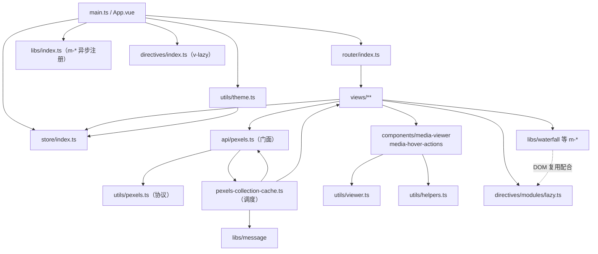

# 07 模块详解
> 项目：PEXELS 壁纸应用 ｜ 版本：v1.1 ｜ 生成日期：2026-10-06 ｜ 依据：源码分析

## 1. 本篇定位与阅读方法

《01-系统架构》已经给出了整体分层图与端到端数据流，《03-接口设计》讲透了协议与降级策略，《04-数据模型》梳理了状态与实体。本篇不再重复这些宏观结论，而是**逐模块、逐文件、逐函数**地走读 `src/` 目录：每个模块先交代它在整个系统中的职责与边界，再给出关键文件与函数的清单表格（含函数签名要点、被谁调用），然后用一段连贯的机制走读解释源码中的关键实现决策（尤其是注释里记录的历史缺陷与防护手段），最后说明它与其它模块的交互方式。

全篇的模块清单与行数规模（以当前工作区源码为准，`wc -l` 实测）如下，可作为改动时的"影响面速查"：

| 模块 | 目录 / 文件 | 行数 | 一句话职责 |
| --- | --- | --- | --- |
| 协议层 | `src/utils/pexels.ts` | 674 | PexelsClient 类 + 全部类型 + 归一化 + 降级数据生成 |
| 门面层 | `src/api/pexels.ts` | 356 | 8 个导出函数：参数钳制、降级决策、错误分级、total 截断 |
| 调度层 | `src/utils/pexels-collection-cache.ts` | 145 | 合集封面内存缓存 + 3 并发排队 + 429 熔断 |
| 弹层模型 | `src/utils/viewer.ts` | 126 | ViewerItem 统一模型与多来源归一化 |
| 虚拟滚动瀑布流 | `src/libs/waterfall/` | 573 | 绝对定位瀑布流 + ±400px 虚拟裁剪 + 响应式列数 |
| 详情弹层 | `src/components/media-viewer/index.vue` | 398 | 图片/视频共用弹层：动画、地址同步、手势、下载 |
| 状态层 | `src/store/index.ts` | 63 | pinia 实例 + app/category/theme 三 store |
| 工具层 | `src/utils/helpers.ts`、`src/utils/theme.ts` | 150 | isMobileTerminal/randomTint/滚动恢复；主题应用 |
| 其余 libs | `src/libs/` 其余 7 个文件 | 约 700 | popup/popover/segmented/button/infinite-list/message/icon-map |
| 页面层 | `src/views/**` | 约 1900 | layout 骨架 + 7 个路由页面 + 私有组件 |

阅读顺序建议：先读第 2 节（入口装配，只有 4 个小文件）建立"应用如何启动"的心智模型，再按 3 → 4 → 5（数据三兄弟）→ 6（瀑布流，全站最复杂）→ 10（弹层，交互最密集）的顺序读核心链路，其余各节按需查阅。

## 2. 入口装配模块：main.ts、App.vue、env.d.ts、types/vendor.d.ts

### 2.1 关键文件与函数清单

| 文件 | 导出 / 职责 | 说明 |
| --- | --- | --- |
| `src/main.ts` | 默认启动流程 | createApp → use(router/pinia/mLibs/mDirective) → useTheme() → mount('#app') |
| `src/main.ts` | `unhandledrejection` 监听 | 全局兜底 console.error，避免 Promise 拒绝静默失败 |
| `src/App.vue` | 一级路由出口 | 仅一个 `<router-view>`，无任何全局包装 |
| `src/env.d.ts` | `ImportMetaEnv` 全局声明 | 4 个 VITE_ 变量的类型；@vue/runtime-core 模块增强 |
| `src/types/vendor.d.ts` | `md5` 模块声明 | 历史遗留，依赖已移除（见《13-技术债务与演进建议》） |

### 2.2 机制走读与模块间交互

`src/main.ts` 的装配顺序是有讲究的：`useTheme()` 在 `app.mount()` 之前调用，它内部的 `watch(themeType, changeTheme, { immediate: true })` 会同步执行一次 `changeTheme`，把 localStorage 恢复出来的主题 class 写到 `<html>` 上——这保证了首帧渲染时 Tailwind 的 `dark:` 变体已经生效，不会出现"先白后黑"的闪烁窗口。`useTheme` 能在 mount 前访问 store，是因为 pinia 实例已在 `use(pinia)` 时注册，而主题恢复值由 `pinia-plugin-persistedstate` 在 store 首次被 `useThemeStore()` 实例化时从 localStorage 读入。这三个模块（store、theme、main）因此构成了启动期一条隐式的初始化链。

`src/env.d.ts` 的文件头注释值得逐字读一遍：它是"模块文件"（有顶层 import/export），因此其中的 `declare module '@vue/runtime-core'` 是**模块增强**而不是环境声明；而 `ImportMetaEnv` 放在 `declare global` 块里。注释还记录了一个重要的历史决策——**刻意不声明 `declare module '*.vue'` shim**：一旦声明，所有 SFC 的类型会被抹平成 `DefineComponent<Record<string, unknown>, ...>`，vue-tsc 对模板内 props 的校验就形同虚设（这条与《09-测试与质量保障》的类型门禁直接相关）。目前该文件里仍保留 `VITE_BASE_API` 与 `VITE_APP_SECRET` 两个已无消费方的类型声明，属于遗留（见《08-安全与权限设计》第 5 节）。

## 3. 协议层：src/utils/pexels.ts

### 3.1 关键类型与函数清单

| 成员 | 类别 | 要点 | 主要消费方 |
| --- | --- | --- | --- |
| `PEXELS_API_BASE` | 常量 | `https://api.pexels.com/v1` | PexelsClient 构造默认值 |
| `PexelsPhoto/PexelsVideo/PexelsCollection` | 接口 | Pexels 原始 JSON 结构（snake_case） | 协议层内部 |
| `NormalizedWallpaper/NormalizedVideo/NormalizedCollection` | 接口 | 归一化模型（camelCase） | 门面层、viewer.ts、合集页 |
| `WallpaperItem` | 接口 | 首页卡片适配模型（photo/photoWidth...） | 首页列表、pins 页 |
| `PexelsApiError` | 类 | 携带 `status` 的 Error 子类 | 门面层错误分级、封面调度器 |
| `PexelsClient` | 类 | 9 个接口方法 + 3 个归一化方法 + request/buildParams | `src/api/pexels.ts` 单例化 |
| `toWallpaperItem` | 函数 | NormalizedWallpaper → 卡片模型 | 门面层 `getPexelsList` |
| `generateFallbackWallpaper(s)` | 函数 | 单张/批量 Picsum 占位图 | 门面层全部图片接口 |
| `generateFallbackVideo(s)` | 函数 | Picsum 封面 + BigBuckBunny 片源 | 门面层视频接口 |
| `generateFallbackCollections` / `generateFallbackCollectionMedia` | 函数 | 示例合集引导卡 / 占位照片流 | 门面层合集接口 |

### 3.2 机制走读

**PexelsClient 的构造防线**（`src/utils/pexels.ts` 的 constructor）：构造函数里有一条容易忽略的守卫——`if (!apiKey && !isProxy) throw`，即官方直连模式下没有 Key 直接抛错；但代理模式（baseUrl 非官方地址）允许空 Key，因为 Key 由代理服务端注入。这条分支与门面层的 `client = API_KEY || PROXY_BASE ? new PexelsClient(...) : null` 配合：只有"既无 Key 也无代理"时才不实例化，走全量降级。

**request 的错误分级**：`PexelsClient.request` 私有方法用 `buildParams` 拼参（过滤 undefined 与空串，防止出现 `query=all` 这类脏参数——"全部分类"的 id 就是靠这层过滤在 URL 上消失的），代理模式下不发 Authorization 头。响应按状态码三档抛错：401 →「API Key 无效，请重新设置」；429 →「Pexels 请求过于频繁，请稍后再试」；其余 →「API 请求失败: {status} {statusText}」。`PexelsApiError` 上携带的 `status` 字段是整条错误处理链的判别依据——门面层用它判断 401/403/429（见第 4 节），封面调度器用它单独识别 429（见第 5 节）。

**归一化的字段兜底哲学**：`normalizePhoto` 对每个可能缺失的字段都做了兜底——`url` 按 large2x → large → original 逐级回退、`description` 缺失时拼「壁纸 {id}」、`avgColor` 缺失给空串（卡片层再回退 `randomTint()`）、`liked` 强制 Boolean。`normalizeCollection` 把 snake_case 统一驼峰化并给 `mediaCount` 等数值兜底 0，且**不填 cover 字段**——注释写明这是为了避免客户端 N+1 耦合进协议层，封面由调用方按需补（第 5 节的调度器与第 11 节的 collection-item 共同完成这件事）。`normalizeCollectionMediaResponse` 按 Pexels 的 `type: 'Photo' | 'Video'` 判别字段分派归一化并打上小写 `type` 标签，产出全站唯一的混合联合类型。

**降级生成器的 id 设计**：`createFallbackWallpaper(id)` 的 Picsum 地址用 `/id/{n}/1920/1080` 的固定 id 形式而非随机形式，保证同一序号恒返回同一张图——瀑布流翻页往回滚时图片不会"变脸"。批量版的 id 序号 = `(page - 1) × perPage + i + 1`，翻页不重复。视频封面的 `(id % 1084) + 1` 取模是因为 Picsum 有效 id 上限约 1084，防批量 404。这些映射规则的完整表见《15-接口全量参考》第 3 节。

### 3.3 模块间交互

协议层是全项目依赖最干净的模块：不 import 任何业务代码，只依赖 fetch 与类型系统。它的唯一消费方是 `src/api/pexels.ts`（单例化 + 降级决策）与 `src/utils/viewer.ts`（只 import 类型）。改变供应商 = 重写本文件；改变降级策略 = 只动门面层，本文件零感知。

## 4. 门面层：src/api/pexels.ts

### 4.1 关键导出清单

| 导出 | 签名要点 | 无 Key 行为 | 请求失败（非 401/403/429） | 401/403/429 |
| --- | --- | --- | --- | --- |
| `getPexelsList(PexelsListQuery)` | 返回 `{ list: WallpaperItem[], total }` | Picsum 列表，total=200 | Picsum 列表 | 抛出 |
| `getPexelsFromId(id)` | 返回单个 `WallpaperItem` | 固定 id=1 占位图 | **抛出**（防张冠李戴） | 抛出 |
| `searchVideos(VideoSearchQuery)` | 返回 `VideoSearchResult` | 示例视频列表 | 示例视频列表 | 抛出 |
| `getPopularVideos(VideoPopularQuery)` | 返回 `VideoSearchResult` | 同上 | 同上 | 抛出 |
| `getVideoById(id)` | 返回 `NormalizedVideo` | 单个示例视频 | **抛出** | 抛出 |
| `getFeaturedCollections(CollectionListQuery)` | 返回 `CollectionResult` | 示例合集卡 | 示例合集卡 | 抛出 |
| `getMyCollections(CollectionListQuery)` | 返回 `CollectionResult` | **空数组** | catch 全部 → 空数组 | 空数组 |
| `getCollectionMedia(CollectionMediaQuery)` | 返回混合媒体列表 | 占位照片流 | **一律抛出** | 抛出 |

模块级常量：`PEXELS_MAX_TOTAL = 8000`（照片/视频/合集共用截断上限）、`FALLBACK_MAX_TOTAL = 200`（含视频/合集各自的 200）、`API_KEY` 与 `PROXY_BASE` 的通道计算（见《03-接口设计》第 1 节，不重复展开）。

### 4.2 机制走读

门面层 8 个函数遵循同一个骨架：参数钳制（page 下限 1、perPage 钳到 [1,80]）→ 无 client 短路降级 → try 请求 → 成功则 `Math.min(res.total, 上限)` 截断 → catch 里用 `isAuthOrLimitError` 分流。这条骨架里有两个设计点需要展开。

**其一，"哪些接口允许静默降级"不是一刀切，而是按数据可信度要求分档**。`getPexelsFromId`、`getVideoById`、`getCollectionMedia` 三个"详情/媒体"类接口在有 Key 但请求失败时一律抛出：注释给出了各自的理由——详情页返回一张与点击目标无关的随机图是"张冠李戴"；合集媒体会被写进缓存并当作真实数据展示，静默换占位会污染缓存。反过来，列表类接口降级是安全的，因为列表本来就是"浏览流"，占位图不会造成误导。而 `getMyCollections` 的降级更进一步：无 Key、失败、401 三种情形都返回空数组——因为该端点依赖 Pexels 账号登录态，前端直连场景下"空"就是最真实的答案，返回占位卡反而误导。

**其二，total 截断是无限滚动收敛性的保底**。Pexels 分页上限 page × per_page ≤ 8000，超过后 `next_page` 为 null；若把真实 total（如 18374）原样透传，页面层"已加载数 ≥ total 才停"的判定永远无法满足，无限滚动会一直发注定失败的请求。截断到 8000 后，页面层在加载到第 400 页（20 条/页）时自然收敛。配合页面层用 `>=` 而非 `===` 判完成（防返回条数轻微超出被截断 total，见《04-数据模型》第 4 节），构成双保险。

### 4.3 模块间交互

门面层向上服务 4 个页面（首页列表、视频列表、合集列表/详情、两个详情直达页），向下依赖协议层与调度层。注意一个反直觉的方向：`pexels-collection-cache.ts` import 了 `getCollectionMedia`，即**调度层在门面层之上**，门面层本身不知道调度器的存在。页面层永远只 import 门面层函数，跳过门面直连协议层会绕开错误分级与配额保护（《00-项目总览》第 5 节的自检路径即基于此）。

## 5. 调度层：src/utils/pexels-collection-cache.ts

### 5.1 关键导出与内部状态清单

| 成员 | 类型 | 要点 |
| --- | --- | --- |
| `requestCover(id, cb)` | 导出函数 | 命中缓存同步回调；否则排队；**返回取消函数**供卡片卸载时反注册 |
| `getCachedCollectionMeta(id)` / `setCachedCollectionMeta(id, meta)` | 导出函数 | 合集元信息缓存的读写口，唯一写入点在合集详情页 |
| `CONCURRENCY = 3` | 常量 | 单批并发数 |
| `BATCH_DELAY_MS = 250` | 常量 | 批间隔，避开突发速率限制 |
| `RATE_LIMIT_COOLDOWN_MS = 5 * 60 * 1000` | 常量 | 429 冷却时长 |
| `coverCache: Map<string,string>` | 内部状态 | 封面缓存，**只在成功时写入** |
| `metaCache: Map<string,unknown>` | 内部状态 | 合集元信息缓存 |
| `waiters: Map<string, Set<cb>>` | 内部状态 | 同一 id 多订阅者登记表 |
| `queue: string[]` + `enqueued: Set<string>` | 内部状态 | 待拉取队列 + 已登记集合，防重复入队 |
| `rateLimited / rateLimitUntil / rateLimitNotified` | 内部标量 | 熔断状态机；同一冷却期只提示一次 |
| `isRateLimited()` | 内部函数 | 惰性判断：冷却到期自动复位 |
| `drain()` / `fetchOne(id)` / `notify(id, cover)` | 内部函数 | 队列泵 / 单次拉取 / 订阅者通知 |

### 5.2 机制走读

这个 145 行的文件是全项目"配额意识"的浓缩，四件事的协作关系值得完整走读一遍。**入队路径**：`requestCover` 先查 `coverCache`，命中则同步回调并返回空取消函数；再查 `isRateLimited()`，冷却期内直接回调空串（卡片显示占位色块）也不入队；否则把回调挂进 `waiters[id]`，若该 id 未入过队则 push 进 `queue` 并触发 `drain()`。**消费路径**：`drain` 是单飞循环（`draining` 标志防重入），每轮 `splice(0, 3)` 取一批并发 `fetchOne`，批间 `sleep(250ms)`；循环开头检查熔断状态，冷却期内**放弃当前全部排队项**——逐个 `enqueued.delete` 并 notify 空串，让卡片回落到占位态，卡片下次重新进入视口时会自然重新排队。**失败路径**：`fetchOne` 成功时取 `media[0]`（视频用 `image`、照片用 `url`）写缓存并 notify；失败时若是 429 则拉闸（置 `rateLimited`、记录 `rateLimitUntil`，同一冷却期只 `message('warn')` 一次），无论哪种失败都 notify 空串且**不写缓存**——失败不缓存意味着下次仍可重试。

两个精巧的细节值得点名。**waiters 订阅表 + 取消函数**的组合解决了"回调打到已卸载组件"的问题：虚拟滚动会把滚出视口的卡片 DOM 销毁，`src/views/collections/components/collection-item.vue` 在 `onUnmounted` 时调用 `requestCover` 返回的取消函数把自己从 `waiters` 集合里摘除；同时它 watch `data.id`，因为瀑布流按下标复用 DOM，同一张卡片可能先展示合集 A 再复用为合集 B，此时若已相交则立即重取封面。**惰性熔断复位**（`isRateLimited` 里 `Date.now() >= rateLimitUntil` 时自动复位并把 `rateLimitNotified` 清零）意味着不需要任何定时器——下一次有人问"是否熔断中"时答案永远是新鲜的，也保证了"每个冷却期提示一次"的计数自然重置。

### 5.3 模块间交互

调度层是唯一的"业务层用 UI 层"案例：它 import `@/libs` 的 `message` 弹配额警告。它与门面层的依赖方向是"调度层 → 门面层"（调 `getCollectionMedia(perPage=1)` 拉首图），与《01-系统架构》第 2 节描述的分层纪律一致。消费方只有两个：合集列表卡片（封面）与合集详情页（元信息缓存）。

## 6. 通用组件库：src/libs/

### 6.1 文件清单

| 文件 | 组件/导出 | 核心机制 | 详见 |
| --- | --- | --- | --- |
| `src/libs/index.ts` | install 插件 | `import.meta.glob('./*/index.vue', 排除 message)` 异步注册 m-* 组件 | 《02-页面设计》第 4 节 |
| `src/libs/waterfall/index.vue` + `utils.ts` | m-waterfall | 瀑布流 + 虚拟滚动 + 响应式列数 | 本节重点 |
| `src/libs/infinite-list/index.vue` | m-infinite-list | IntersectionObserver 触底 + 失败点击重试 + 首屏未铺满补发 | 《05-核心流程》第 1 节 |
| `src/libs/popup/index.vue` | m-popup | teleport 底部弹层 + `useScrollLock` + 双钩子解锁 | 《02-页面设计》第 6 节 |
| `src/libs/popover/index.vue` | m-popover | hover 气泡、200ms 延迟关闭、四向定位 | 同上 |
| `src/libs/segmented/index.vue` | m-segmented | 分段控件，`role="tab"` + `aria-selected` | 同上 |
| `src/libs/button/index.vue` | m-button | type/size/icon/loading，icon 模式自动切 icon-* 尺寸键 | — |
| `src/libs/message/index.ts` + `index.vue` | message() | 命令式消息，独立容器防覆盖，visibleCount 依次下移 44px | 《01-系统架构》第 4 节 |
| `src/libs/icon-map.ts` | iconMap | 字符串名 → lucide 组件映射（8 个图标） | — |

### 6.2 m-waterfall 深度走读

`src/libs/waterfall/index.vue`（544 行）是全站最复杂的组件，按生命周期走一遍它的完整工作流。

**布局准备阶段**（onMounted）：先 `setupResponsiveColumns()` 按容器宽度初始化列数（`matchColumnByWidth` 把 `responsiveColumns` 按 minWidth 降序排序后找到第一个 `width >= minWidth` 的档位），再 `useColumnWidth()` 计算列宽（容器 offsetWidth 减去左右 padding、再减去 `(列数-1)×列间距` 后除以列数，`Math.max(width, 0)` 防容器不可见时算出负列宽——注释指出负数对模板 v-if 仍是 truthy，会渲染出非法宽度），随后 `bindScrollListener()` 用 `findScrollParent` 向上查找最近的 `overflow-y: auto/scroll/overlay` 祖先绑定滚动监听（找不到回退 window），最后 `relayoutAll()` 执行首次布局。**列数变化的 watch 特意等到 onMounted 之后才注册**——初始化阶段修改 currentColumn 不应触发额外重排。

**测量-定位阶段**（measure → useItemHeight → useItemLocation）：全量渲染所有 item（`visibleIndexes = null`），`nextTick` 后从 DOM 读取每个 `.m-waterfall-item` 的 `offsetHeight`（按 `data-index` 属性映射，与 DOM 顺序解耦），然后在副本上逐个计算定位：`left = 最矮列序号 × (列宽+列间距) + 容器左边距`，`top = 当前最矮列高`，并把该列高度累加 `itemHeight + rowSpacing`。全部定位完成后取列高最大值作为容器总高，调用 `updateVisible()` 按当前滚动位置裁剪。`warnZeroHeight` 在开发环境一次性告警"item 高度为 0"，因为高度为 0 的 item 会让定位错乱。`getMinHeight/getMaxHeight`（`src/libs/waterfall/utils.ts`）对空对象兜底 0——注释记录了 `Math.min()` 空参返回 Infinity 的历史 bug。

**虚拟裁剪阶段**（updateVisible）：把滚动容器视口的上下边界换算到瀑布流坐标系（`viewTop - containerRect.top ± VISIBLE_BUFFER`，缓冲 400px），遍历所有 item 的定位结果——**已定位且落在区间外的剔除，未定位的始终保留**（供测量），得到下一帧渲染集合；与当前集合逐项比对，完全相同则不更新（避免滚动每一帧都触发重渲染）。滚动监听用 `requestAnimationFrame` 节流。这套机制的效果是 DOM 数量只与视口面积相关、与数据总量无关。

**数据变化的两条重排路径**（watch `[() => props.data, () => props.data.length]`）：通过"数组引用是否变化"区分整体替换（切分类：`clearLayout + relayoutAll`，全量重来）与原地追加（加载更多：`ensureNewItemsVisible` 把未定位的新 item 强行加入渲染集合，`relayoutAppend` 只测新 item，旧定位全保留）。注释解释了为什么不用 deep watch——会在回调改写数据的组合下引发一轮多余重排；也解释了为什么定位结果放在独立的响应式数组 `itemStyles` 而不是挂在 props.data 元素上——既污染调用方数据（props 应只读），又会触发额外重排。还有 `getItemStyle` 的防护：未定位的 item 只输出宽度不输出 left/top，避免 `left: undefinedpx` 非法 CSS。

**窗口 resize**（200ms 防抖触发 `reset`）与**列数变化**（100ms 防抖的 ResizeObserver 回调更新 `currentColumn`，再由 watch 触发 `reset`）都走"清空定位 + 全量重排"。`nodeKey` 缺失时回退 index 作 key，防多个 undefined key 导致复用错乱。onUnmounted 里清了 3 个定时器、1 个 rAF、滚动监听、列数 watch 和 ResizeObserver——虚拟滚动组件的清理项比普通组件多得多，这也是为什么它把所有清理句柄都存成了模块内变量。

### 6.3 其余 libs 的共性纪律

其余六个积木有三个共同点：一是都用 `useVModel` 实现双向绑定（popup/segmented/infinite-list），emit 命名遵循 `update:modelValue`；二是清理纪律严格——popup 在 `onUnmounted` 与 `onDeactivated` 双钩子解锁 body 滚动（keep-alive 页面离开只触发 deactivated，漏掉会让整站永久不可滚动），popover 在 onUnmounted 清延时器，message 组件在 onUnmounted 清关闭定时器；三是注释里都埋着历史 bug 档案——message 的"独立容器防 `document.body._vnode` 互相覆盖"、popover 的"插槽 vnode children 未必是数组导致有内容也弹不出来"、message 样式表里"fill-* 会把描边图标涂成实心色块"、message 过渡里"translate3d 与工具类位移叠加导致横向偏移翻倍"。这些注释就是《09-测试与质量保障》第 4 节"注释即回归测试档案"的素材来源。

## 7. 指令层：src/directives/

`src/directives/index.ts` 用 eager glob 扫描 `./modules/*.{js,ts}`，取文件名注册为同名指令——目前只有 `lazy.ts`，即 `v-lazy`。注册用 eager 而非异步 glob，是因为指令轻量且首屏就要用。

`src/directives/modules/lazy.ts` 的完整机制：`mounted` 时若 URL 已在 `loadedCache`（模块级 `Set<string>`，只在图片 load 事件成功后登记）则直接显示并登记 stateMap（否则后续 updated 钩子找不到 state 无法切 src）；否则把 src 换成 1×1 透明 GIF 占位（注释：早期把 src 置空串会被浏览器解析为当前页面 URL，对 HTML 文档再发一次请求），再用 `useIntersectionObserver` 观察元素，相交时从 stateMap 取**最新地址**（而非闭包捕获的旧值——updated 钩子可能已更新真实地址）赋给 src，并用一次性 load 监听把成功加载的 URL 写入缓存。`updated` 钩子处理 `:src` 动态变化，且**只认 binding.value**——注释警告读 el.src 会把透明占位图误当新地址。`unmounted` 必须停止观察：指令钩子不一定在组件的 effect scope 内，不能依赖 vueuse 自动清理。这套设计同时服务普通懒加载与"虚拟滚动 DOM 销毁重建"场景，与瀑布流是强耦合的搭档。

## 8. 状态层：src/store/index.ts

| Store | state | actions | 持久化 | 交互说明 |
| --- | --- | --- | --- | --- |
| app | `currentCategory`、`searchText` | `changeCurrentCategory`（连带清空 searchText）、`changeSearchText` | 否 | navigation 写、header-search 双向、两个列表页 watch |
| category | `categories` | `setCategories`（头部插入「全部」）、`useCategoryData`（异步空壳） | 否 | 仅 navigation 消费 |
| theme | `themeType` | `changeThemeType` | `persist: true` | header-theme 写、utils/theme.ts watch |

机制要点（字段语义的完整表见《04-数据模型》第 1 节，不重复）：**全局状态只放"跨页面意图"**。`changeCurrentCategory` 把"切分类必清搜索词"的互斥语义内聚进 action，杜绝"滑块在动、列表不动"的假死（其成因分析见《05-核心流程》第 1 节）。`useCategoryData` 是分类本地静态化后保留调用形状的异步空壳，`src/views/main/components/navigation/index.vue` 在 setup 顶层调用它并 catch 弹错——调用形状的保留让"未来若恢复远程分类"只改 store 一个文件。

## 9. 工具层：src/utils/helpers.ts、viewer.ts、theme.ts

**helpers.ts** 四个导出：`isMobileTerminal` 是 computed 布尔值（UA 正则 ∨ （有触摸 ∧ 视口宽 <1024）），全站双端分支的唯一开关；`randomTint` 生成 `hsla(随机色相, 55%, 50%, 0.16)` 的半透明淡彩，注释解释了为什么放弃全饱和随机色（浅色刺眼、深色不可用）而改用"半透明叠页面背景"方案——无需读当前主题即可两端自适应；`formatDuration` 把秒格式化为 m:ss，统一收敛避免多处分叉；`useScrollRestore` 解决 keep-alive 缓存组件 DOM 被移出文档后 scrollTop 归零的问题，`onActivated` 时把 `useScroll` 记录的 y 写回 scrollTop，返回的 `containerTarget` 必须绑定页面滚动容器。

**viewer.ts** 的 `toViewerItem` 三入一出（来源判别、pickVideoFile 的清晰度选择规则见《04-数据模型》第 3.2 节与《01-系统架构》决策四），补充两个走读细节：`isVideoSource` 的鸭子测试是"唯一带非空 videoFiles 数组的即视频"，因此混排项（带 type 标签）与纯视频对象走同一条分支；照片分支里 `'photo' in item` 判别首页卡片来源，字段名整体平移，缺失字段全部回退空串/0——弹层模板因此零判空。`pickVideoFile` 先过滤 `file_type` 以 `video/` 开头的可播文件（HLS 的 m3u8 被排除），全部不可播时退回"只要有 link 的文件"，再优先 hd、否则取宽度最大者。

**theme.ts** 的三个机制点（流程图见《05-核心流程》第 4 节）：`changeTheme` 只增删自己的主题 class（注释记录了早期 `html.className = themeClassName` 整写会清掉第三方注入类的缺陷）；`watchSystemThemeChange` 是模块级单例，OS 主题变化回调里先判断 `themeType === 'system'` 才应用，保护用户的显式选择；旧 Safari（<14）用 `addListener` 降级。非法 themeType（如 localStorage 被改坏）时 switch 落空、`themeClassName` 为空串、函数直接 return——"非法主题等于维持现状"。

## 10. 跨页面组件层：src/components/

### 10.1 media-viewer（398 行）

| 逻辑块 | 关键成员 | 机制 |
| --- | --- | --- |
| 数据 | `visible`/`current`/`hasPrev`/`hasNext` | 全部由 `modelValue`（下标，-1 关闭）与 `items` 派生 |
| 清晰度 | `qualities`/`qualityIndex`/`currentSrc` | 过滤 `video/` 可播文件（全不可播退回有 link 者）；切媒体时归零 |
| 地址同步 | `syncUrl`/`hasPushed`/`detailPathOf` | pushState 打开 / replaceState 切换 / popstate 关闭 |
| 关闭 | `onClose` | 先取 hasPushed 快照再 emit（watcher 会复位它）；embedded 时 history.back()，直达页按 history.state.back 分流 |
| 手势/键盘 | onTouchStart/End、keydown | 水平位移 ≥50px 且大于垂直位移才切换；Esc 关闭、方向键切换 |
| 下载 | getFileExtension/sanitizeFileName/onDownload | URL 推扩展名（失败按类型兜底 jpg/mp4）、非法字符清洗、先提示后延迟 100ms saveAs |
| 动画 | beforeEnter/enter/leave | gsap + `:css="false"`，从卡片中心点缩放进出；无起点退化为淡入淡出 |

地址同步的完整状态机与动画时序已在《05-核心流程》第 2 节给过时序图，这里补三个走读细节。**`:key="current.id + '-' + qualityIndex"`** 让切换清晰度时整个 `<video>` 节点重建而非换 src——这会丢失播放进度，但换 src 在部分浏览器对跨域视频的行为不可控，注释取舍为"重建节点行为最可控"。**loadMoreOffset=3**：watch 里判断 `index >= items.length - loadMoreOffset` 时 emit load-more，弹层内连续切换到接近末尾时提前预取下一页，保证"左右切换不断档"；序号显示（`{i+1} / {总数}`）随预取实时增长。**pushState 时保留 `history.state`**——vue-router 在 state 里存滚动位置等信息，传 null 会清空它。

### 10.2 media-hover-actions

PC 端卡片 hover 浮层：`v-if="!isMobileTerminal"` 整体只在 PC 渲染；下载走 file-saver（同一套"先提示后延迟 100ms"模式）；复制走 `navigator.clipboard`，catch 后提示手动复制。它是全项目最小的组件，却承载了"移动端无 hover 所以不放功能、弹层内已有同功能入口"的交互决策。

## 11. 页面层：src/views/

| 页面 | 路由/名 | keep-alive | 数据来源 | 私有组件 |
| --- | --- | --- | --- | --- |
| `views/layout/index.vue` | 骨架 | — | — | header、tabbar、main-tabs.ts |
| `views/main/index.vue` + `components/` | home | 是 | `getPexelsList` | navigation、list/index.vue、list/item.vue |
| `views/videos/index.vue` + `components/` | videos | 是 | `getPopularVideos` / `searchVideos` | list/index.vue、video-item.vue |
| `views/video/index.vue` | video | 否 | `getVideoById` | 复用 media-viewer（embedded=false） |
| `views/collections/index.vue` + `components/` | collections | 是 | `getFeaturedCollections` / `getMyCollections` | collection-item.vue |
| `views/collection/index.vue` + `components/` | collection | 否 | `getCollectionMedia` + 元信息翻页匹配 | media-item.vue |
| `views/pins/index.vue` | pins | 否 | `getPexelsFromId` | 复用 media-viewer（embedded=false） |
| `views/error/404/index.vue` | 404 | 否 | — | m-button 返回首页 |

四个列表页（首页、视频、合集列表、合集详情）共享同一套局部状态模型（isLoading/isFinished/hasError/列表 ref + 非 响应式 query + requestSequence 序号），其状态机与四条不变量已在《04-数据模型》第 4 节完整给出。本节只补页面间的三个差异点。

**首页与视频页是 keep-alive 缓存页**，因此多出 `isActive` 开关与 `onActivated/onDeactivated` 钩子：失活期间 store（或 props）变化只更新 appliedQuery 快照不发请求，激活时统一比对补拉——避免在视频页搜索时首页白烧一次配额。视频页的 watch 用 `{ immediate: true }` 且 applied 初值为 null，保证首帧必然通过比对发起首次加载。**合集详情页不缓存**，但 watch `route.params.id`（immediate）处理合集 A→B 的参数变化；它的元信息加载 `loadCollectionMeta` 是全项目唯一的"翻页匹配"逻辑：先查 metaCache，未命中则在特色合集中最多翻 3 页×80 条按 id 匹配、再兜底查我的合集，命中即写缓存；查不到时保持 collection 为 null，模板回退「合集 ID：xxx（未在特色/我的合集中找到）」文案，并区分 metaLoading 的"加载中"态。**弹层的加载方式在页面间不一致**：首页与视频页用 `defineAsyncComponent`（gsap 不进首屏包），合集详情页直接静态 import media-viewer——构建产物中 collection chunk 会静态依赖 media-viewer chunk（连带 vendor-animation），即进入 `/collections/:id` 就会拉取 gsap，这是一个可优化点（见《10-性能设计与优化》第 6 节与《13-技术债务与演进建议》）。

layout 层的 `CACHE_NAMES = ['home','videos','collections']` 与 `:key="$route.fullPath"`（同路由不同参数也重建组件，因此合集 A→B 不走 keep-alive 复用而是重挂载）、`main-tabs.ts` 的 `matchMainTabKey` 前缀匹配规则（`/collections*` → collection、`/videos*` → video、其余含 `/pins/*` → photo）都已见《02-页面设计》第 1、2 节。

## 12. 样式层：src/styles/index.css 与构建配置的咬合

`src/styles/index.css` 是 Tailwind 4 CSS-first 的唯一配置点（无 tailwind.config.js），四块内容：`@layer base` 设根字号 `min(10vw, 40px)`（取代早期 JS 方案 flexible.ts）；`@custom-variant dark` 把暗色变体绑定到 `.dark` class 而非媒体查询（与 utils/theme.ts 的 class 切换咬合）；`@theme` 定义字号（0.25rem 起步的缩小字号阶梯）、品牌色 `--color-main: #f44c58`、功能色板与 `--backdrop-blur-4xl: 240px`；六个 `@utility` scrollbar 工具类——注释说明 Tailwind 4 核心不含 scrollbar-* 且本项目未装 tailwind-scrollbar 插件，升级后这些类名曾全部静默失效，故用 `@utility` 自建（自动支持 xl:/dark: 变体）。这份文件与 `vite.config.ts` 的 px-to-viewport（只转 `.vue` 内 px、mediaQuery:false、minPixelValue:1）共同构成《00-项目总览》第 5 节"设计约定"两条红线的技术根源：rem 间距放大约 2.5 倍、精确尺寸用任意值 px。配置逐项解释见《14-配置与环境详解》。

## 13. 模块间交互总览与依赖纪律

依赖纪律在《01-系统架构》第 2 节已有定论，本篇走读后可以再收敛成三条实操规则：**页面层不得 import 协议层**（绕过门面即绕过降级与截断）；**libs 不得 import views/api/store**（唯一例外是调度层用 message，方向仍是业务用 UI）；**所有跨模块的类型从 `@/utils/pexels`、`@/utils/viewer`、`@/constants` 具名导入**，业务类型不做全局注册（全局声明仅 env.d.ts 与 vendor.d.ts 两个文件，见第 2 节）。改动任何模块前，先回到本篇对应小节确认它的上下游，再动手。
