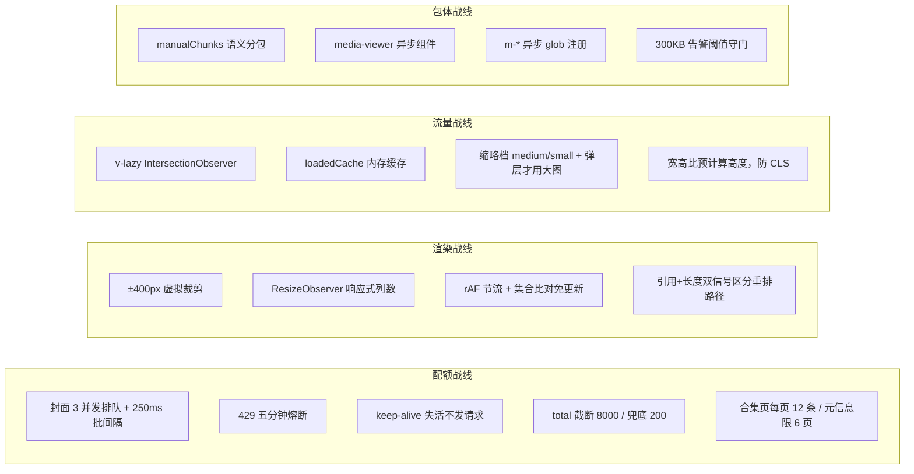

# 10 性能设计与优化
> 项目：PEXELS 壁纸应用 ｜ 版本：v1.1 ｜ 生成日期：2026-10-06 ｜ 依据：源码分析

## 1. 性能设计的约束模型：四种资源，四条战线

本项目的性能问题不是一个笼统的"快"字，而是四种资源各自设防：**API 配额**（Pexels 免费 Key 约 200 次/小时，全站最稀缺资源）、**DOM 数量**（无限滚动列表在移动端的头号杀手）、**图片流量**（瀑布流页面天然的重流量场景）、**JS 包体**（移动端首屏加载）。对应地，源码里埋着四组互相独立又互相配合的机制：配额组（排队调度 + 熔断 + 失活不发请求 + total 截断）、渲染组（虚拟滚动 + 响应式列数）、流量组（懒加载 + 内存缓存 + 尺寸档位 + 高度预计算）、包体组（语义化分包 + 异步组件 + 异步 glob）。《01-系统架构》第 4 节"配额是一等公民"与《00-项目总览》第 3.1 节的"配额意识"已给出决策视角，本篇逐一深入实现细节，最后在第 6 节给出实测产物基础上的优化清单。

先给一张总览图，把四条战线与对应机制挂在一起：

## 2. 渲染战线：瀑布流虚拟滚动的完整机制

`src/libs/waterfall/index.vue` 的虚拟滚动是全项目性能设计的核心，其工作流在《07-模块详解》第 6.2 节已按生命周期走读，本节从性能视角重新组织它回答的四个问题。

**裁剪窗口怎么算**。`updateVisible` 把"滚动容器视口"（通过 `getBoundingClientRect` 取其上下边界，兼容 window 与内部滚动容器两种宿主）换算到瀑布流自身的坐标系，再向两侧各扩展 `VISIBLE_BUFFER = 400`px 形成裁剪区间；已定位（有 style）且完全落在区间外的 item 被剔除出渲染集合，**未定位的 item 始终保留**——因为它们还没被测量过，剔除会让布局永远无法完成。DOM 数量因此只取决于视口高度加 800px 缓冲能容纳多少卡片（按 2~5 列、单卡 200~400px 高估算，稳定在十几到几十个），与数据总量（理论上限 8000 条）彻底解耦。

**滚动时怎么不抖**。三层防抖动设计叠加：滚动监听用 `requestAnimationFrame` 节流（每帧最多一次计算，注释称避免 layout thrashing）；计算出的渲染集合与当前集合做逐项比对（`sameIndexes`），完全相同就不更新响应式状态，滚动中大多数帧因此零渲染；卡片的 key 用 `nodeKey`（业务 id）而非下标，DOM 复用时 Vue 只挪动已有节点。配合**图片高度预计算**（卡片按 `(列宽/原图宽)×原图高` 在图片加载前就占住高度，`src/views/main/components/list/item.vue` 的 `photoHeight`）与容器总高主动设置（`containerHeight` 取列高最大值，滚动条长度从第一屏起就是稳定的），滚动过程既没有布局跳动也没有滚动条长度突变。

**列数怎么响应**。`responsiveColumns` 模式用 ResizeObserver 监听瀑布流容器宽度（不是 window 宽度——侧边栏、滚动条出现都会改变容器实际可用宽度），回调经 100ms 防抖后调用 `matchColumnByWidth` 重匹配列数（候选档位按 minWidth 降序找第一个满足项），列数真正变化才触发全量重排。四个页面各自的档位梯度：首页 `[{0,2},{640,3},{1024,4},{1280,5}]`，视频页/合集列表/合集详情少一档上限 4 列。窗口 resize 则走独立的 200ms 防抖 `reset`（清空全部定位、重算列宽、全量重排）。ResizeObserver 只在 `onMounted` 建一次、`onUnmounted` 断开，组件销毁不留观察器。

**数据变化怎么少算**。watch 用 `[() => props.data, () => props.data.length]` 双信号：整体替换（切分类，引用变）走 `clearLayout + relayoutAll` 全量重排；原地追加（加载更多，引用不变长度变）走 `ensureNewItemsVisible + relayoutAppend`——旧 item 的定位结果、列高累计、裁剪状态全部保留，只为新增 item 补测量与定位。这条路径是无限滚动的性能关键：翻到第 N 页时，成本只与前 20 个新卡片相关，与已渲染的几百条数据无关。

## 3. 流量战线：图片从"不加载"到"不重复加载"

**v-lazy 指令**（`src/directives/modules/lazy.ts`）的机制见《07-模块详解》第 7 节，性能视角补三点：其一，占位阶段用 1×1 透明 GIF 而非空 src，省掉的是"每个未加载图片对当前 HTML 文档多发一次请求"这种隐蔽流量（注释记录的旧坑）；其二，观察器在首次相交触发后即停止（`latest.stop()`），图片加载完成后元素不再被观察，长列表滚动时观察器总量随 DOM 裁剪保持在低位；其三，`loadedCache: Set<string>` 记录加载成功的 URL——虚拟滚动销毁又重建卡片时命中缓存的图片**直接赋真实地址**，跳过占位与观察器两个阶段，这是"懒加载 + DOM 复用"组合下防止重复请求的关键一环（失败图片不进缓存，滚回时仍可重试，正确性优先）。

**尺寸档位选择**在协议层一次定型：列表缩略图用 `src.medium || src.small`（`normalizePhoto` 的 thumb 字段），大图（large2x → large → original）只在详情弹层使用——列表页一屏几十张图全部是小档位，弹层一次只加载一张大图。降级数据同理：Picsum 缩略 `/400/300`、大图 `/1920/1080`。

**防 CLS（布局偏移）**不只是体验问题也是流量问题：所有图片卡片的容器高度在图片加载前就按原始宽高比算出（三个卡片组件各自的 `photoHeight/mediaHeight/videoHeight` computed，缺原始尺寸时兜底 auto），配合 `avgColor || randomTint()` 的占位底色，图片加载完成时**页面几何零变化**——不存在"图片加载后把下方内容推下去"的二次布局，也就不会因此引发 IntersectionObserver 的重复触发与重复加载。占位色用 computed 而非模板内联（旧坑㉞）保证重排不换色，视觉上等于"零闪烁"。

## 4. 配额战线：把 200 次/小时花在刀刃上

**合集封面调度器**（`src/utils/pexels-collection-cache.ts`）解决的是全站最陡的 N+1：合集列表每页 N 个合集，每个都要单独发一次 `collectionMedia(perPage=1)` 拉首图当封面。调度器的四层限流见《07-模块详解》第 5.2 节，性能视角的量化账：无节制时一页 18 条 = 1 次列表 + 18 次封面 = 19 次请求，翻 10 页就是 190 次——直接打穿小时配额。现在的实际消耗路径是：每页 12 条（`src/views/collections/index.vue` 的 `DEFAULT_PAGE_SIZE = 12`，注释明说"把单页配额消耗从 18→13"）× 只对进入视口 ±200px 的卡片入队（`collection-item.vue` 的 `useIntersectionObserver`，rootMargin 200px）× 单批 3 个并发、批间 250ms × 同 id 命中 `coverCache` 不重发 × 429 后熔断 5 分钟。叠加后一个会话的封面请求量从"页数×18"变成"实际看过的卡片数（去重）"，且最坏情况被熔断封顶。

**keep-alive 失活不发请求**是另一笔大账。`CACHE_NAMES = ['home','videos','collections']` 三个一级页常驻内存（`src/views/layout/index.vue`），它们的列表组件在 `onDeactivated` 时把 `isActive` 置假，此后 store 或 props 的变化只更新 `appliedQuery` 快照、不发起请求，`onActivated` 时统一比对补拉一次。场景价值：用户在视频页搜索，首页的 watch 也会触发——若不挂起，首页会在用户看不见的背景下白烧一次列表请求；三页缓存 + 挂起机制保证"任何时刻只有当前可见页面在消费配额"。

**total 截断与分页收敛**：`PEXELS_MAX_TOTAL = 8000`（`src/api/pexels.ts`）截断超大结果集（如 nature 分类 18000+ 条），配合页面层 `已加载 >= total` 的判定，无限滚动在 8000 条处必然收敛，不会在 Pexels 分页上限之外发注定失败的请求；兜底模式的 total 固定 200 则同时限制了 Picsum 的 404 风险。**元信息查找的封顶**：合集详情页 `loadCollectionMeta` 最多翻 3 页×80（特色）+ 3 页×80（我的）共至多 6 次请求查标题，命中 `metaCache` 后同会话零消耗——这是 Pexels 无"按 id 查合集"端点（《03-接口设计》2.1 节）下能做的最省方案。

**分类静态化**是最早的一笔省法：13 个分类 id 即搜索词，本地常量（`src/constants/index.ts`）替代了历史上的一次 `/category` 请求——每次会话固定省 1 次，且消灭了一个首屏阻塞点。

## 5. 包体战线：入口极薄、重物后置

`vite.config.ts` 的分包与异步化策略见《01-系统架构》第 5 节。用当前 `dist/` 实测数据验证策略的实际效果（`ls -la dist/assets`，单位 KB，取主要 chunk）：

| chunk | 体积 | 何时加载 | 机制 |
| --- | --- | --- | --- |
| rolldown-runtime | ~2 | 首屏（modulepreload） | 运行时胶水 |
| vendor-vue | 42.9 | 首屏（modulepreload） | vue/@vue/vue-router/pinia 单列分组 |
| vendor-utils | 6.7 | 首屏（modulepreload） | @vueuse/core（tree-shaking 后极小） |
| vendor-misc | 78.0 | 首屏（modulepreload） | 其余 node_modules 兜底（含 @lucide/vue 图标等） |
| index + css | 9.3 + 34.9 | 首屏 | 入口与全局样式 |
| main/layout/videos/collections 等 | 5~7 | 对应路由 | 路由级懒加载 |
| media-viewer | 6.9 | 首次点开详情（首页/视频页） | defineAsyncComponent |
| vendor-animation (gsap) | 69.6 | media-viewer 加载时 | gsap 独立分组 |
| vendor-media (file-saver) | ~2 | media-viewer / hover-actions 加载时 | 独立分组 |

三组数字值得解读：**首屏 JS 约 139KB（未压缩）**，其中 vendor-misc 的 78KB 是最大项——它兜底了所有未点名分组的 node_modules（@lucide/vue、pinia-plugin-persistedstate 等），是第 6 节优化的头号对象；**gsap 的 69.6KB 成功被推迟到首次点开详情**，这正是首页与视频页用 `defineAsyncComponent` 包裹 media-viewer 的全部意义；**但有一个例外**——`src/views/collection/index.vue` 直接静态 import media-viewer（未走 defineAsyncComponent），实测 collection chunk 的头部 import 链包含 media-viewer chunk，连带 vendor-animation：进入 `/collections/:id` 即拉取 gsap。这不算 bug（合集详情本来就大概率会用弹层），但与其它页面的策略不一致，是包体策略的唯一漏点。

其余机制：`src/libs/index.ts` 的异步 glob 让 6 个 m-* 积木各自成 chunk（实测 button/popup/popover/segmented/infinite-list 均有独立文件），模板零 import 且不用的不进首屏；`chunkSizeWarningLimit: 300` 把"分包退化"变成构建期报警（注释明确不许调大它）；`sourcemap: false` 兼顾安全（不暴露源码结构，见《08-安全与权限设计》）与体积；`reportCompressedSize: false` 牺牲构建期的体积报告换构建速度。部署侧的配套（assets 长缓存 + HTML 短缓存、开 gzip/brotli）见《06-部署运行》第 4.2 节。

## 6. 优化建议清单（按 ROI 排序）

以下建议全部基于前文实测证据，标注了动改点与预期收益，供排期参考；未标注"已达标"的项均属于当前未做。

1. **给合集详情页补上异步弹层**（低成本高一致性）：把 `src/views/collection/index.vue` 的 `import mediaViewer from '@/components/media-viewer/index.vue'` 改为与首页/视频页一致的 `defineAsyncComponent`，`/collections/:id` 首屏立减约 77KB（media-viewer + gsap，未压缩）。这是包体策略唯一漏点，一行改动。
2. **审视 vendor-misc 的 78KB**：在 `vite.config.ts` 为 `@lucide/vue` 单设分组（如 vendor-icons），并把入口真正用到的图标数量维持收敛（`src/libs/icon-map.ts` 已集中管理 8 个动态图标，静态引用处可直接具名 import）；vendor-misc 余量应只剩 pinia-plugin-persistedstate 等小包。收益是首屏 preload 体积下降，且图标升级不再污染核心 chunk。
3. **补 CSP 与资源预连接**：为 `index.html` 加 `<link rel="preconnect" href="https://api.pexels.com">`（及图片 CDN 域，域名以实际返回为准 ⚠️ 待确认）可提前完成 TLS 握手；CSP 的收益与配置基线见《08-安全与权限设计》第 4 节。两者都是部署文件改动，不碰源码。
4. **元信息查找的服务端化**（若启用代理）：`loadCollectionMeta` 的"翻 6 页找标题"是配额视角最浪费的设计，根因是 Pexels 缺端点。若按《08-安全与权限设计》第 2.3 节启用反向代理，可在代理层为 `/collections/featured` 加短 TTL 缓存，把多用户共享的元信息查找成本摊薄到接近零；前端代码不用动。
5. **waterfall 列高缓存的内存权衡（暂不建议做）**：`itemStyles` 与 `itemHeightMap` 无淘汰，理论上有内存增长；但 8000 条上限 × 每条 3 个数字的量级（约百 KB）远小于图片缓存，当前做淘汰策略反而增加"回滚后重测量"的复杂度。列出仅为记录已评估。
6. **`loadedCache` 与 `coverCache` 的会话级增长（同上，暂不建议做）**：两者都只增不清，但量级以百计且值是短字符串，刷新即清空；若未来引入"本地持久化的浏览历史"再统一考虑淘汰策略（与《04-数据模型》第 6 节"不存在的数据"的演进联动）。
7. **可感知性能的两个小补充**：视频页封面可评估 `preload="metadata"` 之外的 poster 预热（当前 `<video>` 在弹层打开才创建，已达标，记录现状防止未来回退）；弹层大图加载期间已有 avgColor 底色占位，可再叠加 `decoding="async"` 属性进一步降低主线程占用（一行改动，收益微小但零风险）。

对照第 1 节的四条战线做个收束：渲染、流量、配额三条战线的设计已相当完整且互相咬合（虚拟滚动依赖懒加载缓存、配额调度依赖虚拟裁剪），包体战线九成到位、留了一个静态 import 的尾巴与一个未分组的 vendor-misc。第 6 节前两条做完，这个项目在"移动端直连第三方 API 的壁纸工具"这个品类里，性能设计就没有明显短板了。
