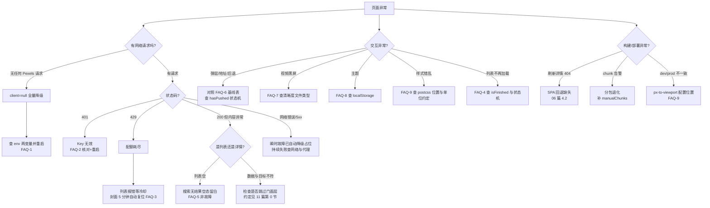

# 12 FAQ 与故障排查
> 项目：PEXELS 壁纸应用 ｜ 版本：v1.1 ｜ 生成日期：2026-10-06 ｜ 依据：源码分析

## 0. 排查入口与预备动作

排查前先建立两个共识，能省掉一半无效排查。**共识一：本项目的"假数据"是设计而非故障**——无 Key（或无代理）时全站展示 Picsum 占位图、BigBuckBunny 示例视频与「示例合集」卡，行为矩阵见《03-接口设计》3.2 节；判断数据真假只需要看 `src/api/pexels.ts` 的 `client` 是否为 null（即 env 里 `VITE_PEXELS_API_KEY` 与 `VITE_PEXELS_PROXY_BASE` 是否至少配置了一个）。**共识二：改 env 必须重启 dev server**——`API_KEY`/`PROXY_BASE` 是模块级常量，Vite 只在启动时读取 env 文件，改完不重启的"没生效"都不是 bug（《06-部署运行》第 2 节）。

调试入口速查表（按排查时打开频率排序）：

| 入口 | 位置 | 用途 |
| --- | --- | --- |
| Network 面板 | 浏览器 DevTools | 看请求走向：走 `/api/pexels`（dev 代理）还是直连 `api.pexels.com`；看状态码 401/403/429/404；看 query 参数 |
| Sources 面板搜 `api.pexels.com` | 浏览器 DevTools | 确认产物中的通道与 Key 是否内联（见《08-安全与权限设计》第 3 节） |
| Console | 浏览器 DevTools | `unhandledrejection` 兜底打印（`src/main.ts`）；瀑布流零高度告警（仅 dev，`src/libs/waterfall/index.vue` 的 `warnZeroHeight`） |
| Application → Local Storage | 浏览器 DevTools | 仅一条 `theme` 记录；多出来或值非法时的表现见 FAQ-9 |
| 全局 message 弹条 | 页面顶部居中 | `PexelsApiError` 的中文文案在此呈现（401「API Key 无效」/ 429「请求过于频繁」） |
| vue-router 调试 | URL 地址栏 | 弹层打开时应看到 `/pins/:id` 或 `/videos/:id`；历史栈行为见 FAQ-6 |

## 1. 高频问题速查表

### FAQ-1 页面全是灰彩占位块 / 示例视频 / 「示例合集」卡

**现象**：图片是随机风景占位、视频全是同一段 BigBuckBunny、合集页是「示例合集 N」说明卡。**原因**：`client = null`，全量降级——两个环境变量都未配置。**判定**：Network 面板无任何发往 api.pexels.com 的请求（门面层短路，连错误提示都不产生，《05-核心流程》第 5 节）。**处理**：`cp .env.example .env.development` 后填 `VITE_PEXELS_API_KEY`（申请地址 `https://www.pexels.com/api/`），**重启** dev server。若只想验证降级形态本身，把 Key 注释掉重启即可。注意降级也是分级的：列表类接口降级、详情类接口（`getPexelsFromId`/`getVideoById`/`getCollectionMedia`）在有 Key 但失败时是抛错不降级的——所以"无 Key 有占位、有 Key 失败无占位"同为预期行为。

### FAQ-2 控制台/弹条报「API Key 无效，请重新设置」（401）

**原因**：Key 填错、已作废、或复制时带了引号/空格。此类错误被 `isAuthOrLimitError` 刻意上抛、绝不静默降级——否则用户无法区分真数据与假数据（《01-系统架构》决策一）。**处理**：核对 env 中的 Key 值与 Pexels 控制台一致，重启 dev server；若历史排查过《08-安全与权限设计》第 2 节的轮换流程，确认用的是轮换后的新 Key。**注意**：合集页的「我的合集」Tab 不适用本条——它对任何失败（含 401）都静默返回空数组并显示"当前账号暂无合集 / 需要在 Pexels 登录"，这是设计（`src/api/pexels.ts` 的 `getMyCollections`）。

### FAQ-3 报「Pexels 请求过于频繁，请稍后再试」（429）/ 合集封面集体停更

**原因**：配额耗尽（免费 Key 约 200 次/小时，跨所有使用该 Key 的访客共享）。**两种表现**：列表区出现错误弹条 + 「加载失败，点击重试」（页面层兜底）；合集封面区无弹条但封面批量变占位色块——封面调度器熔断了，5 分钟冷却期内同一冷却期只提示一次「Pexels API 配额已耗尽，合集封面暂停加载，约 5 分钟后自动重试。」（`src/utils/pexels-collection-cache.ts`，冷却到期自动复位，无需刷新页面）。**处理**：等冷却或换 Key；长期方案是代理层限流/缓存（《08-安全与权限设计》第 7 节）。**排查延伸**：若 429 出现得远早于配额预期，检查是否有多个环境（同事本地、测试部署）共用同一把 Key。

### FAQ-4 列表 forever loading / 「加载失败，点击重试」点击无效

**先看 Network**：无请求发出 → 是前端状态问题；有请求且失败 → 回 FAQ-2/FAQ-3。**无请求发出的三个已知成因**：① `isFinished` 已为真（列表底部应显示「已经没有更多数据了!」）——不是 bug；② 上一轮请求的 `isLoading` 未复位——源码已在 finally 兜底（《04-数据模型》第 4 节不变量），若你改过列表组件的 try/catch/finally 结构，先核对这三块是否仍完整；③ 触底元素不在视口且首屏未铺满——`m-infinite-list` 已用"loading 归零后 nextTick 补发一次"解决（`src/libs/infinite-list/index.vue`），若你替换了该组件需自行保留此逻辑。**点击重试无效**：确认点击的是文字占位本体（`m-infinite-list` 的 hasError 分支），重试走独立 retry 事件不经过 IntersectionObserver，失败不会引发请求风暴。

### FAQ-5 搜索无结果时页面一片空白

**现象**：搜索一个冷门词，弹条无错误，列表区空白，底部显示「已经没有更多数据了!」。**原因**：Pexels 返回空 `photos`，页面层判定完成，但**全站没有实现"搜索无结果"空态插图/文案**——这是已知产品留白（`src/views/main/components/list/index.vue` 的模板只有 infinite-list 与弹层，无空列表分支），《05-核心流程》第 1 节与《13-技术债务与演进建议》均有记录。**判定为非故障**：Network 中该次请求 200 且响应 `photos: []`。**若要修复**：在列表容器加 `v-if="!isLoading && pexelsList.length === 0"` 的空态分支，注意不要破坏 infinite-list 的状态机。

### FAQ-6 弹层的地址栏/后退行为"不对"

这一组问题的根源都是弹层路由化（pushState）机制（《01-系统架构》决策五），先给正常行为基线再列异常：

| 操作 | 正常行为 | 若不符，查哪里 |
| --- | --- | --- |
| 首页点卡片 | 地址变 `/pins/:id`，弹层从卡片中心放大 | `src/components/media-viewer/index.vue` 的 `syncUrl(false)` 分支 |
| 弹层内左右切换 | 地址 replaceState 跟随更换 id；浏览器后退一步=关闭弹层（不是回上一张） | replace 设计注释：避免后退变成逐张回退 |
| 浏览器后退 | 关闭弹层回到列表（popstate 分支） | `useEventListener(window, 'popstate')` 仅 embedded 模式劫持 |
| 弹层内点关闭 | 地址回退到列表（history.back） | `onClose` 的 `hasPushed` 快照逻辑 |
| 刷新 `/pins/:id` | 独立页加载单图并开弹层（embedded=false，不动地址） | `src/views/pins/index.vue` |
| 直达页关闭 | 有历史则 router.back，否则 push(exitPath) | `history.state?.back` 判定 |

**两个已知边界**（设计取舍，非 bug）：① 弹层打开期间在浏览器地址栏直接前进/后退到另一条详情地址，嵌入式模式只处理"后退关闭"，不支持跨详情切换；② 刷新直达时弹层无动画起点（origin 全零），退化为纯淡入淡出。**真正的异常形态**：后退后地址变了但弹层没关——检查是否有代码在 popstate 前调用了 `history.pushState`（会打乱 hasPushed 状态机）；连续两次关闭报错——`onClose` 里"先取快照再 emit"的顺序被改动（watcher 会复位 hasPushed，注释原话）。

### FAQ-7 视频播放黑屏 / 切清晰度后从头播放

**黑屏**：先看弹层清晰度胶囊——某些视频只有 HLS（m3u8）文件时，`qualities` 会回退为"只要有 link 的文件"，原生 `<video>` 在非 Safari 下放不了 HLS，属源数据极端情形的已知取舍（《05-核心流程》第 3 节）。切换清晰度会通过 `:key` 重建 `<video>` 节点，**播放进度必然从头开始**，这是刻意实现（换 src 对跨域视频行为不可控）。**顺带确认**：无 Key 时视频永远是 BigBuckBunny（FAQ-1），这不是播放器问题。

### FAQ-8 刷新后主题丢失 / 切换主题无效

主题是全站唯一持久化项（localStorage key `theme`，见《04-数据模型》第 2 节）。**刷新丢失**：查 Application → Local Storage 是否有 `theme` 记录；无则可能是浏览器隐私模式禁用了存储。**切换无效**：`changeTheme` 对非法 themeType 直接 return（switch 落空、className 为空串）——如果 localStorage 被手动塞了非法值，表现为"点了没反应但页面不坏"；清掉该记录即可恢复。**跟随系统不生效**：OS 主题变化回调只在 `themeType === 'system'` 时应用（保护显式选择的设计），确认当前选择确为「跟随系统」；旧 Safari 用 addListener 降级路径。

### FAQ-9 dev 下样式与 prod 不一致 / 移动端间距异常

dev/prod 不一致的经典成因：postcss-px-to-viewport 被移回 `postcss.config.js`——Vite 8（rolldown）dev 下它对 `.vue` 样式块的加载不可靠，必须配在 `vite.config.ts` 的 `css.postcss`（《06-部署运行》第 7 节，源自 `docs/dependency-upgrade-plan.md` 踩坑 2）。**移动端间距过大**：本项目根字号 `min(10vw, 40px)`，Tailwind rem 间距实际渲染约为常规项目 2.5 倍——这是设计不是 bug，需要精确尺寸时用任意值 px（README「设计约定」）。**滚动条样式失效**：`scrollbar-*` 工具类是 `src/styles/index.css` 用 `@utility` 自建的（Tailwind 4 核心不含），确认没有动过这个文件。

### FAQ-10 手机访问不了 dev server / 真机手势不生效

访问不了：必须用 `pnpm dev`（含 `--host`，监听 0.0.0.0），手机与开发机同网段，访问 `http://<电脑IP>:5173`。真机上弹层左右滑动切换不生效：滑动手势要求水平位移 ≥50px 且大于垂直位移（`media-viewer` 的 `onTouchEnd` 判定，避免与纵向滚动冲突）；PC 上无法验证手势，需真机或浏览器设备模拟（同时开启触摸模拟，否则 `isMobileTerminal` 判定会走 PC 分支）。

### FAQ-11 构建告警 / 详情页刷新 404 / dev 请求被 Cloudflare 拦截

构建出现 >300KB chunk 告警：这是分包退化信号（如新依赖落入 vendor-misc），去 `vite.config.ts` 的 `resolveVendorChunk` 补分组，**不许调大阈值**。刷新 `/pins/123` 404：服务器未配 SPA 回退（`try_files $uri $uri/ /index.html`，nginx 示例见《06-部署运行》4.2）。dev 下 Network 报 Cloudflare 拦截页：localhost 来源直连被拦——确认未显式配置 `VITE_PEXELS_PROXY_BASE` 时请求应自动走 `/api/pexels` 代理（`vite.config.ts` 的 server.proxy）；若手动改过 `src/api/pexels.ts` 的 `PROXY_BASE` 计算，恢复原状。

### FAQ-12 合集封面不加载，但列表与详情都正常

这是一类独立的故障域，因为封面是全站唯一"静默失败"的路径（普通错误不弹提示，只丢封面）。按顺序查三件事：**查熔断**——若曾经出现过 429，调度器进入 5 分钟冷却，期间所有封面请求直接返回空占位色块，等冷却到期后把卡片滚出再滚回视口即可重新排队（`isRateLimited` 惰性复位，无需刷新页面）；**查缓存**——`coverCache` 是会话级的，失败不写缓存，但若你正处于降级模式（无 Key），示例合集卡的 mediaCount 为 0 且封面流程整体不工作，这属于 FAQ-1 而非本条；**查观察器**——卡片封面依赖 `useIntersectionObserver`（rootMargin 200px），如果布局改造把滚动容器换了（比如把 `h-full overflow-auto` 挪到别的元素上），观察器可能永不触发，此时列表正常但封面永远不请求——核对《02-页面设计》第 6 节"滚动体系的分工"三条指向是否仍一致。

## 1.5 排查的方法论：先分"设计与故障"，再动代码

本项目的注释密度极高，这带来一个排查上的特殊优势：**大部分"看起来像 bug"的现象，其实是有注释、有论证的设计决策**。排查时建议养成先读触发点注释的习惯——比如看到"详情请求失败页面纯白"就该想到门面层"有 Key 失败必须抛出、绝不静默换占位"的注释论证；看到"切清晰度从头播放"就该想起 `:key` 重建节点的取舍说明。**真故障的判定标准只有三条**：行为与注释/文档描述不符（如熔断没有在 5 分钟后自动恢复）、行为在两端表现不一致（dev 正常 prod 异常，或移动端独有问题）、行为随时间劣化（越用越卡、越用越错）。三条都不占的，优先怀疑自己对新机制的理解，其次怀疑版本差异，最后才是怀疑代码。反过来，确认是真故障后，修复的第一步也不是改代码，而是在《09-测试与质量保障》第 4 节的历史档案里查同类旧坑——约四成的"新 bug"是旧坑的变体（时序类、清理类、单位类各有其套路），照着旧坑的修复模式套，通常能把修复收敛在一两行内。

## 2. 排查决策树

## 3. 一页速记：现象 → 结论

最后把最高频的十条压缩成一行式的速记，供值班式排查：全占位图=没 Key（FAQ-1）；401=Key 坏（FAQ-2）；429=配额尽（FAQ-3，封面等 5 分钟）；列表停=看 isFinished 与 finally（FAQ-4）；搜索空白=无空态留白（FAQ-5）；后退怪=hasPushed 状态机（FAQ-6）；视频黑=HLS 极端情形（FAQ-7）；主题怪=localStorage 非法值（FAQ-8）；样式歪=单位与 postcss 位置（FAQ-9）；手机连不上=--host 与同网段（FAQ-10）。所有"为什么"都能在《07-模块详解》对应小节找到机制级解释，所有"改不改"的决策依据见《13-技术债务与演进建议》。
