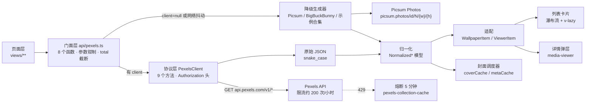

# 15 接口全量参考
> 项目：PEXELS 壁纸应用 ｜ 版本：v1.1 ｜ 生成日期：2026-10-06 ｜ 依据：源码分析

## 0. 本篇定位与总览

本篇是全项目"对外数据接口"的一站式参考手册，按三大部分组织：Pexels API 已用端点的全量详表（端点、参数、响应字段与**消费点**、限流）、Picsum 降级映射规则全表、本地存储与内存缓存键全表。与《03-接口设计》的分工：那一篇讲"为什么这样设计"（降级哲学、代理契约、错误分级决策），本篇讲"每一个字段长什么样、被谁消费"——写代码时开着本篇对照即可。全部内容取自 `src/utils/pexels.ts`（协议层）与 `src/api/pexels.ts`（门面层）的当前源码。

阅读本篇有三个方法约定。**其一，"消费点"列是全表的灵魂**：接口字段本身的权威定义在 Pexels 官方文档，本项目真正关心的问题是"Pexels 给的每个字段被代码用在了哪一行"，所以每张表都把响应字段一路追到消费组件——字段名可以背错，消费关系不能记错，它是判断"改这个字段影响谁"的唯一依据。**其二，未消费字段同样入表**：`liked`、`videoPictures`、`next_page` 这类"透传但不消费"的字段都明确标注了状态，因为扩展时最先犯的错误就是假设某个字段"没人用所以可以随便改"（实际它们承载着预留意图，见《13-技术债务与演进建议》D-04）。**其三，表格与正文互补**：表格记录静态契约，正文小节记录动态行为——翻页怎么收敛、错误长什么样、缓存什么时候写，这些时序性质的内容放在各表之间的行文里。

先看总览图：一个请求从页面层出发，经门面层分流后要么发往 Pexels、要么落地为 Picsum 降级数据，响应经归一化后进入三类消费场景（列表卡片、详情弹层、封面调度器）。

## 1. 请求基础设施（全端点公共约定）

| 项 | 值 | 依据与说明 |
| --- | --- | --- |
| 基础地址 | `https://api.pexels.com/v1` | `src/utils/pexels.ts` 的 `PEXELS_API_BASE` |
| 认证头 | `Authorization: <API_KEY>`（无 Bearer 前缀） | 直连模式必带；代理模式（baseUrl ≠ 官方地址）不发，Key 由服务端注入 |
| 通道选择 | 显式 `VITE_PEXELS_PROXY_BASE` → dev 自动 `/api/pexels` → prod 直连 | `src/api/pexels.ts` 第 23~28 行 |
| 分页参数 | `page`（下限 1）、`per_page`（钳制 [1, 80]） | 协议层与门面层各钳一次，双重防御 |
| 参数过滤 | `buildParams` 剔除 `undefined` 与空串 | "全部分类"（id=all）不会产生 `query=all` 脏参数 |
| 错误承载 | `PexelsApiError(status, message)` | 401/429 有定制中文文案，其余 `API 请求失败: {status} {statusText}` |
| 翻页方式 | 不消费响应的 `next_page`，页面层自持 page 游标成功后自增 | 重试不跳页；代价是页面层必须保证自增时机 |
| 限流 | 免费 Key 约 200 次/小时（Pexels 侧限制，前端无重试退避） | 应对手段见第 6 节配额预算表 |

基础设施里有三个动态行为值得单独用文字讲透，它们不体现在任何一张字段表里，却是日常排查最高频的疑问来源。

**第一，请求的生命周期只有"成功"与"抛错"两态，没有重试**。`PexelsClient.request` 拿到响应后只做两件事：`res.ok` 为真就 `res.json()` 解析返回；不为真就按状态码构造 `PexelsApiError` 抛出。协议层不做任何重试与退避——重试职责完全上移：列表类错误由用户点击 m-infinite-list 的"点击重试"触发（人肉退避），封面类错误由调度器的队列机制决定是否再试。这意味着 Network 面板里**不会看到同一个 API 请求自动连发多次**，若看到了，一定是调用方逻辑被改过，应先查页面层的 loadMore 触发条件。

**第二，totalPages 是"参考值"而非"控制值"**。三个列表端点的归一化都产出 `totalPages = Math.ceil(total_results / per_page) || 1`，但本项目真正的翻页终止条件在页面层：`已加载数 >= total`（配合门面层把 total 截断到 8000）。totalPages 在列表场景中基本无人消费——它存在的原因是保持返回形状与 Pexels 语义对齐，便于未来切换到 `next_page` 驱动的翻页模式。理解这一点可以解释一个现象：把 total 截断到 8000 后，totalPages 并没有被同步截断到 400，这没有 bug，因为没人读它。

**第三，"空结果"与"错误"是两条独立通道**。搜索无结果时 Pexels 返回 200 与空数组，链路表现为"正常完成 + 列表为空"（页面显示"没有更多数据了"，无空态文案，见《12-FAQ与故障排查》FAQ-5）；而鉴权失败、限流、网络故障走抛错通道，最终呈现为错误弹条与重试占位。排查时先分清"空"与"错"，能省一半时间。

## 2. Pexels 端点全量详表

### 2.1 照片组（3 个端点）

| 端点 | 协议方法 → 门面函数 | 业务入口 |
| --- | --- | --- |
| `GET /v1/search` | `search` → `getPexelsList` | 首页分类浏览与全局搜索 |
| `GET /v1/curated` | `curated` → `getPexelsList`（query 为空时） | 「全部」分类的官方精选流 |
| `GET /v1/photos/:id` | `getById` → `getPexelsFromId` | `/pins/:id` 详情直达页 |

**search / curated 的参数**：

| 参数 | 类型 | 本项目取值 | 说明 |
| --- | --- | --- | --- |
| `query` | string | 分类 id 或搜索词（trim 后） | search 专属；curated 无此参数 |
| `page` | number | 页面层游标 | 下限 1 |
| `per_page` | number | 20（首页每页 size） | 上限 80 |
| `orientation` | landscape/portrait/square | **未启用 UI**（协议已支持） | 预留能力，扩展见《11-扩展开发指南》SOP-C |
| `color` | 12 色名 | **未启用 UI** | 同上 |

**响应字段 → 归一化 → 消费点**（search 与 curated 响应同构，`PexelsSearchResponse`）：

| 响应字段 | 归一化去向 | 消费点 |
| --- | --- | --- |
| `total_results` | `total` | 门面层 `Math.min(total, 8000)` 截断 → 页面层完成判定 `已加载 >= total` |
| `page` / `per_page` | 未消费 | —（页面层自持游标） |
| `next_page` / `prev_page` | 未消费 | —（不采用拼好的翻页 URL） |
| `photos[]` | `SearchResult.items` | 全部下游 |
| `photos[].id` | `id`（String 化） | 列表 key、详情定位 `findIndex`、下载文件名 `pexels-{id}` |
| `photos[].width / height` | `width / height` | 卡片高度预计算 `(列宽/原图宽)×原图高`（防 CLS） |
| `photos[].src.large2x / large / original` | `url`（逐级回退） | 首页卡片 `photo`、弹层大图 |
| `photos[].src.medium / small` | `thumb` | `v-lazy` 列表缩略图实际加载地址 |
| `photos[].src.original` | `photoDownLink` | 下载（`toWallpaperItem`）与"复制链接" |
| `photos[].src`（8 档全量） | `src` | ViewerItem 大图取值链、portrait 预留 |
| `photos[].alt` | `description`（缺省兜底「壁纸 {id}」） | 卡片标题、弹层标题、下载文件名 |
| `photos[].photographer / photographer_url / photographer_id` | `author / authorUrl / authorId` | 弹层作者行、卡片副标题（合集内） |
| `photos[].url` | `pexelsUrl` | 弹层「原页」外链（target=_blank + rel=noreferrer） |
| `photos[].avg_color` | `avgColor` | 卡片与弹层的占位底色（缺省回退 `randomTint()`） |
| `photos[].liked` | `liked`（Boolean 化） | **仅透传，无消费 UI**（本项目无点赞） |

**photos/:id 响应**即单个 `PexelsPhoto`，归一化同上表单条路径；消费点：`/pins/:id` 页把 `WallpaperItem` 喂给弹层（`viewerItems = toViewerItems([item])`）。

### 2.2 视频组（3 个端点）

| 端点 | 协议方法 → 门面函数 | 业务入口 |
| --- | --- | --- |
| `GET /v1/videos/search` | `videosSearch` → `searchVideos` | 视频页搜索态 |
| `GET /v1/videos/popular` | `videosPopular` → `getPopularVideos` | 视频页默认热门流 |
| `GET /v1/videos/videos/:id` | `videoById` → `getVideoById` | `/videos/:id` 详情直达（**注意双段路径**，源码注释专门标注） |

**videosSearch / videosPopular 的参数**：

| 参数 | 归属端点 | 本项目取值 | 说明 |
| --- | --- | --- | --- |
| `query` | search | store 的 searchText | — |
| `page` / `per_page` | 两者 | 页面游标 / 18 | 上限 80 |
| `orientation` | search | 未启用 UI | — |
| `size` | search | 未启用 UI | large/medium/small |
| `locale` | search | 未启用 UI | — |
| `min_width` / `min_height` | popular | 未启用 UI | — |
| `min_duration` / `max_duration` | popular | 未启用 UI | — |

**响应字段 → 归一化 → 消费点**（`PexelsVideoSearchResponse`）：

| 响应字段 | 归一化去向 | 消费点 |
| --- | --- | --- |
| `total_results` | `total` | 截断 8000 → 完成判定 |
| `videos[]` | `VideoSearchResult.items` | 全部下游 |
| `videos[].id` | `id`（String 化） | 定位、下载文件名 `pexels-{id}.mp4`（固定 mp4，因视频 URL 无后缀） |
| `videos[].image` | `image` | 视频卡片封面（`v-lazy`）、弹层 poster、降级封面取模来源 |
| `videos[].duration` | `duration` | `formatDuration` 的时长标签、弹层信息区 |
| `videos[].width / height` | `width / height` | 卡片高度预计算、副标题尺寸展示 |
| `videos[].url` | `url` | ViewerItem.sourceUrl（「原页」外链） |
| `videos[].user{id,name,url}` | `user` | 卡片标题（作者名）、弹层作者 |
| `videos[].video_files[]` | `videoFiles`（兜底空数组） | `pickVideoFile` 选清晰度（过滤非 video/*，优先 hd，否则宽度最大）、弹层清晰度胶囊、下载 |
| `videos[].video_pictures[]` | `videoPictures` | **透传未消费**（预留"抽帧预览"，见《13-技术债务与演进建议》D-04） |

### 2.3 合集组（3 个端点）

| 端点 | 协议方法 → 门面函数 | 业务入口 |
| --- | --- | --- |
| `GET /v1/collections/featured` | `collectionsFeatured` → `getFeaturedCollections` | 合集页「特色合集」Tab；合集详情页元信息翻页匹配 |
| `GET /v1/collections` | `myCollections` → `getMyCollections` | 「我的合集」Tab（**依赖 Pexels 账号登录态**，前端直连下多数用户为空） |
| `GET /v1/collections/:id` | `collectionMedia` → `getCollectionMedia` | 合集详情媒体流；封面调度器取首图（perPage=1） |

**参数**：三者共享 `page` / `per_page`（合集列表页每页 12、详情页每页 18、元信息匹配每页 80）；`collectionMedia` 额外支持 `type`（photos/videos，**未启用 UI**）与 `sort`（asc/desc，未启用 UI）。

**响应字段 → 归一化 → 消费点**：

| 响应字段 | 归一化去向 | 消费点 |
| --- | --- | --- |
| `total_results` | `total` | 截断 8000 → 完成判定（元信息匹配用它判断提前 break） |
| `collections[].id` | `id` | 路由 `/collections/:id`、封面调度器缓存 key |
| `collections[].title / description` | `title / description`（后者空值兜底空串） | 合集卡片文案、详情页头部 |
| `collections[].media_count / photos_count / videos_count` | `mediaCount / photosCount / videosCount`（兜底 0） | 卡片统计胶囊「N 张 / N 个视频」、详情页统计行 |
| `collections[].private` | `private`（Boolean 化） | 卡片左上角「私密」琥珀色标签 |
| `media[]`（:id 端点） | 按 `type: 'Photo'|'Video'` 分派归一化并打小写 `type` 标签 | 混排瀑布流（`media-item.vue` 按 type 分支）与混排弹层 |
| `media[].type` | 判别字段 | 唯一混合类型数据源的类型来源 |

**已知形状缺口**：Pexels 无"按 id 查合集元信息"端点 → 详情页标题需翻 featured/my 列表匹配（最多 6 页×80，`metaCache` 缓存命中后零消耗）；合集列表响应**不含封面** → 封面由调度器对每卡单独发 `collectionMedia(perPage=1)` 取 `media[0]`（视频用 `image`、照片用 `url`）。

端点详表读完，再补一段**端点与页面的映射关系**，这是反查"这个页面到底会打哪些接口"的快捷方式。首页 `/`：首屏 1 次 `/search` 或 `/curated`，每次触底翻页加 1 次，弹层内切换 0 次；搜索词与分类同时存在时只发 1 次（searchText 优先）。`/pins/:id`：仅 1 次 `/photos/:id`，刷新直达页无列表请求。视频页 `/videos`：同首页，二选一走 `/videos/popular` 或 `/videos/search`。`/videos/:id`：仅 1 次 `/videos/videos/:id`。合集列表 `/collections`：Tab 切换各 1 次列表请求（featured 或 my），外加每张进入视口的卡片至多 1 次封面请求（走 `/collections/:id?per_page=1`，被缓存与熔断层层削峰）。合集详情 `/collections/:id`：媒体流按页递增 + 元信息匹配至多 6 次（首访）+ 无封面请求（详情页头部不需要封面）。把这张"页面 → 请求次数"的心智表记住，配额异常时逐页对照，很快能定位是哪类页面在超支。

## 3. 门面层行为矩阵（8 个函数 × 5 种输入）

这是《03-接口设计》3.2 节矩阵的完整版，增加了 total 口径列——改动门面层时对照本表逐格验收：

| 门面函数 | 无 client | 网络抖动/5xx | 401/403/429 | total 口径 |
| --- | --- | --- | --- | --- |
| `getPexelsList` | Picsum 列表 | Picsum 列表 | 抛出 | 真实 min(total,8000)；降级 200 |
| `getPexelsFromId` | 固定 id=1 占位图 | **抛出** | 抛出 | 单对象无 total |
| `searchVideos` / `getPopularVideos` | 示例视频列表 | 示例视频列表 | 抛出 | min(total,8000)；降级 200 |
| `getVideoById` | 单个示例视频 | **抛出** | 抛出 | 单对象 |
| `getFeaturedCollections` | 示例合集卡 | 示例合集卡 | 抛出 | min(total,8000)；降级 200 |
| `getMyCollections` | 空数组 | catch 全部→空数组 | 空数组 | 0 |
| `getCollectionMedia` | 占位照片流 | **一律抛出**（防缓存污染） | 抛出 | min(total,8000)；降级 200 |

## 4. Picsum 降级映射规则全表

降级生成器位于 `src/utils/pexels.ts` 底部，id 序号公式统一为 `(page - 1) × perPage + i + 1`（翻页不重复、回滚不变脸）：

| 降级对象 | 生成函数 | 字段映射 | 规则要点 |
| --- | --- | --- | --- |
| 降级照片 | `createFallbackWallpaper(id)` | 原图/大图 `picsum.photos/id/{id}/1920/1080`；缩略 `/400/300`；portrait `/1080/1920`；tiny `/80/60` | 应用内 id `fallback-{id}`；宽高固定 1920×1080；描述「精美壁纸 {id}」；作者 Picsum Photos；`avgColor` 空串→卡片走 `randomTint()`；`pexelsUrl` 空→弹层无「原页」；`liked` false |
| 批量照片 | `generateFallbackWallpapers(page, perPage)` | 按序号公式批量 | 供列表接口 |
| 单张照片 | `generateFallbackWallpaper()` | 固定 id=1 | 供详情接口无 Key 时，避免调用方取数组下标 |
| 降级视频 | `createFallbackVideo(id)` | 封面 `picsum.photos/id/{(id % 1084) + 1}/640/360`；片源 BigBuckBunny.mp4（hd/mp4/1920×1080/fps30） | 应用内 id `fallback-video-{id}`；时长固定 15 秒；**取模 1084** 防 Picsum 无效 id 批量 404；单文件列表保证详情可播 |
| 批量/单个视频 | `generateFallbackVideos / generateFallbackVideo` | 同上 | — |
| 降级合集 | `generateFallbackCollections(page, perPage)` | title「示例合集 N」；description「请配置 VITE_PEXELS_API_KEY 后查看 Pexels 真实合集」 | `mediaCount/photosCount/videosCount` 全 0；`private` false；id `fallback-collection-{n}` |
| 降级合集媒体 | `generateFallbackCollectionMedia(_id, page, perPage)` | 复用批量照片并打 `type: 'photo'` | 参数 `_id` 未消费（占位流与合集无关） |
| 降级总数 | 各接口 `FALLBACK_MAX_TOTAL = 200` | — | Picsum 有效 id 有限，防滚动到大量 404 |

## 5. 本地存储键与内存缓存键全表

存储是本项目的"接口面"里最容易被忽视的一半：它决定了刷新后什么还在、什么消失。先讲清一条设计立场再上表——**本项目对浏览器存储的态度是极度保守的**：localStorage 里只有主题一个字符串，没有收藏、没有历史、没有缓存落地，所有"缓存"都是会话级的内存对象。这个立场的直接收益是没有"缓存失效一致性"问题（刷新即全部复位，永远从干净状态开始），代价是每次会话都要重新消耗配额重建封面与元信息缓存——在 200 次/小时的现实下，这是一个"存储换配额"的明确取舍，未来若要反转（把 coverCache/metaCache 落地 localStorage），本表就是迁移清单。

**持久化存储（localStorage）全表**——全项目仅 1 条，经 `pinia-plugin-persistedstate` 写入（业务代码 0 处直接调用 localStorage）：

| 键 | 写入方 | 值结构 | 生命周期 | 消费点 |
| --- | --- | --- | --- | --- |
| `theme` | theme store（`persist: true`） | `{"themeType":"light"|"dark"|"system"}` | 永久，刷新后插件还原 | `src/utils/theme.ts` 启动时 watch immediate 应用到 html class |

**内存缓存键全表**——模块级单例，跨组件共享、刷新即失：

| 缓存 | 位置 | 键 → 值 | 写入时机 | 读取时机 |
| --- | --- | --- | --- | --- |
| `coverCache: Map` | `src/utils/pexels-collection-cache.ts` | 合集 id → 封面 URL | `fetchOne` 成功且取到首图 | `requestCover` 入口（命中同步回调） |
| `metaCache: Map` | 同上 | 合集 id → NormalizedCollection | 合集详情页 `loadCollectionMeta` 匹配成功 | 详情页进入时 `getCachedCollectionMeta` |
| `waiters: Map` | 同上 | 合集 id → 回调 Set | `requestCover` 未命中时登记 | `notify`（完成后逐个回调并删除） |
| `queue` + `enqueued` | 同上 | 待拉取 id 队列 / 已登记集合 | `requestCover` 入队 | `drain` 消费 |
| 熔断标量（rateLimited/rateLimitUntil/rateLimitNotified） | 同上 | — | 429 命中时 | `isRateLimited` 惰性判定（到期自动复位） |
| `loadedCache: Set` | `src/directives/modules/lazy.ts` | 已加载成功的图片 URL | img load 事件（once） | `v-lazy` mounted 时（命中跳过占位） |
| `stateMap: WeakMap` | 同上 | img 元素 → {src, stop} | mounted | updated / unmounted 钩子 |

除以上外的一切状态（列表数据、分页游标、requestSequence、viewerIndex、弹层清晰度）都是组件内 ref 或普通变量，随组件销毁或 keep-alive 缓存清理，无任何键可查——这就是《04-数据模型》"一份持久化 + 两处内存缓存 + 一堆页面 ref"的完整键清单。

内存缓存还有三条使用纪律需要记录在案，它们是上表读不出来但改代码必须知道的。**写入门槛**：`coverCache` 只在成功拿到非空封面时写入、`loadedCache` 只在 load 事件成功时登记——失败值一律不缓存，这是"缓存永远可信"约定的落点，破坏它会把一次网络抖动固化成整个会话的破图。**键的稳定性**：两个缓存都以"应用内 id"为键——合集用 Pexels 的字符串 id、图片用归一化后的字符串化 id（`String(p.id)`），降级数据用 `fallback-*` 前缀 id；由于降级数据 id 按序号公式生成，会话内稳定，缓存在降级模式下同样工作正常。**容量假设**：两处缓存都无淘汰策略，其安全性建立在"数据量以百计、值为短字符串、刷新即清空"三个假设上，假设一旦被打破（例如未来做本地持久化），需同步引入淘汰机制（《10-性能设计与优化》第 6 节已预留评估结论）。

## 6. 配额预算与限流应对总表

把散落各篇的配额数字收进一张表（免费 Key 约 200 次/小时为基数）。先给一段使用方法：这张表回答的问题不是"我用了多少"而是"我还能省多少"——每行的"缓解机制"列就是当前代码已经拿走的那部分收益，"残余风险"列则是代理层（服务端）还有机会继续拿走的部分。公网部署前按行过一遍，基本能估算出"每个访客每次会话"的配额成本：典型浏览动线（首页 3 页 + 视频 1 页 + 合集列表 2 页 + 合集详情 1 次）约为 1+2+1+2+1 次列表请求、12~24 次封面请求、至多 6 次元信息请求，合计约 20~35 次/会话——即一个免费 Key 理论上只够支撑不到 10 个完整浏览动线/小时，这正是"配额是一等公民"的全部现实基础。

| 场景 | 单次消耗 | 缓解机制 | 残余风险 |
| --- | --- | --- | --- |
| 首页/视频列表翻页 | 1 次/页 | 失活不发请求、页码成功后自增、完成判定收敛 | 无 |
| 分类切换/搜索 | 1 次/操作 | appliedQuery 快照去重（不重复发） | 快速连点产生并发（序号丢弃响应但请求已发出） |
| 合集列表封面 | 1 次/卡 | 每页 12 条、进视口±200px 才入队、3 并发+250ms、coverCache 去重、429 熔断 5 分钟 | 多访客共享 Key 时仍可打满 |
| 合集详情元信息 | 至多 6 次/合集（首访） | metaCache 会话内零复耗 | 首访贵；查不到的合集 6 次全烧 |
| 详情直达页 | 1 次/页 | 无缓存（每次刷新都请求） | 低频场景可接受 |
| 弹层内切换 | 0 次请求 | viewerItems 与列表同序，纯本地切换 | — |
| 下载/复制 | 0 次 API 请求（直连媒体 CDN） | — | 媒体 CDN 不占 API 配额 |

**限流应对的三层防线**（汇总）：前端自保（本表全部机制）；服务端管控（代理层限流 + 只读端点短 TTL 缓存，公网多人部署时必做，见《08-安全与权限设计》第 7 节）；熔断兜底（429 后封面暂停 5 分钟、列表报错可重试，见《12-FAQ与故障排查》FAQ-3）。

## 7. 类型声明索引

最后一节给"找类型"的索引，写扩展时按图索骥：Pexels 原始结构（`PexelsPhoto`、`PexelsVideo`、`PexelsVideoFile`、`PexelsVideoPicture`、`PexelsCollection`、三个响应接口）与归一化模型（`NormalizedWallpaper`、`NormalizedVideo`、`NormalizedCollection`、`NormalizedCollectionMediaItem`）及 `SearchResult`/`VideoSearchResult`/`CollectionResult`/`CollectionMediaResult` 全部定义在 `src/utils/pexels.ts`；卡片适配模型 `WallpaperItem` 在同文件；弹层模型 `ViewerItem`、来源联合 `ViewerSource`、`pickVideoFile` 在 `src/utils/viewer.ts`；筛选参数类型 `Orientation`/`ColorFilter` 与请求参数接口（`PexelsListQuery`、`VideoSearchQuery`、`VideoPopularQuery`、`CollectionMediaQuery`、`CollectionListQuery`）分别在协议层与门面层；环境变量类型在 `src/env.d.ts`。

两点收束说明。**关于运行时校验**：接口层无 zod 之类的运行时校验，代码"信任 Pexels 契约"，字段缺失一律在归一化时兜底为空串/0——这换来了协议层零依赖与归一化代码的极简，代价是 Pexels 若变更字段名将静默产生空数据而非报错，因此每次怀疑"Pexels 数据没显示"时，第一步应直接查看原始响应（Network 面板）与归一化输出的差异。**关于本篇的维护**：接口层无运行时校验的另一面是，**本篇表格即运行时契约的最终文字版本**——若未来引入运行时校验、更换数据源（《11-扩展开发指南》SOP-D）或调整归一化兜底链，应以本篇为基线逐表回归，并同步更新消费点列；表与代码不一致时，以代码为准、改表，并在《13-技术债务与演进建议》的文档漂移清单里记一笔。
